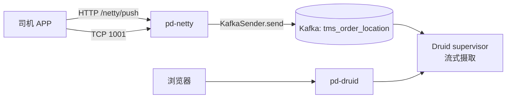

# 车辆轨迹服务开发：pd-netty 的 HTTP/TCP 双接口接收与 pd-druid 查询落地

上一篇把 Druid 装好、把两种数据摄取跑通之后，本章剩下两个模块就都是纯 Java 开发了：pd-netty 负责接收司机端上报的车辆定位信息并转发到 Kafka 队列，pd-druid 负责对外提供 Druid 里轨迹数据的查询。司机端与 pd-netty 的交互提供两种方式：HTTP 接口实现简单，基于 Netty 的 TCP 方式效率更高，司机 APP 可以任选其一上报。这一篇按课程顺序把两条接收路都走通，再用现成的 pd-druid 代码把查询闭环补上。

## 先给结论

- pd-netty 提供 HTTP 接口与基于 Netty 的 TCP 两种接收方式：HTTP 走 Controller 收 JSON 报文，实现最简单；TCP 效率更高，服务端大部分是 Netty 模板代码，真正要写的只有读到数据后的业务处理。
- Kafka 配置不写死：bootstrap.yml 里全用 `${spring.kafka.bootstrap-servers}` 这类占位符，运行时从 Nacos 配置中心的 pd-netty-dev.yml 动态读取（`68.79.7.219:9092`），以后要改只改配置中心，项目内文件不动。
- KafkaSender 做成工具类的关键是 `@PostConstruct`：先把 `@Autowired` 注入的 KafkaTemplate 实例在 Bean 创建完成后赋给静态字段，静态方法 `send(topic, message)` 才能用类名直接调。
- 发送前用 FastJSON 的 `JSON.toJSONString` 把 LocationEntity 转成字符串（send 第二参数是 String）；队列名用常量 `MSG_TOPIC = "tms_order_location"`，且必须提前在 Kafka 里建好。
- TCP 服务端 NettyServer 实现 CommandLineRunner 随项目启动绑定端口（`netty.port=1001`），channelRead 里收报文、转 JSON、调 KafkaSender 发送，finally 里必须 `ReferenceCountUtil.release` 释放 ByteBuf，否则内存泄漏。
- 两种方式的验证口径一致：发一条消息，看 Druid 数据源 tms_order_location 行数是否加一（HTTP 测试 8904→8905，TCP 测试 8909→8910，摄取有几秒延迟）；pd-druid 是现成代码，本质就是 Avatica JDBC 查 tms_order_location。

## HTTP 接口方式：Controller 收 JSON，转字符串丢进 Kafka

### 配置与实体

工程骨架、依赖和配置文件课程都直接给了，值得展开的是两处。一是 bootstrap.yml 里激活的是 dev profile，会按规则去读 bootstrap-dev.yml，Nacos 注册中心与配置中心都配在其中；二是 kafka 那一段配置没有写任何真实地址，全是占位符写法：

```yaml
kafka:
  bootstrap-servers: ${spring.kafka.bootstrap-servers}
  listener:
    concurrency: ${spring.kafka.listener.concurrency}
  producer:
    retries: ${spring.kafka.producer.retries}
    key-serializer: ${spring.kafka.producer.key-serializer}
    value-serializer: ${spring.kafka.producer.value-serializer}
  consumer:
    group-id: ${spring.kafka.consumer.group-id}
```

这些值运行时从配置中心的 pd-netty-dev.yml 里动态获取：bootstrap-servers 指向 `68.79.7.219:9092`（9092 是 Kafka 默认端口），此外还有监听器、线程数、重试次数等参数。pd-netty 接到位置信息后要把消息发进 Kafka 队列，这段配置就是为此服务的；配置到位后，KafkaTemplate 就能直接通过 `@Autowired` 注入使用。

实体类 LocationEntity 放在 entity 包下，封装一次上报的位置信息，字段就是接口规范：

| 字段 | 说明 |
| --- | --- |
| businessId | 业务 id，快递员 id 或车辆 id |
| type | 坐标来源：truck 是车辆（司机运输途中上报），courier 是快递员（派送途中上报） |
| name / phone | 司机或快递员姓名、电话（电话可以为空） |
| licensePlate | 车牌号 |
| lat / lng | 纬度、经度，最关键的两个字段 |
| currentTime | 当前时间 |
| team / transportTaskId | 所属车队、运输任务 id |

id 不是普通属性：`getId()` 把 businessId、type、currentTime 用 `#` 拼起来返回，天然构成一条坐标的标识。业务上只有运输中的司机和派送中的快递员才上报坐标，下班状态的位置没有收集意义。启动类 NettyApplication 是两个固定注解：`@SpringBootApplication` 加 `@EnableDiscoveryClient`，因为服务要注册到 Nacos，也可能需要查找别的服务。

### KafkaSender 工具类

service 包下的 KafkaSender 只干一件事：往 Kafka 队列发消息。`@Autowired` 能直接注入 KafkaTemplate 靠两点：pom 里导入了 spring-kafka 整合坐标，配置文件里配了 Kafka 服务地址，启动时框架自动实例化好对象并指向配置的队列。但这里要把发送封装成静态工具方法（用类名直接调），静态方法只能使用静态属性，于是先注入实例，再用 `@PostConstruct` 在实例创建完成后把它交给静态字段：

```java
@Component
@Slf4j
public class KafkaSender {
    public final static String MSG_TOPIC = "tms_order_location";

    @Autowired
    private KafkaTemplate<String, String> kafkaTemplate;
    private static KafkaTemplate<String, String> template;

    @PostConstruct
    public void init() {
        template = kafkaTemplate;
    }

    public static boolean send(String topic, String message) {
        try {
            template.send(topic, message);
            log.info("消息发送成功：{}, {}", topic, message);
        } catch (Exception e) {
            log.error("消息发送失败：{}, {}", topic, message, e);
            return false;
        }
        return true;
    }
}
```

返回 boolean，true 视为发送成功、false 为失败。MSG_TOPIC 指向的队列提前在 Kafka 服务里建好，发送方必须保证队列存在，这个前后要一致。

### NettyController 与测试验证

controller 包下的 NettyController 提供上报接口：

```java
@RestController
@RequestMapping("netty")
@Api(tags = "车辆轨迹服务")
@Slf4j
public class NettyController {

    @PostMapping("push")
    public Result push(@RequestBody LocationEntity locationEntity) {
        // 将车辆定位信息发送到kafka队列
        String message = JSON.toJSONString(locationEntity);
        KafkaSender.send(KafkaSender.MSG_TOPIC, message);
        log.info("HTTP接口方式推送位置信息到kafka: [{}]", message);
        return Result.ok();
    }
}
```

接口规范与司机端提前定好：POST 提交 JSON，`@RequestBody` 解析后封装成 LocationEntity。send 的第二个参数是 String，所以先用 FastJSON 的 `JSON.toJSONString` 把实体转成字符串再传。Result 是公共工程封装的统一返回对象，`Result.ok()` 内部 new 一个 Result，默认 message 是 success、code 是 0。测试用的 SwaggerConfig 从 pd-base 工程拷过来，只需确认包扫描范围能覆盖 controller 包。

验证思路很直接：pd-netty 发到 Kafka 的消息会被 Druid 的 supervisor 实时摄取进 tms_order_location 数据源，看行数有没有加一即可。服务起在 8192 端口，打开 Swagger 文档对 push 执行 Try it out，请求体按业务字段填写：type 写 truck 代表司机坐标，写 courier 代表快递员坐标；phone 没提交所以字段为空，这是允许的。在 controller 里加断点，能看到 JSON 已提交并解析成实体；放行后控制台无报错，日志输出了推送信息。刷新 Druid 页面，tms_order_location 从 8904 条变成 8905 条（摄取有几秒延迟），HTTP 这条链路跑通。

## TCP 接口方式：Netty 服务端的事件驱动模型

### NettyServer：模板化启动代码

Netty 是 JBoss 提供的 Java 开源框架，提供异步的、事件驱动的网络应用程序框架和工具，用来快速开发高性能、高可靠性的网络服务器和客户端程序，本项目用它开发服务端。课程把 Netty 当工具直接拿来用，不展开框架细节：Netty 编程基本都是模板化代码，随业务变化的只有读到数据之后的处理，本项目是转发 Kafka，别的项目可能是记日志、写库。

config 包下的 NettyServer 就是那个模板化的服务端启动类：

```java
@Slf4j
@Component
public class NettyServer implements CommandLineRunner {

    @Value("${netty.port}")
    private int port;
    private static NettyServer nettyServer;

    private EventLoopGroup mainGroup;
    private EventLoopGroup subGroup;
    private ServerBootstrap server;
    private ChannelFuture future;

    @PostConstruct
    public void init() {
        nettyServer = this;
    }

    public NettyServer() {
        // NIO线程组，用于处理网络事件
        mainGroup = new NioEventLoopGroup();
        subGroup = new NioEventLoopGroup();
        // 服务初始化工具，封装初始化服务的复杂代码
        server = new ServerBootstrap();
        server.group(mainGroup, subGroup)
              .option(ChannelOption.SO_BACKLOG, 128)      // 设置缓冲
              .childOption(ChannelOption.SO_KEEPALIVE, true) // 长连接
              .channel(NioServerSocketChannel.class)      // 产生接收连接的Channel
              .childHandler(new NettyServerHandler());    // 具体处理网络IO事件
    }

    public void start() {
        // 启动netty服务端，绑定端口
        this.future = server.bind(nettyServer.port);
        log.info("Netty Server 启动完毕！！！ 端口：{} ", nettyServer.port);
    }

    @Override
    public void run(String... args) {
        this.start();
    }
}
```

几个要点：加 `@Component` 是为了交给 Spring 管理，从而用 `@Value("${netty.port}")` 动态注入端口，配置中心定义 `netty.port=1001`，端口不写死、只要不与其他服务冲突即可；实现 CommandLineRunner 后，Spring Boot 项目启动时会执行 run 方法，进而调用 start() 里的 `server.bind()` 绑定端口，效果类似 Tomcat 启动后监听 8080 持续接收请求；`@PostConstruct` 把实例赋给静态 nettyServer，bind 时用的是 nettyServer.port。构造方法里创建两个 NioEventLoopGroup，这是 NIO 线程组，用多线程并行处理网络事件，mainGroup 与 subGroup 之间有分工；ServerBootstrap 封装了服务初始化的复杂代码，group 绑定两个线程组，SO_BACKLOG 设置缓冲，SO_KEEPALIVE 对应长连接，channel 指定用 NioServerSocketChannel 产生接收连接的通道（channel 可以理解成一个连接，但和 JDBC 那种 connection 不是一回事），childHandler 挂上真正处理网络 IO 事件的 NettyServerHandler。

### NettyServerHandler：个性化的事件处理

处理类放在 service 包，按 Netty 的要求必须继承父类 ChannelInboundHandlerAdapter。父类里 channelRegistered（通道注册后）、channelActive（激活时）、channelRead（读到客户端消息）、channelReadComplete（读取完成后）、exceptionCaught（读取过程出现异常）等方法全是事件驱动：不像以前 Controller 调 Service、Service 调 DAO 由自己主动调用，现在只需覆盖对应方法，事件发生时框架自动回调。父类默认实现满足不了"读到的数据要发 Kafka"，所以要覆盖 channelRead：

```java
@Override
public void channelRead(ChannelHandlerContext ctx, Object msg) {
    log.info("ServerHandler.channelRead()");
    ByteBuf in = (ByteBuf) msg;
    try {
        // 接收报文
        String body = getRequestBody(in);
        log.info("报文内容: {}", body);

        // 解析报文
        String message = parseMessage(body);
        if (StringUtils.isBlank(message)) {
            log.info("报文解析失败");
            return;
        }

        // 发送至Kafka队列
        KafkaSender.send(KafkaSender.MSG_TOPIC, message);
    } catch (Exception e) {
        log.error(e.getMessage());
    } finally {
        // 使用完ByteBuf之后，需要主动去释放资源，否则资源一直在内存中加载，容易造成内存泄漏
        ReferenceCountUtil.release(msg);
        // 把当前的写指针 writerIndex 恢复到之前保存的 markedWriterIndex 值
        if (null != in) {
            in.resetWriterIndex();
        }
    }
}
```

两个参数：ctx 是上下文对象，msg 是读到的信息，先向下强转成 ByteBuf。getRequestBody 把 ByteBuf 转字符串：new 一个 byte 数组，readBytes 读入，再用 UTF-8 编码 new String；parseMessage 把原始字符串转成 JSON 返回，空报文记日志直接返回。读完之后执行的 channelReadComplete 里 writeAndFlush 一个空 buffer 刷新写出区域，并关闭 socket 连接；exceptionCaught 里关闭上下文即可。对应到业务：司机 APP 上报时触发 channelRead，上报完成触发 channelReadComplete。

### Netty 客户端模拟司机上报

TCP 方式没法再用 Swagger 测，课程提供了一个 Netty 客户端测试类（代码不做要求，仅用于验证服务端可用）：定义 host、port 两个属性，构造方法传入，测试时连本地 1001。start 方法同样是 Netty 编程，只是角色变成客户端：NioEventLoopGroup 注册线程池，Bootstrap 创建客户端对象，channel 指定 NioSocketChannel，remoteAddress 指定远程地址与端口，handler 注册具体的处理类 EchoClientHandler，connect 建立连接后 `closeFuture().sync()` 等待关闭、`shutdownGracefully().sync()` 释放线程组。EchoClientHandler 继承 `SimpleChannelInboundHandler<ByteBuf>`：channelActive 在通道被激活（连接成功）时执行，里面 writeAndFlush 把一段 JSON 位置信息写给服务端，内容就是业务 ID、type、经纬度、车牌号、车队、运输任务 id 这些字段，JSON 里的引号需要转义；channelRead0 处理服务端返回的数据；exceptionCaught 打印异常并关闭连接。

执行 main 方法：客户端依次输出创建、connected、通道激活、连接关闭，建立一次连接、把报文发过去、通道关闭，整个过程就结束了。服务端这边随即打出 ServerHandler.channelRead() 与报文内容，说明已接收并转发 Kafka。测试前 Druid 里 tms_order_location 是 8909 条，刷新后变成 8910（同样有几秒延迟），TCP 这条路也跑通了。

## pd-druid 查询：现成的 JDBC 封装



车辆轨迹服务涉及两个模块，pd-netty 开发完，剩下的 pd-druid 在初始项目里已经写好、直接使用。它的职责是与 Druid 服务对接查询，用的就是上一篇 Java 客户端操作 Druid 那套 JDBC 写法，连接串同样指向 Druid 的 `/druid/v2/sql/avatica` 接口，区别只是操作的数据源换成 tms_order_location。

controller 提供三个查询接口，全是查车辆位置信息，只是参数不同：select 查全部车辆的最后位置列表，selectOne 查指定车辆的位置，selectByList 按动态参数查询（`@RequestBody` 传 List，元素是一个个 Map）。三个方法都调 service 层，service 把 SQL 拼出来：

```sql
select name, phone, licensePlate, businessId, __time
from tms_order_location
where 1=1
-- whereSql(params) 按参数动态拼 where 条件，orderSql(params) 拼排序
```

from 的正是 Druid 上那个数据源。mapper 的 listFirst 是眼熟的 JDBC 代码：注入配置好的数据源对象，`dataSource.getConnection` 拿连接、createStatement、executeQuery，取 ResultSetMetaData 后遍历，把列名和列值封装进 HashMap 返回，finally 里关闭连接。技术上没有新知识点，会用即可。

## 小结

pd-netty 一个服务两种接法：HTTP 方式是标准 Spring MVC 三件套，Controller 收 JSON、FastJSON 转字符串、KafkaSender 发队列，接入成本最低；TCP 方式用 Netty 起独立端口 1001 的服务端，在事件驱动的 Handler 里完成收报文、转 JSON、发 Kafka，效率更高，代价是必须自己写一个 Netty 客户端才能测试。实现层面有两处最值得记住的细节：KafkaSender 静态工具类用 `@PostConstruct` 桥接实例与静态字段；ByteBuf 用完必须在 finally 里 release，否则内存泄漏。pd-druid 无需开发，Avatica JDBC 查 tms_order_location，三个接口对应全部车辆、指定车辆、动态参数三种查法。至此，从司机上报到轨迹可查的完整链路，上报 → pd-netty → Kafka → Druid → pd-druid → 浏览器，全部打通。
