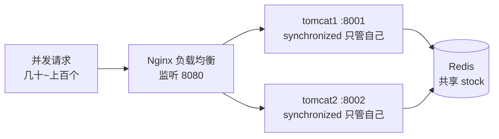

# 从集群并发到分布式锁：synchronized 为什么失效，以及数据库唯一索引实现

品达物流 TMS 第九章进入分布式锁主题。应用一旦从单机走向集群部署，以前解决线程同步的 synchronized 和 ReentrantLock 就不够用了——它们的作用范围被钉死在单个 JVM 内部。这一篇先把分布式锁的概念、诞生原因和应具备的特性讲清楚，再动手用数据库唯一索引实现第一版可运行的分布式锁，并用 JMeter 压测验证效果。

## 先给结论

- synchronized、ReentrantLock 都是 JVM 级别的锁，只能保证单个虚拟机内部的线程同步；应用集群部署后，两台 Tomcat 上的线程可以同时执行同一个方法，传统锁彻底失效。
- 分布式锁是控制分布式系统之间同步访问共享资源的一种方式：通过互斥让各节点有序访问共享资源，防止彼此干扰，保证数据一致性。
- 一个减库存接口就能走完整个证据链：无锁并发压测出现重复的"剩余库存"数字；单机加 synchronized 后恢复正常；集群部署后问题重现——这就是必须引入分布式锁的原因。
- 合格的分布式锁应具备六个特性：互斥执行、高可用的获取与释放、高性能、可重入、锁失效机制防死锁、非阻塞。
- 数据库实现方案建一张 mylock 表，methodName 字段加唯一索引：insert 成功即获得锁，delete 即释放锁，插入报错即未获锁。双实例加 Nginx 压测后剩余库存数字无重复，锁生效。
- 演示中还踩了一个真实的坑：只写 insert 忘了释放锁，表里残留记录让所有请求都拿不到锁——这正是"锁失效机制"必须解决的问题。

## 单机锁的边界：JVM 内说了算

单机开发时代，线程同步有一套成熟答案：方法上加 synchronized 变成同步方法，同一时刻只有一个线程能进入；或者用 ReentrantLock 构造锁对象圈出同步代码块。课程先写了一个最小复现类 LockTest：

```java
public class LockTest implements Runnable {

    public synchronized void get() {
        System.out.println("1 线程 --> " + Thread.currentThread().getName());
        System.out.println("2 线程 --> " + Thread.currentThread().getName());
        System.out.println("3 线程 --> " + Thread.currentThread().getName());
    }

    @Override
    public void run() {
        get();
    }

    public static void main(String[] args) {
        LockTest test = new LockTest();
        for (int i = 0; i < 10; i++) {
            new Thread(test, "线程" + i).start();
        }
    }
}
```

main 里循环十次同时拉起十个线程。带 synchronized 运行时，输出始终是某个线程连着打完 1、2、3 三行，下一个线程才接手——哪个线程先抢到 CPU 执行权是随机的（运行结果里常出现线程 5 先抢到的情况），但一旦抢到，整个方法必然执行完。把 synchronized 去掉再跑，输出立刻乱掉：线程 0 刚打了第一行，线程 3 就插进来执行，每次运行结果都不一样。前后对比说明 synchronized 在单个 JVM 内确实有效。

问题在于这个"有效"的范围。集群部署时前面挂一台 Nginx 做负载均衡，请求被分发到 tomcat1 和 tomcat2 两个实例，两者部署同一个项目、同一个方法。synchronized 只能保证 tomcat1 内部不并发，管不了 tomcat2——它是 JVM 级别的锁，没办法控制其他 JVM，于是两个实例上的线程完全可以同时执行同一个方法。要实现"一台机器执行时另一台排队"这种跨机器的同步，就需要分布式锁。主流方案有三类：数据库实现、ZooKeeper 实现、Redis 实现，后面逐一动手。



## 减库存压测：把问题完整复现出来

原理之外，课程用一个减库存接口把问题复现了一遍。新建 lock-test 工程，继承 Spring Boot Starter Parent，导入 spring-boot-starter-data-redis 坐标；库存不存数据库，放在 Redis 里，key 为 stock，初始值 50：

```yaml
server:
  port: 8080
spring:
  redis:
    host: 68.79.63.42
    port: 26379
    password: itheima123
```

StockController 注入 StringRedisTemplate 直接读写库存。之所以能直接注入，是 Spring Boot 自动配置的功劳：启动时 spring-boot-autoconfigure 包里的 spring.factories 会加载 RedisAutoConfiguration，在类路径存在 Redis 相关类、且容器中缺少该 Bean 时（@ConditionalOnMissingBean），自动创建 RedisTemplate 和 StringRedisTemplate。无锁版的扣减逻辑如下：

```java
@RestController
public class StockController {

    @Autowired
    private StringRedisTemplate redisTemplate;

    @GetMapping("/stock")
    public String stock() {
        int stock = Integer.parseInt(redisTemplate.opsForValue().get("stock"));
        if (stock > 0) {
            stock--;
            redisTemplate.opsForValue().set("stock", stock + "");
            System.out.println("库存扣减成功，剩余库存：" + stock);
        } else {
            System.out.println("库存不足！！！");
        }
        return "OK";
    }
}
```

并发请求用 Apache JMeter 制造（企业做性能测试还常用 LoadRunner，JMeter 相对轻量）。jmeter.bat 启动图形界面，在 Test Plan 上右键添加 Thread Group 线程组：Number of Threads 填 5 表示模拟 5 个用户，Ramp-up 填 4 表示每秒发 4 个请求，Loop Count 填 5；再在线程组下添加 HTTP Request 采样器，协议 http、服务器 localhost、端口 8080、GET 方式、Path 填 /stock。启动 Spring Boot 后点击 Start，压力就打到接口上。第一轮结果：输出 49、48、47、47、46、46——出现重复数字。原因是两个用户同时执行到同一句代码，都从 Redis 读到 48，各自减 1 后都输出 47。把 Loop Count 改成 50 把库存扣到底，库存不足之后请求还在不停进来，控制台里 0、0、0 连着出现，问题彻底暴露。

第二轮验证单机解法：在扣减代码块外套 synchronized (this)，重启、恢复 stock=50 再测，输出 42、41、40、39……严格递减、无重复，判断标准很直接——控制台里只要出现相同的"剩余库存"数字，就说明两个请求只减了一次的量，数据不一致；无重复则说明串行执行、数据一致。

第三轮模拟集群：Nginx 监听 8080，把请求转发到 upstream 里的 127.0.0.1:8001 和 127.0.0.1:8002（未配权重，默认均摊轮询）；本地把 application.yml 端口改成 8001 启动一个实例，再改成 8002 启动一个，JMeter 目标地址不变仍是 localhost:8080。synchronized 保留的情况下压测：单看任何一个实例的控制台，49、47、46、45、44……没有重复，像是没问题；把两个实例的输出合起来看，一边有 47，另一边也有 47——两个 JVM 同时读到同一个值、同时减 1。结论落定：集群部署下 synchronized 解决不了问题，必须使用分布式锁。

## 一把合格的分布式锁长什么样

动手实现之前，先明确检验标准。分布式锁应该具备六个特性：

| 特性 | 含义 |
| :--- | :--- |
| 互斥执行 | 分布式环境下，一个方法同一时刻只能被一台机器上的一个线程执行，这是分布式锁最根本的作用 |
| 高可用 | 需要锁的场景都是高并发场景，锁组件一旦挂掉，获取、释放全部失败，整个应用都会被拖垮；数据库、ZooKeeper、Redis 都应做集群，部分节点挂掉锁依然可用 |
| 高性能 | 获取锁、释放锁的开销要小，否则高并发下响应变慢，用户体验直接受损 |
| 可重入 | 线程持有锁执行方法时，方法内部又调用了另一个同样需要加锁的方法，同一线程应能再次拿到锁 |
| 失效机制防死锁 | 持锁线程程序挂掉、来不及释放锁时，锁应有有效期，到期自动释放，让其他线程还能获取 |
| 非阻塞 | 十个线程同时争锁，一个成功，其余九个直接返回失败，而不是阻塞排队 |

这套清单不是摆设：后面每实现一种方案，都可以拿它对照检验。数据库方案在可重入、失效机制上的欠缺，正是它的主要扣分点。

## 数据库唯一索引实现：insert 即获锁，delete 即释放

基于数据库实现分布式锁，建立在数据库唯一索引的特性之上。在本地 MySQL 建一个 dlock 库，放一张 mylock 表，字段只有两个：id 自增主键、methodName 字符串，methodName 上建唯一索引（演示里索引名叫 UK001）。手工往表里插两条 methodName 相同的数据，第二条立刻报 Duplicate entry，提交不进去——唯一性由数据库保证，这就是整个方案的地基。

```sql
-- 与演示中 desc mylock 的结构一致
CREATE TABLE `mylock` (
  `id` INT(11) NOT NULL AUTO_INCREMENT,
  `methodName` VARCHAR(255) DEFAULT NULL,
  PRIMARY KEY (`id`),
  UNIQUE KEY `UK001` (`methodName`)
);
```

约定很简单：执行目标方法前，先向 mylock 表插入一条 methodName 为方法名的记录，插入成功即获得锁；执行完业务删除这条记录，即释放锁；插入报错说明别的线程已经持锁。并发请求同时插入相同的 methodName，只有一个能成功。

工程改造仍在 lock-test 上进行。pom 补 mysql-connector-java 和 mybatis-plus-boot-starter（3.2.0）；application.yml 加数据源（jdbc:mysql://127.0.0.1:3306/dlock，账号 root/root）与 mybatis-plus 配置（mapper-locations 指向 classpath:mapper/*.xml、关闭驼峰转换等）。实体类 MyLock 用 @TableName("mylock") 映射表；Mapper 继承 BaseMapper 并扩展一个按方法名删除的方法，对应释放锁：

```java
@Mapper
public interface MyLockMapper extends BaseMapper<MyLock> {
    void deleteByMethodName(String methodName);
}
```

```xml
<delete id="deleteByMethodName">
    delete from mylock where methodName = #{methodName}
</delete>
```

Controller 里注入 MyLockMapper（为演示简化直接注了 Mapper，规范做法应注入 Service），把 synchronized 方案注释掉，换成数据库锁版本：

```java
@GetMapping("/stock")
public String stock() {
    MyLock myLock = new MyLock();
    myLock.setMethodName("stock");
    try {
        myLockMapper.insert(myLock); // 插入成功即获得锁
        int stock = Integer.parseInt(redisTemplate.opsForValue().get("stock"));
        if (stock > 0) {
            stock--;
            redisTemplate.opsForValue().set("stock", stock + "");
            System.out.println("库存扣减成功，剩余库存：" + stock);
        } else {
            System.out.println("库存不足！！！");
        }
        myLockMapper.deleteByMethodName("stock"); // 释放锁，与插入的 methodName 保持一致
    } catch (Exception ex) {
        System.out.println("没有获得锁，不能执行减库存操作...");
    }
    return "OK";
}
```

try 里能走到释放锁，说明整段业务是持锁执行的：那条记录一直存在于表中，其他线程插不进去、拿不到锁，只能等它删掉记录后才有机会；catch 里走到说明插入失败、未获锁，直接输出提示返回。所以释放锁的代码放在 try 里就够了——进了 catch 就说明根本没获得锁，无需释放。

演示过程中有两个值得记录的细节。一是第一次执行 insert 就报连接错误，问题不在锁而在 MySQL 时区，连接串追加 serverTimezone=Asia/Shanghai 后解决。二是用断点单步验证了两个分支：第一次请求 insert 成功，表里出现记录（id 自增到 2）；第二次请求同一接口，insert 抛出 Duplicate entry 'stock' for key 'UK001'，违反唯一约束——获锁与未获锁都被实际触发过。

最终测试回到双实例加 Nginx 加 JMeter 的环境，第一轮压测控制台清一色"没有获得锁"：此前调试只写了 insert、还没写释放锁，表里残留着那条记录，所有线程都插不进去。手动清掉表数据（无需重启服务，锁状态完全由表数据决定）后重测：两个实例都能正常获锁扣减，49、48 在一边，47、46 在另一边，中间夹杂大量"没有获得锁"——那是高并发下上一个线程还没执行完、后续请求尝试一次即返回的正常表现。全程数字无重复，集群下的并发问题被数据库唯一索引这把锁挡住了。

对照特性清单，这版实现欠缺也很明显：数据库挂了锁就不可用；不可重入；没有失效机制，一旦忘了删除记录（上面已经真实踩过一次）就会阻塞所有后续请求；再加上每次获锁、释放都是一次数据库操作，性能天花板肉眼可见。这些不足连同 ZooKeeper、Redis 两种方案，留到下一篇展开。

## 小结

这一篇完成了分布式锁的"是什么、为什么、要什么、怎么造"四步：synchronized 与 ReentrantLock 是 JVM 级锁，集群部署下无法跨虚拟机同步；减库存案例用三轮压测走完无锁、单机锁、集群失效的证据链；由此得出互斥、高可用、高性能、可重入、失效机制、非阻塞六条特性清单；最后基于数据库唯一索引实现第一版可用的分布式锁，insert 即获锁、delete 即释放，双实例压测数字无重复。它验证了原理，也暴露了可用性、可重入、失效机制与性能上的短板——下一篇用 ZooKeeper、Redis 与 Redisson 把这些短板逐一补齐。
