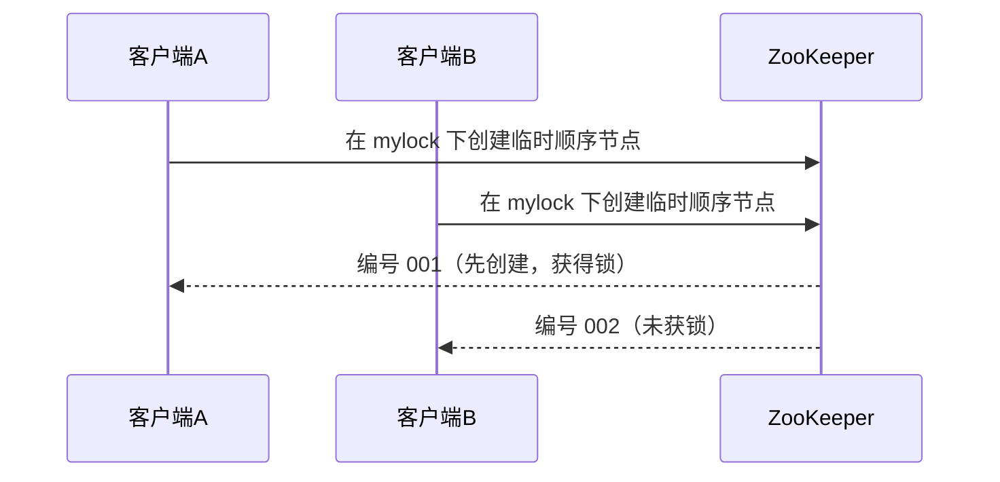

# 分布式锁三大实现横评：数据库 vs ZooKeeper vs Redis/Redisson

上一篇用数据库唯一索引做出了第一版分布式锁，留下了可用性、可重入、失效机制和性能上的悬念。这一篇接着品达物流 TMS 第九章往下走：先给数据库方案的问题定性，再用 ZooKeeper 的临时顺序节点和 Redis 的 SET NX 各实现一遍，最后引出企业里真正主流的方案 Redisson。

## 先给结论

- 数据库方案的短板有五条：锁的可用性被数据库绑定（要双机部署、数据同步、主备切换）、不可重入、无失效机制、不具备阻塞特性，且获锁与释放锁都是 insert/delete，高并发下对同一张表频繁读写，性能是最大硬伤。
- ZooKeeper 方案靠临时顺序节点：所有客户端到锁节点下创建子节点，按创建时间编号，序号最小的获得锁；客户端断开连接后节点自动删除，天然自带失效机制。
- 原生 API 实现繁琐，实际用 Apache Curator：`InterProcessMutex.acquire(0, SECONDS)` 是非阻塞尝试；等待时间改成 2 秒后，压测中每个请求都能等到锁，库存一路扣到 0。
- Redis 方案核心是 `SET key value NX`：key 不存在才能设置成功，谁设置成功谁持锁，DEL 即释放；Redis 服务端单线程处理命令，自身不存在并发问题。
- Redis 锁按三个版本演进：v1 只有 NX，程序挂了锁不释放会死锁；v2 加 PX 过期时间兜底；v3 把线程 ID 存进 value、释放前校验，防止误删别人的锁。
- 自研 Redis 锁仍有两个硬伤：非阻塞导致大量请求空手而归；业务执行超过过期时间，锁提前失效引发并发。Redisson 内置了完善的分布式锁实现（含续命机制），导入一个依赖即可用，是企业中用得最多的选择。

## 数据库方案：能用，但短板在哪

先回顾上一版的套路：执行减库存前向 mylock 表 insert 一条 methodName 为 stock 的记录，成功即获锁；抛异常进 catch 说明没抢到；业务执行完 deleteByMethodName("stock") 释放锁。代码简单，问题也随之而来：

| 短板 | 具体表现 | 改进思路 |
| :--- | :--- | :--- |
| 可用性绑定数据库 | 数据库挂了，获取锁、释放锁全部失效，程序瓶颈卡死在这里 | 数据库双机部署、数据同步、主备切换 |
| 不可重入 | 线程拿锁后调用了另一个也要加锁的方法，同一线程再次 insert 必然失败——那行数据还挂着 | 表里加一列记录持锁的机器与线程信息，再次获取时先查询，是当前线程持有就直接放行 |
| 没有失效机制 | 程序在释放锁之前挂掉，记录永远留在表里，其他线程都拿不到锁 | 加一列记录失效时间（如 5 秒），用定时任务扫描清除过期数据 |
| 不具备阻塞特性 | 获取不到直接返回失败，不会等待 | 优化获取逻辑，循环多次尝试 |
| 性能差 | 获取锁是 insert、释放锁是 delete，全是数据库操作，大并发下频繁操作同一张表 | 这是方案层面的天花板，改造弥补不了 |

前四条都能靠加列、加定时任务、改循环来弥补，代价是实现越来越复杂；最后一条性能问题则没有解法。接下来看两条绕开数据库的路。

## ZooKeeper：临时顺序节点排队

ZooKeeper 的数据存储结构是一棵树，节点叫 ZNode，共四种类型：

| 类型 | 特点 |
| :--- | :--- |
| 持久节点（PERSISTENT） | 默认类型，客户端断开连接后节点仍然存在 |
| 持久顺序节点（PERSISTENT_SEQUENTIAL） | 创建时按时间顺序给节点名编号，先创建的是 001，后创建的是 002 |
| 临时节点（EPHEMERAL） | 客户端与 ZooKeeper 断开连接后，节点自动被删除 |
| 临时顺序节点（EPHEMERAL_SEQUENTIAL） | 临时加顺序的组合：创建时编号，断连即删 |

分布式锁的原理就落在临时顺序节点上：所有客户端都到某个锁节点（如 mylock）下创建临时顺序节点，谁创建的节点编号最小、说明谁创建得早，谁就获得锁。



原理简单，但用原生 API 自己写创建节点、比较序号的代码相当繁琐。实际开发用 Apache Curator——一个比较完善的 ZooKeeper 客户端框架，封装好的高级 API 里就包括分布式锁的实现。工程引入三个坐标（zookeeper 3.4.10、curator-framework 2.12.0、curator-recipes 2.12.0），再写一个配置类创建客户端：

```java
@Configuration
public class ZkConfig {
    @Bean
    public CuratorFramework curatorFramework() {
        RetryPolicy retryPolicy = new ExponentialBackoffRetry(1000, 3);
        CuratorFramework client = CuratorFrameworkFactory.builder()
                .connectString("localhost:2181")
                .sessionTimeoutMs(5000)
                .connectionTimeoutMs(5000)
                .retryPolicy(retryPolicy)
                .build();
        client.start();
        return client;
    }
}
```

StockController 里把数据库方案注释掉，注入 CuratorFramework，核心代码三步：创建锁对象、尝试获取、释放：

```java
@Autowired
private CuratorFramework curatorFramework;

@GetMapping("/stock")
public String stock() {
    InterProcessMutex mutex = new InterProcessMutex(curatorFramework, "/mylock");
    try {
        boolean locked = mutex.acquire(0, TimeUnit.SECONDS); // 尝试获取锁
        if (locked) {
            int stock = Integer.parseInt(redisTemplate.opsForValue().get("stock"));
            if (stock > 0) {
                stock--;
                redisTemplate.opsForValue().set("stock", stock + "");
                System.out.println("库存扣减成功，剩余库存：" + stock);
            } else {
                System.out.println("库存不足！！！");
            }
        } else {
            System.out.println("没有获得锁，不能执行减库存操作...");
        }
    } catch (Exception ex) {
        System.out.println("争抢异常...");
    } finally {
        mutex.release(); // 释放锁
    }
    return "OK";
}
```

`/mylock` 对应 ZooKeeper 里的持久节点（不存在就创建），acquire 底层在这个持久节点下创建临时顺序节点并比较序号，这些过程全被框架封装掉了。acquire 的第一个参数是等待时间：写 0 表示抢一下、抢不到立即返回 false；写 1 表示最多等一秒，期间其他线程可能执行完释放了锁，再尝试就有机会拿到。注意 acquire 抛异常不等于没抢到——连不上 ZooKeeper 也会抛异常，是否抢到要看返回的 boolean。

本地 ZooKeeper 跑在 2181 端口，8001、8002 两个实例启动时日志里就能看到在连接 ZooKeeper 服务。第一轮压测（等待时间 0）出现大量"没有获得锁"：非阻塞尝试，抢不到就走人。但已获锁的请求扣出的数字互相交错、没有任何重复（一边出现 16、18、20，另一边是 17、19、21），锁已经生效。把等待时间改成 2 秒再测，效果立变：扣减业务本身很快，两秒足够上一个线程释放锁、自己再次尝试成功，于是前面的请求全部扣减成功，库存一路减到 0 才开始报库存不足；两个控制台一边全是偶数（48、46、44、42），一边全是奇数——Nginx 没配权重，轮询分摊得非常均匀。数字无重复，说明线程们在排队串行执行，没有产生并发。

## Redis：SET NX 的三个版本

Redis 方案的原理最轻：利用 set 命令的 NX 参数。NX 的含义是 key 不存在才设置，已存在则不执行任何操作、不会覆盖。用命令验证一遍：`set test itcast` 成功后，不带 NX 再执行 `set test itheima`，值被直接覆盖；而 `set city beijing NX` 写入成功后，再来一次 `set city nanjing NX` 返回 nil，city 还是北京。DEL 删掉 key 之后，又能重新 set 成功。

于是约定为：所有客户端都执行 `set lock_key lock_value NX`，返回 OK 的那个获得锁，执行业务，最后 DEL 释放锁。Java 里对应的是 `redisTemplate.opsForValue().setIfAbsent(...)`，底层就是这条命令。围绕它的完善过程分三个版本：

| 版本 | 加锁命令 | 解决的问题 | 遗留问题 |
| :--- | :--- | :--- | :--- |
| v1 | `set mylock mylock NX` | 互斥：双实例压测数字无重复 | 无失效机制，程序挂掉锁不释放，后面所有线程拿不到锁 |
| v2 | `set mylock mylock NX PX 5000` | PX 指定过期时间，5 秒后 Redis 自动删除，防死锁 | value 固定，任何人都能删锁 |
| v3 | `set mylock threadId NX PX 5000` | value 存当前线程 ID，释放前先 GET 比较，是自己的锁才删 | 仍是非阻塞；业务超时锁提前失效 |

v2 的命令行为可以直观验证：`set city beijing NX PX 10000`（1 万毫秒即 10 秒）写入成功后，客户端能看到剩余有效期，期间再 set 返回 nil；十秒一到 key 自动消失，又能重新写入。Java 侧只需给 setIfAbsent 追加两个参数：

```java
Boolean locked = redisTemplate.opsForValue()
        .setIfAbsent("mylock", "myLock", 5000, TimeUnit.MILLISECONDS);
```

v3 在加锁前取线程 ID——`Thread.currentThread().getId()` 返回 long，拼上空串转成 String——作为 value；释放锁时先 get 出 mylock 的值，与当前线程 ID 相等才执行 delete。加锁和解锁必须是同一个客户端、同一个线程，不能把别人持有的锁删掉。v2 加 v3 叠加后的完整形态：

```java
@GetMapping("/stock")
public String stock() {
    String threadId = Thread.currentThread().getId() + "";
    try {
        Boolean locked = redisTemplate.opsForValue()
                .setIfAbsent("mylock", threadId, 5, TimeUnit.SECONDS);
        if (locked) { // 加锁成功
            int stock = Integer.parseInt(redisTemplate.opsForValue().get("stock"));
            if (stock > 0) {
                stock--;
                redisTemplate.opsForValue().set("stock", stock + "");
                System.out.println("库存扣减成功，剩余库存：" + stock);
            } else {
                System.out.println("库存不足！！！");
            }
            String myValue = redisTemplate.opsForValue().get("mylock");
            if (threadId.equals(myValue)) {
                redisTemplate.delete("mylock"); // 是自己的锁才释放
            }
        } else {
            System.out.println("没有获得锁，不能执行减库存操作...");
        }
    } catch (Exception ex) {
        System.out.println("出现异常！！！");
    }
    return "OK";
}
```

一个演示环境的插曲值得记录：换成 Redis 方案时，工程里还挂着 ZooKeeper 的配置类和 CuratorFramework 注入，而 ZooKeeper 服务已经停了，启动时一直尝试重连报错——把这两处注释掉才恢复正常。另外三个版本都没有把超时场景测出来：正常执行的程序还是手动 delete，自动过期更像一份保险，只有程序真的挂掉、来不及 delete 时才由 Redis 兜底。

## Redisson：别自己造轮子

自研的 Redis 锁到这里覆盖了互斥、防死锁、防误删三件事，但对照特性清单，还有两个解决不了的硬伤。

其一，非阻塞导致获取效率低。setIfAbsent 只尝试一次，获取不到直接返回。一万个请求打过来，可能有九千多个空手而归，只有少数抢到锁；想做成阻塞的要自己写循环重试，课程里没有实现。

其二，超时时间与业务时长不匹配。锁设了 5 秒过期，假设业务执行超过 5 秒：锁到点被 Redis 自动删掉，第二个线程随即获得锁也开始执行业务——两个线程同时进入临界区，这段业务代码不再同步，分布式锁直接失效。把超时改成 10 秒只是缓解，不是根治。真正需要的是"续命"机制：业务还没执行完、锁快到期时，自动重新设置超时时间再往后延 5 秒。自研代码没有这个机制。

这两个问题，Redisson 都考虑到了并且都解决了。Redisson 官方的说法是一个基于 Redis 的 Java 内存数据网格（In-Memory Data Grid），通俗理解就是一个 Redis 客户端框架，提供了一系列具有分布式特性的常用工具类，其中就包括非常完善的基于 Redis 的分布式锁实现——底层走的仍是 Redis 这条路线，只是把上面的坑全部填掉，用它可以在分布式环境中简化程序之间的协作。使用只需要导入一个坐标：

```xml
<dependency>
    <groupId>org.redisson</groupId>
    <artifactId>redisson</artifactId>
    <version>3.10.1</version>
</dependency>
```

分布式锁只是 Redisson 全部功能里很小的一部分，课程只取所需；从应用角度看，它是强烈推荐的方案，也是企业中用得最多的分布式锁解决方案。前面自己实现的三版，价值在于搞清原理；生产上应该直接站在 Redisson 的肩膀上。本课程随后的小节就是 Redisson 分布式锁的具体使用方式，以及配合的 Lua 脚本。

三种方案到此凑齐，放在一起对比：

| 维度 | 数据库 | ZooKeeper | Redis / Redisson |
| :--- | :--- | :--- | :--- |
| 加锁 | 向 mylock 表 insert 方法名（唯一索引） | 在锁节点下创建临时顺序节点 | `set key value NX`，设置成功即持锁 |
| 释放 | delete 记录 | release，断连节点自动删除 | del key |
| 失效机制 | 无，需加失效时间列加定时任务 | 临时节点断连自动删除 | PX 过期时间兜底；Redisson 有续命 |
| 阻塞性 | 非阻塞，需循环改造 | acquire 可指定等待时间 | 自研非阻塞，Redisson 完善 |
| 性能 | 差：获锁、释放全是数据库操作 | 依赖 ZooKeeper 集群 | 内存操作，最好 |
| 实现载体 | MyBatis-Plus 操作锁表 | Apache Curator 的 InterProcessMutex | StringRedisTemplate / Redisson |

## 小结

这一篇把分布式锁的三条实现路线走完并横向对比：数据库方案胜在简单直观，败在可用性绑定数据库、无失效机制、不可重入、性能差，适合用来理解原理；ZooKeeper 方案用临时顺序节点实现排队竞争，断连自动删节点天然防死锁，借 Curator 的 InterProcessMutex 几行代码就能用；Redis 方案靠 SET NX 三个版本从互斥演进到防死锁、防误删，性能最好，但自研版本始终跨不过非阻塞与超时续命两道坎——这两道坎由 Redisson 兜底解决，也因此成为企业中的首选。三条路线的代码骨架都落在同一个减库存接口上，换方案只需替换"获锁—执行业务—释放锁"里的前后两步。
