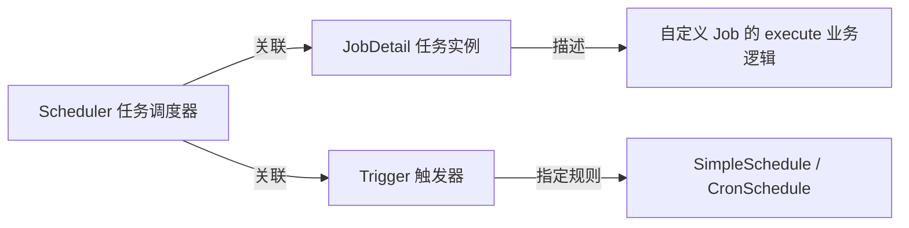

# Quartz 定时任务组件：核心 API、入门案例与动态定时任务数据模型落地

品达物流 TMS 第八章进入智能调度服务（pd-dispatch），开篇第一块就是定时任务组件 Quartz。这一篇按课程的推进顺序走三条线：先把核心 API 的概念铺清楚，再用一个入门案例把 API 全部串起来，最后解决入门案例遗留的问题——任务信息只存内存、重启即丢，换成 JDBC 落库的 JobStoreTX，配官方 11 张表，做出可以动态添加的定时任务。

## 先给结论

- Quartz 是 OpenSymphony 开源组织在 job scheduling（作业调度）领域的开源项目，纯 Java 开发，功能远强于 java.util.Timer，带有 JTA 全局事务、集群等企业级特性；既能单独使用，也能与 Spring 整合。引入只需 `org.quartz-scheduler` 下的 quartz 和 quartz-jobs 两个坐标（课程版本 2.3.0）。
- 核心 API 记三件套：Job 是任务的抽象，业务逻辑写在自定义实现类的 execute 方法里；Trigger 是触发器，决定任务什么时候触发（SimpleTrigger 管简单频率，CronTrigger 管复杂规则）；Scheduler 任务调度器把任务和触发器关联起来，统一调度。
- 入门案例是五步模板代码：调度器工厂创建 Scheduler → JobBuilder 构建 JobDetail → TriggerBuilder 构建 Trigger → scheduleJob 关联两者 → start 启动。
- 三个思考题的答案：自定义 Job 是多例的，每次触发都会 new 一个新实例；参数传递靠 JobDataMap 存、JobExecutionContext 取；复杂触发时间用 CronScheduleBuilder 加 cron 表达式。
- 入门案例的任务信息默认存在内存（RAMJobStore），服务重启就丢；换成 JobStoreTX（通过 JDBC 保存到数据库），配合 Quartz 官方提供的 11 张 QRTZ_ 前缀表，任务信息持久化的同时获得动态定时任务能力（动态添加、暂停、删除），还能开启集群模式。
- Spring Boot 项目里不再用 main 方法手工拼对象，而是通过 SchedulerFactoryBean 配置类统一创建 Scheduler，Controller 里 @Autowired 注入就能用。

## Quartz 是什么，核心 API 长什么样

Quartz 官网是 quartz-scheduler.org，定位类似 Java 基础里用过的 Timer——能指定频率执行定时任务，但能力上强出一个量级，几乎可以集成到任何 Java 应用程序中。任务调度领域的同类知名产品还有 XXL-JOB 这样的分布式任务调度平台。项目中引入两个坐标即可使用。

编程时会接触到的核心 API 可以先整体过一遍，后续代码里都会出现：

| API | 定位 | 说明 |
| :--- | :--- | :--- |
| Job | 接口（框架提供） | 定时任务的抽象，触发时执行其中的逻辑；自定义类如 SendMailJob、SendMessageJob 去实现它 |
| Trigger | 接口 | 触发器，指定任务什么时候触发，类似手机上的闹钟 |
| SimpleTrigger / CronTrigger | 触发器实现 | 前者设简单频率（每隔几秒执行一次）；后者用 cron 表达式描述复杂规则（每周一上午十点、每月最后一天下午五点） |
| Scheduler | 任务调度器 | 将 Job 与 Trigger 关联，统一进行任务调度 |
| StdSchedulerFactory | 调度器工厂 | 创建 Scheduler 对象 |
| JobDetail | 任务对象 | 描述任务的具体信息，关联哪个自定义 Job |
| JobBuilder | 任务构建器 | 用于创建 JobDetail |
| TriggerBuilder | 触发器构建器 | 用于创建 Trigger |
| JobExecutionContext | 执行上下文 | 任务执行时传入，通过它可以拿到当前任务的 JobDetail、Trigger 等信息 |
| JobDataMap | 状态存储 | 保存任务实例的状态信息 |

JobDataMap 的内容存到哪，取决于 JobStore 的选择：RAMJobStore 把数据放内存，访问速度极快但易失，断电或服务重启后信息就没了；JobStoreTX 通过 JDBC 把所有数据保存到数据库，持久化可靠。这个选择正是后面动态定时任务的分水岭。

三者关系可以画成一张图：



## 入门案例：五步模板代码

新建一个 Maven 工程（quartztest），导入坐标后先写自定义任务。实现 org.quartz.Job 接口，触发时要执行的业务逻辑就放在 execute 方法里：

```java
/**
 * 自定义Job
 */
public class HelloJob implements Job {

    /**
     * 当任务触发时执行此方法
     */
    public void execute(JobExecutionContext jobExecutionContext) throws JobExecutionException {
        System.out.println("自定义Job执行，执行时间为：" + new Date());
    }
}
```

再写一个带 main 方法的调度入口，把核心 API 全部用上：

```java
public class HelloJobMain {
    public static void main(String[] args) throws Exception {
        // 1. 通过调度器工厂创建任务调度器对象
        Scheduler scheduler = StdSchedulerFactory.getDefaultScheduler();
        // 2. 通过任务构建器创建任务实例，withIdentity 指定唯一标识
        JobDetail jobDetail = JobBuilder.newJob(HelloJob.class)
                .withIdentity("myjobdetail").build();
        // 3. 通过触发器构建器创建触发器：每隔3秒触发一次，永远重复
        SimpleTrigger trigger = TriggerBuilder.newTrigger()
                .withIdentity("mytrigger")
                .withSchedule(SimpleScheduleBuilder.simpleSchedule()
                        .withIntervalInSeconds(3).repeatForever())
                .build();
        // 4. 关联任务实例和触发器对象
        scheduler.scheduleJob(jobDetail, trigger);
        // 5. 启动任务调度器，开始任务调度
        scheduler.start();
    }
}
```

这五步全是模板化代码：Scheduler 不能 new，必须经工厂；JobDetail 和 Trigger 也都经由各自的 Builder 构建。withIntervalInSeconds 还有 withIntervalInHours、withIntervalInMinutes、withIntervalInMilliseconds 等变体；repeatForever 表示不手动停止进程，任务就一直调度下去。

运行 main 方法，控制台按 3 秒的间隔持续输出执行时间，与设置的触发频率一致——入门案例跑通。整体过程就是三步：建工程导坐标、写自定义 Job、用核心 API 完成统一调度。

## 三个问题：多例、传参与 Cron 表达式

入门案例留下三个问题，逐个验证。

**问题一：自定义 Job 是单例还是多例？** 给 HelloJob 加一个无参构造方法并打印，运行后控制台每次任务触发前都会输出"HelloJob被创建了"，创建完紧接着执行。结论：**每次任务触发都会创建一个新的 HelloJob 实例**，它是多例的。

**问题二：如何给任务传参数？** 用前面提到的 JobDataMap。任务定义侧往 map 里放业务参数：

```java
jobDetail.getJobDataMap().put("key1", "value1");
jobDetail.getJobDataMap().put("key2", "value2");
```

任务执行侧通过上下文对象取回——getJobDetail() 拿到的 JobDetail 与定义时是同一个对象，getJobDataMap() 取出的也就是同一个 map：

```java
public void execute(JobExecutionContext jobExecutionContext) throws JobExecutionException {
    System.out.println("自定义Job执行，执行时间为：" + new Date());
    // 获取存放的任务状态信息
    JobDataMap jobDataMap = jobExecutionContext.getJobDetail().getJobDataMap();
    Set<Map.Entry<String, Object>> entries = jobDataMap.entrySet();
    entries.forEach(entry -> {
        String key = entry.getKey();
        Object value = entry.getValue();
        System.out.println(key + "=" + value);
    });
}
```

运行后控制台多出 `key1=value1`、`key2=value2` 两行，且每次触发都能取到。lambda 写法要求 JDK 8 以上，工程编译级别低了会报错，调整到 level 8 即可。

**问题三：能否用 cron 表达式设置触发时间？** 把 withSchedule 里的 SimpleScheduleBuilder 换成 CronScheduleBuilder，注意此时 build 出的类型不再是 SimpleTrigger 而是普通 Trigger：

```java
CronScheduleBuilder cronScheduleBuilder =
        CronScheduleBuilder.cronSchedule("1,5,11,20,27,35 * * * * ?");
Trigger trigger = TriggerBuilder.newTrigger()
        .withIdentity("mytrigger")
        .withSchedule(cronScheduleBuilder).build();
```

cron 表达式由七位构成：秒、分、时、日、月、周，最后一位年可以省略，一般写前六位；每位上还可以使用特殊字符增加灵活性。上面这个表达式的含义：秒的位置是 `1,5,11,20,27,35`，逗号表示"或者"（列表），即每到这些秒就触发；后面全是 `*`，表示每分钟、每小时、每天、每周、每月都不限制；最后用 `?` 表示该位可忽略。运行验证：任务在 10:48:05、10:48:11、10:48:20、10:48:27、10:48:35 依次触发，下一分钟又从 10:49:01 开始——与表达式的秒列表完全吻合。比起"每隔几秒"，cron 能写出每月几号、每周星期几几点这类复杂规则。

## 动态定时任务：把任务信息落进数据库

入门案例有个隐患：任务信息存在内存里。debug 断点沿 JobExecutionContext → scheduler → resources 找到 jobStore，可以看到默认用的是 **RAMJobStore**——正好对应核心 API 里"访问速度快但数据易失"的那个实现。服务一重启，JobDataMap 里的状态、任务定义全部消失。

要实现动态定时任务（动态添加、暂停、删除任务），就得换成 JobStoreTX，通过 JDBC 把数据持久化到数据库。这套数据模型由 Quartz 官方提供，共 11 张表。官方安装包解压后，docs 下的 dbTables 目录里有针对不同数据库（DB2、H2、MySQL、Informix、Oracle 等）的建表脚本，MySQL 用 tables_mysql.sql，里面全是 CREATE TABLE 语句：qrtz_triggers 存触发器，qrtz_simple_triggers、qrtz_cron_triggers 分别对应两类触发器，还有 blob_triggers、calendars 等。执行脚本建库建表即可——课程在本地 MySQL 建了一个名为 quartz 的库，11 张表就绪。

Spring Boot 工程的环境搭建：坐标除 quartz/quartz-jobs 外还有 Spring Boot starter-web、starter-test、Swagger、MySQL、MyBatis、MyBatis-Plus、Druid 数据源；application.yml 配置 server.port、应用名和本地数据源（jdbc:mysql://localhost:3306/quartz，用户名/密码 root）。核心是配置类，不再写 main 方法，改用 SchedulerFactoryBean 这个工厂 Bean 来产出 Scheduler：

```java
@Configuration
public class ScheduleConfig {

    @Bean
    public SchedulerFactoryBean schedulerFactoryBean(DataSource dataSource) {
        SchedulerFactoryBean factory = new SchedulerFactoryBean();
        // 要访问数据库中的 11 张表，先设置数据源
        factory.setDataSource(dataSource);
        Properties prop = new Properties();
        prop.put("org.quartz.scheduler.instanceName", "pdScheduler");
        prop.put("org.quartz.scheduler.instanceId", "AUTO");
        prop.put("org.quartz.threadPool.class", "org.quartz.simpl.SimpleThreadPool");
        prop.put("org.quartz.threadPool.threadCount", "20");
        // 关键：任务存储改用 JDBC 方式持久化，默认是内存的 RAMJobStore
        prop.put("org.quartz.jobStore.class", "org.quartz.impl.jdbcjobstore.JobStoreTX");
        prop.put("org.quartz.jobStore.isClustered", "true");
        prop.put("org.quartz.jobStore.tablePrefix", "QRTZ_");
        prop.put("org.quartz.jobStore.misfireThreshold", "120000");
        prop.put("org.quartz.jobStore.selectWithLockSQL",
                "SELECT * FROM (SELECT LOCKS FROM QRTZ_LOCKS WHERE LOCK_NAME = ?) LOCKS");
        factory.setQuartzProperties(prop);
        factory.setSchedulerName("pdScheduler");
        return factory;
    }
}
```

值得留意的配置：jobStore.class 指定为 JobStoreTX，是整个动态定时任务的基础；isClustered 开启集群模式；tablePrefix 对应建表脚本里 QRTZ_ 前缀的命名规则；selectWithLockSQL 操作的是 QRTZ_LOCKS 这张锁表，集群下靠它锁定、避免多节点重复调度；instanceName、线程池、misfireThreshold 这些属于固定套路照配即可。SchedulerFactoryBean 本身是个工厂 Bean，调用它的 getObject() 最终返回的就是 Scheduler 对象；工厂上还可以设置延时启动，配置后延迟约 3 秒才开始整体调度。

自定义 Job 也换了一种写法：不再直接实现 Job 接口，而是继承 Spring 整合 Quartz 时提供的 QuartzJobBean——父类已实现 Job 接口并处理了参数准备，子类只需重写抽象方法 executeInternal，上下文对象照样传进来：

```java
public class HelloJob extends QuartzJobBean {

    @Override
    protected void executeInternal(JobExecutionContext context) throws JobExecutionException {
        LocalDateTime now = LocalDateTime.now();
        DateTimeFormatter formatter = DateTimeFormatter.ofPattern("yyyy-MM-dd HH:mm:ss");
        String time = formatter.format(now);
        Object bizId = context.getJobDetail().getJobDataMap().get("bizId");
        System.out.println("自定义Job...bizId = " + bizId + " 执行时间 " + time);
    }
}
```

真实项目里，重点就是编写这个触发时要执行的业务方法，演示只用输出占位。最后加上 Swagger 配置类（便于接口测试）、启动类和一个注入了 Scheduler 的 QuartzController，环境就绪。

动态添加定时任务的方法写在 Controller 里，接收业务参数 bizId 和触发规则 cronExpression：

```java
@ApiOperation("动态添加定时任务")
@PostMapping
public String save(String bizId, String cronExpression) throws Exception {
    // 创建任务实例对象，bizId 作为唯一标识
    JobDetail jobDetail = JobBuilder.newJob(HelloJob.class)
            .withIdentity(bizId).build();
    jobDetail.getJobDataMap().put("bizId", bizId);
    // 创建触发器对象，用传入的 cron 表达式指定触发时间
    CronScheduleBuilder cronScheduleBuilder = CronScheduleBuilder.cronSchedule(cronExpression);
    Trigger trigger = TriggerBuilder.newTrigger()
            .withSchedule(cronScheduleBuilder).build();
    // 关联任务实例和触发器对象
    scheduler.scheduleJob(jobDetail, trigger);
    return "OK";
}
```

代码与入门案例几乎一致，两处不同：Scheduler 是 @Autowired 注入的（来自配置类）；任务存储指定了 JDBC，落库之后即使服务重启，任务信息依然存在。withIdentity 用 bizId 保证每个任务唯一，这要求调用方（如页面）先做校验，确保传入的 bizId 不重复。在这个基础上，暂停任务、删除任务等方法按同样的套路往 Controller 里逐个添加即可。

## 小结

这一篇完成了 Quartz 的从 0 到 1：核心 API 围绕 Job、Trigger、Scheduler 三件套展开，Builder 和 Context 服务于构建与执行；入门案例的五步模板代码跑通基础调度，三个思考题澄清了 Job 多例、JobDataMap 传参和 cron 触发规则三个使用要点；再从 RAMJobStore 换到 JobStoreTX + 官方 11 张表，任务信息持久化的同时拿到了动态添加（以及后续暂停、删除）的能力，并顺带开启了集群模式。这套动态定时任务，正是品达物流 TMS 智能调度服务 pd-dispatch 的地基。
