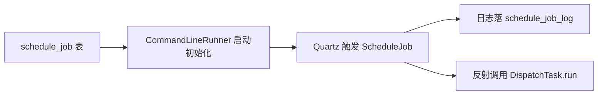

# 智能调度服务从建模到实现：定时任务初始化、完善与智能调度组件

智能调度服务的数据模型还剩两张关联表没收尾，补完之后 pd-dispatch 库的图纸就齐了。这一篇先补上这两张表和跨库的运输任务、司机作业单，再进入实现过程：基础环境一次性导入，写出定时任务半成品，用 CommandLineRunner 在项目启动时按 schedule_job 表批量初始化任务，然后给任务类补上执行日志与反射调用，最终跑通"启动初始化 → Quartz 触发 → 日志落库 → 反射调用调度组件"的完整链路。

## 先给结论

- pd_cache_line_use 缓存路线使用表：cache_line_id 关联规划出的线路，order_classify_id 关联订单分类。订单靠"分类"间接挂到线路上——订单属于某分类、分类关联线路，某个单子走哪条线由此推出来。
- pd_order_classify_attach 车次车辆司机订单分类关联表：trips_id、truck_id、driver_id、order_classify_id 四个字段把车次、车辆、司机和订单分类关联到一块。运输任务表和司机作业单表（driver_job）不在 pd_dispatch，在 pd_work 库，智能调度天然是跨库操作。
- 定时任务类 ScheduleJob 继承 QuartzJobBean，executeInternal 里 context.getMergedJobDataMap().get(JOB_PARAM_KEY) 取回创建任务时 put 进去的 ScheduleJobEntity；JobDetail 和 Trigger 都能放 JobDataMap，merged 取的是两边合并后的结果，put 与 get 必须用同一个常量。
- 启动初始化靠 CommandLineRunner：selectList(null) 查 schedule_job 全表，逐条用 getCronTrigger 判断——触发器为空说明没创建过，走 createScheduleJob；不为空说明已存在，走 updateScheduleJob。任务标识统一用 "TASK_" 前缀拼表主键，如 TASK_11。
- 完善后的任务类只做两件事：记录日志（try 成功置 1、catch 失败置 0 并记异常堆栈、finally 算耗时；任务类不归 Spring 管，只能 SpringContextUtils.getBean 取 service 保存）；核心调度逻辑下沉到目标 Bean，反射 getBean(beanName) → getDeclaredMethod("run", 四个 String) → invoke，否则这个方法至少要写 5000 行以上。
- DispatchTask 以 @Component("dispatchTask") 注册，Bean 名必须与库表 bean_name 完全一致；run(businessId, params, jobId, logId) 四个参数与 invoke 实参一一对应。造两条每 5 秒、每 3 秒触发的测试数据，控制台能看到调度输出和日志 INSERT，schedule_job_log 每触发一次多一条记录。

## 数据模型收尾：两张关联表与跨库的作业单

缓存路线主子表解决了"从哪个网点到哪个网点、具体走哪几条线"，但规划出来的线路跟订单还没有关系。第七张表 pd_cache_line_use 缓存路线使用表补上这一环：cache_line_id 对应缓存路线表主键，order_classify_id 对应订单分类表主键，这次规划用的哪条线路、拉的是哪个分类的货，靠这张表挂接。

注意订单不是直接挂在线路上的，而是间接挂钩：每个订单属于某个订单分类（pd_order_classify_order 维护），分类再通过 pd_cache_line_use 关联到线路。三组关系串起来，"某个单子具体走哪条线路"就推出来了。

第八张表 pd_order_classify_attach，名字很长——车次车辆司机订单分类关联表。线路规划好之后终究要司机开车去拉货，这张表把四个要素关联到一块：

| 字段 | 含义 |
| :--- | :--- |
| trips_id | 车次 id |
| truck_id | 车辆 id |
| driver_id | 司机 id |
| order_classify_id | 订单分类 id |

至此 pd_dispatch 库的 8 张业务表齐了。但业务说明里说的"创建运输任务""创建司机运输作业"在这 8 张表里找不到落点——运输任务表、司机作业单表（driver_job）存在 pd_work 库里。智能调度整个处理流程既操作 pd_dispatch 的业务表，也要写 pd_work 里的运输任务和司机作业单，跨库操作是这门业务的常态，复杂度也体现在这里。表结构信息量大，bean_name、business_id、classify、sort、transport_line_id 这些关键字段要抓住。

## 环境搭建与定时任务半成品

实现从 pd-dispatch 这个空 Maven 工程开始，里面只有包结构。第一步搭基础环境：配置文件、实体类、DTO、枚举、Mapper、配置类、工具类、启动类。这类代码量大但没有技术含量，课程资料里提前整理好，直接整批复制进 resources 和包结构。

配置是常规套路：bootstrap 激活 dev，注册中心 discovery 和配置中心 config 指向 Nacos，group 为 pinda-tms。实体类 8 个，与 8 张业务表一一对应，属性对字段。DTO 比较多：路线规划用的 AnalysisRoutePlanningDTO；CacheLineDTO 在缓存线路子表实体上扩展了起始机构、终点机构两个对象——DTO 即数据传输对象，远程调用时把实体封装成它来传，用到时再展开。枚举两个：ScheduleParams 定义规划策略（distance 距离最短、cost 成本最低、estimatedTime 用时最少、transfer 中转次数最少），ScheduleStatus 定义任务状态（0 暂停、1 正常）。配置类里 JSON、Swagger、MVC、MyBatis-Plus 分页都是常规项，重点是 Quartz 配置类：SchedulerFactoryBean 创建调度器，org.quartz.jobStore.class 用 Quartz 提供的 JobStoreTX，任务由此维护进 QRTZ_ 那套表；Quartz 表的前缀在这里指定；还设了延时 5 秒启动——项目启动完成后定时任务不是立刻启动，延迟 5 秒才跑。Mapper 都继承 MyBatis-Plus 的 BaseMapper。工具类里有一层对 Feign 的封装：要远程调 OrgApi 这类接口时，把接口和参数传进去，内部用 CompletableFuture 异步完成调用。启动类普通。

环境就绪，写定时任务类 ScheduleJob。它的业务逻辑就是智能调度，但没法一次写成最终版：先做最简版测通触发，确认没问题再逐步完善。Quartz 定时任务要实现 Job 接口或继承其子类，这里选择继承 QuartzJobBean，实现抽象方法 executeInternal：

```java
public class ScheduleJob extends QuartzJobBean {
    @Override
    protected void executeInternal(JobExecutionContext context) throws JobExecutionException {
        ScheduleJobEntity scheduleJob = (ScheduleJobEntity) context.getMergedJobDataMap()
                .get(ScheduleUtils.JOB_PARAM_KEY);
        System.out.println(new Date() + " 定时任务开始执行...定时任务id：" + scheduleJob.getId());
    }
}
```

从上下文拿 merged 的 JobDataMap，按常量 JOB_PARAM_KEY 取值并强转成 ScheduleJobEntity。merged 是合并的意思：创建任务时，JobDetail 和 Trigger 都可以 getJobDataMap().put(...) 设置参数，getMergedJobDataMap 取的是多处设置合并之后的结果。取参数用的常量在 ScheduleUtils 里，创建时 put 什么 key、执行时就 get 什么 key，前后必须一致——put 进 k1 才能 get 出 k1。此刻这个类是半成品，输出一行日志只为验证能否正常触发。

## 启动即初始化：CommandLineRunner 按表建任务

ScheduleJob 只有一个类，任务却不止一个：每个网点、转运中心都对应自己的定时任务，触发时间不同（A 网点每天 18 点、B 网点可能 15 点），规划策略也可能不同。目标是在项目启动时把这些任务批量动态创建出来——动态增删改的 API 前面都写过，现在换成启动时机加数据驱动。

Spring Boot 提供 CommandLineRunner 接口，实现它的 Bean 在项目启动完成后执行 run 方法。新建 DispatchCommandLineRunner 放 init 包下，加 @Component 交给 Spring 管理、@Slf4j 打日志：

```java
@Slf4j
@Component
public class DispatchCommandLineRunner implements CommandLineRunner {
    @Autowired
    private Scheduler scheduler;
    @Autowired
    private ScheduleJobMapper scheduleJobMapper;

    @Override
    public void run(String... args) throws Exception {
        log.info("开始进行定时任务初始化...");
        // 查询定时任务表中所有的数据
        List<ScheduleJobEntity> list = scheduleJobMapper.selectList(null);
        for (ScheduleJobEntity scheduleJobEntity : list) {
            // 获得触发器对象
            CronTrigger cronTrigger = ScheduleUtils.getCronTrigger(scheduler, scheduleJobEntity.getId());
            if (cronTrigger == null) {
                // 触发器对象为空，说明对应的定时任务还没有创建
                ScheduleUtils.createScheduleJob(scheduler, scheduleJobEntity);
            } else {
                // 触发器对象不为空，说明对应的定时任务已经存在了，此时只需要更新
                ScheduleUtils.updateScheduleJob(scheduler, scheduleJobEntity);
            }
        }
    }
}
```

注入两个对象：Scheduler 用 Quartz 配置类创建好的（org.quartz 包下那个），ScheduleJobMapper 负责 schedule_job 表。run 里先 selectList(null) 不带条件查全表，再遍历。为什么不直接创建？每次启动都会执行这段代码，任务可能早就建过了。判断依据是触发器：getCronTrigger 按任务 id 封装 TriggerKey 去取，取不到说明没建过，走创建；取到了说明已存在，走更新——表达式可能变了（原来下午 5 点触发改成 6 点），重新构建触发器再 rescheduleJob，没变化重刷一遍也无妨。status 为 0（暂停）的任务，创建或更新之后还要调一次 pauseJob，注册归注册，暂停的任务不参与调度。

ScheduleUtils.createScheduleJob 就是前面动态添加定时任务那套代码换了壳：

```java
// 构建 job 信息
JobDetail jobDetail = JobBuilder.newJob(ScheduleJob.class)
        .withIdentity(getJobKey(scheduleJob.getId())).build();
// 表达式调度构建器
CronScheduleBuilder scheduleBuilder = CronScheduleBuilder
        .cronSchedule(scheduleJob.getCronExpression())
        .withMisfireHandlingInstructionDoNothing();
// 构建 CronTrigger
CronTrigger trigger = TriggerBuilder.newTrigger()
        .withIdentity(getTriggerKey(scheduleJob.getId()))
        .withSchedule(scheduleBuilder).build();
// 放入参数，运行时可以获取
jobDetail.getJobDataMap().put(JOB_PARAM_KEY, scheduleJob);
// 暂停任务
if (scheduleJob.getStatus() == ScheduleStatus.PAUSE.getValue()) {
    scheduler.pauseJob(getJobKey(scheduleJob.getId()));
}
scheduler.scheduleJob(jobDetail, trigger);
```

任务类是 ScheduleJob，Job 和 Trigger 的唯一标识都用 schedule_job 的主键（getJobKey/getTriggerKey 内部是 "TASK_" 前缀拼主键），cron 表达式取实体的 getCronExpression，misfire 策略仍是 DoNothing，参数直接把整个实体 put 进 JobDataMap——正是 executeInternal 里 get 回来的那个对象。

debug 启动打断点验证：断点停在 run 里，说明项目启动完成后方法确实执行；selectList 查出 38 条记录，每条封装成 ScheduleJobEntity，bean_name、params、cron 表达式、status、business_id 都在。表里绝大多数数据是每天 18 点触发，为了马上看到效果，提前手动插了 id=10 的测试数据，秒位 0/5 每 5 秒触发一次。这批数据以前初始化过，逐条走 else 更新分支；放行后控制台开始输出"定时任务开始执行...定时任务id：10"，每隔 5 秒一次。

再造一条新数据验证创建分支：id=11，bean_name 同样 dispatchTask，params 用 transfer，表达式每 3 秒触发，status=1，business_id 随手给 123。重启后循环到 id=11 时触发器为空，走 if 创建分支，qrtz_triggers 表从 39 条变 40 条，新增那条触发器名就是 TASK_11——前缀常量拼主键，命名规则一目了然；触发时间记在 qrtz_cron_triggers。这些 QRTZ_ 表的读写全部由 Quartz 框架自己完成，只管调它的 API。放行后控制台出现 id=11 的输出，42、45、48 秒每 3 秒一次，初始化验证通过。

schedule_job 的数据从哪来？不是手插：正常流程是管理页面点左侧机构树，右侧表单录入后调服务接口写入，只是页面部分还没开发到，现阶段才手动造测试数据。

## 完善任务类：日志落地与反射调用目标 Bean

初始化通过后，回头补 ScheduleJob。它要干两件事：真正的智能调度，以及每次触发记一条日志到 schedule_job_log。核心调度逻辑非常庞大，全塞进 executeInternal 这个类至少 5000 行以上，所以做了抽取：任务类只负责记日志并通过反射调用目标对象，智能调度核心逻辑封装在目标 Bean 里。这也解释了 schedule_job 里 bean_name 字段的设计——表里存 dispatchTask，就是要反射调用的那个 Bean 的名字。

日志部分，先封装日志实体，再用 try-catch-finally 兜住执行过程：

```java
// 记录定时任务相关的日志对象
ScheduleJobLogEntity logEntity = new ScheduleJobLogEntity();
logEntity.setId(IdUtils.get());
logEntity.setJobId(scheduleJob.getId());
logEntity.setBeanName(scheduleJob.getBeanName());
logEntity.setParams(scheduleJob.getParams());
logEntity.setCreateDate(new Date());
long startTime = System.currentTimeMillis();
try {
    // 通过反射调用目标对象，在目标对象中封装智能调度核心逻辑
    logger.info("定时任务准备执行，任务id为：{}", scheduleJob.getId());
    Object target = SpringContextUtils.getBean(scheduleJob.getBeanName());
    Method method = target.getClass().getDeclaredMethod("run",
            String.class, String.class, String.class, String.class);
    method.invoke(target, scheduleJob.getBusinessId(), scheduleJob.getParams(),
            scheduleJob.getId(), logEntity.getId());
    logEntity.setStatus(1); // 成功
} catch (Exception ex) {
    logEntity.setStatus(0); // 失败
    logEntity.setError(ExceptionUtils.getStackTrace(ex));
    logger.error("定时任务执行失败，任务id为：{}", scheduleJob.getId());
} finally {
    int times = (int) (System.currentTimeMillis() - startTime);
    logEntity.setTimes(times); // 耗时
    IScheduleJobLogService scheduleJobLogService =
            SpringContextUtils.getBean(IScheduleJobLogService.class);
    scheduleJobLogService.save(logEntity);
}
```

日志实体字段与表一一对应：job_id 记录哪个任务触发（schedule_job 主键）、bean_name 和 params 从任务实体带过来、create_date 当前时间。任务成不成功事先不知道，用 try-catch 判定：反射调用成功 setStatus(1)；进 catch 就是失败，setStatus(0)，并用 ExceptionUtils 把异常堆栈转成字符串塞进 error。耗时在调用前记 startTime，finally 里当前时间减去 startTime 强转 int 放进 times。保存用 IScheduleJobLogService——继承 MyBatis-Plus 的 IService，另扩展了分页和按 id 查询两个方法（当前没用到，后面会用到，一并抄了），实现类继承 ServiceImpl 加 @Service。这里不能 @Autowired：ScheduleJob 每次触发都 new 新实例，不归 Spring 管理，只能用 SpringContextUtils.getBean 按类型从容器里取。

try 里的三步就是反射调用：getBean 按名称拿目标对象——传的是 scheduleJob.getBeanName()，因为库里存的是 Bean 名不是类名，名称是动态的；getDeclaredMethod 拿目标方法，方法名约定为 run，四个参数全是 String；invoke 触发执行，四个实参依次是 businessId（机构 id）、params（规划策略）、jobId（定时任务主键）、logId（日志表主键）。约束就此定死：目标类必须有 run(String, String, String, String) 方法。

最后写目标类 DispatchTask，放 task 包，这就是智能调度组件：

```java
@Slf4j
@Component("dispatchTask")
public class DispatchTask {
    /**
     * 智能调度
     */
    public void run(String businessId, String params, String jobId, String logId) {
        log.info("智能调度正在执行，参数为：{},{},{},{}", businessId, params, jobId, logId);
    }
}
```

@Component 必须指定名称 dispatchTask，要与数据库 bean_name 完全一致，否则 getBean 按名取不到。run 方法先打日志占位，链路通了再填真正的调度逻辑。debug 重启验证：schedule_job 39 条数据，其中 37 条真实数据每天 18 点触发，两条测试数据分别每 5 秒、每 3 秒触发；初始化跑完，控制台先后出现"定时任务开始执行...定时任务id：10/11"和"智能调度正在执行，参数为：..."——反射调用成功穿透任务类直达目标 Bean。紧接着能看到 INSERT 语句，这是 finally 里 save(logEntity) 落的日志；schedule_job_log 的历史记录已经上千条，翻页才能看全，每触发一次就多一条。整条链路自此打通：



## 小结

数据模型收尾后看清了全局：8 张业务表回答"任务怎么配、订单怎么分、线路怎么走、车次车辆司机怎么挂"，而运输任务和司机作业单落在 pd_work 库，跨库是这门业务的常态。实现从环境搭建起步：ScheduleJob 继承 QuartzJobBean 先做半成品验证触发；DispatchCommandLineRunner 在启动时把 schedule_job 表翻译成一堆 Quartz 任务，靠触发器是否存在区分创建与更新，任务标识统一 "TASK_" 前缀拼主键；任务类完善后只管两件事——记日志和反射调 Bean，调度逻辑全部下沉到 DispatchTask。这套"数据库配置 + 启动初始化 + 反射分发"的结构，让每个网点、转运中心的定时任务都能纯靠数据配置；至于 run 方法里真正的订单分类、路线规划，是这一章剩下的硬骨头。
