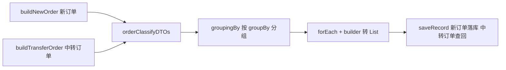

# 智能调度·订单分类实现下半：调度算法落地与验证（11-20 讲）

上半篇结束时，订单分类推到了最后一环：calculate 方法有思路没代码，中转订单、分组、落库都还空着。这十个视频把剩下的全部做完——三层循环算出最近网点并用假数据验证，中转订单接入与起始机构计算，一行 groupingBy 完成真正的分类，最后按新订单、中转订单两个分支落库。订单分类自此闭环。

## 先给结论

- calculate 按三层循环落地：网点集合 → getMultiPoints()（List<List<Map>>）→ 每个坐标 Map；getPoint 把 Map 拼成"经度,纬度"字符串，与收件人坐标 location 同格式；EntCoordSyncJob.getDistance 调百度地图算两点距离，两个参数谁前谁后无所谓。
- 同一网点多个顶点只留一个：agencyMap 以 agencyId 为 key，put 前比较 preDistance == null || distance < preDistance，保证留下的是该网点离收件人最近的距离；全部网点算完再 entrySet 转 List，comparingDouble 按 value 升序，get(0).getKey() 就是最近网点，Result.ok().put("agencyId", agencyId) 返回。
- main 方法造假数据验证：mutiPoints 嵌套深、造数据繁琐（集合套集合再套 Map），断点两次揪出复制笔误；真正的 bug 是 map.get("lng") 强转 String 抛 ClassCastException，Map 里存的是 Double，改用 toString() 解决。
- calculate 测通后回填 getEndAgencyId，新订单构建闭环；buildTransferOrder 复制 buildNewOrder 改三处：状态换 IN_TRANSIT、起始机构换 getStartAgencyId（复制 getEndAgencyId 全套、receiver 全面换 sender）、currentAgencyId 不动。
- 分类依据是 OrderClassifyDTO.groupBy()：返回 startAgencyId#endAgencyId#currentAgencyId；Collectors.groupingBy(OrderClassifyDTO::groupBy) 一行完成分组，得 Map<String, List<OrderClassifyDTO>>，再 forEach + builder 转成 List<OrderClassifyGroupDTO>（key + orders 原始订单）。
- 落库分两支：新订单（isNew：起始机构等于当前机构）写两张表——pd_order_classify 一类一条（classify、jobId、logId、起止机构、total），关联表一条订单一条记录（orderId + orderClassifyId）saveBatch；中转订单在起始网点已保存过分类，只按订单 id 查回分类 id 回填，后面路线规划要用。

## calculate 落地：三层循环、保最小、排最近

calculate 的思路上一期已经明确：把每个网点覆盖范围的顶点全部迭代出来，分别算与收件人坐标的距离，最近的顶点落在哪个网点，目的地就是它。落地成代码，是三层循环加一次排序：

```java
private Result calculate(List<AgencyScopeDTO> agencyList, String location) {
    Map<String, Double> agencyMap = Maps.newHashMap();
    for (AgencyScopeDTO agencyScopeDto : agencyList) {
        // 遍历某个机构下保存的业务范围坐标
        for (List<Map> maps : agencyScopeDto.getMultiPoints()) {
            for (Map map : maps) {
                String point = getPoint(map); // 获得坐标值
                // 调用百度地图工具类，计算两点之间的距离
                Double distance = EntCoordSyncJob.getDistance(point, location);
                // 获取已经保存的值
                Double preDistance = (Double) agencyMap.get(agencyScopeDto.getAgencyId());
                if (preDistance == null || distance < preDistance) {
                    agencyMap.put(agencyScopeDto.getAgencyId(), distance);
                }
            }
        }
    }
    // entrySet 转 List，按距离升序排序，第一个就是最近网点
    List<Map.Entry<String, Double>> list = new ArrayList<>(agencyMap.entrySet());
    list.sort(Comparator.comparingDouble(Map.Entry::getValue));
    String agencyId = list.get(0).getKey();
    return Result.ok().put("agencyId", agencyId);
}
```

三层循环对应三层结构：外层遍历网点集合（一个个封装成 AgencyScopeDTO 的机构）；中层遍历 getMultiPoints()——muti_points 是二维数组，映射到 Java 就是 List<List<Map>>，遍历出来还是集合；内层拿到的每个 Map 才是一个具体坐标点。getPoint 把它整理成工具类要的格式：

```java
private String getPoint(Map map) {
    String lng = map.get("lng").toString(); // 经度
    String lat = map.get("lat").toString(); // 纬度
    return lng + "," + lat;
}
```

key 与 muti_points 里的 JSON 字段一致（lng/lat），拼出来是逗号分隔的"经度,纬度"，和 location 的格式完全一样。EntCoordSyncJob.getDistance(point, location) 内部调的还是百度地图接口，算两点之间的距离——两个参数的先后顺序不影响结果。

中间那段 if 是整个算法的关键。直接 put 也能做到每个网点只留一条，但 HashMap 后写的覆盖先写的，留下的是最后遍历到的顶点，不保证最近。所以 put 之前先取已存的 preDistance：为 null 说明是第一次遍历该网点，直接放；不为 null 就比较，当前距离更小才覆盖。三层循环跑完，agencyMap 里 key 是网点 id，value 是该网点离收件人地址最近的距离。最后 entrySet 转 List，Comparator.comparingDouble(Map.Entry::getValue) 默认升序，get(0).getKey() 取到距离最小的网点 id，包成 Result.ok().put("agencyId", agencyId) 返回。

验证靠 main 方法造假数据。calculate 是私有非静态方法，直接 new 一个 TaskOrderClassifyServiceImpl 来调。麻烦在数据本身：一个 AgencyScopeDto 要 setAgencyId，multiPoints 是集合套集合再套 Map——外层 new ArrayList 装 points，points 里再 new ArrayList，里面 new HashMap put("lng", ...) put("lat", ...)。造两个机构、各两个顶点就写了一大片，中途还因为复制没改彻底（dto2 的 points2 没换干净）被断点揪出来重跑；location 写死一个真实坐标 "116.349936,40.066258"。debug 走一遍能看到完整过程：机构 1 第一个顶点算出 2510，map 里是 {1=2510}；第二个顶点 2446 更近，覆盖成 {1=2446}，size 仍是 1——"同网点保最小"生效；两个机构各留一个最小值后排序，get(0) 取到更近的那个。测试还暴露一个真 bug：getPoint 里把 map.get("lng") 强转 String 抛了 ClassCastException，Map 里存的其实是 Double，改成 toString() 解决。

## 从新订单到中转订单：回填与复制改造

calculate 测通后，getEndAgencyId 补上最后一步就能用了：

```java
// 计算当前区域下所有网点距离收件人地址最近的网点
Result result = calculate(agencyScope, location);
// 当时 put 用的 key 是 agencyId，取也按它取
return (String) result.get("agencyId");
```

到这里值得回头看一眼整个调用过程：execute 是主线，buildNewOrder 查新订单并封装成 OrderClassifyDTO；封装时要目的地机构，于是有 getEndAgencyId；它里面先 receiverFullAddress 拼完整地址，再调百度地图取坐标、取区域 Map、拿 adcode，经 areaApi.getByCode（Feign）查回区域对象并比对区县，然后 findAllAgencyScope 查当前区县下所有网点，最后 calculate 算出最近网点。每个细节一个私有方法，主线保持可读。

主线的下一个动作是中转订单。buildTransferOrder 与 buildNewOrder 高度相似，直接复制过来改三处：

- 查询状态：OUTLETS_WAREHOUSE 换成 IN_TRANSIT——中转订单是运输中状态的单子；
- 查询机构不动：currentAgencyId 还是当前机构，只关心流转到本机构的中转订单；
- 起始机构不能再用当前机构：中转订单的当前机构肯定不是它收件的那个网点，所以换成 getStartAgencyId(item)。

```java
private List<OrderClassifyDTO> buildTransferOrder(String agencyId) {
    OrderSearchDTO orderSearchDTO = new OrderSearchDTO();
    // 状态为运输中
    orderSearchDTO.setStatus(OrderStatus.IN_TRANSIT.getCode());
    orderSearchDTO.setCurrentAgencyId(agencyId);
    List<Order> orderList = orderFeign.list(orderSearchDTO);
    OrderClassifyDTO.OrderClassifyDTOBuilder builder = OrderClassifyDTO.builder();
    builder.currentAgencyId(agencyId);
    return orderList.stream().map(item -> {
        builder.order(item); // 原始订单
        builder.startAgencyId(getStartAgencyId(item)); // 起始机构：中转订单要算
        builder.endAgencyId(getEndAgencyId(item)); // 目的地机构
        builder.orderType(item.getOrderType());
        return builder.build();
    }).collect(Collectors.toList());
}
```

复制来的代码里连日志文案都还写着"查询到新订单个数"，这类细节后面还要专门修一轮。getStartAgencyId 的实现思路与 getEndAgencyId 完全一样，只有一处不同：地址从收件人换成发件人。所以又是复制：新增 senderFullAddress（复制 receiverFullAddress，三个 receiver 的 ID getter 换成 senderProvinceId / senderCityId / senderCountyId），后面的链路照旧——拼地址、取坐标、取 adcode、getByCode(adcode + "000000") 查区域、比对、查网点、calculate，只有比对对象从 receiverCountyId 换成 senderCountyId，异常提示也变成"发件地址区域id和根据坐标计算出的区域不一致"。

复制改造的代价马上结账：senderFullAddress 拼接处 order.getReceiverAddress() 忘了改成 getSenderAddress()，比对处 getReceiverCountyId() 忘了换成 getSenderCountyId()，都是复制后没改彻底的遗留——复制过来的代码必须逐行检查。execute 主线随之补全：orderClassifyDTOs.addAll(buildTransferOrder(agencyId))，新订单和中转订单都进集合了。

## 一行分组：groupBy 与 groupingBy

两种订单齐了，真正的分类来了。分类依据早在 OrderClassifyDTO 里埋好——groupBy 方法：

```java
public String groupBy() {
    if (StringUtils.isNotBlank(this.startAgencyId)
            && StringUtils.isNotBlank(this.endAgencyId)
            && StringUtils.isNotBlank(this.currentAgencyId)) {
        return this.startAgencyId + "#" + this.endAgencyId + "#" + this.currentAgencyId;
    }
    return "";
}
```

三个维度：起始机构、终止机构、当前机构。两个订单的 groupBy 返回值相同，就归为一类。分类本身一行：

```java
// 进行订单分类
Map<String, List<OrderClassifyDTO>> orderClassifyDTOGroup =
        orderClassifyDTOs.stream().collect(Collectors.groupingBy(OrderClassifyDTO::groupBy));
```

Collectors.groupingBy 对集合里每个 DTO 调 groupBy，返回值作 key，同类 DTO 收进一个 List 作 value。一个网点 1000 个订单可能分成几十类，得到的 map 就有几十个 entry。

execute 要求返回 List<OrderClassifyGroupDTO>，所以还要把 map 转回 list——forEach 遍历 map，每组用构建器封一个分组对象：

```java
// 对象转换：Map 转 List<OrderClassifyGroupDTO>
OrderClassifyGroupDTO.OrderClassifyGroupDTOBuilder builder = OrderClassifyGroupDTO.builder();
orderClassifyDTOGroup.forEach((key, value) -> {
    builder.key(key); // 分组维度，即 groupBy 的返回值
    // 从每个 DTO 里取原始订单
    List<Order> orders = value.stream().map(OrderClassifyDTO::getOrder)
            .collect(Collectors.toList());
    builder.orders(orders);
    orderClassifyGroupDTOS.add(builder.build());
});
```

分组对象里就两块：key 存分组维度，orders 关联这一类的原始订单。之所以要转成这个形态，是因为订单分类只是智能调度的第一步，后面还有路线规划、司机规划、工作单生成，key + 原始订单的结构后边程序用起来最方便。

照例用 main 方法验证。造三个 OrderClassifyDTO：dto1（start=1、end=10、current=1，订单 1001）、dto2（三个维度与 dto1 相同，订单 1002）、dto3（start=2、end=12、current=11，订单 1003）。断点下的结果与预期一致：原始 3 个订单，groupingBy 后 map 的 size 是 2——"1#10#1" 下挂着 1001、1002 两个 DTO，"2#12#11" 下只有 1003 自己；转换后 orderClassifyGroupDTOS 同样 size=2，key + orders 的结构一目了然。造数据途中又踩了一次复制笔误：builder2、builder3 里关联的 order 忘了换成 order2、order3，订单 ID 是空，断点一眼看出来。

## 落库：saveRecord 的两个分支

分类完成，最后落库。saveRecord(list, jobId, logId) 接收分组结果，jobId、logId 一并传入——分类记录本身要记这两个 id。要操作的是两张表，各有对应实体：

| 实体 / 表 | 关键字段 | 说明 |
| :--- | :--- | :--- |
| OrderClassifyEntity ↔ pd_order_classify | id、jobId、logId、startAgencyId、endAgencyId、classify、total | 一类一条记录；classify 存的就是 start#end#current 字符串；total 是该类订单数量 |
| OrderClassifyOrderEntity ↔ 订单分类订单关联表 | orderClassifyId、orderId（外加 jobId、logId） | 一条订单一条记录，标明它属于哪个分类 |

配套两个 service 都是纯数据库操作，从讲义直接拷：IOrderClassifyService 继承 MyBatis-Plus 的 IService<OrderClassifyEntity>（另扩展 findByJobLogId），实现类继承 ServiceImpl；IOrderClassifyOrderService 同样套路，实现类里另有一个 getClassifyId(orderId)：LambdaQueryWrapper 按订单 id selectOne，返回 orderClassifyId。两个 service 注入 TaskOrderClassifyServiceImpl，saveRecord 就能写了：

```java
private void saveRecord(List<OrderClassifyGroupDTO> orderClassifyGroupDTOS,
                        String jobId, String logId) {
    orderClassifyGroupDTOS.forEach(item -> {
        if (item.isNew()) {
            // 新订单：起始机构与当前机构相同，需要保存
            log.info("新订单 保存分组信息");
            OrderClassifyEntity entity = new OrderClassifyEntity();
            entity.setClassify(item.getKey());
            entity.setJobId(jobId);
            entity.setLogId(logId);
            entity.setStartAgencyId(item.getStartAgencyId());
            entity.setEndAgencyId(item.getEndAgencyId());
            entity.setTotal(item.getOrders().size());
            entity.setId(IdUtils.get());
            orderClassifyService.save(entity);
            // 关联表：一条订单一条记录
            List<OrderClassifyOrderEntity> orderClassifyOrders = item.getOrders().stream()
                    .map(order -> {
                        OrderClassifyOrderEntity o = new OrderClassifyOrderEntity();
                        o.setOrderId(order.getId());
                        o.setOrderClassifyId(entity.getId());
                        o.setJobId(jobId);
                        o.setLogId(logId);
                        return o;
                    }).collect(Collectors.toList());
            orderClassifyOrderService.saveBatch(orderClassifyOrders);
        } else {
            // 中转订单：不保存，查回分类 id 回填
            log.info("中转订单，查询分组信息");
        }
    });
}
```

isNew 的判断就是老标准：起始机构与当前机构相同即为新订单。新订单分支把分组 DTO 转成 entity 落两张表，关联数据按订单一条条封好再 saveBatch。中转订单走 else——它不需要保存：单子在第一个收件它的网点做智能调度时，分类数据已经落过库，中转到当前机构时记录已经存在。这里只做查询：把订单 id 都取出来，按条件查关联表，拿回 orderClassifyId 回填到当前分组对象上。回填是为了后面——订单分类之后是路线规划，路线规划要用到这个分类 id。

到这里 execute 主线全景已经完整：



## 小结

十个视频收官，订单分类完整落地：calculate 用三层循环加"保最小再排序"算出最近网点，假数据加断点验证通过；起始机构、目的机构都能动态算出，新订单和中转订单统一封装进 orderClassifyDTOs；一行 groupingBy 按"起始#终止#当前"分组，map 转回 key + orders 的分组列表；落库时新订单写分类表和关联表，中转订单只查回分类 id 回填——同一条单子的分类数据全链路只写一次。回看 execute 主线，三步骨架始终清晰：收集、分组、保存，所有复杂度都沉在私有方法里。两个教训值得留下：复制改造必须逐行检查，getSenderAddress、getSenderCountyId 两处遗留都是这么漏的；嵌套深的数据结构，肉眼 review 不如断点可靠。订单分类之后，就是这条主线的下一站——路线规划。
