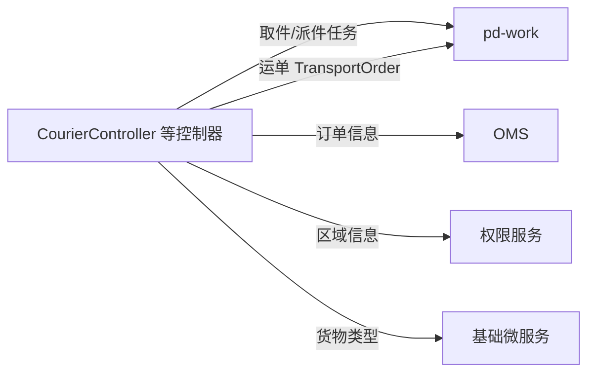

# TMS 司机端/快递员端：导入功能代码怎么落

进入品达物流 TMS 的客户端章节（第10章），第一节不是动手写代码，而是导代码：司机端、快递员端两个 Web 工程的功能代码在课程资料里已经全部备好，要做的是按位置拷进工程，再跑起来对着 Swagger 文档核对接口。这节内容不长，但有两个点值得展开：代码到底拷到哪，以及导入的代码为什么几乎全是 Feign 调用。顺带能看到聚合层控制器的一批典型写法，包括构造器注入、可覆盖的 Feign 服务名配置，以及用 CompletableFuture 并发聚合省市区数据的技巧。

## 先给结论

- 本章（TMS 客户端）共三节：导入功能代码、RabbitMQ、分布式链路追踪。本篇只覆盖第一节，RabbitMQ 与链路追踪在后续篇章展开。
- 司机端代码在资料目录 `TMS司机端服务` 下的 `PDWeb Driver代码导入` 文件夹里，配置文件与 Java 代码分开放，对应拷入 `pd-web-driver` 工程即可。
- 快递员端代码在资料目录 `TMS快递员端服务` 下，对应拷入 `pd-web-courier` 工程对应位置。
- 导入的代码本质是一层聚合门面：Controller 里没有业务逻辑，全靠 Feign 调用把请求转给下游微服务。快递员端从待取件、待妥投的任务查询到运单操作，一条条都是 Feign 接口。
- 主要链路五条：取派件任务与运单走 pd-work，订单走 OMS，区域走权限服务，货物类型走基础微服务。
- 验证方式：启动服务后打开 Swagger 文档（演示环境地址 `http://localhost:8164/swagger-ui.html`），按文档分组逐个核对接口。

## 拷代码：两个 Web 端，资料里都是现成的

先说司机端。资料里找到 `TMS司机端服务`，其下有个 `PDWeb Driver代码导入` 文件夹，里面就是两样东西：配置文件和 Java 代码。把这两部分拷到 `pd-web-driver` 工程的对应位置，导入就完成了。讲师演示时已经提前拷好，工程里代码和配置各自落位；对学习者来说，自己照着资料结构拷一遍即可，这一步没有任何需要手写的内容。

快递员端同理。资料里的 `TMS快递员端服务` 目录下有对应的代码包，拷到 `pd-web-courier` 工程对应位置就行。

| 端 | 资料位置 | 目标工程 |
| --- | --- | --- |
| 司机端 | `TMS司机端服务` / `PDWeb Driver代码导入` | `pd-web-driver` |
| 快递员端 | `TMS快递员端服务` | `pd-web-courier` |

两处导入完成后，司机端和快递员端的功能代码就都进了工程。资料里给的是完整成品代码，不是伪代码或片段，拷完即可编译运行。

## 导进来的代码：Controller 聚合，Feign 干活

以快递员端为例，导入包里的 `CourierController` 集中放快递员的业务操作。最典型的是两类查询：待取件任务、待妥投任务。这两条接口本质都是任务查询，查快递员当前有哪些待取件的任务、待投递（派件）的任务，调一下接口就能拿到结果。

把代码翻下去会发现一个规律：这些 Controller 里几乎全是 Feign 调用，涉及到的 Feign 接口数量相当多。按功能归组，链路是这样的：



| Feign 归组 | 下游服务 | 拿什么数据 |
| --- | --- | --- |
| 任务相关 | pd-work | 取件、派件任务信息 |
| 订单相关 | OMS | 订单信息 |
| 区域（Area） | 权限服务 | 区域信息，按不同条件、不同参数查询，最终查的都是区域 |
| 货物类型（GoodsType） | 基础微服务 | 货物类型信息 |
| 运单（Transport） | pd-work | 运单（TransportOrder）相关操作 |

Web 端工程自己不存数据、不做核心业务，它把请求转给一个个微服务，再把结果组织成前端需要的形态。这就是这层代码的全部价值：聚合与转发。

控制器写法上有一个统一模式，直接看画面演示里抄录的一段：

```java
@Api(tags = "地址簿")
@RestController
@RequestMapping("address")
public class AddressBookController {
    private final AddressBookFeign addressBookFeign;
    private final AreaApi areaApi;
    public AddressBookController(AddressBookFeign addressBookFeign, AreaApi areaApi) {
        this.addressBookFeign = addressBookFeign;
        this.areaApi = areaApi;
    }
}
```

三个细节值得注意：`@Api(tags = ...)` 负责把控制器归到 Swagger 文档分组；依赖用 `private final` 字段加构造器注入，不走 `@Autowired`；注入的类型就是 Feign 客户端（`AddressBookFeign`、`AreaApi`），控制器拿着它们去调下游。

Feign 客户端本身是接口定义，下面是画面里演示的文件上传客户端：

```java
@FeignClient(
    name = "${pinda.feign.authority-server:pd-file-server}",
    path = "/attachment"
)
public interface AttachmentClient {
    @PostMapping(
        value = "/upload",
        consumes = MediaType.MULTIPART_FORM_DATA_VALUE
    )
    Object upload(
        @RequestPart(value = "file") MultipartFile file,
        @RequestParam(value = "isSingle", required = false, defaultValue = "false") Boolean isSingle,
        @RequestParam(value = "id", required = false) Long id,
        @RequestParam(value = "bizId", required = false) String bizId,
        @RequestParam(value = "bizType", required = false) String bizType
    );
}
```

这段有两个可以复用的写法：`name` 属性用配置占位符 `${pinda.feign.authority-server:pd-file-server}`，允许在配置文件里覆盖目标服务名，冒号后面是默认值；文件上传要显式声明 `consumes = MULTIPART_FORM_DATA_VALUE`，参数用 `@RequestPart` 接 `MultipartFile`，其余业务参数用 `@RequestParam` 且都允许缺省。

聚合层的另一个典型场景是地址簿查询：拿到地址簿后，要同时把省、市、区三个 ID 对应的区域信息查出来。画面里的写法是先把三个 ID 收进一个 `Set` 去重，再用 `CompletableFuture` 并发去查区域映射，最后填充 DTO：

```java
if (addressBook == null) {
    return Result.error();
}
Set<Long> areaSet = new HashSet<>();
areaSet.add(addressBook.getProvinceId());
areaSet.add(addressBook.getCityId());
areaSet.add(addressBook.getCountyId());
CompletableFuture<Map<Long, Area>> areaMapFuture = FeignClient.getAreaMapFuture();
// ... (后续代码)
```

画面到这里截断，后续逻辑是并发取回结果，再把区域信息填充进 AddressBookDTO。

用户信息接口的返回口径是另一种典型写法：

```java
Member member = memberService.detail(userId);
if (member != null) {
    return Result.ok().put("data", UserProfileDTO.builder()
        .id(userId)
        .avatar(member.getAvatar())
        .name(member.getName())
        .phone(member.getPhone())
        .build());
} else {
    return Result.ok().put("data", UserProfileDTO.builder().build());
}
```

查到用户就填充 `UserProfileDTO` 的头像、姓名、手机号；查不到不返回 error，而是返回 ok 加一个空 DTO。对用户资料这类查询接口来说，没查到是正常分支，前端拿到空对象就能正常渲染占位。

## 跑起来验证：Swagger 文档与移动端原型

代码导完，把服务跑起来，浏览器打开 `http://localhost:8164/swagger-ui.html`（演示环境口径），整个工程的接口文档按分组列出来，包括业务接口、公共信息、地址簿、文件上传这些模块。点开业务接口分组下的 `MailingController`，能看到每个接口的具体定义。对着文档过一遍，司机端和快递员端到底提供了哪些服务接口就都清楚了。

课程还配了 Axure RP 做的移动端原型，画面里打开的是移动端司机端原型，包含首页、寄件、查询、我的四个模块，逐个点开能看到页面设计和交互逻辑。把原型和 Swagger 文档对照着看，后端接口和前端页面的对应关系一目了然，也解释了为什么这层代码全是 Feign 聚合：每个页面要的数据，都来自一个或多个下游微服务。

这一节做完，本章还剩两个主题：RabbitMQ 和分布式链路追踪，下一篇从 RabbitMQ 的原理与工作模式讲起。

## 小结

- 导入功能代码这一节的工作量在拷不在写：司机端、快递员端的代码和配置在资料里都是现成的，按位置拷入 `pd-web-driver`、`pd-web-courier` 即可。
- 导入的代码是聚合层：Controller 无业务逻辑，`CourierController` 里从待取件、待妥投任务查询到运单操作，全靠 Feign 调用下游微服务。
- 链路归属记五条就够：任务和运单走 pd-work，订单走 OMS，区域走权限服务，货物类型走基础微服务。
- 写法上有三个可复用的模式：构造器注入 Feign 客户端，`@FeignClient` 的 name 用配置占位符加默认值，文件上传声明 multipart 并用 `@RequestPart` 接文件。
- 验证以 Swagger 文档为准（演示环境 `http://localhost:8164/swagger-ui.html`），再配 Axure 移动端原型对照页面与接口。
