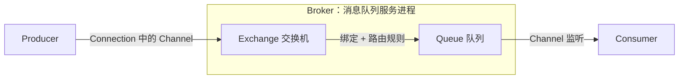

# RabbitMQ 从原理到五种工作模式 + 分布式链路追踪开篇

TMS 客户端章节（第10章）的第二部分整块给了 RabbitMQ：先讲它是什么、怎么工作，再用 Docker 跑起来，然后用 Spring Boot 写一个生产者加消费者的入门案例，最后过完六种工作模式，末尾带出分布式链路追踪的开篇。

## 先给结论

- MQ（Message Queue）就是消息队列，一般称为消息中间件，是应用间的通信方法，最大特点是异步通信：生产者把消息发到队列，一个或多个消费者监听队列取消息。常见产品有 ActiveMQ、RabbitMQ、Kafka、RocketMQ。
- RabbitMQ 由 Erlang 语言开发，基于 AMQP（高级消息队列协议）实现；优点是使用简单、社区活跃文档完善、高并发性能好，且 Spring Boot 已默认集成。
- 工作原理记一句话：消息不直接进队列。Producer 通过 Connection 里的 Channel 把消息发给 Broker 内的 Exchange，交换机按绑定规则转发到 Queue，Consumer 再通过 Channel 监听 Queue 消费。
- 部署选 Docker 最省事：拉 rabbitmq:3.7.7-management 镜像，映射 5672（应用收发消息）和 15672（Web 控制台）两个端口；默认账号密码 admin。
- 入门案例四步走：引 spring-boot-starter-amqp 依赖、配 yml 连接、RabbitmqConfig 声明交换机/队列/绑定三件套、测试里 RabbitTemplate.convertAndSend 直发交换机；消费端一个 @RabbitListener 完成监听。
- 六种工作模式的区别集中在交换机类型与路由键写法：简单模式、工作队列走默认交换机，发布订阅 fanout 全量广播，路由 direct 精确匹配，通配符 topic 支持 # 和 * 通配。企业实战里路由和通配符用得最多。

## RabbitMQ 是什么：异步通信与解耦

MQ 是应用间的一种通信方法：生产者把消息发到队列，一个或多个消费者监听队列，消息经由队列中转，两边是异步的。

两个典型应用场景：

1. 任务异步处理。不需要同步处理、耗时较长的操作，由消息队列通知接收方异步处理。比如发邮件、发短信，不必直接调用相应接口，发一条消息，消费端监听到之后再处理。
2. 应用程序解耦。生产方与消费方通过 MQ 中转交互，MQ 相当于中介，两个应用之间就没有直接的耦合性了。

RabbitMQ 的技术底座与优点：

| 维度 | 内容 |
| --- | --- |
| 开发语言 | Erlang |
| 协议 | AMQP（高级消息队列协议） |
| 官网 | http://www.rabbitmq.com/ |
| 优点 | 使用简单、功能强大；基于 AMQP 协议；社区活跃、文档完善；高并发性能好（得益于 Erlang 语言）；Spring Boot 默认集成 |

Spring Boot 默认集成这条最实用，引入 starter 就能用。安装时留意：不用 Docker 的话，操作系统需要先具备 Erlang 依赖环境；用 Docker 就没这个负担。

## 工作原理：Broker、Exchange、Queue

用 MQ 的场景一定有生产方 Producer（可能有多个）和接收方 Consumer（也可能有多个）。RabbitMQ 的特殊之处是队列前面多了一个交换机。



Broker 就是消息队列的服务进程，MQ 作为一个服务启动，进程里包含两个核心组件：Exchange（交换机，也有翻译成交换器的）和 Queue（消息队列）。

与以往直接把消息发到队列不同，RabbitMQ 里消息发到的是交换机，由交换机转发到对应的队列。生产方与 Broker 建立 Connection 连接，连接里用的是 Channel（通道），通过通道把消息发给交换机；交换机与队列存在绑定关系，收到消息后推送到绑定的队列。消费方同样创建连接、通过 Channel 监听某个队列，队列里一旦有消息就能拿到并消费。

五个组成部分的定义：

| 组件 | 定义 |
| --- | --- |
| Broker | 消息队列服务进程，包括 Exchange 和 Queue 两部分 |
| Exchange | 消息队列交换机，按一定的规则将消息路由转发到某个队列，对消息进行过滤（绑定时带规则，不是绑定了就一定能收到消息） |
| Queue | 消息队列，存储消息，消息到达队列并转发给指定的消费方 |
| Producer | 消息生产者，生产方客户端，将消息发送到 MQ |
| Consumer | 消息消费者，消费方客户端，接收 MQ 转发的消息 |

## Docker 安装与启动

直接用 Docker 装，两步：

```bash
docker pull rabbitmq:3.7.7-management
```

```bash
docker run -d --name rabbitmq3.7.7 -p 5672:5672 -p 15672:15672 -v /data/var/lib/rabbitmq -e RABBITMQ_DEFAULT_VHOST=my_vhost -e RABBITMQ_DEFAULT_USER=admin -e RABBITMQ_DEFAULT_PASS=admin 288deb59dfc
```

run 命令的参数逐个看：

| 参数 | 作用 |
| --- | --- |
| -d | 后台运行容器 |
| --name | 指定容器名称 |
| -p 5672:5672 | 应用访问端口，Java 代码发消息、收消息走这个 |
| -p 15672:15672 | Web 管理控制台端口，浏览器访问 |
| -v | 目录映射 |
| -e RABBITMQ_DEFAULT_VHOST | 默认虚拟主机名 |
| -e RABBITMQ_DEFAULT_USER / PASS | 默认用户名、密码 |
| 288deb59dfc | 镜像 ID |

虚拟主机（virtual host）不是 VMware 那种虚拟机，而是 MQ 下划分出来的逻辑空间，队列数据都归在这个空间下面，默认有一个以斜线命名的（根）。另外注意：RabbitMQ 根据主机名来存储数据，默认主机名就是容器的主机名。

容器停掉之后不用重新 run。docker ps 看不到、ps -a 里显示退出状态的话，直接 docker start 启动即可。

启动成功的标志是浏览器能打开 http://ip:15672/ 并登录进控制台。标签页有：Overview（总览）、Connections（连着 MQ 的客户端）、Channels（通道）、Exchanges（交换机列表，type 有 direct、fanout、topic 等）、Queues（消息队列）、Admin（用户角色管理，可点 Add User 加新用户，也可按名字添加新的 Virtual Hosts）。看得最多的两个菜单是 Queues 和 Exchanges；能看到这个页面，就说明 MQ 启动成功了。

## 入门案例：生产者把消息发进队列

环境就绪后写入门案例。工程结构是一个父工程（packaging 用 pom），下面挂两个子工程：mq-producer（生产者）和 mq-consumer（消费者）。

第一步，依赖。父工程继承 spring-boot-starter-parent，坐标统一放父工程，子工程继承过去。关键引一个 starter：

```xml
<dependency>
    <groupId>org.springframework.boot</groupId>
    <artifactId>spring-boot-starter-amqp</artifactId>
</dependency>
```

依赖树里没有直接出现 rabbitmq 字眼，因为 Spring Boot 已经做了整合：starter-amqp 传递引入了 spring-rabbit，再往下是 RabbitMQ 的 client 核心包。只导这一个坐标，相关 jar 包就全有了。

第二步，配置文件 application.yml：

```yaml
spring:
  rabbitmq:
    host: 68.79.7.219
    port: 5672
    username: admin
    password: admin@2020
    virtual-host: /
```

host、port、username、password、virtual-host（就是前面说的虚拟主机）五项。密码是 admin@2020 而不是 docker run 示例里设置的 admin，因为案例连的是另一台机器（68.79.7.219）：之前演示 run 命令的那台没有对外暴露端口，外网访问不到，这台机器上设置的密码就是 admin@2020。virtual-host 用默认的斜线。

第三步，配置类，这是最关键的一步。配置类里要创建三个对象：交换机、队列、绑定。三个名称都用常量定义：

```java
public static final String EXCHANGE = "myexchange2";
public static final String QUEUE = "myqueue2";
public static final String ROUTING_KEY = "fire2";
```

```java
@Configuration
public class RabbitmqConfig {

    // 交换机
    @Bean
    public DirectExchange exchange() {
        return ExchangeBuilder.directExchange(EXCHANGE).durable(true).build();
    }

    // 队列
    @Bean
    public Queue queue() {
        return new Queue(QUEUE);
    }

    // 将队列和交换机绑定
    @Bean
    public Binding binding(@Qualifier(QUEUE) Queue queue, @Qualifier(EXCHANGE) DirectExchange exchange) {
        return BindingBuilder.bind(queue).to(exchange).with(ROUTING_KEY);
    }
}
```

读一遍这段代码：@Bean 创建 DirectExchange 对象，ExchangeBuilder 指定交换机名称，durable(true) 指定数据是否做持久化，调用 build 创建出来；不用 builder、直接 new 也可以。队列直接 new 一个 Queue，给个名称。绑定用 BindingBuilder.bind(队列).to(交换机).with(路由key)，两个对象通过 @Qualifier 按 Bean 名称注入。

routing key（路由 key）本质就是个字符串，叫什么都可以，只要发送时和绑定时保持一致，消息就能被转发到绑定的队列。入门阶段对它感到模糊很正常，讲完工作模式就清晰了。这类配置代码都是模板化的，不必手敲，理解配置类的作用即可。

第四步，启动类加单元测试。启动类就是最普通的 @SpringBootApplication 加 main；测试不起 web 环境，直接发消息：

```java
@RunWith(SpringRunner.class)
@SpringBootTest
public class RabbitmqTest {

    @Autowired
    RabbitTemplate rabbitTemplate;

    @Test
    public void testSendMsg() {
        rabbitTemplate.convertAndSend(RabbitmqConfig.EXCHANGE,
                RabbitmqConfig.ROUTING_KEY,
                "hello world");
    }
}
```

配置类就绪后，Spring 会自动创建 RabbitTemplate 模板对象，直接注入使用。convertAndSend 的参数依次是交换机名称、路由 key、消息内容。注意消息不是发到队列，代码层面直接面对的是交换机，由它转发到对应的队列。

运行测试没有报错就说明发送成功。验证方法：打开管理控制台，Queues 标签页里会多出 myqueue2 队列；点进队列，展开 Get Message(s)，能看到消息内容 hello world，页面上也能看到它跟 myexchange2 的绑定关系。此时消费者还没开发，消息就积压在队列里。

## 消费者：一个 @RabbitListener 收完

消费者同样是一个 Maven 子工程 mq-consumer，继承父工程，pom 不用再配；application.yml 从生产者那边拷过来即可，两边都要连接 MQ，配置没有区别。

消费方最核心的代码是一个消息处理类（监听器）：

```java
@Component
public class MyConsumer {
    @RabbitListener(queues = "myqueue")
    public void receive(String msg) {
        System.out.println("消费者接收到消息：" + msg);
    }
}
```

@Component 把它交给 Spring 管理。方法名随便起，关键是 @RabbitListener 注解：加上它，这个方法就成了监听方法，queues 指定监听的队列；它是个数组，可以同时监听多个队列。队列里一旦有消息，方法就会被回调，消息通过参数传进来，之后怎么处理就看具体业务。

启动消费者：队列里还积压着刚才那条消息，启动后立刻被消费，控制台输出 hello world。再回生产者把测试消息改几个字符重新执行，消费者又读取到新消息，监听器生效。到这里入门案例就写完了，整体套路和 RocketMQ、Kafka 类似：往队列里产生消息，消费方消费消息，只是代码层面的写法不一样。

## 五种工作模式对比

RabbitMQ 提供了 6 种工作模式：简单模式 Hello World、工作队列模式 Work Queue、发布/订阅模式 Publish/Subscribe、路由模式 Routing、通配符模式 Topics、RPC 模式。RPC 不建议使用，不展开，知道有这 6 种即可。刚才的入门案例其实就属于其中一种：路由模式。

| 模式 | 交换机类型 | 路由键 | 特点与场景 |
| --- | --- | --- | --- |
| 简单模式 | （默认交换机，图中省略） | 无 | 一个生产者发消息到队列，一个消费者接收；真实环境生产者、消费者往往都不止一个，实际用得少 |
| 工作队列 | （默认交换机，图中省略） | 无 | 一个生产者、多个消费者；一条消息只能被一个消费者接收；RabbitMQ 用轮询方式把消息平均发给消费者；任务过重或较多时用它提高处理速度 |
| 发布/订阅 | fanout | 无 | 生产者把消息发给交换机，交换机转发到所有绑定的队列，每个队列都收到消息，类似广播，多个消费者都能接到 |
| 路由 | direct | 精确匹配字符串 | 绑定队列时设置 routing key，发送消息时也指定 routing key，交换机只转发到匹配的队列 |
| 通配符 | topic | 通配符 # 和 * | 绑定时设置通配符形式的 routing key，匹配规则更灵活，适用场景更多 |

两点说明：其一，简单模式和工作队列的图里没画交换机，因为用的是默认交换机，由 MQ 服务处理；其二，交换机类型可从源码确认，DirectExchange 继承 AbstractExchange，getType() 返回 direct，抽象体系下还有 Fanout、Topic、Headers，常用的是 Direct、Fanout、Topic 三种。

```java
public class DirectExchange extends AbstractExchange {
    ...
    public final String getType() {
        return "direct";
    }
}
```

路由模式与发布订阅的根本区别就在 routing key：发布订阅是 fanout，绑定了就全量转发；路由模式是 direct，比如两个队列分别以 error 和 info 绑定，发送时指定 routing key 为 error，消息只进 error 那个队列，info 的队列收不到。入门案例里绑定与发送用同一个字符串常量 fire2，走的就是精确匹配的路子。

通配符模式再进一步，routing key 不再写死，而是通配符语法：中间以点分隔，# 匹配一个或多个词，* 匹配一个词。比如队列以 #.email.# 绑定，发送 routing key 为 test.email.test 就能匹配进来；以 #.sms.# 绑定的队列匹配不上，就收不到。对比写死的 error/info，通配符更灵活。

企业实际应用中，路由模式和通配符模式用得最多。

## 末节带出：分布式链路追踪（下一主题开篇）

本章第三部分是分布式链路追踪，这里带出它的开篇。微服务架构通常按业务划分服务，回顾前面开发的 TMS 项目：有基础模块、订单、用户、智能调度等微服务。这些服务之间不是完全独立的，会通过 REST 互相远程调用，一个复杂业务往往由多个服务协同完成，于是出现调用链：用户请求 A 服务，A 调 B，A 还要调 C，C 又调 D 拿数据，再调 E，结果一层层往回返，最终回到用户。五个服务部署独立，运行时却存在调用关系。

链上任何一处出问题（某个服务挂了、报异常、网络超时），整个请求就算失败。链条长、服务多，排查时到底是 A、B 还是 C 的问题？日志还分散在各个服务里，查起来很困难。分布式链路追踪就是为了解决这个：把一个完整调用链的零碎日志整合为一份按时间排序的完整日志，清晰看到全部日志与执行顺序，轻松定位问题；还能把谁调用谁、谁依赖谁追踪并展示出来，新接手一个不了解调用关系的项目时尤其有用。

课程在这里引出了具体工具 Spring Cloud Sleuth：Spring Cloud 体系中的一个模块，用于在整个分布式系统中跟踪一个用户请求的全过程，覆盖数据采集、传输、存储、分析、可视化。捕获这些数据就能构建微服务的整个调用链视图，是调试和监控微服务的关键工具。细节留到后续展开。

## 小结

- RabbitMQ 是 Erlang 开发、基于 AMQP 的消息中间件，核心价值在异步通信与解耦，Spring Boot 已默认集成，引 starter-amqp 一个依赖就能用。
- 工作原理的核心是消息先到交换机再到队列：Producer 经 Connection/Channel 发给 Exchange，Exchange 按绑定规则转发到 Queue，Consumer 通过 Channel 监听 Queue。
- Docker 部署两条命令搞定，5672 给应用、15672 给控制台；虚拟主机是 MQ 下的逻辑空间；容器退出状态直接 docker start 重启。
- 入门案例的固定套路：yml 连接配置、配置类声明交换机/队列/绑定三件套、RabbitTemplate.convertAndSend 直发交换机、消费端 @RabbitListener 监听队列。
- 五种常用工作模式按交换机类型区分：默认交换机（简单/工作队列，轮询分发）、fanout 广播、direct 精确路由、topic 通配；企业实战里路由和通配符用得最多。
- 下一主题分布式链路追踪解决的是微服务调用链上日志分散、排查困难的问题，工具从 Spring Cloud Sleuth 讲起。
