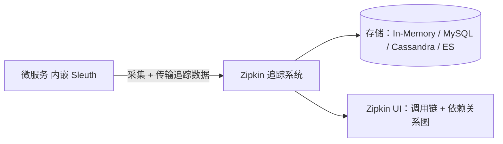
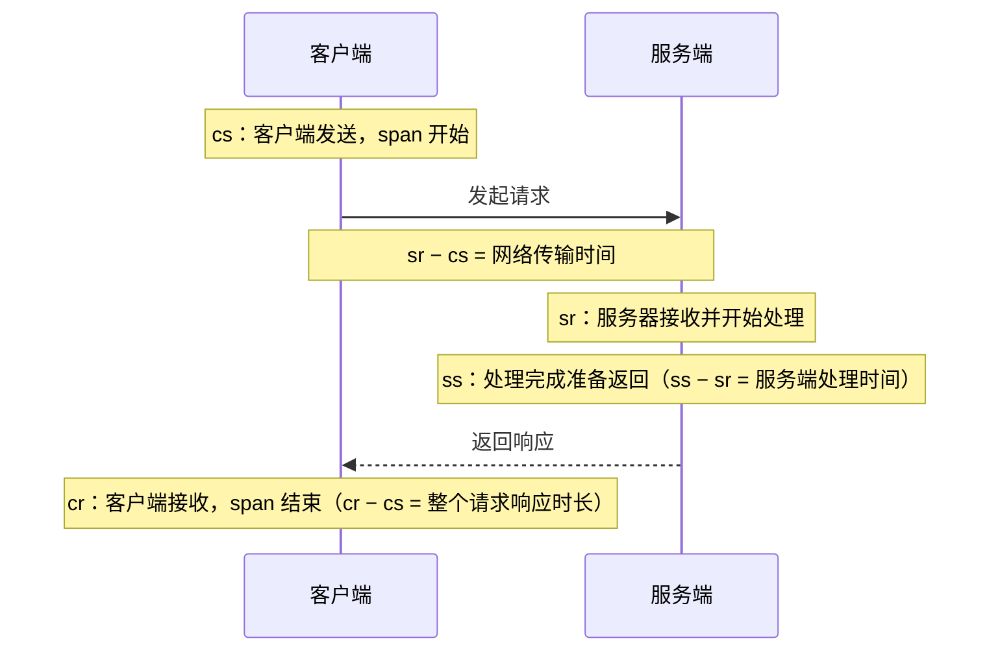

# Spring Cloud Sleuth + Zipkin 链路追踪：概念、入门到 MySQL 存储与 RabbitMQ 异步上报

微服务之间层层远程调用，日志散落在各个服务里，出了问题不知道该看谁——链路追踪就是解决这件事的。落地工具是 Spring Cloud 体系里的 Sleuth 加上开源追踪系统 Zipkin：Sleuth 嵌在微服务里采集数据，Zipkin 负责存储、分析和页面展示。这一篇按课程的推进顺序把整条线走完：认识两个组件、三个微服务跑通入门案例、看懂页面上的核心概念，最后补上两块生产化改造——MySQL 持久化存储和 RabbitMQ 异步上报。

## 先给结论

- Sleuth 是 Spring Cloud 体系中的一个模块，提供分布式链路追踪的完整方案，覆盖数据采集、传输、存储、分析、可视化全流程；捕获这些数据就能构建微服务的整个调用链视图，是调试和监控微服务的关键工具。
- 企业里一般 Sleuth + Zipkin 整合使用：Sleuth 管数据采集和传输，Zipkin 管存储、分析和 UI 展示；Zipkin 支持四种存储——In-Memory（默认）、MySQL、Cassandra、Elasticsearch。
- Sleuth 四大特点：提供链路追踪（理清服务间调用关系）、性能分析（看清每个请求各段耗时，为扩容提供依据）、数据分析优化（对频繁调用、并行调用做优化）、可视化（程序未捕获的异常在 Zipkin 界面上能看到）。
- 入门案例三步：`java -jar` 启动 zipkin-server（端口 9411），跑起 trace-1/2/3 三个微服务并依次 REST 调用，配好采样率和 Zipkin 地址；请求一次，调用链、耗时、依赖关系图全部呈现在页面上。
- 页面三个核心概念：Span 是一次远程调用（64 位 ID 唯一标识），Trace 是一系列 Span 组成的树状结构，Annotation 是 cs/sr/ss/cr 四个时间点，页面上的各项耗时全靠它们算差值。
- 两个生产化改造：存储从内存换 MySQL（官方脚本建三张表，重启数据不丢）；上报从 HTTP 换 RabbitMQ 异步（断连不丢数据，队列可积压千万级消息，高并发下性能更有优势）。

## Sleuth 与 Zipkin：分工与整合

Sleuth 的定位是"分布式链路追踪的解决方案"：用于在整个分布式系统中跟踪一个用户请求的过程，从链路数据的采集，到传输、存储、分析，再到页面可视化展示，全流程都有它。四大特点过一遍：

| 特点 | 说明 |
| --- | --- |
| 提供链路追踪 | 很清晰地看出一个请求经过了哪些服务，方便理清服务之间的调用关系 |
| 性能分析 | 很方便地看到每个请求的耗时，分析出哪些服务调用比较耗时，为扩容提供依据 |
| 数据分析优化 | 对频繁调用一个服务、或并行调用等情况，可以针对业务做一些优化措施 |
| 可视化 | 程序未捕获的异常，可以在 Zipkin 界面上看到 |

不过采集归采集，存储和展示是另一个组件的事。Zipkin 是开源的分布式跟踪系统（GitHub 地址 `https://github.com/openzipkin/zipkin`），说白了就是一个服务：跑起来之后，Sleuth 把追踪到的数据传输给它，它基于这些数据分析，最终通过 UI 界面展示出来。每个服务向 Zipkin 报告计时数据，Zipkin 根据调用关系通过 Zipkin UI 生成依赖关系图。所以企业里的标准用法是两者整合：Sleuth 负责采集和传输，Zipkin 负责存储、分析和展示。



## 入门案例：三个微服务串成一条链

### 第一步：启动 Zipkin

课程资料里提供了 Zipkin 官方的 jar 包，可以直接运行：

```bash
java -jar zipkin-server-2.12.2-exec.jar
```

启动日志里能看到服务跑在 9411 端口。浏览器访问 `http://localhost:9411`，不需要登录，能打开页面（搜索页和依赖页）就说明服务启动成功。此时页面上没有任何追踪数据——因为还没有服务向它上报。

### 第二步：导入 Maven 工程

为了演示追踪效果，资料里准备了四个 Maven 工程：`sleuth_parent` 父工程统一管理依赖并聚合三个子工程，`sleuth_client1`/`sleuth_client2`/`sleuth_client3` 是三个链路追踪客户端工程，也就是产生链路数据提供给 Zipkin 展示的微服务。调用关系是一条链：client1 通过 REST 调 client2，client2 再调 client3，client3 调到头直接返回。

父工程 pom 里两个关键坐标：

```xml
<!-- spring-cloud sleuth 支持包 -->
<dependency>
    <groupId>org.springframework.cloud</groupId>
    <artifactId>spring-cloud-starter-sleuth</artifactId>
</dependency>
<!-- spring-cloud sleuth zipkin 整合 -->
<dependency>
    <groupId>org.springframework.cloud</groupId>
    <artifactId>spring-cloud-sleuth-zipkin</artifactId>
</dependency>
```

外加普通的 spring-boot-starter-web 和 starter-test，父工程继承 spring-cloud-starter-parent。三个客户端工程的 application.yml 几乎一样，只有端口和应用名不同，以 client1 为例：

```yaml
server:
  port: 9101
spring:
  application:
    name: trace-1
sleuth:
  sampler:
    probability: 1 # 这个是收集比例，1表示100%，全部收集
zipkin:
  base-url: http://localhost:9411
```

`sampler.probability` 是采样率，配 1 表示 100% 全部收集。收集数据本身要消耗时间，考虑系统性能时不一定要把所有追踪数据都提交，生产上可以按需调低。`zipkin.base-url` 指向刚启动的 Zipkin 服务。

代码非常薄。client1 的启动类里声明了一个 RestTemplate Bean，用于发 REST 请求：

```java
@SpringBootApplication
public class Application1 {
    @Bean
    RestTemplate restTemplate() { return new RestTemplate(); }
    public static void main(String[] args) { SpringApplication.run(Application1.class, args); }
}
```

每个客户端工程里一个普通 Controller（TestClient），注入 RestTemplate 后远程调用下一个服务；client3 已经调到头，直接返回字符串即可，RestTemplate 对它可有可无：

```java
@RestController
public class TestClient {
    @Autowired
    RestTemplate restTemplate;

    @GetMapping("/trace-2")
    @ResponseBody
    public String test(HttpServletRequest request) {
        //logger.info("===call trace-3, TraceId={}", request.getHeader("X-B3-TraceId"));
        return "Trace";
    }
}
```

### 第三步：跑起来，看数据

在 IDEA 里同时选中 Application1/2/3 三个启动类右键 Run，端口分别是 9101/9102/9103，应用名 trace-1/2/3。调用前先到 Zipkin 页面点查询，确认当前没有数据。

浏览器请求 `http://localhost:9101/trace-1`，返回的 "Trace" 实际是 client3 一路远程调用后给出的。回到 Zipkin 点查询：数据出来了，整个调用过程耗时 378ms。点击"依赖"，页面上出现 trace-1 指向 trace-2、trace-2 指向 trace-3 的依赖关系图——节点名用的就是 `spring.application.name`。点节点会弹窗：所谓依赖就是调用关系，trace-1 依赖 trace-2（调用了 1 次，失败 0 次），trace-3 只被 trace-2 依赖、自己不依赖谁。真实企业里微服务十几二十个、调用关系错综复杂，在这张图上谁调用谁一目了然。

点进具体调用记录还能看到树状展开的时间明细：总耗时 378ms，其中 trace-1 调 trace-2 这段 293ms，trace-2 调 trace-3 这段 144ms。注意这些时间是包含关系不是相加——trace-2 的耗时里包含它自己调 trace-3 的时间（加上请求建立连接、响应的时间）。再刷新页面调用一次，这次只用了 30ms，展开后同样能看到 25ms 里包含着 12ms 的层级关系。

## 页面上的三个概念：Span、Trace、Annotation

看完数据，把链路追踪里最常遇到的三个概念说清楚。

**Span 是基本的工作单元。** 发送一个远程调用就会产生一个 Span：请求发出去即开始，服务端响应回来即结束。Span 由 64 位 ID 唯一标识（由 Sleuth 自动生成，不用管），还包含摘要、时间戳事件、Span 的 ID 等信息。上面那次请求中间有多次远程调用，所以产生的是多个 Span，不止一个。

**Trace 是一系列 Span 组成的树状结构**，说白了就是整个调用链条。请求一个微服务系统的 API 接口，这个接口要调用多个微服务，每调一个就产生一个新 Span，所有由这个请求产生的 Span 组成了这个 Trace。

**Annotation 用来定义一个请求的开始和结束。** 注意它跟 Java 注解不是一回事，本质是四个时间点：

| Annotation | 全称 | 含义 | 差值 |
| --- | --- | --- | --- |
| cs | client send | 客户端发起请求，表示 span 开始 | — |
| sr | server received | 服务器收到请求并开始处理 | sr − cs = 网络传输（延迟）时间 |
| ss | server send | 服务器处理完请求，准备返回数据给客户端 | ss − sr = 服务端处理请求花费的时间 |
| cr | client received | 客户端接收到处理结果，表示 span 结束 | cr − cs = 客户端接收服务端数据的整个时长 |

这四个时刻在 Zipkin 页面上都有体现：详情里的 server start / server finish / client start / client finish，每个动作都记录了发生时间，各段耗时就是拿这些时间点算差值得到的。



## 生产化改造一：MySQL 持久化存储

入门案例里 Zipkin 用的是默认存储方式——内存存储。演示一下后果：服务不重启时查询、依赖都正常；Ctrl C 停掉进程再启动，刷新页面点查询，数据全没了。实际企业应用中这些数据需要持久化，Zipkin 恰好支持四种存储，这里切到 MySQL。

第一步，建库建表。官方脚本只有建表语句，库要手动建，库名用官方建议的默认名 `zipkin`（也可以自定，启动时指定对应上即可）。建表脚本从 GitHub 上取：`openzipkin/zipkin` 仓库下的 `zipkin-storage/mysql-v1/src/main/resources/mysql.sql`，把语句复制过来执行，建出三张表：`zipkin_spans`、`zipkin_annotations`、`zipkin_dependencies`。

第二步，启动命令加参数，指定存储类型和数据库位置：

```bash
java -jar zipkin-server-2.12.2-exec.jar --STORAGE_TYPE=mysql --MYSQL_HOST=127.0.0.1 --MYSQL_TCP_PORT=3306 --MYSQL_DB=zipkin --MYSQL_USER=root --MYSQL_PASS=root
```

第三步，验证。再请求一次 trace-1，打开数据库看：`zipkin_spans` 里有三条记录，对应浏览器请求 trace-1、trace-1 请求 trace-2、trace-2 请求 trace-3 这三次调用；`zipkin_annotations` 数据最多，记录的是服务器发送、结束等一个个时刻。这些表由 Zipkin 自己维护，不需要手动操作，能在页面上看到数据就行。把 Zipkin 再重启一次，页面查询数据还在——持久化生效。

## 生产化改造二：RabbitMQ 异步上报

还剩一个问题：Sleuth 是怎么把数据发给 Zipkin 的？默认走 HTTP。新版本 Zipkin 的数据传输方式在源码的枚举里定义了三种：

```java
public enum SenderType {
    // RabbitMQ sender.
    RABBIT,

    // Kafka sender.
    KAFKA,

    // HTTP based sender.
    WEB
}
```

不配置时默认用 WEB，也就是 HTTP 直传。这种方式的问题：HTTP 不是异步的，一旦由于不可抗因素导致通信中断，这一次采集到的链路数据就丢了。换成消息中间件则不同：数据先发到 MQ 的队列里，Zipkin 下次重连时还可以继续消费，防的就是追踪数据丢失；而且 RabbitMQ 的队列可以积压千万级别的消息，随着线程增多、并发量提升，这种异步发送的方式性能更有优势。注意 Zipkin 只支持 RabbitMQ 和 Kafka 这两种 MQ，其他的不行。

改造后各微服务是生产方（往队列发追踪数据），Zipkin 是消费方（从队列取数据存 MySQL），两头的地址都要配。改造分三步。

第一步，父工程统一引入 amqp 依赖：

```xml
<dependency>
    <groupId>org.springframework.boot</groupId>
    <artifactId>spring-boot-starter-amqp</artifactId>
</dependency>
```

第二步，各微服务的 application.yml 配两处，层次不要搞反：sender 在 zipkin 下面，rabbitmq 在 spring 下面。

```yaml
zipkin:
  base-url: http://localhost:9411
  sender:
    type: rabbit   # 发送方式：rabbit / kafka / web，不配默认 web（HTTP）
spring:
  rabbitmq:
    host: 68.79.7.219
    port: 5672
    username: admin
    password: admin@2020
    virtual-host: /
```

演示用的是线上 RabbitMQ 服务，练习时在本地或自己的虚拟机里搭一个都可以。三个客户端工程都要改。

第三步，重启 Zipkin，在 MySQL 参数之外追加 MQ 参数——它是消费方，得告诉它去哪取消息：

```bash
java -jar zipkin-server-2.12.2-exec.jar --STORAGE_TYPE=mysql --MYSQL_HOST=127.0.0.1 --MYSQL_TCP_PORT=3306 --MYSQL_DB=zipkin --MYSQL_USER=root --MYSQL_PASS=root --RABBITMQ_ADDRESSES=68.79.7.219:5672 --RABBITMQ_USER=admin --RABBITMQ_PASSWORD=admin@2020 --RABBITMQ_VIRTUAL_HOST=/
```

三个微服务的配置文件也改了，所以同样要重启。之后刷新页面请求一次 trace-1，回到 Zipkin 按时间降序一查，新数据多了一条——微服务生产消息、RabbitMQ 中转、Zipkin 消费入库，整条异步上报链路跑通。

```mermaid
flowchart LR
    B[浏览器] --> T1[trace-1 :9101]
    T1 -->|REST| T2[trace-2 :9102]
    T2 -->|REST| T3[trace-3 :9103]
    T1 & T2 & T3 -->|Sleuth 采集，异步发送| Q{{RabbitMQ 队列}}
    Q -->|消费| Z[Zipkin :9411]
    Z -->[(MySQL)]
```

## 小结

- 分工记一句话：Sleuth 管采集和传输，Zipkin 管存储、分析和展示；Zipkin 一个 jar 就能跑起来，9411 端口出 UI，支持内存、MySQL、Cassandra、ES 四种存储。
- 接入成本极低：starter-sleuth 和 sleuth-zipkin 两个依赖，yml 里配采样率（probability: 1 即全采）和 base-url，RestTemplate 的远程调用自动产生链路数据，业务代码不用动。
- 概念一句话：Span 是一次远程调用，Trace 是这次请求产生的全部 Span 组成的树，Annotation 是 cs/sr/ss/cr 四个时间点，页面上的网络耗时、服务端处理耗时都是拿时间点算差值得来的。
- 默认的内存存储重启即丢，是入门案例暗藏的坑：切 MySQL 只需执行官方 mysql.sql 建 zipkin 库三张表，启动命令加 --STORAGE_TYPE=mysql 及连接参数。
- 上报链路同理可以加固：HTTP 同步传输断连即丢数据，配 starter-amqp 加 sender.type=rabbit 改走 RabbitMQ，Zipkin 启动命令追加 RABBITMQ 参数作为消费方，断连可重连续消费、千万级积压兜底，高并发下异步优势明显。
