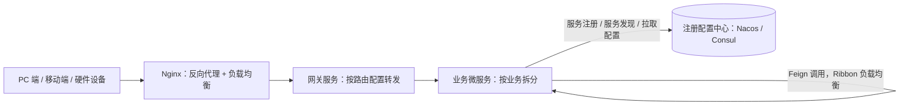

# 品达物流 TMS 项目总结：微服务架构全景收束

课程走到品达物流 TMS 的第 12 章，是项目总结。总结不抠细节——具体算法怎么算、数据怎么存、业务逻辑长什么样，前面章节都已经讲过——这一章换全局视角，用几张图把整个项目重新看一遍。本篇先交代总结的七个方面，再重点展开其中的第一块：微服务架构到底长什么样。

## 先给结论

- 第 12 章从七个方面做全局总结：微服务架构、软件架构体系、系统架构、技术架构、业务流程、数据库设计、服务列表，全都是画图讲整体，不涉及细节。
- 品达物流 TMS 是典型的微服务架构项目：前端 UI 层（PC 端、移动端、硬件设备）→ Nginx 反向代理 + 负载均衡 → 网关按路由配置转发 → 按业务拆分的微服务。
- 网关本质上也是一个微服务，同样需要注册到服务注册中心；业务微服务之间用 Feign 远程调用，底层靠 Ribbon 做负载均衡。
- 服务怎么找到彼此、配置怎么统一管理：注册中心 + 配置中心；Consul、Nacos 这类中间件已经把两者合二为一，课程用的是 Nacos。
- 运行期靠服务监控（实例是否健康、某个服务挂了能不能感知）和链路追踪（调用链非常长）保障；上线靠持续集成：代码提交 Git，Jenkins 自动拉取、打包 Docker 镜像、自动发布。
- 业务微服务背后还有一批支撑服务：分布式任务、消息队列、缓存、日志、数据存储、实时分析，分别对应 Quartz、Kafka、Redis、ELK、MySQL、Apache Druid。

## 七个视角收束整个项目

第 12 章的讲义全是一张张图，每个视角对应一张：

1. **微服务架构**——项目最核心的架构形态，下一节展开。
2. **软件架构体系**——分层模型，从上至下是应用层、服务层、基础架构/开发平台层、存储/中间件层、操作系统层。
3. **系统架构**——展示层（Web、手机 App）、统一接入网关、业务中台（订单中心、评价中心等）、基础平台（权限中心、用户中心）、技术平台（监控、运维、发布）的划分。
4. **技术架构**——按层列技术栈：前端是 Vue、JS、HTML5；交互层是 HttpClient、Feign；网关是 Spring Gateway；业务层是 Spring Boot、MyBatis-Plus；交换层是 RabbitMQ、Kafka。
5. **业务流程**——从下单到收件、派送、转运、入库、出库的完整流转，中间还有支线运输和干线运输的逻辑。
6. **数据库设计**——按职责拆库：pd_base（基础数据）、pd_users（用户数据）、pd_oms（订单数据）、pd_work（物流作业数据）、pd_aggregation（聚合数据）、pd_dispatch（智能调度数据）、pd_auth（权限数据）、customer_auth（C 端用户数据）。
7. **服务列表**——客户网关（cust-auth）、业务网关（pd-gateway），以及 pd-web-courier、pd-web-manager、pd-user、pd-redis 等一批业务服务及其调用关系。

这七张图合起来就是项目的全貌：架构怎么分、系统怎么划、技术选什么、业务怎么流、数据怎么存、服务怎么摆。

## 微服务架构：一条请求的完整路径

微服务架构图从最左侧看起。微服务属于前后端里的后端；前端一般是 UI 层，也就是用户能直接看到的部分：以前用得最多的是 PC 端，浏览器里展示；现在更多的是移动端，手机或 Pad；还有一些特殊的，比如硬件设备。这些终端都要跟后台微服务交互。

交互的第一站不是网关，是 Nginx：它做反向代理和负载均衡，把请求分发到后边。然后才到网关服务。网关本质上也是一个微服务，作用是按路由配置把请求转发到对应的某个微服务。

网关后面的微服务跟业务相关，按业务拆分。品达物流项目里就拆出了很多：基础数据微服务、订单微服务、车辆轨迹、智能调度……按业务划分成 N 多个微服务。

## 拆分之后要解决的四件事

把一个大系统按业务拆成 N 多个微服务，问题随之而来，架构图上每一块都对应一件事。

**服务之间怎么调用。** 微服务之间存在调用关系，用 Feign 发起远程调用，底层基于 Ribbon 做负载均衡。比如 ServiceA 要调 ServiceB，请求就通过这套机制发过去。

**怎么知道对方在哪、配置放哪。** ServiceA 想调 ServiceB，怎么调通、怎么知道 B 部署在什么位置？这需要服务注册中心；各服务有大量配置文件，需要配置中心统一管理。现在有些中间件把这两件事合二为一，同时具备注册中心和配置中心的能力，Consul 是这一类，课程上用的 Nacos 也是同类的产品。所有服务注册进去，调用时通过服务注册、服务发现找到目标服务。

**运行状态怎么掌握。** 服务实例是否健康？某个服务挂了之后，其他微服务能不能感知？这是服务监控的职责，图上有 Spring Boot Admin、SkyWalking 这类组件。另外整个调用过程非常长，还需要链路追踪把它们串起来。监控和追踪都有对应的中间件来实现。

**开发完怎么快速上线。** 这就是持续集成：代码提交到 Git，Jenkins 自动拉取代码、自动发布，打成 Docker 镜像自动部署，图上配套的还有 GitLab、Nexus 和容器编排 K8s。

除了这四件事，业务微服务下面还有一层支撑服务：分布式任务（Quartz）、消息队列（Kafka）、缓存服务（Redis）、日志系统（ELK）、数据存储（MySQL）、实时统计分析（Apache Druid）。它们不对前端，专门给上面的业务微服务提供支撑。

这也是微服务架构在企业里流行的原因：业务不断发展壮大、越来越复杂，按不同业务拆分成不同的微服务（就像品达物流这样）；拆分之后产生调用关系，于是需要注册中心、配置中心；微服务一般不直接面对前端，中间加上网关层按路由转发；而网关从技术层面讲本质上也是一个微服务，所以它同样要注册到服务注册中心。整张图合起来，就是这个项目、也是当下企业比较主流的微服务架构形态。

## 小结

- 项目总结的打开方式是全局视角：微服务架构、软件架构体系、系统架构、技术架构、业务流程、数据库设计、服务列表七个方面各一张图，细节回前面章节查。
- 一条请求的路径：前端 UI 层 → Nginx（反向代理 + 负载均衡）→ 网关（按路由转发）→ 按业务拆分的微服务；网关本质也是微服务，也要注册。
- 服务间调用用 Feign + Ribbon；注册与配置由 Nacos（或同类 Consul）一肩挑，服务发现靠它完成。
- 运行保障两件套：服务监控看实例健康，链路追踪串起长调用链；上线走持续集成，Git 提交后 Jenkins 自动构建发布 Docker 镜像。
- 业务微服务不是孤岛，底下有 Quartz、Kafka、Redis、ELK、MySQL、Apache Druid 一层支撑服务托着。
