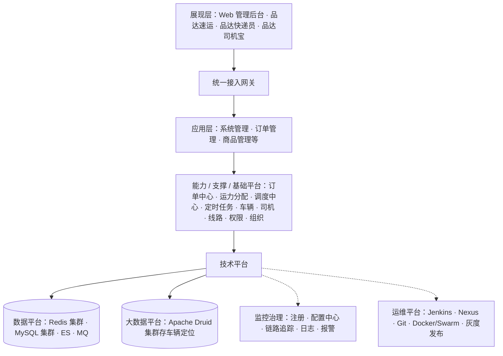
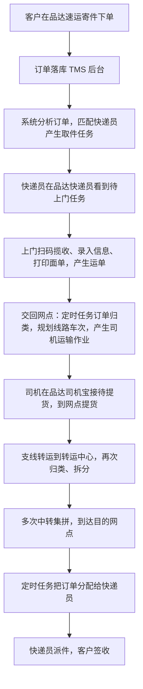

# 品达物流 TMS 开篇：项目定位、系统/技术架构、业务流程与服务全景

品达物流 TMS 是六大进阶项目中的物流行业项目，整个课程分 12 章，每章相对独立。第 1 章「项目概述和环境搭建」不写代码，先把几件大事说清楚：项目是什么、行业什么样、系统怎么分层、技术选了哪些、业务怎么流转、开发基于什么。本篇覆盖第 1 章的概述、业务需求与开发方式三部分，基础数据配置和环境搭建另起一篇。

## 先给结论

- 项目全名品达物流 TMS，TMS 即 Transportation Management System（运输管理系统），对运输作业从运力资源准备到货物抵达目的地做全流程管理；课程选的细分业态是快递。
- 系统共四个端：Web 管理后台（公司内部管理员）+ 三个 App（品达速运、品达快递员、品达司机宝），分别服务用户寄件查件、快递员取派件、司机运输任务与位置上报。
- 系统架构自上而下：展现层 → 统一接入网关 → 应用层 → 能力/支撑/基础平台 → 技术平台 → 数据平台与大数据平台，旁边配套监控治理和运维平台。
- 技术栈核心是 Spring Boot + Spring Cloud 微服务，配 MyBatis-Plus、Feign、Redisson、Drools、Otter、百度地图；支撑层用 Quartz、ElasticSearch、Kafka；注册配置中心用 Nacos，容器化用 Docker。
- 整体业务流程一条线：下单 → 揽收产生运单 → 定时任务订单归类规划线路车次 → 司机多级转运 → 目的网点分配派件 → 签收。
- 开发方式不是从零造轮子：权限、短信、文件、C 端注册登录全部调用既有的通用服务，课程专注物流业务本身。

## 项目是什么：一个 TMS，四个端

TMS 是 Transportation Management System 的首字母缩写，即运输管理系统。物流的本质是货物从 A 点到 B 点的运输过程，中间要处理运力分配（车辆、司机）、固定线路、多次中转等细节，这一整套都用 TMS 管理。它适用于各类运输公司、企业下属运输车队，主要模块包括订单管理、配载作业、调度分配、行车管理、GPS 车辆定位、车辆管理、线路管理、车次管理、人员管理、数据报表、基本信息维护。

从用户层面切，项目一共四个端：

| 端 | 应用名 | 使用者 | 主要功能 |
|---|---|---|---|
| TMS 后台系统管理端 | Web 页面 | 物流公司内部管理员（运营管理、网点管理员） | 基础数据维护、订单管理、运单管理 |
| 客户端 App | 品达速运 | 外部客户 | 寄件下单、查询物流信息 |
| 快递员端 App | 品达快递员 | 公司内部快递员 | 接收取、派件任务 |
| 司机端 App | 品达司机宝 | 公司内部司机 | 接收运输任务、上报位置信息 |

物流运输市场最普遍的四种业态是快递、快运、专线、三方，支撑着全国商品货物的流通。普通人接触最多的是快递，但它只是物流行业的一种形态：

| 业态 | 客群 | 货物特点 | 配送网络 | 典型代表 |
|---|---|---|---|---|
| 快递 | C 端个人 | 小件 | 送货上门 | 顺丰、中通、圆通、韵达 |
| 快运 | B 端为主，少量个人 | 小批量，几立方米或几十公斤，如单个沙发、桌椅 | 自建和加盟两种方式 | 德邦等快运企业 |
| 专线 | B 端（仓库、工厂、门店） | 大宗商品，按吨结算 | 社会化网络，多次中转、集拼 | 各专线公司协作 |
| 三方 | B 端 | 不直接承运 | 签运输合同，转交专线或车队司机 | 轻资产运作 |

品达物流 TMS 对应的就是第一类，快递。

## 系统架构与技术选型

系统架构按分层展示。最上面是展现层：公司内部的运营管理、网点管理员用 Web 后台，普通用户、快递员、司机分别用品达速运、品达快递员、品达司机宝三个 App。这些端本质只是界面展示，功能都来自后台，请求统一经过统一接入网关进入后台。往下依次是应用层、能力/支撑/基础平台、技术平台、数据平台、大数据平台，侧翼还有监控治理和运维平台。

数据平台里，Redis 集群放缓存，MySQL 集群存绝大部分业务数据，再配 ES 和 MQ；大数据平台的 Druid 集群存车辆定位信息，司机运输途中品达司机宝每隔几秒实时上报一次位置，后台随时能查到每个司机的车辆定位。

技术架构展现的是技术选型，同样分层：

| 层 | 技术 |
|---|---|
| 展现层 | 移动 App（安卓开发）、Web 管理后台 |
| 路由层 | Vue、Element UI、eCharts、NodeJS；网关（Nginx + Spring Cloud Gateway） |
| 应用层 | Spring Boot、Spring Cloud、JWT、MyBatis-Plus、Feign 远程调用、Redisson（分布式锁）、Drools（规则引擎）、Otter（数据同步）、GIS & Map（百度地图） |
| 支撑层 | Quartz（分布式定时任务）、ElasticSearch（搜索）、Kafka（消息） |
| 存储层 | Redis、MySQL、Apache Druid |
| 基础层 | Docker |
| 平台 | 注册与配置中心 Nacos；持续集成 Nexus、GitLab、Jenkins；监控平台 Spring Boot Admin、SkyWalking |

百度地图承担两类事：前端展示车辆轨迹；服务端调用百度地图的接口，比如计算两个点之间的距离。课程开发以后端为主，前端程序直接提供成品运行，不在课上从头写。

## 业务需求：四端原型与一条完整物流流程

业务需求部分参考随课下发的《品达物流项目产品 PRD 文档_V0.5.1.docx》，目录五块：市场调研、系统简介、系统流程图、系统功能清单、TMS 系统功能说明。

市场调研的结论是行业在高速增长：2016 年至今，平台经济和 O2O 为城际运输、同城物流、即时配送三大垂直领域带来大量需求，顺丰和三通一达先后 IPO，当年国内社会物流总费用 11.2 万亿元。业务调研强调物流是长链条、复杂交互的业务形态，功能要素包括运输、保管、装卸、包装、流通加工、配送、信息处理，其中运输是基本服务功能。

按商业类型分，物流和快递是两条线：物流针对 B 端企业，多是大宗货品，按体积收费，不送货上门需自提，费用便宜，以陆运为主；快递针对 C 端用户，是小件，按重量收费，送货上门费用较贵，有时空运。按运输范围又分城际、同城、即时配送三大市场。

产品定位上，课程设定的公司是类似顺丰的独立物流集团「品达物流集团」：下设市级分公司、一级/二级转运中心和网点，覆盖仓配、城际运输，可延伸至三方运输管理系统，服务同城、城际、零担、整车业务，面向 B/C 端客户，最终实现仓、配、人、货一体化的智能供应链生态闭环。组织架构「集团 → 市级分公司 → 一级转运中心 → 二级转运中心 → 网点」本身就是基础数据，后面要原样配置进系统：集团和市级分公司承担行政管理职能（财务、超级管理员等），网点负责快递员取派快件、集中货品等待分配调度，转运中心配管理员和调度员。系统角色分两类：客户（消费者）和公司员工（快递员、司机、调度员、仓管员、财务管理员等）。几个行业术语：3PL 第三方物流、4PL 第四方物流、SN 产品序列号、零担（一车多单）、整车（一车一单）、中转（起始地不能直达需多次中转）。

功能清单与原型分两处看。TMS 后台功能列表包括首页工作台（可视化统计图表）、组织管理（对集团、分公司、一二级转运中心、网点增删改查）、订单管理、运单管理、网点管理、转运中心管理、调度规则管理、司机作业管理、机构数据看板等，这只是四个端里的一个端。三个移动端的页面原型放在蓝湖（产品文档和设计图共享平台）上在线维护。原型里：司机端有登录、待提货、在途、我的，提货和交付要调手机相机拍照上传货物照片，在途时实时上报定位；快递员端有登录、首页（待上门、待妥投两个 tab 切换）、收件、派件、我的，快递员隶属于网点（如昌平回龙观网点）；客户端有注册登录、首页、寄件、支付、地址簿管理、网点自寄、运单详情、我的。另外各类单据编号都有业务规定的固定规则，订单、运单、取件作业、派件作业、运输任务、运输作业、车次、车型、车辆各有格式，不是随机生成就能用。

整体业务流程从寄件人下单一直到收件人签收：

几个关键点：下单页的寄件人、收件人信息可从地址簿直接调取，再选上门取件时间、货品信息、付款方式，点下单即落库；快递员揽收后产生运单，客户从此拿运单号查物流；订单归类是把目的地相同的订单归为一类，比如发往上海的一批订单归成一类去转运；转运中心再次归类时有的分天津、有的分上海、有的分南京，多次转运后到达目的网点，由定时任务把订单分配给快递员派送。

## 开发方式：基于四个通用服务做业务

一个软件的层次关系：最底层是容器、虚拟机、操作系统；往上是存储和中间件；再往上是基础框架（MyBatis、Spring、Spring Boot、Spring Cloud）和开发平台；其上是服务层和应用层；旁边配套运维（CI/CD）和监控。品达物流要开发的主要是服务层和应用层，下面的基础全部复用已有框架和服务；企业做久了就会把通用功能抽成服务或开发平台，新应用直接复用。

四个可复用的通用服务：

1. **通用权限系统**。自研的通用开发平台和权限管理平台，提供岗位、组织结构、菜单、角色、用户等基础数据维护，以及认证鉴权功能。课程里已提前部署好，登录请求走它的网关；品达物流需要的菜单先在它的系统管理里配置出来，再分配给用户和角色，登录后才能看到，第 1 章后半段的基础数据配置就在这里做。
2. **短信服务**。移动端登录常用短信验证码，各短信平台调用方式不同，课程整合主流平台提供统一的短信服务，TMS 直接对接。品达快递员登录页输入手机号点「获取验证码」，请求的就是它。
3. **文件服务**。文件上传下载是常见功能，存储方式有本地存储、FastDFS、云存储（阿里云、腾讯云、七牛云），处理方式各不相同。通用文件服务把它们整合起来，对外暴露统一接口；切换存储只改文件服务自己的配置，调用端代码一行不改。快递员端上传的文件、图片都走它。
4. **注册登录服务**。针对 C 端用户的通用注册登录服务，客户端 App 用它完成注册和登录（手机号 + 验证码）。

真正进入 TMS 开发后，要专注的是物流核心业务；认证鉴权、发短信、文件上传、C 端注册登录，全部以接口调用交给已有服务或平台完成。

## 小结

- 品达物流 TMS = Transportation Management System，做运输全流程管理，课程取快递这一业态；四个端是 Web 后台、品达速运、品达快递员、品达司机宝。
- 系统架构从展现层经统一接入网关下探到应用层、三大平台、技术平台、数据平台（Redis/MySQL/ES/MQ）和大数据平台（Druid 存车辆定位），监控治理与运维平台在侧翼支撑。
- 技术栈以 Spring Boot + Spring Cloud 为骨架，MyBatis-Plus、Feign、Redisson、Drools、Otter、百度地图各司其职，支撑层 Quartz + ES + Kafka，注册配置中心 Nacos，部署靠 Docker。
- 业务需求看两份材料：PRD 文档给市场与系统全貌（物流/快递的分野、组织架构、角色、术语、功能清单），蓝湖原型给四个端的具体页面。
- 整体业务流程是「下单 → 揽收产生运单 → 订单归类 → 司机多级转运 → 网点分配派件 → 签收」的闭环，订单归类和任务分配靠定时任务驱动。
- 开发方式是复用四个通用服务（通用权限、短信、文件、注册登录），课程只开发物流核心业务，这也是企业基于积累做开发的常态。
