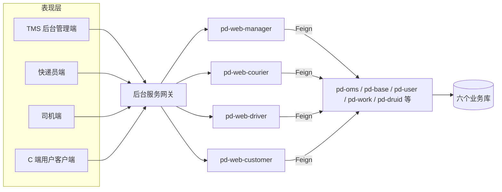

# TMS 基础数据配置五步 + 开发环境搭建（MySQL/Nacos/Maven 初始工程）

第 1 章后半段做两件事，都是为后面写代码铺路：一是把品达物流要用的基础数据录入通用权限系统，组织、菜单权限、岗位、角色、用户五类；二是把 TMS 开发环境搭起来，六个 MySQL 业务库、Nacos 配置中心、Maven 初始工程，外加 settings.xml 的私服配置。环境搭完，后续章节就在这套东西之上开发物流核心业务。

## 先给结论

- 基础数据全部配在已提前部署好的通用权限系统里，五类依次是组织、菜单与权限、岗位、角色、用户；每类既能在页面手动录，也有配套 SQL 脚本一键导入。
- 组织是树形结构（集团 → 分公司 → 一/二级转运中心 → 网点），落 pd_core_org 表；菜单落 pd_auth_menu，权限是接口级资源，落 pd_auth_resource（资源表）。
- 角色是权限中枢：角色先配置菜单、再关联菜单下的权限，用户最后被授权角色；新建用户默认密码 123456，只给菜单不给权限时登录后看得见菜单、点不出数据。
- 数据库按业务拆六个：pd_aggregation（聚合）、pd_base（基础）、pd_dispatch（定时任务/智能调度）、pd_oms（订单）、pd_users（C 端用户）、pd_work（作业），脚本与库一一对应执行。
- Nacos 先建「品达-TMS」命名空间，再一次性导入 12 个配置文件，命名规则 pd-服务名-dev.yml；Nacos 同时充当注册中心和配置中心。
- Maven 初始工程 pinda-tms-java 直接导入 IDEA：pd-web 下四个子工程对应四个端，经网关进来后 Feign 调服务层微服务；pd-auth-entity、pd-auth-api 两个 jar 不在中央仓库，settings.xml 必须配私服。

## 基础数据配置：五类数据录入通用权限系统

五类数据的入口、落表和脚本一张表看完：

| 数据 | 系统管理入口 | 数据库表 | 初始化脚本 | 要点 |
|---|---|---|---|---|
| 组织 | 组织管理 | pd_core_org | pd_core_org.sql | 组织类型：分公司、一级/二级转运中心、网点 |
| 菜单、权限 | 菜单配置 | pd_auth_menu / pd_auth_resource | pd_auth_menu.sql、pd_auth_resource.sql | 菜单挂权限，权限即资源 |
| 岗位 | 岗位管理 | pd_core_station | pd_core_station.sql | 司机、快递员、员工 |
| 角色 | 角色管理 | pd_auth_role | pd_auth_role.sql | 建完要配置菜单、关联权限 |
| 用户 | 用户管理 | pd_auth_user | pd_auth_user.sql | 默认密码 123456，建完要授权角色 |

组织机构是树形的：根节点品达物流集团有限公司，下面挂上海分公司、北京分公司、品达内蒙古分中心等；分公司下是一级转运中心（如赤峰市一级转运中心），个别地方还有二级转运中心，转运中心下再挂一个个网点。不管集团、分公司、转运中心还是网点，都是一条组织记录，全存 pd_core_org 这一张表。手动新增时填上级名称（顶级没有上级）、组织名称、组织类型、地址、联系电话即可；课上直接执行脚本把整棵树一次性导入。

菜单配置页面左侧是菜单树，中间表单录入或修改菜单，右侧给菜单挂权限。菜单分一级、二级乃至多级，配好后登录系统左侧出现的「品达物流」菜单及其子菜单（机构作业范围、订单、订单列表等），就是从菜单表动态查出来的。权限其实是接口级的资源，比如机构作业范围菜单下挂了获取机构数、机构范围详情、保存机构范围三个权限，订单列表下的权限更多。

岗位就是一个列表页，「更多 → 添加」录入岗位名称、组织、描述；组织下拉选项正好来自刚导入的组织结构。项目里常用的岗位是司机、快递员、员工，员工指网点或转运中心的内部人员。

角色要录入编码、名称、状态、描述、数据范围，系统里已有平台管理员、普通员工、部门经理等角色。角色建完有两步关联，这是本节的核心：第一步「配置」勾选菜单，平台管理员几乎全勾，测试角色只勾品达物流，被分配该角色的用户登录后只看得到品达物流这组菜单，系统管理、监控都看不见；第二步关联菜单下的权限，只给菜单不给权限时页面能点开但数据出不来（机构作业范围页需要「获取机构数」权限）。具体给哪些权限由业务定：超级管理员全给，普通用户可能只有订单列表下的几个权限。

用户录入账号、姓名、密码（默认 123456）、组织、岗位、性别、状态。用户新建后还不能登录，因为没分配角色，要到角色管理的「授权」里把用户加进某个角色的已选成员。课上完整走了一遍链路：新建 user001（张三）授权测试角色 001，登录后只见品达物流菜单，机构作业范围暂无数据；超级管理员把测试角色的机构作业范围、订单列表权限补勾上，user001 再登录就能看到组织机构树和订单列表的测试数据，而运单列表仍无数据，因为那个权限没给。用户量不大，手动录或执行脚本都行。

## 数据库环境与配置中心：六个库加 12 个配置

数据库按业务划分建六个库，资料给六个 SQL 脚本，文件名与库名一致，在对应库里执行建表语句（先 drop table if exists 再 create）。建在本地或远程服务器都行，脚本千万别执行错库。

| 数据库 | 存什么 | 要点 |
|---|---|---|
| pd_aggregation | 聚合数据 | 用 Otter 数据同步把多库的表聚合到一个库，避免跨库查询；含区域、司机作业、车队、订单、运单、运输任务、车辆等表，其中组织机构、岗位两表从通用权限库同步过来 |
| pd_base | TMS 基础数据 | 车队、车辆、线路、线路类型、车次、司机、驾驶证、行驶证、货物类型、机构作业范围、快递员作业范围等，是整个项目运行的地基 |
| pd_dispatch | 定时任务数据 | QRTZ_ 开头的大写表是 Quartz 框架自带表结构；自定义表承接智能调度：订单归类、路线规划、分配司机、产生运输作业 |
| pd_oms | 订单数据 | 订单表、规则、订单位置信息、货物信息 |
| pd_users | C 端用户数据 | 只有 pd_member 会员表和 pd_address_book 地址簿两张表 |
| pd_work | 作业数据 | 司机作业、快递员取派件任务、运单、运输任务；定时任务的计算结果落这里，快递员、司机登录手机端就能看到自己的任务 |

配置中心用 Nacos，装在远程服务器或本地都可以。先建命名空间：名称「品达-TMS」，描述品达物流项目配置文件，ID 留空自动生成（类似 UUID），这个 ID 马上要用。然后在配置列表点「导入配置」，把资料 Nacos 配置中心目录里的压缩包一次性导入，共 12 个配置文件。

配置文件与微服务一一对应，命名规则是 pd-服务名-dev.yml：pd-user-dev.yml 对应 pd-user 微服务，dev 表示开发环境；同类的还有 pd-oms-dev、pd-base-dev、pd-work-dev、pd-netty-dev、pd-druid-dev，以及 pd-web-courier-dev（快递员端）、pd-web-manager-dev（后台管理端）、pd-web-customer-dev（客户端）、pd-web-driver-dev（司机端）。具体内容用到哪个服务再回头查详情。注意 Nacos 除了当配置中心，也当注册中心。

工程侧的对应改动在 bootstrap 配置：每个模块有总的 bootstrap.yml，里面 profiles.active: dev 决定激活 bootstrap-dev.yml；后者通过 spring.cloud.nacos 配置 discovery（注册中心：server-addr、group、namespace）和 config（配置中心：同一组参数）。要改的就是两处 namespace，换成新建命名空间的 ID：

```yaml
spring:
  cloud:
    nacos:
      discovery:                 # 服务注册中心
        server-addr: nacos地址:8848
        namespace: 品达-TMS 的命名空间 ID
      config:                    # 配置中心
        server-addr: nacos地址:8848
        namespace: 品达-TMS 的命名空间 ID
```

server-addr 按自己的 Nacos 安装地址改，端口默认 8848。另外这套环境用的 Nacos 是开了鉴权的新版本（1.3），连接配置中心还要配用户名密码。改完之后启动的服务就会注册到新命名空间；没启动前，Nacos 服务列表在该命名空间下是空的。

## Maven 初始工程：模块地图、调用链与私服

TMS 开发不从零建工程，直接导入资料里提供好的初始工程 pinda-tms-java。建议先复制一份到自己的 ideaProjects 目录再打开，不要在原始目录上操作。第一次打开会很慢，pom 依赖多，要从中央仓库联网下载；打开后仪表盘里能看到各个微服务的启动类。模块定位如下：

| 模块 | 定位 | 对应数据库 |
|---|---|---|
| pd-aggregation | 聚合微服务，需启动 | pd_aggregation |
| pd-base | 基础数据微服务：车辆、货物类型、线路、线路类型等 | pd_base |
| pd-oms | 订单微服务，需启动 | pd_oms |
| pd-user | C 端用户微服务，需启动 | pd_users |
| pd-work | 作业微服务：取派件任务、司机作业 | pd_work |
| pd-dispatch | 智能调度微服务，需启动 | pd_dispatch |
| pd-druid | 从 Apache Druid 查询车辆、快递员的定位信息 | — |
| pd-netty | 接收快递员、司机上报的位置，写入 Kafka，再摄取进 Druid | — |
| pd-common | 通用工具 jar：工具类、JSON 转换、异常、枚举、上下文，被依赖不启动 | — |
| pd-service-api | Feign 接口与实体（domain）定义 jar，按业务拆 aggregation/base/oms/user/work 子模块 | — |
| pd-web | 父工程，下分 courier、customer、driver、manager 四个微服务 | — |

命名很规范：微服务和它操作的数据库能对上的，就用同一个名字。四个端的调用关系是一条链：



四个端属表现层，请求先过网关，路由到应用层的四个 pd-web 微服务；它们不直接操作数据库，通过 Feign 调服务层微服务取数，比如查订单就调 pd-oms。Feign 接口提前定义在 pd-service-api 里，例如聚合服务里分页查询快递任务的接口：

```java
@FeignClient(name = "pd-aggregation")
@RequestMapping("appCourier")
@ApiIgnore
public interface AppCourierFeign {

    @PostMapping("page")
    PageResponse<TaskPickupDispatchDTO> findByPage(@RequestBody AppCourierQueryDTO dto);
}
```

父工程 pom 继承 Spring Boot 的 spring-boot-starter-parent，packaging 为 pom，modules 聚合全部子模块；各框架版本号统一收在 properties，dependencyManagement 管住 Spring Cloud 版本，子工程 pom 的依赖坐标都已整理好，开发时不用再调：

```xml
<properties>
    <java.version>1.8</java.version>
    <spring-boot.version>2.2.5.RELEASE</spring-boot.version>
    <spring-cloud.version>Hoxton.SR3</spring-cloud.version>
    <spring-cloud-alibaba.version>2.2.1</spring-cloud-alibaba.version>
    <mybatis-plus.version>3.3.0</mybatis-plus.version>
    <druid.version>1.1.23</druid.version>
    <swagger.version>2.9.2</swagger.version>
</properties>
```

最后一步是 Maven 的 settings.xml（安装目录 conf 下，Maven 3.5.4）。初始工程引用了通用权限系统提供的两个 jar：pd-auth-entity 和 pd-auth-api，它们不在 Maven 中央仓库，而已部署到私服（用阿里云云效服务搭建）；不配私服，工程连编译都过不了。照资料提供的 settings 文件原样复制，不要手敲：两个 server（release 发布版、snapshots 快照版，用户名密码相同）、阿里云镜像、profile 仓库配置，再用 activeProfiles 激活：

```xml
<mirror>
    <id>aliyun</id>
    <mirrorOf>central</mirrorOf>
    <name>阿里云公共仓库</name>
    <url>https://maven.aliyun.com/repository/public</url>
</mirror>
<profile>
    <id>rd</id>
    <pluginRepositories>
        <pluginRepository>
            <id>rd-releases</id>
            <url>https://maven.aliyun.com/repository/330518-release</url>
            <releases><enabled>true</enabled></releases>
            <snapshots><enabled>false</enabled></snapshots>
        </pluginRepository>
        <pluginRepository>
            <id>rd-snapshots</id>
            <url>https://maven.aliyun.com/repository/330518-snapshot</url>
            <releases><enabled>false</enabled></releases>
            <snapshots><enabled>true</enabled></snapshots>
        </pluginRepository>
    </pluginRepositories>
</profile>
<activeProfiles>
    <activeProfile>rd</activeProfile>
</activeProfiles>
```

配置完把两个依赖坐标补上版本号 1.0.0，粘到 pd-user 的 pom 里：

```xml
<dependency>
    <groupId>com.iteima</groupId>
    <artifactId>pd-auth-entity</artifactId>
    <version>1.0.0</version>
</dependency>
<dependency>
    <groupId>com.iteima</groupId>
    <artifactId>pd-auth-api</artifactId>
    <version>1.0.0</version>
</dependency>
```

刷新 Maven，两个 jar 会从私服下载到本地仓库；没有这段私服配置就只能去中央仓库找，而中央仓库里不会有。

## 小结

- 五类基础数据（组织、菜单权限、岗位、角色、用户）全部进通用权限系统，页面能录、脚本能导，落 pd_core_org、pd_auth_menu、pd_auth_resource、pd_core_station、pd_auth_role、pd_auth_user 六张表。
- 权限链路是「用户 → 角色 → 菜单 + 权限」：角色配置菜单决定登录能看见什么，角色关联接口权限决定页面能不能出数据；新建用户默认密码 123456，授权角色后才能登录。
- 六个业务库按职责拆分：聚合库靠 Otter 同步解决跨库查询，pd_dispatch 里 QRTZ_ 大写表是 Quartz 自带结构，作业数据落 pd_work 供两端 App 展示。
- Nacos 一物两用（注册中心 + 配置中心）：先建品达-TMS 命名空间，再导 12 个 pd-服务名-dev.yml，工程 bootstrap-dev.yml 里换 namespace ID 即可切换。
- 初始工程 pinda-tms-java 十来个模块职责清晰：pd-web 四子工程对四端，pd-common 与 pd-service-api 是 jar 不是服务，服务层微服务与数据库同名对应。
- 私服是编译的前置条件：settings.xml 照抄资料的配置（镜像 + profile + 激活），pd-auth-entity、pd-auth-api 两个权限系统 jar 只能从私服拉。
