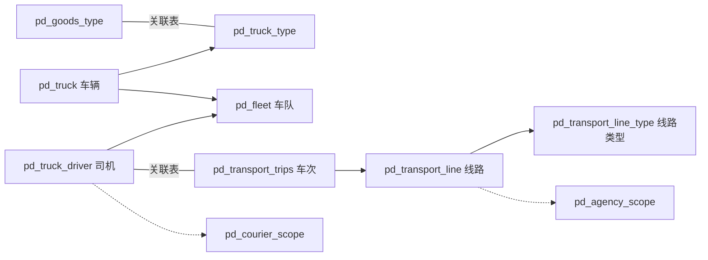

# TMS 基础数据服务开篇：14 张表数据模型、开发准备与货物类型管理（上）

第 2 章正式进入业务开发：基础数据微服务 pd-base，负责货物类型、车型、车队、车辆这些 TMS 底层数据的维护。它是整个物流链路的地基——pd-base 不就绪，后面的调度、作业都没法做。本章路线是五步：先过一遍 14 张表的数据模型，再做开发准备（配置、启动类、配置类、Id 生成器），然后以货物类型管理为例把接口开发完整走一遍，后接 Hibernate Validator 数据校验，最后把其余基础数据代码直接导入。本篇覆盖前三步，货物类型管理讲到「新增」接口落地为止。

## 先给结论

- 基础数据服务对应 pd-base 工程和 pd_base 库，一共 14 张表；读表结构的重点是关联字段——车次挂线路、车辆司机挂车队、司机来自通用权限系统的用户表。
- 线路是静态概念（点对点路径），车次才是排班（某线路上的班次，period 支持 1 天/2 周/3 月为周期）；作业范围用 multi_points 一串坐标点围出不规则区域，光有行政区域 ID 不够。
- 开发准备的配置文件初始工程已备好：工程内配置项绝大部分写成 `${...}` 占位符，值从 Nacos 配置中心的 pd-base-dev.yml 动态取；改配置只改配置中心重新发布，代码零改动。
- 两个配置类都是模板套路：MybatisPlusConfig 注册 PaginationInterceptor 分页插件；SwaggerConfig 加 @EnableSwagger2、继承 WebMvcConfigurationSupport 并重写 addResourceHandlers，防止 swagger-ui.html 被 Spring MVC 拦截。
- Id 生成器 CustomIdGenerator 实现 MyBatis-Plus 的 IdentifierGenerator 接口，内部用 pd-common 提供的 IdWorker（机器 ID、数据中心 ID 各占 5 位、序列号 12 位的雪花结构）产生唯一主键，配合 IdType.INPUT 使用。
- 货物类型「新增」要一次写两张表：pd_goods_type 存主数据，pd_truck_type_goods_type 存车辆类型关联（前端可勾选多个车型）；DTO 与实体用 BeanUtils.copyProperties 双向拷贝，保存后把生成的 ID 回填给前端。

## 数据模型：pd_base 库的 14 张表

基础数据微服务提供的维护能力，落到 pd_base 库就是 14 张表。先整体过一遍，混个脸熟，后续开发就是围着这些表转：

| 表 | 含义 | 关键字段 / 要点 |
|---|---|---|
| pd_goods_type | 货物类型 | name、default_weight 默认重量（千克）、default_volume 默认体积（方）、remark、status（0 禁用 1 正常） |
| pd_truck_type | 车辆类型 | allowable_load 准载重量、allowable_volume 准载体积、measure_long/width/high 长宽高 |
| pd_truck_type_goods_type | 车辆类型-货物类型关联表 | truck_type_id + goods_id，表达什么车拉什么货 |
| pd_transport_line_type | 线路类型 | type_number 编号、start_agency_type / end_agency_type 起止机构类型 |
| pd_transport_line | 运输线路 | agency_id 所属机构、transport_line_type_id、起止机构 ID、距离、成本、预计运行时间 |
| pd_transport_trips | 车次 | 发车时间、所属线路 ID、period 周期（1 天 / 2 周 / 3 月） |
| pd_fleet | 车队 | 司机与车辆的归属单位 |
| pd_truck | 车辆 | truck_type_id、fleet_id、brand、license_plate 车牌号、device_gps_id、准载重量/体积 |
| pd_truck_license | 车辆行驶证 | engine_number 发动机编号、强制报废日期、检验有效期、整备质量、运输证编号 |
| pd_truck_driver | 司机 | user_id 关联权限系统用户、fleet_id 所属车队、age、picture、driving_age 驾龄 |
| pd_truck_driver_license | 司机驾驶证 | user_id、准驾车型、初次领证日期、有效期限、驾驶证号、驾龄 |
| pd_transport_trips_truck_driver | 车次-司机关联表 | truck_id 车辆、trips 车次 ID、user_id 司机 |
| pd_agency_scope | 机构作业范围 | agency_id + area_id 行政区域 + multi_points 坐标点 |
| pd_courier_scope | 快递员作业范围 | user_id + area_id + multi_points，范围比网点更小 |

核心关联关系一图看完：



几张表的业务逻辑值得展开。货物类型是最基础的数据：寄件下单时必须选择货物类型（服饰、食品、数码产品、书籍等），每种类型都预设默认重量和默认体积，比如海产品、药品要求冷链车运输，车厢要像冰柜一样能制冷，这就是车辆类型和货物类型之间要有关联表的原因。

线路类型用起止机构类型区分：网点到网点、网点到转运中心（多为城际或市内路线），转运中心到转运中心（长途干线），例如金燕龙网点到顺义转运中心是一种类型，顺义转运中心到上海某转运中心又是另一种。线路必须挂在某个机构下（agency_id），并关联一种线路类型。只有线路还不行，线路是静态的点对点路径，类似公交车的固定路线；车次才对应排班——一条线路上 1 点、2 点、3 点各发一班车，每个车次由一个司机驾驶一辆车执行，所以车次表里每天十个车次就是十条记录，再通过关联表绑到具体司机。

作业范围是空间数据：一个网点的服务区域可能只覆盖附近几个小区和街道，海淀这样的行政区域太大、下面有很多网点，所以除了 area_id 还要存 multi_points——一系列坐标点连成的不规则闭合区域，落在区域内就归该网点负责。快递员作业范围同理，只是把网点负责的范围再切一块分给个人。

## 开发准备：动态配置、两个配置类与 Id 生成器

Spring Boot 配置在导入的初始工程里已经全部写好，浏览一遍即可。启动最先加载 bootstrap.yml：

```yaml
server:
  port: 8185
  uri-encoding: UTF-8
  max-threads: 1000
  connection-timeout: 50000ms

spring:
  application:
    name: pd-base               # 应用名，决定去配置中心读哪份配置
  profiles:
    active: dev                 # dev 开发 / test 测试 / prod 生产
  main:
    allow-bean-definition-overriding: true
```

active 为 dev 意味着还会加载 bootstrap-dev.yml，里面除了 nacos 的 discovery、config 两段连接配置（server-addr、group、namespace），剩余配置项几乎全是 `${...}` 占位符：

```yaml
spring:
  jackson:
    time-zone: ${spring.jackson.time-zone}
    date-format: ${spring.jackson.date-format}
  datasource:
    type: ${spring.datasource.druid.type}
    driver-class-name: ${spring.datasource.druid.driver-class-name}
    url: ${spring.datasource.druid.url}
    username: ${spring.datasource.druid.username}
    password: ${spring.datasource.druid.password}

mybatis-plus:
  mapper-locations: ${mybatis-plus.mapper-locations}   # mapper XML 都放 classpath*:mapper 目录
```

占位符类似三目表达式风格的动态取值：启动时按 key 去 Nacos 配置中心找同名的 `spring.jackson.time-zone` 等配置项，取到值再赋给属性，最终封装成 JacksonProperties 这类配置属性对象。读取哪份配置由应用名加环境拼出来——pd-base 加 dev 就是 pd-base-dev.yml。这样设计的好处是：要调参数只改配置中心里的配置、点发布即可，代码一行不动，可维护性明显更强。

启动类 BaseApplication 第一章已经写好（@SpringBootApplication + @EnableDiscoveryClient + main），这里直接复用。真正要新写的是两个配置类，都放在 config 包下。MybatisPlusConfig 注册分页插件：

```java
@Configuration
public class MybatisPlusConfig {

    @Bean
    public PaginationInterceptor paginationInterceptor() {
        return new PaginationInterceptor();
    }
}
```

类被 @Configuration 扫描到，方法上的 @Bean 把实例放进 Spring 容器，MyBatis-Plus 做分页查询时就会用上这个拦截器。SwaggerConfig 稍长，固定套路是三段：

```java
@Configuration
@EnableSwagger2
public class SwaggerConfig extends WebMvcConfigurationSupport {

    @Bean
    public Docket createRestApi() {
        return new Docket(DocumentationType.SWAGGER_2)
                .apiInfo(apiInfo())
                .select()
                .apis(RequestHandlerSelectors.basePackage("com.itheima.pinda.controller"))
                .paths(PathSelectors.any())
                .build();
    }

    private ApiInfo apiInfo() {
        return new ApiInfoBuilder()
                .title("品达物流管理后台基础数据-Swagger文档")
                .version("1.0")
                .build();
    }

    @Override
    protected void addResourceHandlers(ResourceHandlerRegistry registry) {
        registry.addResourceHandler("/swagger-ui.html")
                .addResourceLocations("classpath:/META-INF/resources/");
        registry.addResourceHandler("/webjars/**")
                .addResourceLocations("classpath:/META-INF/resources/webjars/");
    }
}
```

Docket 里最关键的是 basePackage 指定扫描 controller 包；继承 WebMvcConfigurationSupport 是为了拿到它的生命周期方法，重写 addResourceHandlers 注册 swagger-ui.html 和 webjars 静态资源，防止 Spring MVC 把文档页面拦截掉。这类配置代码本质上是「配置文件的另一种形态」，手敲没有意义，直接抄、能看懂、会改造就够了——真正的工作量在业务代码上，那是模板化不了的。

Id 生成器是个小工具类，放在 common 包下：

```java
@Component
public class CustomIdGenerator implements IdentifierGenerator {

    @Bean
    public IdWorker idWorker() {
        return new IdWorker(1, 1);   // 机器 ID 与数据中心 ID 各传 1
    }

    @Autowired
    private IdWorker idWorker;

    @Override
    public Long nextId(Object entity) {
        return idWorker.nextId();
    }
}
```

实现的是 MyBatis-Plus 提供的 IdentifierGenerator 接口，唯一要实现的方法是 nextId。真正产 ID 的是 pd-common 工具包里的 IdWorker，一个分布式自增 ID 组件：内部按时间戳、5 位 workerId（工作机器 ID）、5 位 datacenterId（数据中心 ID）、12 位序列号切分位数，同毫秒内序列号递增，synchronized 保证并发安全，时钟回拨直接抛异常拒绝。@Bean 创建、@Autowired 注入之后，任何 controller 或 service 拿到 CustomIdGenerator 调 nextId 就能得到唯一 ID。这正好呼应实体类里 IdType.INPUT 的主键策略——ID 不靠数据库自增，由应用侧生成。

## 货物类型管理上半：原型、实体与新增接口

货物类型管理从业务需求和产品原型起步。原型由产品经理在蓝湖上设计管理，后台菜单里的「货品类型」页面长这样：顶部两个搜索框（静态原型，点了没反应，只为说明功能），新增按钮弹出新增页面，下方列表支持分页、删除、修改，还有一个刷新按钮。它对应的数据模型就是 14 张表里的 pd_goods_type：名称、默认重量（千克）、默认体积（方）、说明、状态，结构非常简单。

第一个动作是导入实体类。在 entity.base 包下创建 PdGoodsType，属性与表字段一一对应：

```java
@Data
@TableName("pd_goods_type")
public class PdGoodsType implements Serializable {

    private static final long serialVersionUID = 1L;

    @TableId(value = "id", type = IdType.INPUT)
    private String id;
    private String name;
    private BigDecimal defaultWeight;
    private BigDecimal defaultVolume;
    private String remark;
    private Integer status;
}
```

@Data 由 Lombok 生成 getter/setter 和常用构造方法，大幅省代码；@TableName 指定映射表名；@TableId 标注主键并把生成策略定为 INPUT——主键值由自定义 Id 生成器提供；其余属性与字段完全同名，@TableField 都可以省。因为新增货物类型时要关联车辆类型，关联表 pd_truck_type_goods_type 的实体也要建，放在 entity.truck 包下：PdTruckTypeGoodsType，同样三件套注解，属性只有 id、truckTypeId、goodsTypeId 三个。

接着搭 Controller 骨架。GoodsTypeController 加 @RestController 和 @RequestMapping（按规范以 base 开头，路径 base/goodsType），再加 @Api(tags = "货物类型管理") 给 Swagger 分组。新增方法先用最简形态测通：

```java
@PostMapping
@ApiOperation(value = "添加货物类型")
public GoodsTypeDto saveGoodsType(@RequestBody GoodsTypeDto goodsTypeDto) {
    // 新增货物类型，同时关联车辆类型
    return null;
}
```

入参和返回值都定义为 GoodsTypeDto——DTO 即数据传输对象，类放在 pd-service-api 模块里，初始工程已经提供，属性对应前端表单要提交和展示的字段（名称、默认重量、默认体积、说明以及车辆类型 ID 集合 truckTypeIds）。@PostMapping 值留空串，POST 到类级路径即可命中；@ApiOperation 描述方法用途。启动前必须确认 Nacos 处于运行状态，因为服务要连它拿配置并注册；启动成功后访问 localhost:8185/swagger-ui.html，能看到「货物类型管理」分组和「添加货物类型」接口。此时响应不明显，原因是方法返回 null，等补完逻辑就能看到返回值。

最后是 service 层。坚持面向接口编程，service 包按 base 和 truck 拆两层：IPdGoodsTypeService 定义 PdGoodsType saveGoodsType(PdGoodsType)，操作货物类型表；IPdTruckTypeGoodsTypeService 定义 void batchSave(List<PdTruckTypeGoodsType>)，批量保存关联表——之所以是批量，因为 DTO 里的 truckTypeIds 是 List，新增一个货物类型可能一次关联多种车辆类型，每种对应关联表里一条记录。两个接口用 @Autowired 注入 Controller；只有接口没有实现类时 IDEA 会标红，把注入检查级别降为 warning 即可先往下写，实现类后面必然要补。

方法完整逻辑三步。第一步保存主表：new 一个 PdGoodsType，BeanUtils.copyProperties(dto, entity) 把 DTO 属性拷给实体，调 goodsTypeService.saveGoodsType 保存并接收带 ID 的返回值。第二步组装关联记录：取 getTruckTypeIds()，判空（为 null 或 size 为 0 就跳过），然后 stream 流处理——map 里对每个 truckTypeId new 一个 PdTruckTypeGoodsType，goodsTypeId 取主表保存后实体的 getId()（ID 已由 IdWorker 生成回填），truckTypeId 用遍历变量，collect(Collectors.toList()) 收集成 List 交给 batchSave。第三步反向拷贝返回：再调一次 BeanUtils.copyProperties(entity, dto)，方向反过来，把保存后产生的 ID 回填进 DTO 再返回。前端提交的表单里根本没有 ID 输入框，DTO 过来时不带 ID，但前后端约定好返回值要带回去，前端可能拿它做后续操作。到这里 Controller 写完，下一步补 service 实现类之后才能联调。

## 小结

- 第 2 章开发基础数据微服务 pd-base：14 张表的数据模型是全部后续业务的支撑，读表结构优先盯关联字段——车次挂线路、车辆司机挂车队、司机 user_id 指向通用权限系统的用户。
- 线路与车次是两个概念：线路是静态路径，按起止机构类型（网点/转运中心）分线路类型；车次是排班，period 支持 1 天/2 周/3 月，由司机关联表绑到具体人。
- 作业范围表用 area_id 加 multi_points 坐标点表达不规则服务区域，机构作业范围管网点、快递员作业范围管个人，后者是前者的一部分。
- 配置动态化是工程基调：bootstrap.yml 定应用名与环境，bootstrap-dev.yml 里 `${...}` 占位符全部从 Nacos 的 pd-base-dev.yml 取值，改配置不改代码。
- 配置类抄模板即可：MybatisPlusConfig 出分页插件，SwaggerConfig 出 Docket + ApiInfo + 静态资源映射；CustomIdGenerator 实现 IdentifierGenerator，靠 IdWorker 雪花结构出唯一 ID，配合 IdType.INPUT 主键。
- 新增货物类型一次写两表：主表 PdGoodsType 与关联表 PdTruckTypeGoodsType（truckTypeIds 批量组装），DTO 与实体两次 BeanUtils.copyProperties，把服务端生成的 ID 带回前端。
