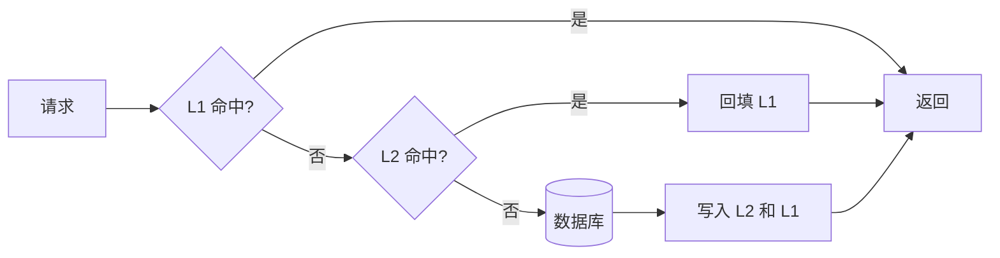

# 用户服务开篇：j2cache 多级缓存入门六连与数据模型、开发准备

第三章开发用户服务，对应 pd-user 工程。动工前先学一个新框架 j2cache——课程用六个视频从框架介绍一路讲到入门案例实测，之后过一遍用户服务的数据模型和开发准备。本篇把这条主线收拢：框架是什么、怎么配、怎么用、项目里怎么落。

## 先给结论

- j2cache 是 OSChina（开源中国）正在使用的两级缓存框架，不重复造轮子而是做资源整合：L1 进程内缓存（caffeine/ehcache），L2 集中式缓存（Redis/Memcached），数据读取顺序 L1 → L2 → DB。
- 两级分工针对一个痛点：大量缓存读取会让 L2 的网络成为整个系统的瓶颈，L1 的目标就是降低对 L2 的读取次数；框架主要用于集群环境，单机也能用——避免应用重启导致 ehcache 缓存数据丢失。
- 1.3.0 版本起支持 JGroups 和 Redis Pub/Sub 两种缓存事件通知；案例用的是 Redis 发布订阅（SpringRedisPubSubPolicy）。
- 入门工程 j2cache_demo 的全部家当：Spring Boot 2.2.2 + 两个 Maven 坐标（j2cache-spring-boot2-starter、j2cache-core，要排除 slf4j-simple/slf4j-api 防日志冲突）、application.yml + caffeine.properties 两个配置文件、注入 CacheChannel 写接口。
- CacheChannel 是核心 API：get/set/evict/clear/exists/check；starter 借 spring.factories 里的自动配置类把 bean 注册好，@Autowired 直接注入（CacheChannel 是抽象类，实际注入的是 J2CacheBuilder 创建的子类实例）。
- 实测关键现象：set 把数据写进 Redis；下一次 get 从 L2 取数并自动回填 L1（check 由 2 变 1）；服务重启 L1 清空、L2 还在；clear 两级同时清；FST 序列化 31 字节、Java 序列化 89 字节差三倍，存取序列化方式不一致会直接报错。

## j2cache 是什么：两级缓存的资源整合

提到缓存，熟悉的是 Redis、Memcached、Ehcache 这些具体产品，j2cache 和它们不是竞争关系。它本身不实现缓存，而是把市面主流缓存技术整合成两级结构：第一级 L1 用 caffeine/ehcache 这类进程内缓存，第二级 L2 用 Redis/Memcached 这类集中式缓存，具体选哪个看配置。

| 级别 | 整合对象 | 位置 | 特点 |
| --- | --- | --- | --- |
| L1 | caffeine / ehcache | 进程内 | 直接读内存、无网络开销，性能最好；进程结束（服务重启）数据即消失 |
| L2 | Redis / Memcached | 集中式 | 服务重启数据还在；访问走网络，有开销 |

设计动机是讲义里的原话：由于大量的缓存读取会导致 L2 的网络成为整个系统的瓶颈，L1 的目标是降低对 L2 的读取次数。数据读取顺序因此固定为 L1 → L2 → DB：



L1 可以简单理解成就近原则：先读自己进程内的内存，没有再走网络读 L2，取到后回填 L1，下次还是优先 L1。框架主要用于集群环境；单机也能用，价值是避免应用重启导致 ehcache 缓存数据丢失——L1 没了但 L2 还有，读一次就回来了。另外 j2cache 从 1.3.0 开始支持缓存事件通知，有 JGroups 和 Redis Pub/Sub 两种方式：Redis 集群各节点之间的数据同步，就靠它底层的发布订阅模式。这部分属于框架底层，使用层面知道即可，不影响后面写代码。

## 入门工程搭建：两个坐标、两个配置文件

依赖就两个坐标，外加 web 环境。j2cache 自带的 slf4j-simple 和 slf4j-api 要排掉，避免和项目日志实现冲突：

```xml
<dependency>
    <groupId>net.oschina.j2cache</groupId>
    <artifactId>j2cache-spring-boot2-starter</artifactId>
    <version>2.8.0-release</version>
    <exclusions>
        <exclusion>
            <groupId>org.slf4j</groupId>
            <artifactId>slf4j-simple</artifactId>
        </exclusion>
        <exclusion>
            <groupId>org.slf4j</groupId>
            <artifactId>slf4j-api</artifactId>
        </exclusion>
    </exclusions>
</dependency>
<dependency>
    <groupId>net.oschina.j2cache</groupId>
    <artifactId>j2cache-core</artifactId>
    <version>2.8.0-release</version>
</dependency>
```

application.yml 配置项不少，但真正要改的只有 IP、端口、密码。讲义默认连本地 127.0.0.1:6379，演示时换成远程 Redis 68.79.63.42:26379（带密码，0 号库）。配置分四段，pinda.redis 是自定义块，下面全用占位符引用它，以后改地址只动一处：

```yaml
server:
  port: 9000
pinda:
  redis:
    ip: 68.79.63.42
    port: 26379
    password: <redis密码>
    database: 0
spring:
  redis:
    host: ${pinda.redis.ip}
    password: ${pinda.redis.password}
    port: ${pinda.redis.port}
    database: ${pinda.redis.database}
j2cache:
  cache-clean-mode: passive
  allow-null-values: true
  redis-client: lettuce          # 也可以用 jedis
  l2-cache-open: true            # 开启二级缓存
  broadcast: net.oschina.j2cache.cache.support.redis.SpringRedisPubSubPolicy
  L1:
    provider_class: caffeine
  L2:
    provider_class: net.oschina.j2cache.cache.support.redis.SpringRedisProvider
    config_section: lettuce
    sync_ttl_to_redis: true
    serialization: fst           # fst、kryo、java
caffeine:
  properties: /caffeine.properties
lettuce:
  mode: single
  namespace: j2cache
  storage: generic
  channel: j2cache
  hosts: ${pinda.redis.ip}:${pinda.redis.port}
  password: ${pinda.redis.password}
  database: ${pinda.redis.database}
  maxTotal: 100
  minIdle: 10
  timeout: 10000
```

关键项逐个看：redis-client 选 lettuce，jedis 也可以；broadcast 配 SpringRedisPubSubPolicy，就是前面说的 Redis 发布订阅通知；L1 提供者 caffeine，L2 提供者 SpringRedisProvider（完整类名，来自 starter 包）；serialization 是往 Redis 写数据时的序列化方式，有 fst、kryo、java 几种，对缓存数据大小影响很大，后面实测。Caffeine 自己的参数全收在 caffeine.properties 里，路径前的 / 表示放在 resources 根下：

```properties
# name = size, xxx[s|m|h|d]
default = 2000, 2h
rx = 50, 2h
```

缓存要指定区域（region）：不指定就用 default——最多 2000 个对象、2 小时过期；也可以显式放进自定义区域 rx——50 个对象、2 小时。时间单位支持 s 秒、m 分、h 时、d 天。

## CacheChannel 实测：读写、清理、层级与序列化

操作缓存的核心类是 CacheChannel，直接 @Autowired 注入。没配置过任何 bean 为什么能注入？因为 pom 里引的是 starter，它 jar 包里的 spring.factories 注册了自动配置类，项目启动时通过 @Bean 创建 CacheChannel 放进容器——Spring Boot 自动装配的标准套路。CacheChannel 是抽象类，debug 时能看到实际注入的是 J2CacheBuilder 创建的子类实例。先写主流程接口：

```java
@RestController
@RequestMapping("/cache")
public class J2CacheController {
    @Autowired
    private CacheChannel cacheChannel;

    @GetMapping("/getCacheData")
    public List<String> getCacheData() {
        CacheObject cacheObject = cacheChannel.get("rx", "city");
        if (cacheObject.getValue() == null) {
            // 没有获取到缓存数据，模拟从数据库查询
            List<String> data = new ArrayList<>();
            data.add("beijing");
            data.add("nanjing");
            data.add("shanghai");
            // 将从数据库中获取的数据载入缓存
            cacheChannel.set("rx", "city", data);
            return data;
        }
        return (List<String>) cacheObject.getValue();
    }
}
```

两个细节：get 拿到的 CacheObject 永远不为 null，判断有没有数据要看 getValue()，对象里封装的是 region、key、value、level 几个属性；set 执行后数据写进的是二级缓存 Redis——客户端里能看到 j2cache 命名空间下出现 city 这个 key，值是二进制序列化内容。

断点启动，完整走一遍：第一次请求 value 为 null，走查库-写缓存分支，Redis 里出现数据；第二次请求 value 有值，level=2——从 Redis 取到数据的同时，框架底层自动把它回填进了 L1（这一步在代码上看不见）；第三次请求 level 变成 1，直接命中一级缓存。两级同时有数据时优先 L1，因为它没有网络开销。停掉服务再重启：L1 是进程内的，随进程消失；L2 在 Redis 里，数据还在。重启后第一次请求 level=2，取到后又回填 L1，下一次又是 level=1——重启不丢缓存靠的就是这个机制。

清理和判断类的方法每个就一行：

```java
@GetMapping("/evict")
public String evict() {
    cacheChannel.evict("rx", "city");    // 清理指定缓存，region + key
    return "evict success";
}

@GetMapping("/clear")
public String clear() {
    cacheChannel.clear("rx");            // 清理整个区域
    return "clear success";
}

@GetMapping("/exists")
public Boolean exists() {
    return cacheChannel.exists("rx", "city");
}

@GetMapping("/check")
public int check() {
    return cacheChannel.check("rx", "city");  // 1 在 L1，2 在 L2
}
```

实测顺序：重启服务后先调 exists 返回 true（数据在 Redis）；check 返回 2——还没调过 get，数据只在 L2。清掉旧数据重新加载后：check=2 → 调一次 getCacheData → 再 check 就等于 1，和前面的观察一致。clear 之后客户端里 reload，数据一片空白，exists 变 false——clear 是两级同时清理，不是只清一层；evict 按 key 清理指定缓存，当前只有一个 key，效果与 clear 相同。

序列化再单独补一刀：同一份数据，serialization 用 fst 时 Redis 里占 31 字节；改成 java 后重启、清库、重存，变成 89 字节，差了三倍，一般建议就用 fst。还有个坑：数据用 java 序列化方式存进去后，把配置改回 fst 再去 get 会直接报错——存的时候用什么序列化，取的时候就得用什么反序列化，前后不一致自然出问题。清掉旧数据重新加载即可恢复。

## 回到 pd-user：数据模型与开发准备

第三章要开发的是用户服务，服务对象是 TMS 的 C 端用户——使用物流服务的人（发快递、收快递）。用户微服务有自己的数据库 pd_users，里面只有两张表。

pd_address_book（地址簿）：

| 字段 | 说明 |
| --- | --- |
| id | 主键 |
| user_id | 所属用户 id，标记这是哪个用户的地址 |
| name | 姓名 |
| phone_number / extension_number | 电话号 / 分机号 |
| province_id / city_id / county_id | 省、市、区县，存的都是 id 不是名称 |
| address | 详细地址 |
| company_name | 公司名称 |
| is_default | 是否默认地址，一个用户多条地址时用来指定默认 |
| create_time | 创建时间 |

pd_member（C 端用户表）：

| 字段 | 说明 |
| --- | --- |
| id | 主键 |
| auth_id | 统一认证 id |
| id_card_no | 身份证号 |
| id_card_no_verify | 身份证是否验证通过 |
| phone | 手机号 |

pd_member 和常见用户表不一样：没有用户名、密码字段。因为 C 端用户登录走的是前面介绍过的通用注册登录服务（手机号验证码、微信、QQ、微博等方式都可以），认证信息存在它自己的 customer_auth 库里——tb_auth 表有 user_name、password、mobile、qq 等字段，登录成功后用户信息也保存在那边。pd_member.auth_id 保存的就是 tb_auth 的主键值：跨库没法建物理外键，它是一个逻辑意义上的外键，要查用户详细信息就去认证库查那张表。

开发准备三步。第一步，pd-user 的 pom 里加入 j2cache 的两个坐标（和入门案例完全一样，含 slf4j 排除）。第二步，创建 bootstrap.yml 和 bootstrap-dev.yml——bootstrap.yml 是入口文件，指定端口 8189、应用名 pd-user、激活 dev 环境：

```yaml
server:
  port: 8189
spring:
  application:
    name: pd-user
    profiles: dev
  main:
    allow-bean-definition-overriding: true
```

激活了 dev 就要按规则建 bootstrap-dev.yml，里面是 Nacos 服务发现与配置中心地址（68.79.63.42:8848，group pinda-tms）、redis 引用等；而绝大部分配置项放在 Nacos 配置中心的品达-TMS 命名空间下，读取的文件叫 pd-user-dev.yaml——pinda.redis 的 IP/端口、j2cache 一二级缓存、caffeine、lettuce、mybatis-plus 等全在那边，项目里这份文件全是引用，不用做任何修改。第三步，把 caffeine.properties 放进项目 resources：除了 default 区域，这里自定义了 addressBook（地址簿）区域，同样配置存放数量上限和 2 小时过期，时间可自行调整。到这里 pd-user 的配置就绪。

## 小结

本篇是第三章的地基。j2cache 用"进程内 L1 + 集中式 L2"两级结构补齐单级缓存的短板，读路径 L1→L2→DB，事件通知走 Redis Pub/Sub；入门案例用两个坐标、两个配置文件、一个 CacheChannel 把两级缓存跑通——set 进 Redis、get 回填 L1、重启不丢、clear 两级同清、序列化方式影响字节大小且存取必须一致。pd-user 的数据模型只有地址簿和用户两张表，用户表靠 auth_id 逻辑外键挂在通用注册登录服务上；开发准备就是 pom 坐标、bootstrap 双文件、caffeine.properties 三件套。地基打完，接下来开发地址簿管理。
