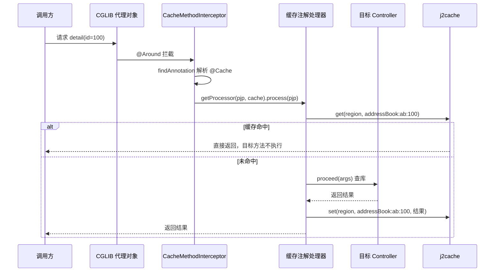

# 从原生 j2cache 的痛点到声明式缓存：注解、拦截器与处理器的自研实现

地址簿接口里手写 cacheChannel.get/set/evict 已经能跑通，但课程没有停在"能用"：这一节把这套手写缓存重构成一个注解驱动的小框架——问题分析、实现思路、两个注解、两个模型、一批工具类、一个拦截器加一个开关注解，十步做下来。本篇按这条主线把自研声明式缓存的骨架完整拆开。

## 先给结论

- 原生 API 两个问题：繁琐（多个模块要用缓存都得手调 CacheChannel 的 get/set/evict）且具侵入性（缓存代码散落在业务代码里）；解法是声明式缓存——方法上加注解自动完成缓存操作，对标 @Transactional 声明式事务。
- 声明式缓存与原生 API 兼容、互为补充：注解只能缓存方法的返回值，方法执行过程中产生的多类对象要载入缓存仍需原生 API 一个个 set。
- 实现原理基于 AOP（代理技术）；拦截对象是 Spring MVC 的 Controller，所以直接写拦截器兼切面；必须指定 @EnableAspectJAutoProxy(proxyTargetClass = true) 用 CGLIB——Controller 往往没有接口，基于接口的 JDK 动态代理走不通。
- 两个注解一套 key 规则：@Cache(region/key/params) 缓存方法返回值，@CacheEvict 内嵌 @Cache 数组用于清理；最终 key 由 region:key:params 动态解析值拼成（如 addressBook:ab:100），params 必须与方法参数名一致。
- 组件分层：CacheMethodInterceptor 两个 @Around 环绕通知只负责拦截；AbstractCacheAnnotationProcessor 静态 getProcessor 重载负责创建处理器（拦截器与具体处理器解耦）；CachesAnnotationProcessor/CacheEvictorAnnotationProcessor 各管一类注解；@EnableCache 是加在启动类上的开关。
- 一个实战坑：拦截器在 j2cache.aop 包，启动类默认只扫描自己所在包，拦截器根本不生效——先用 @Import 显式引入验证，再规范成 @EnableCache 注解内嵌 @Import。

## 原生 API 的问题与实现思路

先回顾 j2cache 原生用法：注入 CacheChannel，get 取缓存、set 设置缓存、evict 清理缓存、check 检查数据存在于哪一级缓存、exists 检查是否存在、clear 清理指定区域。地址簿的 detail 方法就是标准写法——先 get，未命中查库再 set 回去。

问题出在规模上：项目里如果有多个模块都需要缓存功能，每个模块都得这样一遍遍调用原生 API，操作繁琐；更要紧的是，这些操作缓存的代码全部混在业务代码当中，API 对业务代码有侵入性。改进方案的答案就是声明式缓存：定义缓存注解，在需要使用缓存的方法上直接加注解，自动完成缓存相关的操作——程序代码里不再出现 get/set/evict 这些调用，全都封装浓缩成一个注解。这套思路不陌生，和声明式事务一样：以前手动开事务、提交、回滚，后来方法上贴一个 @Transactional 就完事。

两个边界要说清楚。第一，声明式缓存不能完全替代原生 API：注解方式只能把方法的返回值放进缓存，如果方法执行过程中产生了多种类型的对象、都需要载入缓存，注解做不到，还得调原生 set 一个一个放。所以两者兼容，在项目中同时使用、互为补充。第二，实现原理上，声明式缓存底层基于 AOP——AOP 本身又是代理技术。但这次不去定义原生 Spring AOP 那套切面，因为拦截的是 Spring MVC 的 Controller，直接定义拦截器拦截 Controller 即可，底层原理不变。

要设计的类和注解一共七件：

| 组件 | 职责 |
| --- | --- |
| @Cache | 缓存注解，用在 controller 方法上，缓存该方法返回值 |
| @CacheEvict | 清理缓存注解，用在 controller 方法上，清理指定缓存数据 |
| CacheMethodInterceptor | 缓存方法拦截器，只拦截加了缓存注解的方法，处理逻辑下放 |
| AbstractCacheAnnotationProcessor | 抽象缓存注解处理器，为缓存操作提供公共方法（读取、封装注解信息） |
| CachesAnnotationProcessor | 缓存注解处理器，方法上加了 @Cache 时由它处理 |
| CacheEvictorAnnotationProcessor | 失效缓存注解处理器，方法上加了 @CacheEvict 时由它处理（缓存失效即清理） |
| @EnableCache | 开关注解，一般加在启动类上，开启声明式缓存功能 |

## 两个注解与一套 key 规则

注解代码写在 j2cache.annotation 包下。@Cache 的定义：

```java
@Documented
@Target(ElementType.METHOD)
@Retention(RetentionPolicy.RUNTIME)
public @interface Cache {
    String region() default "rx";
    String key() default "";
    String params() default "";
}
```

三个元注解是自定义注解的固定搭配：@Target(ElementType.METHOD) 限定只能加在方法上；@Retention(RetentionPolicy.RUNTIME) 让注解保留到运行时，处理器靠反射才能读到；@Documented 表示可被 javadoc 文档化。

三个属性从哪来？回忆原生调用 cacheChannel.set(region, key, entity)：region 是缓存区域，key 是唯一标识。这里的设计稍有变化——key 被拆成两部分，key 属性代表"分类"，params 代表动态参数。以地址簿为例，region 用 addressBook，key 取缩写 ab，params 是 id：每条地址簿数据都有 id，缓存时把 entity 的 id 动态解析出来拼进去，三段连起来就是最终在 j2cache 里的唯一标识。同一类数据前两段固定，变化的是第三段，这就是 params 必须动态解析的原因。

应用的样子（假设框架已全部实现）——改造前的 detail 方法里全是缓存操作代码，改造后：

```java
@GetMapping("/detail/{id}")
@Cache(region = "addressBook", key = "ab", params = "id")
public AddressBook detail(@PathVariable(name = "id") String id) {
    return addressBookService.getById(id);
}
```

缓存相关的 get/set 全部删掉，只剩查库一句。第一次调用还没有缓存，方法执行、查库，返回值被注解机制自动缓存；第二次传同一个 id，直接从缓存返回，方法体不再执行——相当于在处理器那边就返回了，数据库不会被重复查询。注意 params 不能随便写：必须与方法的参数名一致（这里是 id），处理器就是按这个相同的参数名去解析传进来的值，写成 abc 就什么也取不到。假设传来的 id 是 100，最终 key 就是 region 加冒号加 ab 加冒号加 100——addressBook:ab:100。

清理缓存对应 @CacheEvict，它的元素直接复用 @Cache：

```java
@Documented
@Target(ElementType.METHOD)
@Retention(RetentionPolicy.RUNTIME)
public @interface CacheEvict {
    Cache[] value() default {};
}
```

value 是数组类型，一次可以指定清理多个缓存；value 是默认属性名，使用时可以省略：

```java
@DeleteMapping("/id")
@CacheEvict(@Cache(region = "addressBook", key = "ab", params = "id"))
public Result del(@PathVariable(name = "id") String id) {
    addressBookService.removeById(id);
    return Result.ok();
}
```

拼接规则与 @Cache 完全一致，保证清理时的 key 和当初写入时的 key 是同一个。加了注解之后，del 方法里的 cacheChannel.evict 也不需要了。

## 模型与工具类：注解解析的地基

处理器要动态解析注解、拼 key，先备好两个模型。AnnotationInfo 封装缓存信息：

```java
public class AnnotationInfo<T extends Annotation> {
    private T annotation;   // 封装的是哪个注解
    private String region;  // 区域
    private String key;     // 动态解析、拼接完成之后的完整 key

    public String toString() {
        if (annotation == null) {
            return null;
        }
        return JSONObject.toJSONString(this);
    }
    // getter/setter 省略
}
```

泛型上界限定为 Annotation——所有注解都是 Annotation 的子类，自定义的 @Cache、@CacheEvict 都装得进来。key 属性存的是三段动态解析完、用冒号拼好的串，后续处理直接取用。

CacheHolder 封装缓存结果：

```java
public class CacheHolder {
    private Object value;         // 缓存的具体数据
    private boolean existsCache;  // 缓存数据是否存在
    private Throwable throwable;  // 处理过程中的异常

    private CacheHolder() {}

    public boolean hasError() {
        return throwable != null;
    }

    public static CacheHolder newResult(Object value, boolean existsCache) {
        CacheHolder cacheHolder = new CacheHolder();
        cacheHolder.value = value;
        cacheHolder.existsCache = existsCache;
        return cacheHolder;
    }

    public static CacheHolder newError(Throwable throwable) {
        CacheHolder cacheHolder = new CacheHolder();
        cacheHolder.throwable = throwable;
        return cacheHolder;
    }
}
```

私有构造器配合两个静态工厂：newResult 装正常结果，newError 装异常，查出来有没有数据看 existsCache。工具类从资料包整体拷进 j2cache.utils 包，一共四类：

| 工具类 | 作用 |
| --- | --- |
| CacheKeyBuilder | 生成缓存 key，generate 方法把注解的 key 与动态解析出的 params 拼接成串 |
| FieldAccessDescriptor / ObjectAccessUtils | 通过反射（内部转成 JSON）按字段路径访问目标对象、取参数值，由 CacheKeyBuilder 底层调用 |
| SpringApplicationContextUtils | @Component 持有 ApplicationContext，@PostConstruct 存成静态引用，任何位置可取容器里的对象 |
| StringGenius | 字符串工具，比如 isInteger 用正则判断字符串是否为整数 |

这类成型工具类没有必要手写，直接导入使用。

## 拦截器：两个环绕通知与一次失效排查

拦截器放在 j2cache.aop 包下，是整个声明式缓存最关键的一环：

```java
@Aspect
@Component
@EnableAspectJAutoProxy(proxyTargetClass = true)
@Import(SpringApplicationContextUtils.class)
public class CacheMethodInterceptor implements Interceptor {

    @Around("@annotation(com.itheima.j2cache.annotation.Cache)")
    public Object invokeCacheAllMethod(ProceedingJoinPoint proceedingJoinPoint) throws Throwable {
        System.out.println("缓存拦截器执行了...");
        return proceedingJoinPoint.proceed(proceedingJoinPoint.getArgs());
    }

    @Around("@annotation(com.itheima.j2cache.annotation.CacheEvict)")
    public Object invokeCacheEvictAllMethod(ProceedingJoinPoint proceedingJoinPoint) throws Throwable {
        System.out.println("缓存拦截器执行了...");
        return proceedingJoinPoint.proceed(proceedingJoinPoint.getArgs());
    }
}
```

逐项拆解。类要实现 org.aopalliance.intercept 包下的 Interceptor 接口；@Aspect 表示它同时是切面类，@Component 让容器实例化它。@EnableAspectJAutoProxy 开启 AspectJ 自动代理，proxyTargetClass = true 指定 CGLIB 方式——为 Controller 类创建子类对象做代理，代理与目标类是继承关系。为什么必须 CGLIB？JDK 动态代理基于接口创建，代理类与目标类之间是并列关系、拥有共同接口，而 Controller 往往没有接口，用 JDK 动态代理代理对象根本创建不出来，CGLIB 没有这个问题。@Import(SpringApplicationContextUtils.class) 也有讲究：工具类靠 @Autowired 注入上下文，但它所在包可能不在 Spring Boot 的扫描范围内，扫不到就注不进来，getApplicationContext 返回就是空——在拦截器上 import 它，只要拦截器能被扫描到，这个类就会被感知。

两个 @Around 环绕通知对应两个注解：@annotation 切点表达式直接指定注解全名，controller 方法上加了对应注解就会被拦截，方法名任意。proceed(getArgs()) 是放行——反射调用真正的目标方法，参数原样传回。此时两个方法里只有输出语句，先验证拦截能不能生效。

验证本身还踩了个坑。写一个测试用的 J2CacheController，detail 方法不查库、造一条假数据返回，方法上加 @Cache(region = "addressBook", key = "ab", params = "id")，服务端口 8189，Swagger 里传 id=123 执行——控制台只输出了"查询数据库"，"缓存拦截器执行了..."迟迟不出现，断点也进不去，拦截器完全没起作用。原因不复杂：拦截器在 com.itheima.j2cache.aop 包，启动类 UserApplication 在 com.itheima.pinda 包，Spring Boot 默认只扫描启动类所在包及其子包，j2cache 包下的类根本没被扫描、更没实例化，自然不起作用。

最简单的修复是在启动类上加 @Import(CacheMethodInterceptor.class) 显式引入。重启再测，"缓存拦截器执行了..."出现了；断点里看 ProceedingJoinPoint，信息相当丰富：signature 可以拿到拦截到的方法详情，target 是目标对象 J2CacheController，this 是代理对象——命名符合 CGLIB 规则，目标类名后跟 $$EnhancerBySpringCGLIB$$，getArgs 能看到传参 123。（断点停留太久会报连接超时，无关紧要。）

不过 @Import 直写只是折中方案，不够标准。参照 @EnableDiscoveryClient、@EnableSwagger2 这些 Enable 系列注解的套路——注解内部通过 @Import 把需要的类引进来——自定义开关注解：

```java
// 开启声明式缓存功能的开关，一般加在启动类上
@Import(CacheMethodInterceptor.class)
public @interface EnableCache {
}
```

启动类上把 @Import 换成 @EnableCache，再测效果完全一样。这才是提倡的用法：项目里不想使用缓存注解，把启动类上的注解拿掉，这一整套机制就全部失效——一个标准的开关。

## 处理器分层与完整链路

拦截器验证通了，接下来把两个环绕通知补成真逻辑。以 @Cache 的处理为例：

```java
@Around("@annotation(com.itheima.j2cache.annotation.Cache)")
public Object invokeCacheAllMethod(ProceedingJoinPoint proceedingJoinPoint) throws Throwable {
    MethodSignature signature = (MethodSignature) proceedingJoinPoint.getSignature();
    Method method = signature.getMethod();
    Cache cache = AnnotationUtils.findAnnotation(method, Cache.class);
    if (cache != null) {
        CachesAnnotationProcessor processor =
                AbstractCacheAnnotationProcessor.getProcessor(proceedingJoinPoint, cache);
        return processor.process(proceedingJoinPoint);
    }
    return proceedingJoinPoint.proceed(proceedingJoinPoint.getArgs());
}
```

流程四步：从连接点 getSignature 拿方法签名，向下强转成它的子接口 MethodSignature；getMethod 拿到被拦截的 Method 对象；用 Spring 提供的 AnnotationUtils.findAnnotation 按类型解析方法上的 @Cache；解析到了就交给处理器，没解析到直接放行。@CacheEvict 的方法与之完全对称，只是 findAnnotation 换成 CacheEvict.class，处理器换成失效缓存注解处理器。

处理器不直接 new——为了不让拦截器与具体处理器强耦合，创建动作收进抽象类：

```java
public abstract class AbstractCacheAnnotationProcessor {

    public static CachesAnnotationProcessor getProcessor(ProceedingJoinPoint pjp, Cache cache) {
        return new CachesAnnotationProcessor(pjp, cache);
    }

    public static CacheEvictorAnnotationProcessor getProcessor(ProceedingJoinPoint pjp, CacheEvict cacheEvict) {
        return new CacheEvictorAnnotationProcessor(pjp, cacheEvict);
    }

    public abstract Object process(ProceedingJoinPoint proceedingJoinPoint) throws Throwable;
}
```

两个静态重载按注解类型返回不同处理器，拦截器只耦合抽象类——抽象类定义规范，相对稳定，这是框架的常见玩法。两个具体处理器最初各自都写了 process 方法，往上提一层：抽象类声明 abstract 的 process，子类分别实现，因为一个负责设置缓存、一个负责清理缓存，处理方式不同但方法签名相同。

为什么 process 必须传连接点？因为处理器里可能需要放行、调用真正的目标 Controller 方法：@Cache 场景第一次调用时 j2cache 里还没有缓存，要 proceed 查库，拿到结果再缓存起来，下次同参调用直接从缓存返回；@CacheEvict 场景清理完缓存后，目标方法还要去删数据库的数据。清理缓存、目标调用两件事都要在处理器里完成，连接点是唯一入口。完整链路如下：



## 小结

本篇完成了一次小型框架自研。起点是原生 API 的两个痛点——繁琐、侵入，终点是方法上一个注解搞定缓存：@Cache 负责缓存方法返回值，@CacheEvict 负责清理，key 规则统一为 region:key:params，params 与方法参数名对齐、动态解析。实现上，CacheMethodInterceptor 以切面加拦截器的双重身份拦住 Controller（CGLIB 代理是前提），把处理交给 AbstractCacheAnnotationProcessor 的静态工厂创建的具体处理器，模型层 AnnotationInfo/CacheHolder 承载解析结果，工具类支撑反射取值与 key 拼接，@EnableCache 把整套机制收进一个开关。中间那个"拦截器扫不到所以不生效"的排查也很有代表性——包扫描边界问题在自定义组件里反复出现，@Import 与 Enable 注解是两条标准出路。手写 cacheChannel 的时代结束，pd-user 的缓存从此声明式。
