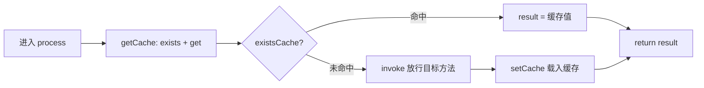

# 声明式缓存深水区：抽象处理器、缓存读写组件与清理组件的完整实现

上一篇搭完了声明式缓存的骨架：两个注解、一套 key 规则、一个拦截器加处理器分层。这一篇往里填实现——抽象处理器怎么把 CacheChannel 与注解解析收进父类、动态 key 按什么规则生成、缓存处理器的"查缓存、放行、载入"三步怎么落地、清理处理器为什么清完缓存还必须放行。代码写完后用断点把第一次与第二次请求完整跟一遍，验证整套机制真的在转。

## 先给结论

- 处理器不是 Spring 管理的 bean（拦截器里手动 new，类上没有 @Component），字段上贴 @Autowired 注不进来；公共的 CacheChannel 只能在构造方法里通过 SpringApplicationContextUtils 先取容器、再 getBean 拿到——pd-user 引入了 j2cache 的 starter 坐标，容器里必有这个 bean。
- getAnnotationInfo 把 @Cache 的解析结果封装成 AnnotationInfo（annotation、region、key 三件）；泛型只需指定 Cache，因为 @CacheEvict 内部引用的还是 @Cache，解析它一个就够。
- key 生成两段规则：注解没写 key（空串）时用"目标类名:方法名"兜底；再由 CacheKeyBuilder.generate(key, params, args) 把动态参数值拼上去，params=id、传参 100 时最终得到 ab:100。
- params 两种写法：参数是简单值直接写参数名 id；参数是对象必须写 0.name——0 是参数下标，.name 取该对象里的 name 字段，map 或实体类都适用。
- 共享数据（如菜单）注解不写 params，所有用户共用一份缓存；用户私有数据（如地址簿）必须写 params 按 id 区分，每人一份。
- 两个具体处理器一条分界线：CachesAnnotationProcessor 缓存命中后目标方法不再执行；CacheEvictorAnnotationProcessor 清理完缓存必须放行——清理必然伴随改库，目标方法每次都要真跑。

## 抽象处理器：把公共能力收进父类

两个具体处理器都要做两类事：操作 j2cache 缓存、解析注解。这些公共能力全部上提到 AbstractCacheAnnotationProcessor。

先说 CacheChannel。protected CacheChannel cacheChannel 声明成成员变量，子类拿来就用。但这里不能直接 @Autowired——这几个处理器类上都没有 @Component，是拦截器里 new 出来的，不在 Spring 容器管理之内，注解注入必然失败。出路是绕道容器：构造方法里先调 SpringApplicationContextUtils 的静态方法 getApplicationContext 拿到容器对象，再按类型 getBean 取出 CacheChannel。容器里为什么一定有？pd-user 已经导入了 j2cache 的 starter 坐标，配置文件配好后，Spring Boot 启动时就会把 CacheChannel 初始化进容器——之前在 Controller 里能直接 @Autowired 注入它，就是现成的证据。

```java
protected CacheChannel cacheChannel;

public AbstractCacheAnnotationProcessor() {
    ApplicationContext applicationContext = SpringApplicationContextUtils.getApplicationContext();
    cacheChannel = applicationContext.getBean(CacheChannel.class);
}
```

构造方法在这里的职责就是初始化公共属性：两个子类 new 自己时 super() 一调，cacheChannel 就完成了赋值。

再看注解信息封装。protected 修饰的 getAnnotationInfo 返回 AnnotationInfo<Cache>，入参是连接点与 @Cache 注解；protected 保证只有子类能调，别的类碰不到。方法体就是三步赋值：

```java
protected AnnotationInfo<Cache> getAnnotationInfo(ProceedingJoinPoint pjp, Cache cache) {
    AnnotationInfo<Cache> annotationInfo = new AnnotationInfo<>();
    annotationInfo.setAnnotation(cache);
    annotationInfo.setRegion(cache.region());
    try {
        annotationInfo.setKey(generateKey(pjp, cache));
    } catch (Exception e) {
        e.printStackTrace();
    }
    return annotationInfo;
}
```

annotation 装原始注解，region 直接取注解属性，都没什么悬念；key 则复杂得多——它是动态解析、拼接完成后的完整串，专门交给 generateKey 生成。

generateKey 的逻辑分两段。第一段处理"没写 key"的情况：用户使用注解时可能只写 region，key 保持定义时的默认空串，这时重新指定为"目标类 SimpleName + 冒号 + 方法名"。类名与方法名都从连接点拿：getTarget().getClass().getSimpleName() 得到不带包名的目标类名；getSignature 强转成子接口 MethodSignature 后，getMethod().getName() 得到方法名。第二段拼动态参数：调用 CacheKeyBuilder.generate，把原始 key、注解里的 params、目标方法的实际参数值 getArgs 一起传进去，它按 params 描述的路径从参数里取值、追加到 key 后面。比如 params 是 id、传参 100，返回的就是 ab:100：

```java
protected String generateKey(ProceedingJoinPoint pjp, Cache cache) throws Exception {
    String key = cache.key();
    if (!StringUtils.hasText(key)) {
        String className = pjp.getTarget().getClass().getSimpleName();
        MethodSignature signature = (MethodSignature) pjp.getSignature();
        String methodName = signature.getMethod().getName();
        key = className + ":" + methodName;
    }
    return CacheKeyBuilder.generate(key, cache.params(), pjp.getArgs());
}
```

CacheKeyBuilder.generate 内部声明了异常，generateKey 继续往外抛，getAnnotationInfo 里 try-catch 住即可。最后回到拦截器一侧，把两个静态工厂 getProcessor 补完整——new 具体处理器时把连接点与注解对象传进构造方法，否则这两个参数就没有意义。到此抽象类成型：一个公共成员变量 cacheChannel，两个公共方法 getAnnotationInfo 与 generateKey，一个 abstract 的 process 留给子类实现，两个静态工厂负责创建。

## key 规则实测：一组用例看清 params 怎么写

抽象类写完，先不急着写子类。key 最终长什么样，光看代码不直观，讲义里那组测试方法（J2CacheController，不查库、自己造数据返回）复制过来逐一验证最清楚：

| 注解写法 | 传参形式 | 生成的 key |
| --- | --- | --- |
| @Cache(region="rx", key="user", params="id") | id=123 | user:123 |
| @Cache(region="rx", key="user", params="0.name") | JSON body：{"name":"小明"} | user:小明 |
| @Cache(region="rx", key="user", params="0.name") | 表单提交，参数同上 | user:小明 |
| @Cache(region="rx", key="users")（无 params） | 无参 | users |
| @CacheEvict(@Cache(region="rx", key="user", params="id")) | id=123 | 清理 user:123 |
| @CacheEvict(@Cache(region="rx", key="users")) | 无参 | 清理 users |

第二个用例的 0.name 有讲究：方法可能不止一个参数，0 代表第一个参数（下标从 0 起），.name 表示取这个参数对象里的 name 字段——前提是 map 里必须有 name 这个字段；换成实体类同理，AddressBook 里有 name 也能取出来。@RequestBody 接 JSON 与 @RequestParam 接表单只是传参形式不同，取值规则完全一样。参数是简单字符串时（第一个用例）就不用写下标，直接写参数名。

无 params 的用例对应另一种业务形态：菜单这类数据所有用户共用一份，没必要每人缓存一份，key 固定为 users 即可；而地址簿是每个用户自己的数据，id 唯一，必须写 params 把各自的缓存区分开。这些写法最终都落到同一个工具类上——CacheKeyBuilder 一路往下调，解析参数名与参数值，name 字段传进来就取 map 里的 name。规则清楚了，子类实现才有把握。

## 缓存处理器：查缓存、放行、载入三步

CachesAnnotationProcessor 处理 @Cache。结构先搭出来：private static final Logger 记日志（LoggerFactory.getLogger 用 Cache.class 作类名）；AnnotationInfo<Cache> annotationInfo 成员变量存解析结果。构造方法两句：先 super()——抽象类构造把 cacheChannel 准备好；再 annotationInfo = getAnnotationInfo(连接点, cache)——注解解析与 key 拼接在 new 的瞬间就完成了。

process 是重头戏，动笔前先理思路，整个方法至少三个动作：

1. 先查缓存里有没有数据：有就直接返回，Controller 的目标方法根本不执行；
2. 缓存没有：放行调用目标方法查库，拿到返回值；
3. 载入缓存：把结果放进缓存，下次同参调用直接走缓存；最终把结果返回。

这三个动作抽成三个 private 方法——全塞进 process 也能跑，但方法功能不单一，按模块化思想拆开。getCache 返回 CacheHolder：

```java
private CacheHolder getCache(AnnotationInfo<Cache> annotationInfo) {
    String region = annotationInfo.getRegion();
    String key = annotationInfo.getKey();
    boolean exists = cacheChannel.exists(region, key);
    if (exists) {
        CacheObject cacheObject = cacheChannel.get(region, key);
        return CacheHolder.newResult(cacheObject.getValue(), true);
    }
    return CacheHolder.newResult(null, false);
}
```

从哪个区域、按哪个 key 取，AnnotationInfo 里都已封装完毕。invoke 一句放行：

```java
private Object invoke(ProceedingJoinPoint pjp) throws Throwable {
    return pjp.proceed(pjp.getArgs());
}
```

setCache 一句写入，annotationInfo 是构造方法里赋的值，直接用成员变量：

```java
private void setCache(Object result) {
    cacheChannel.set(annotationInfo.getRegion(), annotationInfo.getKey(), result);
}
```

process 主体把三个方法串起来：

```java
public Object process(ProceedingJoinPoint pjp) throws Throwable {
    Object result = null;
    boolean existsCache = false;

    CacheHolder cacheHolder = getCache(annotationInfo);
    if (cacheHolder.isExistsCache()) {
        result = cacheHolder.getValue();
        existsCache = true;
    }
    if (!existsCache) {
        result = invoke(pjp);
        setCache(result);
    }
    return result;
}
```



断点把两次请求跟一遍，验证最直观。服务端口 8189，缓存走的是远程 Redis。第一次请求 /cache/detail/{id}（id=123）：先停在 CacheMethodInterceptor 的环绕通知，连接点里 target 是 J2CacheController、目标方法 detail、参数 123，代理对象是 CGLIB 生成的；往下走，注解被解析出来——region=addressBook、key=ab、params=id，与注解上写的完全一致；getProcessor 创建缓存处理器，构造方法里 cacheChannel 与 annotationInfo 都初始化完毕，此时 key 已经动态拼成 ab:123。进入 process：getCache 第一次 exists=false、value 为空，if 不成立，走 invoke——一步跳进 Controller 的 detail 方法（打印"查询数据库"、返回造好的数据），返回后 setCache 写入。看 Redis：数据进来了，key 显示为 addressBook 拼上 ab:123——j2cache 默认会把 region 拼进最终 key，程序里只负责拼 ab:123 这一段，最终 key 由 region、key、动态参数三部分构成。

第二次同样传 123：getCache 里 exists=true、value 拿到缓存对象，直接返回 result，invoke 与 setCache 都没有执行——目标方法没跑，控制台不再出现"查询数据库"。换成 id=1234 再发：又执行了目标方法，Redis reload 后出现两条 key。流程与设计完全吻合：第一次设缓存，之后走缓存，参数变了才重新查库。（过程中出现过一次连接中断的报错，是断点停留太久导致，不是程序问题，快速重跑即可。）

## 清理处理器：先失效，再放行

CacheEvictorAnnotationProcessor 处理 @CacheEvict。它与缓存处理器最大的结构差异来自注解本身：@CacheEvict 的 value 是 @Cache 数组，一次可以声明清理多份缓存，所以成员变量得是集合：

```java
private List<AnnotationInfo<Cache>> cacheList = new ArrayList<>();
```

构造方法同样先 super() 把 cacheChannel 备好，然后 cacheEvict.value() 拿到 @Cache 数组，for 循环逐个调父类的 getAnnotationInfo 封装、add 进集合——后续清理需要的 region 与 key，在构造阶段就全部解析完毕：

```java
public CacheEvictorAnnotationProcessor(ProceedingJoinPoint pjp, CacheEvict cacheEvict) {
    super();
    Cache[] value = cacheEvict.value();
    for (Cache cache : value) {
        cacheList.add(getAnnotationInfo(pjp, cache));
    }
}
```

process 只做两件事：遍历清理、放行：

```java
public Object process(ProceedingJoinPoint pjp) throws Throwable {
    for (AnnotationInfo<Cache> annotationInfo : cacheList) {
        cacheChannel.evict(annotationInfo.getRegion(), annotationInfo.getKey());
    }
    return pjp.proceed(pjp.getArgs());
}
```

清理本身很简单，一次 evict 就完事，真正要注意的是与缓存处理器的行为差异：@Cache 的场景，第二次调用目标方法不执行，直接走缓存；@CacheEvict 的场景，目标方法每一次都要执行——清理缓存一般伴随数据库操作，Controller 方法里要调 service、dao 真正去删库、改库，缓存清完必须 proceed 放行，否则数据库那边就没人动了。这两个处理器放在一起看，分界线非常清晰。

## 小结

本篇把声明式缓存从骨架填成了能跑的完整实现。抽象处理器解决两件基础事：非 Spring 管理对象怎么拿容器 bean（构造方法里经 SpringApplicationContextUtils 取容器再 getBean），注解信息怎么标准化（AnnotationInfo 三件套加 generateKey 动态拼 key）。key 规则通过一组测试方法固化：简单参数写参数名，对象参数写下标.字段名，共享数据干脆不写 params。缓存处理器把读写收敛为 getCache、invoke、setCache 三个单一职责方法，命中即返回、未命中放行后载入；清理处理器按 @Cache 数组逐个 evict，且永远放行，保证数据库操作真实发生。断点跟完两次请求，第一次设缓存、第二次走缓存的分界清晰可见。剩最后一环——清理链路的接口实测与 pd-user 全量改造，下一篇收官。
