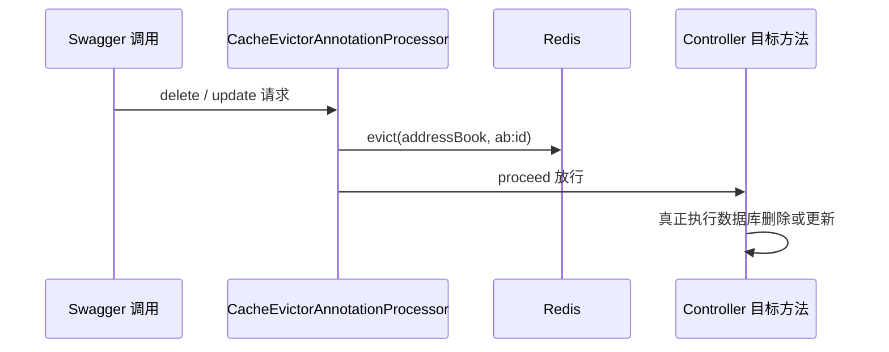

# 声明式缓存收官：清理组件收尾与 pd-user 项目改造实测

上一篇写完了清理处理器的代码，这一篇把它测通，然后动真格的：把 pd-user 里 AddressBookController 的手写缓存整体改成注解方式，从 detail 到 delete 再到 update，逐个接口验证读写失效闭环。源料就三段视频，重点是改造动作与实测证据，不铺陈。

## 先给结论

- 清理与设置必须"同一套"：region、key、params 三者与当初写入时完全一致，evict 才找得到目标；region 对不上（rx 对 addressBook）时调用不报错，但缓存原封不动——框架不会替你校验。
- 清理链路验证路径：getCacheData（region=rx, key=user, params=id）写入 user:101，evict 接口传 101 后 Redis 里该 key 消失；getAllData 与 evictAll 这对无 params 组合写入并清理的是同一个 users。
- 项目改造成本很低，方向是把代码往简单改：启动类 @EnableCache 之前已加；Controller 里手写 get/set/evict 全部删除，只留数据库操作，方法上加 @Cache 或 @CacheEvict。
- params 两种取值姿势：路径参数直接写参数名 id；实体参数写 1.id——1 是参数下标（update 的第二个参数才是 AddressBook entity），从实体里取 id 拼 key。
- 改造后实测三连：detail 第一次发 select、第二次不发（走缓存）；delete 先 evict 再放行真删库，缓存与表数据同步消失；update 执行后库里的数据改了，Redis 缓存也没了。

## 清理组件实测：region 和 key 必须成套对齐

清理处理器写好，重启服务开始测。Redis 里还留着上次设置的 123、1234 两条 addressBook 数据，正好当靶子。直接调 evict 接口（传 id=123），断点从拦截器跟起：这回进入的是 @CacheEvict 对应的环绕通知，连接点显示目标类 J2CacheController、目标方法 evict、参数 123；注解解析正常，处理器里 cacheChannel 与 cacheList 都封装好，key 拼成 user:123、region 是 rx。process 一执行，evict 调用本身没报任何错，目标方法也放行执行了（控制台打印"删除数据库"、返回 evict success）——但 Redis reload 一下，123 还在。

原因一目了然：evict 接口配置的是 region=rx，而之前写入的数据在 addressBook 区域，连 region 都不一样，清理指令发给了另一个区域，自然清不掉。这暴露了一个使用要点：清理与设置必须同一套配置，不是一套就找不到目标，而且全程静默，没有异常提示，只能靠自己留意。

用同一套配置重测。getCacheData 与 evict 用的是同一组 region=rx、key=user、params=id：先调 getCacheData 传 id=101，Redis 里 rx 区域多出 user:101；再调 evict 传 101，断点里看到 evict(region, key) 执行、随后放行目标方法，Redis reload——rx 区域那条没了，剩下两条 addressBook 原样不动。

无 params 的组合也验一遍。getAllData 的注解只有 region=rx、key=users，最终 key 就是 users（j2cache 再把 region 拼进最终 key）；调用后 Redis 出现 users，对应清理它的 evictAll 配置完全相同，执行后 reload，users 消失。课程里 rx、addressBook 两个区域连同这组测试方法都是配套定义好的，可以自行逐个验证，方法都经过测试没有问题。

## 项目改造：三处注解替换手写缓存

组件层面验证完毕，可以改造项目了：把 pd-user 里原生 j2cache 的手写代码换成声明式。成本很低，因为是把代码往简单的方向改。第一步在启动类开启声明式缓存——@EnableCache 之前已经加在 UserApplication 上了，确认即可。第二步进 AddressBookController 逐个方法改。

detail 方法改造前是标准三段式：先调 get 查缓存，有就返回；没有查库，查完 set 进缓存再返回。改造后这些全删，只留一句查库：

```java
@GetMapping("/detail/{id}")
@Cache(region = "addressBook", key = "ab", params = "id")
public AddressBook detail(@PathVariable(name = "id") String id) {
    return addressBookService.getById(id);
}
```

params 不能随手写，必须与方法参数名 id 一致，处理器就按这个名字动态解析传参。page 方法没有加缓存，不用动。

update 方法原来在更新前手动调 cacheChannel.evict 清缓存，这一句删掉，换成注解：

```java
@CacheEvict(@Cache(region = "addressBook", key = "ab", params = "1.id"))
public Result update(@PathVariable(name = "id") String id, @RequestBody AddressBook entity) {
    // 只剩数据库操作
}
```

这里 params 写的是 1.id 而不是 id：update 有两个参数，路径上的 id 在下标 0，AddressBook entity 在下标 1，1.id 表示从第二个参数的实体里取 id 值。原则很简单——当初怎么设置进去的，就得按相同的 region、key、params 清理，三者有一个对不齐，清理时找的就是另一份数据。

删除方法同理，@CacheEvict 的 value 是默认属性名，可以省略直接写内层数组：

```java
@CacheEvict(@Cache(region = "addressBook", key = "ab", params = "id"))
public Result del(@PathVariable(name = "id") String id) {
    // 只剩数据库操作
}
```

至此改造完成：Controller 里与缓存直接相关的语句清零，剩下的全是数据库操作；其他模块用到缓存的地方照这个策略改即可。

## 改造验证：select 消失与缓存联动

重启服务，Redis 先清空，从干净状态开始测 address book controller。id 不再是随手编的——连远程数据库，从 users 库的 address_book 表里挑一条真实记录，把它的 id 复制过来。

detail 验证读写：第一次调用，数据正常返回，控制台发出一条 select——走的是数据库；紧接着第二次调用，数据照常返回，控制台安静，没有 select——命中的是缓存，Redis 里也能看到刚写入的那条缓存数据。

delete 验证清理联动：调 delete 传同一条 id，断点跟进去，处理器要清理的 region 是 addressBook、key 已经动态拼完（ab 后面冒号跟一串），evict 执行完放行，进入真正的目标方法执行 removeById，控制台发出 delete 语句。收尾两看：Redis reload 后缓存没了，刷新数据库表，这条记录也没了——缓存清理与数据库删除同步发生，与清理处理器"先 evict 再放行"的设计一致。



update 验证更新联动：换一条新的 id，先调 detail 给它写一份缓存，Redis 里确认出现；再调 update（PUT 请求，id 必传，其余字段用默认值即可）。第一次执行报错，原因是请求体里的日期字段格式不对，把这个字段去掉重发就过了。执行成功后检查两处：数据库里这条数据改过来了；Redis reload 后缓存也没了——update 方法上的 @CacheEvict 在更新发生时把对应的缓存清掉了，避免改库之后缓存里还留着旧数据。

## 小结

至此声明式缓存全部收尾。清理组件的实测给出一条硬约束：清理与写入必须落在同一套 region、key、params 上，配置不一致时 evict 静默落空；带 params 的 user:101 与不带 params 的 users 两种形态都验证了"写入即清理目标"。项目改造把这条结论兑现到 pd-user：@EnableCache 常驻启动类，AddressBookController 三个方法分别换成 @Cache 与 @CacheEvict（params="1.id" 从实体取 id 是唯一的新写法），手写缓存代码清零。接口实测三连——detail 二次调用 select 消失、delete 清缓存同时删库、update 更新后缓存同步蒸发——说明注解驱动的读写失效闭环在真实业务接口上成立。地址簿的缓存从"手写三段式"进化为"一个注解"，后续模块要接入缓存，照这个模式铺开即可。
