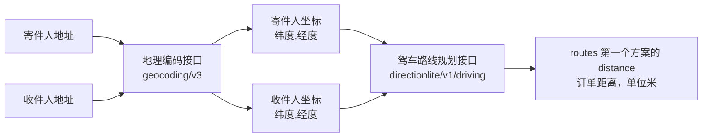

# 百度地图进阶案例：驾车导航、地理编码与订单距离工具类封装

接着上一篇的四个网页端入门案例，这一篇把剩下三个案例补完——驾车导航、地理编码、轻量级路线规划——再用它们串成订单距离计算的完整链路，封装成 BaiduMapUtils 工具类。这条链路就是品达物流 TMS 订单中心服务里"算距离"的全部实现：寄件人地址、收件人地址进去，订单距离（米）出来，为后续按规则计算订单价格提供输入。

## 先给结论

- 案例五（网页版驾车导航）：BMap.DrivingRoute 加三种策略常量（最少时间、最短距离、避开高速），调 search(start, end) 自动规划并绘制路线，连画线都不用自己做。
- 案例六（地理编码）：HTTP GET 请求，结构化地址进去返回经纬度；AK 必须是服务端类型；Java 端用 URLConnection 发请求，fastjson 把返回的 JSON 解析成 Map 后层层 get。
- 案例七（轻量级路线规划）：directionlite/v1/driving 接口，origin/destination 的格式是"纬度,经度"（小数点后不超过 6 位），routes 第一个方案里的 distance 就是实际驾车距离，单位米。
- 订单距离 = 两次接口调用：寄件人地址、收件人地址各自做地理编码拿坐标，再用两个坐标做驾车路线规划拿 distance。
- 工具类 BaiduMapUtils 四个静态方法：getCoordinate、getDistance、getTime、loadJSON。getCoordinate 统一返回"纬度,经度"，正好适配路线规划接口的参数格式，中间不用再调换顺序。
- distance 单位是米，线路耗时 duration 单位是秒，落到业务里还需要按需换算。

## 案例五：网页版驾车导航

导航是地图最典型的功能。按出行方式分，有驾车、步行等不同类型——自驾可以走高架快速路，步行肯定不能上高速；驾车导航还能再选策略：最少时间、最短距离、避开高速，选不同策略规划出来的路线也不一样。

案例五在页面上做的就是这件事：一个 select 下拉框提供三个策略选项（value 分别是 0、1、2），一个查询按钮，外加地图容器。核心 JS 如下：

```javascript
var map = new BMap.Map("allmap");
var start = "天安门";
var end = "金龙办公楼";
map.centerAndZoom(new BMap.Point(116.404, 39.915), 11);
map.enableScrollWheelZoom(true);

// 三种驾车策略：最少时间，最短距离，避开高速
var routePolicy = [
    BMAP_DRIVING_POLICY_LEAST_TIME,
    BMAP_DRIVING_POLICY_LEAST_DISTANCE,
    BMAP_DRIVING_POLICY_AVOID_HIGHWAYS
];

$("#result").click(function () {
    map.clearOverlays();                     // 先清掉上一次导航画出的覆盖物
    var i = $("#driving_way select").val();  // 选中项的 value：0/1/2
    search(start, end, routePolicy[i]);
});

function search(start, end, route) {
    var driving = new BMap.DrivingRoute(map, {
        renderOptions: {map: map, autoViewport: true},
        policy: route
    });
    driving.search(start, end);              // 规划路线并自动标注
}
```

要点有三个。其一，routePolicy 数组里的三个值是百度地图内置的策略常量，直接从示例抄过来即可，别手写错。其二，页面用了 jQuery 语法，需要引入 jquery.js；$("#result") 拿到按钮绑 click，$("#driving_way select").val() 取下拉框选中值，正好当数组下标用。其三，点击查询时先调 map.clearOverlays() 清理覆盖物——地图上线、标记这类元素统称覆盖物，不清掉，多次查询的线会叠在一起。

真正做导航的是 BMap.DrivingRoute：构造时把地图对象和策略传进去，调它自己的 search(start, end)，路线就规划好并自动画在地图上了，不需要自己 new Polyline。演示里选"最少时间"点查询，天安门到金龙办公楼的驾车路线直接标了出来。

## 案例六：地理编码，把地址变成坐标

前五个案例全在浏览器端，案例六换成百度地图的另一种使用方式：HTTP 服务接口。地理编码（GeoCoder）做的事情是：传入结构化地址（如"北京市海淀区上地十街10号"），返回对应坐标点的经纬度。地址必须是真实存在的结构化地址，随手写个不存在的字符串是解析不出来的。

请求是一个 GET 地址：

```text
http://api.map.baidu.com/geocoding/v3/?address=北京市海淀区上地十街10号&output=json&ak=您的AK
```

参数里必须传的是 address 和 ak 两个，其余如城市名 city、输出格式 output（json 或 xml）、JSONP 用的 callback 都是可选。特别注意：这里的 AK 不能再用浏览器端那种，应用类型必须是服务端。

先在浏览器里直接请求验证：不换 AK 时返回"ak 有误"；换上服务端 AK，返回 JSON 数据；把地址改成乱写的值，返回"无相关结果"；把 output 改成 xml，返回格式也跟着变成 xml。

更多时候是在程序里请求再自己解析。在 pd-oms 工程的 test 包（com.itheima.test）下建 BaiduMapTest 类，写 main 方法测试，用 JDK 自带的 java.net 包发请求：

```java
public class BaiduMapTest {
    public static void main(String[] args) throws Exception {
        String ak = "您的服务端AK";   // 注意：ak 类型必须为服务端
        String address = "北京市育新花园小区";
        String httpUrl = "http://api.map.baidu.com/geocoding/v3/?address=" + address
                + "&output=json&ak=" + ak;   // 项目已引入 fastjson，output 统一用 json

        URL url = new URL(httpUrl);
        URLConnection urlConnection = url.openConnection();
        BufferedReader bufferedReader = new BufferedReader(
                new InputStreamReader(urlConnection.getInputStream(), "UTF-8"));
        StringBuilder json = new StringBuilder();
        String inputLine = null;
        while ((inputLine = bufferedReader.readLine()) != null) {
            json.append(inputLine);
        }
        bufferedReader.close();
        System.out.println(json.toString());
    }
}
```

这是多次封装的套路：URLConnection.getInputStream() 拿到普通输入流，包上 InputStreamReader 指定 UTF-8，再包成带缓冲的字符流 BufferedReader，循环 readLine 追加到 StringBuilder，读完关流。输出结果里，status 为 0 表示成功；result 里的 location 含 lng（经度）和 lat（纬度）；precise 为 1 表示精确查找；confidence 是打点绝对精度——100 对应误差小于 20 米，90 以上对应误差小于 50 米，演示里返回 70，对应误差小于 300 米；level 是地址类型，返回"地产小区"。地址改成"12345"再跑，status 变成 1，报"Internal Service Error:无相关信息"。

接下来解析。用 fastjson 的 JSON.parseObject(json字符串, Map.class) 把返回串转成 Map，断点观察结构：成功时 size 等于 2，一层 status、一层 result；result 本身又是一个 Map，里面有 level、location、precise、confidence、comprehension 五项；经纬度藏在 location 里，又是 lng、lat 两项——层层嵌套的 key-value。

```java
Map map = JSON.parseObject(json.toString(), Map.class);
String status = map.get("status").toString();
if (status.equals("0")) {                             // 0 才能正常解析
    Map result = (Map) map.get("result");
    Map location = (Map) result.get("location");      // 一层一层往里 get
    String lng = location.get("lng").toString();
    String lat = location.get("lat").toString();
    DecimalFormat df = new DecimalFormat("#.######"); // 小数点后 6 位足够
    String lngStr = df.format(Double.parseDouble(lng));
    String latStr = df.format(Double.parseDouble(lat));
    String r = latStr + "," + lngStr;                 // 纬度在前、经度在后
}
```

原始经纬度小数点后有十几位，没有必要，用 DecimalFormat("#.######") 格式化成 6 位。失败时 Map 是 size 等于 3 的另一副结构：status 等于 1、result 为空、message 放错误信息，所以解析前必须先判 status。

## 案例七：轻量级路线规划，拿到两点距离

案例五的驾车导航是网页版，案例七是同一件事的 HTTP 服务接口版：轻量级路线规划。必填参数只有三个：

| 参数 | 说明 |
| --- | --- |
| origin | 起点坐标，格式"纬度,经度"，小数点后不超过 6 位 |
| destination | 终点坐标，同上 |
| ak | 服务端 AK |

可选参数里有路线偏好 tactics：0 常规路线、1 不走高速、2 躲避拥堵、3 距离较短等，按需传。返回结果里 status 为 0 表示成功；result 里回显了 origin、destination 坐标，routes 是方案集：每个方案含 distance（路线实际距离，单位米）、duration（线路耗时，单位秒）、过路费预估、路况评价，以及 steps 路线分段。steps 数据量最大：从起点到终点每一步的转向、道路、行驶距离都在里面，instruction 字段经 Unicode 转中文后就是导航语音提示的原文（"从起点向正南方向出发，行驶130米，左转……"），turn 等字段是转向编码（7 表示左转）。浏览器实测：origin 与 destination 各传一组坐标，返回 routes 第一方案的 distance 是 18709，单位米；整段返回数据太大，粘进 JSON 格式化工具再看结构。

Java 端调用和案例六的套路完全一样：拼好 ak、origin、destination 和接口地址 `http://api.map.baidu.com/directionlite/v1/driving?origin=...&destination=...&ak=...`，URLConnection 发请求，读流拼串，fastjson 解析。不同的只有最后取的值：

```java
if ("0".equals(map.getOrDefault("status", "500").toString())) {
    Map childMap = (Map) map.get("result");
    JSONArray jsonArray = (JSONArray) childMap.get("routes");
    JSONObject jsonObject = (JSONObject) jsonArray.get(0);   // 取第一个方案
    double distance = Double.parseDouble(jsonObject.get("distance").toString());
    System.out.println(distance);   // 18709.0，单位米
}
```

routes 是数组，取第一个方案再拿 distance，程序输出 18709。到这里，算订单距离需要的两个接口都验证过了。

## 封装 BaiduMapUtils：订单距离落地成工具类

先明确为什么要做这件事：最终目的是算订单价格。用户下单时系统要预估价格，价格计算的维度有两个——货物重量和订单距离，订单距离是价格计算的前提。实现思路两步，正好对应前面测过的两个接口：



前面都是 main 方法里临时测的，为了复用，封装成工具类 BaiduMapUtils，放在 utils 包下（包路径 com.itheima.pinda.common.utils），规划四个方法：

| 方法 | 职责 |
| --- | --- |
| getCoordinate(String address) | 调地理编码接口，根据地址获取坐标，返回"纬度,经度" |
| getDistance(String origin, String destination) | 调驾车路线规划接口，根据寄件人、收件人地址坐标计算订单距离，返回 Double（米） |
| getTime(String origin, String destination) | 调同一路线规划接口，取线路耗时 duration，返回 Integer（秒） |
| loadJSON(String httpUrl) | 统一发 HTTP 请求，返回百度地图服务端的 JSON 串 |

三个业务方法都要发请求，把 URLConnection 那一坨抽成 loadJSON 统一复用，try-catch 处理 MalformedURLException 和 IOException，逻辑就是前面 main 方法里写过的读流代码。getDistance 与 getTime 调的是同一个接口，只是一个取 distance、一个取 duration（注意字段名叫 duration，不是 time）。

有一个坐标顺序的细节必须交代：地理编码返回的坐标本来是"经度,纬度"（lng 在前），而路线规划接口的 origin/destination 要求"纬度,经度"。处理方式有两种——要么在调路线规划时手动调换顺序，要么让 getCoordinate 直接返回"纬度,经度"。课程选了后者，getCoordinate 里拼接成 latStr + "," + lngStr，后面拿到的坐标直接可用，不用再做格式处理。

工具类里写个 main 方法逐个验证：先 getCoordinate("北京市育新花园小区")，返回"纬度,经度"格式的坐标；拿它当 origin，再 getCoordinate("北京市百度大厦") 当 destination；随后 getDistance(origin, destination) 输出订单距离 6000 多米，getTime(origin, destination) 输出线路耗时若干秒。loadJSON 里那个临时的输出语句为了测试先留着。三个方法都正常，后面要算订单距离时直接调工具类的静态方法即可。

## 小结

这一篇收掉了百度地图的三个进阶案例和整个距离计算链路。案例五用 DrivingRoute 在网页上做策略可选的驾车导航；案例六的地理编码接口把结构化地址转成经纬度，Java 端的固定套路是 URLConnection 读流加 fastjson 解析，status 为 0 才继续取 location；案例七的轻量级路线规划接口吃"纬度,经度"格式的两个坐标，吐出含 distance（米）和 duration（秒）的方案集。三者串起来就是 BaiduMapUtils：getCoordinate 负责地址转坐标（并统一坐标顺序），getDistance 和 getTime 共享 loadJSON 的请求能力分别取距离与耗时，测试跑通"育新花园小区到百度大厦 6000 多米"。订单中心服务算距离的能力就此就位，下一环节是用规则引擎 Drools 把首重续重的价格规则落成代码。
