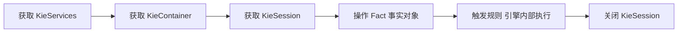

# 从计价规则硬编码的痛点到 Drools：规则引擎概念、优势与入门案例上半

品达物流 TMS 第四章推进到订单计价环节：基于百度地图的距离计算工具类已经封装完毕，而计算订单价格时横着四个计价规则。按传统套路，if-else 一条条判断也能做出来，课程却在此插入了一个新技术——规则引擎 Drools（读音有人读 Drools、有人读 Juice，不必纠结），并配了一整套讲义系统性地讲它。本篇先借"在线申请信用卡"的场景把硬编码的痛点摆上台面，再讲清规则引擎的定义、优势与适用场景，最后动手把 Drools 入门案例做到规则文件编写完毕；单元测试与 Kie 体系留待下一篇。学完整个系列，最终目的还是用 Drools 根据规则算出订单价格。

## 先给结论

- 规则引擎全称业务规则管理系统（BRMS，Business Rules Management System），是一类系统而非具体框架——类比 OA、ERP、CRM；课程选用的具体产品是 Drools，JBoss 组织提供的基于 Java 的开源规则引擎。
- 核心思想：把业务决策（if-else 里的判断逻辑）从代码中分离出来，当"数据"管理——规则库类比数据库，一条条规则类比一条条数据，可查询、添加、更新、统计。
- if-else 硬编码三重代价：规则多代码臃肿难维护、难以应对变化（规则一变代码就得改）、改完必须重启服务才生效；规则变动频率越高，规则引擎的优势越明显。
- Drools 把规则以脚本形式存放在文件或数据库等存储介质中，业务规则变更不需要修改项目代码、不需要重启服务器，线上环境立即生效。
- 入门案例（图书优惠四条规则）开发四步：建 Maven 工程导 drools-compiler → META-INF/kmodule.xml 配 kbase/ksession → Order 实体作数据载体 → resources/rules 下写 .drl 规则文件。
- API 开发步骤高度模板化，与 JDBC 类似：获取 KieServices → 获取 KieContainer → 获取 KieSession → 操作 Fact 事实对象 → 触发规则 → 关闭 KieSession。

## 问题引出：信用卡审批里的 4+5 条规则

课程用"在线申请信用卡"做引子。申请表里除了姓名、性别、年龄、电话、邮寄地址这些基本项，重点看四项：学历、月收入、是否有房是否有车、现有信用卡数量。用户提交申请后，服务端要做用户信息合法性检查——说白了就是银行判断你有没有还款能力：信用卡先消费后还款，还不上银行就吃亏，所以要通过规则判断当前用户是否有资格申请，且不同用户最终拿到的额度也不一样。

第一套规则，四条，任意一条成立即判定无资格：

| 规则 | 条件 | 结论 |
| --- | --- | --- |
| 规则一 | 既没房也没车，学历大专以下，月薪少于 5000 | 不通过 |
| 规则二 | 既没房也没车，学历大专或本科，月薪少于 3000 | 不通过 |
| 规则三 | 既没房也没车，学历本科以上，月薪少于 2000，且之前没有信用卡 | 不通过 |
| 规则四 | 现有信用卡数量大于 10 | 不通过 |

第二套规则，五条，合法性问题通过之后用它确定额度：

| 规则 | 条件 | 额度 |
| --- | --- | --- |
| 规则一 | 有房有车，或月收入 20000 以上 | 15000 |
| 规则二 | 没房没车，月收入 10000-20000 | 6000 |
| 规则三 | 没房没车，月收入 10000 以下 | 3000 |
| 规则四 | 有房没车或没房有车，月收入 10000 以下 | 5000 |
| 规则五 | 有房没车或没房有车，月收入 10000-20000 | 8000 |

最容易想到的实现是分支判断。检查合法性封装一个 checkUser 方法，返回 true 表示通过、false 表示不通过，一条规则一个 if：

```java
public boolean checkUser(User user) {
    // 规则一：既没房也没车，学历大专以下，月薪少于5000
    if (user.getHouse() == null
            && user.getCar() == null
            && user.getEducation().equals("大专以下")
            && user.getSalary() < 5000) {
        return false;
    }
    // 规则二、规则三同构，条件换成对应描述
    // 规则四：现有信用卡数量大于10
    if (user.getCardCount() > 10) {
        return false;
    }
    return true;
}
```

额度计算是另一个方法 determineCreditCardLimit，五段 if-else 逐一判断返回 15000、6000、3000、5000、8000。代码不算难，问题在维护上：

1. **难维护**：一条规则一个 if，规则越多代码越臃肿，全是硬编码。
2. **难以应对变化**：规则是通过代码来反映的，比如额度区间从 10000-20000 调成 20000-30000，代码就得跟着改。
3. **必须重启**：业务规则变了就要修改代码，修改完还得重启服务才能生效。

业务规则经常变化的系统，这套模式非常难受。这也是课程引入规则引擎的时机：变动频率越高，用规则引擎的优势越明显。

## 规则引擎是什么：把规则当数据管

规则引擎的主要思想：将程序中业务决策的部分分离出来，使用预定义的语义模块编写业务决策（即业务规则），由用户或开发者在需要时配置管理。分离出来之后，规则就成了"数据"——规则引擎里有一个规则库的概念，可以把它想象成数据库，一条条业务规则就相当于库里的数据，既然是数据自然可以动态管理：现在四条规则不再适用了，就更新、扩展第五条第六条，做增删改查。

两个关键认知：

- **规则引擎不是具体框架**，而是指一类系统——业务规则管理系统。市面上的具体产品有很多：Drools、Visual Rules、iLog 等，课程讲的是 Drools。
- **规则引擎是输入输出平台**，类似一个大脑：输入原始数据（学历、月薪、是否有房是否有车），内部按规则库里配置的规则自动匹配计算，输出反馈结果（是否有资格申请信用卡）。引入之后，业务规则不再以程序代码的形式驻留在系统里，业务应用里没有这些 if-else 了，取而代之的是处理规则的规则引擎；规则存储在规则库中，完全独立于程序，像管理数据一样查询、添加、更新、统计、提交，加载到规则引擎中供应用系统调用。

Drools 是 JBoss 组织提供的基于 Java 语言开发的开源规则引擎，核心价值是把复杂且多变的业务规则从硬编码中解放出来，以规则脚本的形式存放在文件或特定存储介质中（也可以放数据库、Excel，只是存储方式而已），业务规则变更不需要修改项目代码、不需要重启服务器，在线上环境立即生效。官网 drools.org（国外站点，打开偏慢），源码在 github.com/kiegroup/drools。项目集成很轻量：既可以单独使用，也可以与 Spring 整合，单独使用只需导入一个 Maven 坐标；IDEA 已内置 Drools 插件，编写规则文件有语法提示，Eclipse 则需要单独安装插件。

使用 Drools API 开发的步骤非常固定，和当年用 JDBC 操作数据库（加载驱动 → 获取连接 → 写 SQL → 执行 → 解析结果）是一个路数：



KieContainer 是容器，KieSession 是会话（学过的技术里 Session 很多，这里同理），Fact 字面翻译是"事实对象"，现阶段可以理解成普通的 JavaBean。这些 API 在下面的入门案例里都会实际用到。

## 优势与适用场景

使用规则引擎的优势可以列成一张表：

| 优势 | 说明 |
| --- | --- |
| 业务规则与系统代码分离 | 规则单独提出，在规则引擎中集中管理 |
| 不重启服务扩展维护规则 | 规则当数据动态管理，无需重启即可变更 |
| 快速响应需求变更 | 需求一变直接改规则，不等重新部署 |
| 业务分析人员可参与维护 | 规则与技术研究分离、是纯业务的内容，非开发者的业务人员也能编辑、维护规则 |
| 减少硬编码的成本和风险 | 不再在代码里堆 if-else，规则变了不用改代码 |
| 提供编辑工具 Workbench | 图形化界面，专门做业务规则的编辑与动态维护 |

这些优势归根结底源于一件事：规则从系统代码里分离了出来。反过来看，没有规则引擎时规则必须靠代码体现，业务人员不会写代码，参与不了维护；规则变了就要改代码重启，快速响应无从谈起。

适用场景也好判断：存在比较复杂的业务规则、且业务规则会频繁变动的系统。四类典型：

| 系统 | 典型规则 |
| --- | --- |
| 风险控制系统 | 风险贷款、风险评估 |
| 反欺诈项目 | 银行贷款、征信验证 |
| 决策平台系统 | 财务计算 |
| 促销平台系统 | 满减、打折、加价购（双十一、618 这类活动的大量促销规则） |

不限于这四类，只要规则多、变动频繁，都可以用规则引擎管理。

## 入门案例上半：从空工程到规则文件

入门案例的业务场景：消费者在图书商城购买图书，下单后在支付页面显示订单优惠后的价格。优惠规则四条：

| 规则 | 条件 | 优惠 |
| --- | --- | --- |
| 规则一 | 所购图书总价 100 元以下 | 无优惠 |
| 规则二 | 总价 100-200 元 | 优惠 20 元 |
| 规则三 | 总价 200-300 元 | 优惠 50 元 |
| 规则四 | 总价 300 元以上 | 优惠 100 元 |

**第一步，建工程导坐标。** IDEA 里 Create New Project 建一个普通 Maven 工程，不选骨架，artifactId 用 drools_quickstart，顺便检查 JDK 和本地 Maven 仓库配置。pom 里导入 Drools 坐标，再带上 JUnit 方便稍后单元测试：

```xml
<dependency>
    <groupId>org.drools</groupId>
    <artifactId>drools-compiler</artifactId>
    <version>7.10.0.Final</version>
</dependency>
<dependency>
    <groupId>junit</groupId>
    <artifactId>junit</artifactId>
    <version>4.12</version>
</dependency>
```

**第二步，提供框架所需的配置文件。** 位置和文件名都是固定写法：必须放在 resources 下的 META-INF 目录里，名字必须是 kmodule.xml，Drools 就按这个位置这个名字去解析：

```xml
<?xml version="1.0" encoding="UTF-8"?>
<kmodule xmlns="http://www.drools.org/xsd/kmodule">
    <kbase name="mykbase1" packages="rules" default="true">
        <ksession name="ksession-rule" default="true"/>
    </kbase>
</kmodule>
```

根标签 kmodule 是固定写法；kbase 里 name 可以任意、唯一即可，default="true" 表示它是默认的 kbase；**重点属性是 packages**——它指定规则文件的目录，这里写 rules，稍后就必须在 resources 下建一个叫 rules 的目录来放规则文件。kbase 里可以有多个 ksession 标签，name 同样任意、唯一即可，当前这个指定为默认的会话。

**第三步，创建实体类 Order。** 不是为了操作数据库，而是充当应用与规则引擎之间数据输入输出的载体——规则引擎是输入输出平台，数据总得有个对象来承载：

```java
package com.itheima.drools.entity;

public class Order {
    private Double originalPrice; // 订单原始价格，即优惠前价格
    private Double realPrice;     // 订单真实价格，即优惠后价格

    @Override
    public String toString() {
        return "Order{" +
                "originalPrice=" + originalPrice +
                ", realPrice=" + realPrice +
                '}';
    }
    // getter/setter 省略
}
```

originalPrice 是输入（优惠前的价格），realPrice 是期待引擎算出来的输出（优惠后价格），加 getter/setter 和 toString 就够了。

**第四步，编写规则文件。** 后缀固定为 .drl，文件名任意，这里叫 bookDiscount.drl；存放位置必须在 resources/rules 目录下——与 kmodule.xml 里 packages 指定的目录对应，放别处加载不到。因为 IDEA 内置了 Drools 插件，文件创建出来就能被识别（图标就是 Drools 那个人脸 logo），编写时全程有提示。四条规则完整落进文件：

```java
package book.discount
import com.itheima.drools.entity.Order

// 规则一：所购图书总价在100元以下的没有优惠
rule "book_discount_1"
when
    $order: Order(originalPrice < 100)
then
    $order.setRealPrice($order.getOriginalPrice());
    System.out.println("成功匹配到规则一：所购图书总价在100元以下的没有优惠");
end

// 规则二：所购图书总价在100到200元的优惠20元
rule "book_discount_2"
when
    $order: Order(originalPrice >= 100 && originalPrice < 200)
then
    $order.setRealPrice($order.getOriginalPrice() - 20);
    System.out.println("成功匹配到规则二");
end

// 规则三：所购图书总价在200到300元的优惠50元
rule "book_discount_3"
when
    $order: Order(originalPrice >= 200 && originalPrice < 300)
then
    $order.setRealPrice($order.getOriginalPrice() - 50);
    System.out.println("成功匹配到规则三");
end

// 规则四：所购图书总价在300元以上的优惠100元
rule "book_discount_4"
when
    $order: Order(originalPrice >= 300)
then
    $order.setRealPrice($order.getOriginalPrice() - 100);
    System.out.println("成功匹配到规则四");
end
```

几个第一眼最容易疑惑的点：

- 第一行 `package book.discount` 是逻辑概念，不要求对应真实目录，可以随意写；同一个 package 下的规则文件可以相互访问，不同 package 之间不能。
- import 把 Order 引进来，因为规则里要用它做匹配。
- 一条规则的结构是 `rule "名称"` → `when` 条件 → `then` 结果 → `end`。规则名在文件内唯一即可，甚至能写中文；then 里可以直接写 Java 代码。
- `$order: Order(originalPrice < 100)` 是模式匹配：到规则引擎的工作内存（Working Memory）中查找符合条件的 Order 对象，`$order` 是给匹配到的对象起的名字，可以任意；匹配到了就执行 then，把优惠后价格 set 进去。
- 边界值要留意：规则一是 `< 100`，规则二若写成 `> 100`，总价正好 100 的订单两边都匹配不上，所以规则二用 `>= 100`，规则三、规则四同理。
- 一个 drl 文件里可以写多个规则，理论上数量不限，按业务来。

## 小结

本篇解决两件事：为什么用规则引擎，以及 Drools 怎么开局。信用卡场景的 4+5 条规则展示了 if-else 硬编码的三重代价——难维护、难应变、改一次重启一次；规则引擎的答案是 BRMS 思想：规则从代码中剥离、当数据管理、不重启即可生效，Drools 是这套思想在 Java 世界的具体开源实现。落到动手层面，普通 Maven 工程、META-INF/kmodule.xml（kbase/ksession）、Order 数据载体、resources/rules 下的 drl 规则文件，四步把图书优惠的四条规则全部写成声明式的 rule/when/then，业务代码里再无一处 if-else。规则文件已就位，下一篇从单元测试出发，看 KieServices/KieContainer/KieSession 如何驱动这套规则跑起来，并顺带补齐规则引擎构成、Kie 体系与基础语法。
