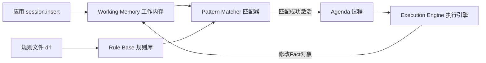
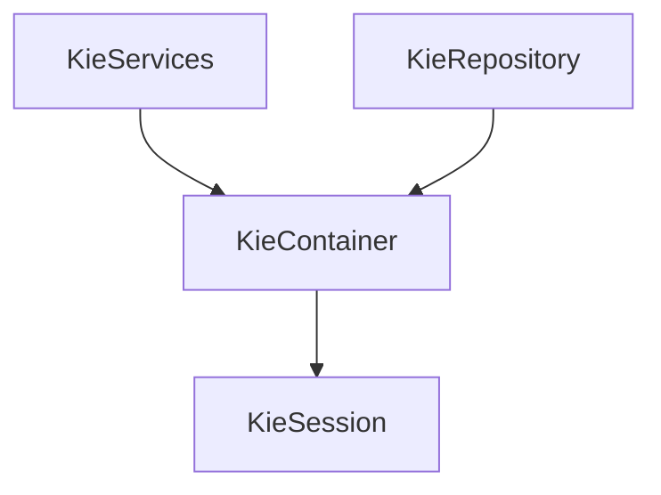

# Drools 入门收尾：从单元测试跑通规则到引擎构成、Kie 体系与基础语法

上篇把四条图书优惠规则写进了 bookDiscount.drl，规则文件已经就位，但还没有真正跑起来。本篇先补上单元测试，让规则执行一次，看清优惠后价格是如何传回应用的；随后的小结部分集中补齐规则引擎构成、Fact 等概念与执行过程，并认识 Kie 体系；最后进入基础语法——规则文件构成、规则体结构、注释与模式匹配。到这里，Drools 的入门部分就算完整收尾了。

## 先给结论

- 测试代码高度模板化：KieServices.Factory.get() 拿服务（不是 new，走工厂）→ newKieClasspathContainer() 拿容器（底层默认读 META-INF/kmodule.xml，按 packages 到 rules 目录加载全部规则）→ newKieSession() 拿默认会话 → insert 插入工作内存 → fireAllRules 触发 → dispose 关闭。
- 插入到工作内存后的普通 JavaBean 才叫 Fact（事实对象），只 new 不插入不算；Fact 是应用与规则引擎数据交互的桥梁——规则里 $order 改的就是应用里那个对象，结果靠对象引用带回，不是靠返回值。
- 原价 500 走通全流程：fireAllRules 之前 realPrice 还是 null，触发后控制台输出"成功匹配到规则四"，优惠后价格 400.0。
- 规则引擎三构成：Working Memory（存 Fact）、Rule Base（存规则）、Inference Engine（推理引擎，内含 Pattern Matcher 匹配器、Agenda 议程、Execution Engine 执行引擎）；执行过程五步，多规则同时激活的冲突由引擎内部自动解决。
- KIE 全称 Knowledge Is Everything（知识就是一切），是 JBoss 系列项目的总称，Drools 只是这个体系下的一个组件，同门还有 jBPM（工作流）、OptaPlanner、UberFire——类比 SpringData 家族。
- 基础语法要点：规则文件由 package/import/global/function/query/rule-end 构成（drl 是 Drools Rule Language 缩写，也支持 Excel 形式）；规则体 rule → attributes（可选）→ when(LHS) → then(RHS) → end；注释写法与 Java 完全一致；模式（Pattern）= 绑定变量名: 类型(Field约束)。

## 单元测试：让规则真正跑起来

在 test 目录下连包一起创建测试类 DroolsTest，方法上加 @Test 注解，对照前面讲过的 API 开发步骤一步步写：

```java
import org.junit.Test;
import org.kie.api.KieServices;
import org.kie.api.runtime.KieContainer;
import org.kie.api.runtime.KieSession;

public class DroolsTest {

    @Test
    public void test1() {
        // 第一步：获取KieServices（注意是带s的org.kie.api.KieServices，别导错）
        KieServices kieServices = KieServices.Factory.get();
        // 第二步：获取Kie容器对象，底层默认读取kmodule.xml，加载rules目录下所有规则文件
        KieContainer kieContainer = kieServices.newKieClasspathContainer();
        // 第三步：从Kie容器对象中获取会话对象
        KieSession session = kieContainer.newKieSession();

        // Fact对象，事实对象
        Order order = new Order();
        order.setOriginalPrice(500);

        // 第四步：将Order对象插入到工作内存中
        session.insert(order);

        // 激活规则，由Drools框架自动进行规则匹配，如果规则匹配成功，则执行当前规则
        session.fireAllRules();

        // 关闭会话
        session.dispose();

        System.out.println("优惠后价格：" + order.getRealPrice());
    }
}
```

几个容易卡壳的细节：

- KieServices 这个类不是 new 出来的，固定写法是 KieServices.Factory.get()，通过工厂方法获取。
- newKieClasspathContainer 之所以能加载到规则，是因为 kmodule.xml 里 packages 指定了 rules 目录，框架据此到 rules 目录下加载所有规则文件。
- newKieSession 没有指定名称也能拿到会话，靠的是配置里 default="true" 的那个默认 ksession——前提是配置文件里确实配置了，并不是所有情况下都能这样获取。
- Order 只设置原始价格 500，realPrice 完全不用设置：用 Drools 的目的就是让它帮我们算最终价格，规则会自动匹配并算出优惠后的值。

insert 明显是"插入"，插到哪？就是前面反复提到的工作内存。Drools 给这种插入到工作内存的对象起了专属名字——Fact，事实对象。运行效果分两段看：在 fireAllRules 执行之前打印 order.getRealPrice()，得到的是 null（new 的时候没设置过）；fireAllRules 执行时框架自动匹配，控制台输出"成功匹配到规则四"（500 落在 >= 300 区间），执行完再打印，优惠后价格 400.0 就出来了。

**结果是怎么传回来的？** 规则文件里的 $order 只是一个对象引用，它指向的就是测试代码里 new 出来传进去的那个 Order 对象。规则真正触发时，then 里的 setRealPrice 改的是同一个对象；fireAllRules 执行完，应用里再调 getRealPrice 自然能拿到设置后的值。也就是说，计算结果不是通过返回值反馈的，而是通过传入的对象引用带回来的——这就是 Fact 作为应用与规则引擎数据交互桥梁的含义。

到这里难免有个疑问：Java 代码里确实没有 if-else 了，但规则文件里描述的不还是 if-else 吗？无非是把逻辑换了个位置，有本质区别吗？区别在动态管理：这些规则判断逻辑被单独抽取到了规则文件（官方提供的 .drl 后缀用得最多），规则被当成数据——可以查询、添加、更新，做到不重启服务器调整业务规则。类比很直接：JDBC 时代 SQL 全写在 Java 代码里，调整并不方便，MyBatis 把 SQL 抽取到 XML 里统一配置；规则引擎抽取的不是 SQL，而是原先散落在 Java 代码里的 if-else 业务规则，同样提供了相应的 API 对规则做动态管理。

## 规则引擎构成与执行过程

开发时这些概念是分散出现的，小结里集中整理。Drools 规则引擎由三部分构成：

| 构成 | 角色 |
| --- | --- |
| Working Memory（工作内存） | 存放 Fact 事实对象的内存区域；KieSession 的 insert 就是插到这里；模式匹配时引擎从这取对象 |
| Rule Base（规则库） | 存放编写的业务规则；程序运行时 drl 文件里的规则都会被加载进来，可简单想象成内存中的"数据库" |
| Inference Engine（推理引擎） | 具有模式匹配、执行、推理功能，内部又分三部分 |

推理引擎内部的三个子件正好解释了 fireAllRules 背后发生了什么：

- **Pattern Matcher（匹配器）**：干模式匹配这件事。引擎从工作内存取出插入的对象，再从规则库取出规则逐一匹配——originalPrice 是 500 时，先试规则一不满足、规则二不满足……最后匹配上规则四。
- **Agenda（议程）**：存放匹配成功、将要执行的规则。匹配成功的规则会被放进这里。
- **Execution Engine（执行引擎）**：执行议程中被激活的规则，也就是规则的 then 部分。

几个概念值得再点名强调：

- **Fact 的判定标准**：只有插入到工作内存里的对象才称为 Fact 对象，简单 new 出来、没插入的不算。Fact 是应用与规则引擎进行数据交互的桥梁或通道。
- **Working Memory 的用法**：规则引擎会从工作内存获取数据并与规则文件中的规则进行模式匹配，所以开发的应用只需把数据插入工作内存，引擎运行时自动来取。

把协作关系画出来就是：



完整的执行过程分五步（对应讲义里的 a-e）：

1. 将初始数据（fact）输入至工作内存；
2. 使用 Pattern Matcher 将规则库中的规则和数据（fact）进行比较；
3. 如果执行规则存在冲突——同时激活了多个规则，将冲突的规则放入冲突集合；
4. 解决冲突，将激活的规则按顺序放入 Agenda；
5. 执行 Agenda 中的规则，重复步骤 2 至 5，直到 Agenda 中所有规则执行完毕。

冲突这一步不用自己操心：插入的 fact 多、规则也多时，难免同时激活多条规则，引擎内部会自动解决冲突，再按顺序放进议程。

## Kie 体系：Drools 的家族背景

操作 Drools 时常用的核心 API 及其关系：顶层是 KieServices，通过它可以获取 KieContainer，容器再获取 KieSession；图上还有 KieRepository、KieBase、KieProject（如 ClasspathKieProject）等类。KieServices、KieContainer、KieSession 这三个在入门案例里都已经实际用过了。



大部分类名都以 Kie 开头，这不是随便起的。KIE 全称 Knowledge Is Everything——知识就是一切，是 JBoss 一系列项目的总称，如今已形成一套体系。KIE 的主要模块包括 Drools、OptaPlanner、UberFire、jBPM（jBPM 是 JBoss 旗下另一个工作流框架）；Drools 和 jBPM 各自都集成了 WB（Workbench，可视化编辑器，后面会专门讲），对应 Drools-WB、jBPM-WB，另有 Guvnor 作为管理工具。Drools 的核心 API 全都以 Kie 命名，正说明它属于整个 KIE 家族——今天讲的只是其中 Drools 这一块。

这个结构不陌生，类比 SpringData 就懂了：SpringData 是 Spring 框架下专注数据存取方向的项目，下面又细分出 SpringDataJPA、SpringDataRedis、SpringDataES、SpringDataJDBC 等一堆子项目；KIE 同理，它是一个系列，Drools 只是这个系列下面的一个组件。

## 基础语法：规则文件、规则体与模式匹配

使用 Drools 时非常重要的工作就是编写规则文件，通常后缀是 .drl——它是 Drools Rule Language（Drools 规则语言）的缩写。Drools 支持的规则文件除了 drl 还有 Excel 文件形式，课程里用的都是 drl，因为它用得最多。一套完整的规则文件由这些关键字构成：

| 关键字 | 描述 |
| --- | --- |
| package | 包名，只限于逻辑上的管理；同一个包名下的查询或函数可以直接调用 |
| import | 用于导入类或静态方法 |
| global | 全局变量 |
| function | 自定义函数 |
| query | 查询 |
| rule...end | 规则体，规则文件最重要的部分 |

package 不像 Java 的 package 必须与目录完全对应，它只是逻辑上的管理；global、function、query 在 IDEA 里敲出来都有提示和颜色变化，靠的就是内置的 Drools 插件。

规则体是规则文件中进行业务规则判断、处理业务结果的部分，语法结构是：

```java
rule "ruleName"
    attributes    // 规则属性，可选
    when
        LHS       // 条件部分，Left Hand Side，左手边
    then
        RHS       // 结果部分，Right Hand Side，右手边
end
```

- rule 后跟规则名称；attributes 是规则与 when 之间的属性部分，可选——入门案例里定义完名称就直接跟 when 了。属性非常多，后面规则属性一节列了十个，全出现在这个位置。
- when 后跟规则的条件部分，统称 LHS（Left Hand Side），由零个或多个条件元素构成。LHS 可以为空，为空则被视为始终为 true 的条件元素——不写条件，这个规则不管什么情况都会触发。
- then 后跟规则的结果部分，统称 RHS（Right Hand Side），规则的后果或行动部分，必须出现在 then 关键字之后。
- end 表示一个规则结束。

注释就简单了：单行注释用 //，多行注释以 /* 开始、以 */ 结束，与 Java 代码的写法完全一致，规则文件里前一篇用过的那些就是单行注释。

模式匹配（Pattern）是 LHS 的核心。LHS 由一个或多个条件组成，条件又称为 Pattern，语法结构是：**绑定变量名: Object(Field约束)**。拿入门案例的规则二对照：

```java
rule "book_discount_2"
when
    $order: Order(originalPrice >= 100 && originalPrice < 200)
then
    $order.setRealPrice($order.getOriginalPrice() - 20);
    System.out.println("成功匹配到规则二");
end
```

- $order 是绑定变量名，名字可以任意起，官方建议以 $ 开头；它不是必须的，可以省略，但通常会写——因为要在 RHS 里通过这个变量名操作 Fact 对象。
- Order 是类型约束，要求匹配的类型必须是 Order 这种类型。
- 括号里的表达式属于 Field 约束（也叫属性约束），是需要返回 true 或 false 的零个或多个表达式，originalPrice >= 100、originalPrice < 200 各是一个。
- 匹配条件要同时满足：工作内存中必须存在 Order 这种类型的 Fact 对象（类型约束），且它的 originalPrice 满足所有属性约束。三个条件同时满足，规则才有可能被激活；只有激活的规则才有可能执行。

绑定变量既可以用在对象上，也可以用在对象的属性上。给属性也绑一个变量 $op，规则触发后 RHS 里就能直接输出它：

```java
rule "book_discount_2"
when
    $order: Order($op: originalPrice < 200 && originalPrice >= 100)
then
    System.out.println("$op=" + $op);
    $order.setRealPrice($order.getOriginalPrice() - 20);
end
```

LHS 还可以定义多个 Pattern，多个条件之间可以使用 and 或 or 连接，不写的话默认就是 and。加上一个 Customer 条件后，两个大条件必须同时满足规则才会触发：

```java
rule "book_discount_2"
when
    $order: Order($op: originalPrice < 200 && originalPrice >= 100) and
    $customer: Customer(age > 20 && gender == 'male')
then
    System.out.println("$op=" + $op);
    $order.setRealPrice($order.getOriginalPrice() - 20);
end
```

换成 or 则只要满足其中一个条件即可。

## 小结

本篇给 Drools 入门画上句号。单元测试五步——KieServices、KieContainer、KieSession、insert、fireAllRules——把上篇写好的四条规则真正跑了一遍，原价 500 匹配规则四，优惠后 400.0 通过对象引用带回应用；"规则文件里不还是 if-else 吗"的疑问也在此收束：抽取本身没有减少逻辑，减少的是维护成本，MyBatis 抽 SQL、规则引擎抽规则，同一个思路。小结部分补齐了引擎三构成（工作内存、规则库、推理引擎及其内部的匹配器、议程、执行引擎）与 a-e 执行过程，KIE 体系则交代了 Drools 的家族背景——Knowledge Is Everything 下的一个组件。基础语法拆完了 drl 的骨架：六个关键字、规则体的 rule/attributes/when/then/end、与 Java 一致的注释，以及"绑定变量名: 类型(Field约束)"的模式匹配和 and/or 连接多 Pattern。往后还有比较操作符、十个规则属性与 Spring Boot 整合，配合品达 TMS 的计价规则，这套引擎才算真正上岗。
