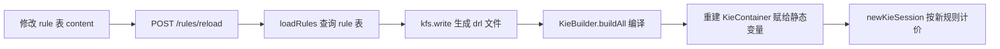

# 订单计价收尾与规则动态化：从数据库加载规则、不重启更新

距离计算已经完成，规则文件也已就绪，这一篇把订单计价的代码收尾：`calculateAmount` 里组装 Fact 对象、触发规则、回填价格，controller 接入计价后用 Swagger 实测两单验证费率。随后处理规则引擎落地时最常见的痛点：规则写在 `.drl` 文件里，改一条资费就得重启服务才生效。解法是把规则搬进数据库的 `rule` 表，Drools 对象改为基于库里的规则构建，再暴露一个 `/rules/reload` 接口重建 `KieContainer`，改完数据库调一下接口，新规则立即生效。

## 先给结论

- `calculateAmount` 先调 `getDistance` 算距离；寄件或收件任一地址解析失败，直接返回带 `amount=0` 和 `errorMsg` 的 Map，不进规则引擎。
- 走规则引擎的固定套路：`kieContainer.newKieSession()` → `insert` 两个 Fact（`AddressRule` 装参数、`AddressCheckResult` 收结果）→ `fireAllRules()` → 用完 `destroy()` 释放。
- 匹配成功后从 `AddressCheckResult.getResult()` 拿价格，包成 `BigDecimal` 写回 `orderDTO.amount`；返回的 Map 里 `orderDto` 和 `amount` 各放一份，controller 取用方便。
- 动态规则三步走：规则内容存数据库、Drools 对象基于库中规则创建、HTTP 接口触发重新加载。
- 核心方法 `loadContainerFromString`：查 `rule` 表 → `kfs.write` 写成 `.drl` 文件 → `KieBuilder.buildAll()` 编译 → `newKieContainer` 返回，属于模板代码。
- 启动时由 `CommandLineRunner` 自动加载一次，运行期改完库调一次 `/rules/reload` 即生效；实测续重单价 6 改 10，同一订单价格从 44 元变 60 元，全程没重启。

## calculateAmount：喂参数、触发规则、收结果

方法第一步是调 `getDistance`：通过百度地图坐标接口解析寄件人和收件人地址，算出公里数（保留两位小数）写回 DTO。地址可能乱填，解析失败时 `getDistance` 会往 `senderAddress` 或 `receiverAddress` 写入错误标记，所以先判这两种异常情况，命中任意一个就直接构造 Map 返回：`amount` 给 0，`errorMsg` 提示"无法计算订单距离和订单价格，请输入真实地址"，同时把 DTO 原样放回去，controller 那边就能通过 `errorMsg` 知道发生了什么。

正常解析的分支才进规则引擎。`KieContainer` 在之前的 Drools 配置类里已经创建完毕，直接注入，然后 `newKieSession()` 拿会话。要往工作内存里插两个 Fact 对象：

- `AddressRule`：封装计价参数。总重量从 `orderDTO.getOrderCargoDto().getTotalWeight()` 取，它藏在 DTO 里层的订单货物对象里，转成 `double`；距离直接用前面算好放回 DTO 的值。规则匹配靠的就是 `totalWeight` 和 `distance` 这两个字段。
- `AddressCheckResult`：空对象直接 insert，规则匹配成功后由规则文件的 `then` 部分往里写结果。

`fireAllRules()` 返回触发的规则条数，打印出来便于调试；session 用完记得 `destroy()` 释放。结果判断用 `isPostCodeResult()`，它初始值是 false，规则命中后 `then` 里会置为 true。真正的运费计算封装在 `DroolsRulesService.calcFee(addressRule)` 里，由规则文件的 `then` 部分调用，Java 侧只负责取 `getResult()` 回填。

```java
public Map calculateAmount(OrderDTO orderDTO) {
    // 计算订单距离
    orderDTO = this.getDistance(orderDTO);
    // 地址解析失败，直接返回
    if ("sender_error_msg".equals(orderDTO.getSenderAddress())
            || "receiver_error_msg".equals(orderDTO.getReceiverAddress())) {
        Map map = new HashMap();
        map.put("amount", "0");
        map.put("errorMsg", "无法计算订单距离和订单价格，请输入真实地址");
        map.put("orderDto", orderDTO);
        return map;
    }
    // 创建规则引擎会话
    KieSession session = kieContainer.newKieSession();
    // Fact对象：计价参数
    AddressRule addressRule = new AddressRule();
    addressRule.setTotalWeight(orderDTO.getOrderCargoDto().getTotalWeight().doubleValue());
    addressRule.setDistance(orderDTO.getDistance().doubleValue());
    session.insert(addressRule);
    // Fact对象：接收计算结果
    AddressCheckResult addressCheckResult = new AddressCheckResult();
    session.insert(addressCheckResult);
    // 触发所有规则，返回触发条数
    int fire = session.fireAllRules();
    System.out.println("触发了" + fire + "条规则");
    // 释放session
    session.destroy();
    // 判断规则匹配结果
    if (addressCheckResult.isPostCodeResult()) {
        System.out.println("规则匹配成功，订单价格为：" + addressCheckResult.getResult());
        orderDTO.setAmount(new BigDecimal(addressCheckResult.getResult()));
    }
    Map map = new HashMap();
    map.put("orderDto", orderDTO);
    // 单独再放一份amount，controller取用方便，有一定数据冗余
    map.put("amount", addressCheckResult.getResult());
    return map;
}
```

计价规则本身在 `orderAmountCalc.drl` 里，四条规则共用一个 `activation-group`（组内只会命中一条），`salience` 控制优先级，数字越大越先匹配：

| 规则 | when 条件 | 计费 | salience |
| --- | --- | --- | --- |
| 1千克以内20元 | `totalWeight <= 1.00` | 固定 20 元 | 10 |
| 1千克以上、200公里以内 | `totalWeight > 1.00 && distance <= 200.00` | 首重 1kg 20 元，续重 6 元/kg | - |
| 1千克以上、200~500公里 | `totalWeight > 1.00 && distance > 200.00 && distance <= 500.00` | 续重 9 元/kg | 8 |
| 1千克以上、500公里以上 | `totalWeight > 1.00 && distance > 500.00` | 续重 15 元/kg | 7 |

以 200~500 公里这条为例，`then` 部分先给 `addressRule` 设首重、首重重量、续重单价，再调服务算出总费用写进结果对象：

```java
rule "1千克以上，订单距离在200~500公里的，首重1千克，首重价格20元，续重每1千克资费为9元"
activation-group "mygroup"
salience 8
when
    addressRule : AddressRule(totalWeight != null && totalWeight > 1.00 && distance > 200.00 && distance <= 500.00)
then
    addressRule.setFirstFee(20.00);
    addressRule.setFirstWeight(1.00);
    addressRule.setContinuedFee(9.00);
    DroolsRulesService droolsRulesService = new DroolsRulesServiceImpl();
    String orderAmount = droolsRulesService.calcFee(addressRule);
    checkResult.setPostCodeResult(true);
    checkResult.setResult(orderAmount);
    System.out.println("1千克以上，订单距离在200~500公里的，首重1千克，首重价格20元，续重每1千克资费为9元");
end
```

## controller 接入计价，两单实测

`OrderController` 原来的 `save` 方法只做 DTO 和实体互拷，订单价格一直没算。现在在真正 save 之前先调 `orderService.calculateAmount(orderDTO)`，从返回的 Map 里取回 `orderDto` 拷到 `order`；地址校验没过就直接返回 DTO，不做保存；价格从 `map.getOrDefault("amount", "20")` 取，取不到兜底默认 20，相对保险。

```java
@PostMapping("save")
public OrderDTO save(@RequestBody OrderDTO orderDTO, HttpServletResponse res) {
    Order order = new Order();
    // 调用service计算订单价格
    Map map = orderService.calculateAmount(orderDTO);
    orderDTO = (OrderDTO) map.get("orderDto");
    // 地址校验失败，直接返回
    if ("sender_error_msg".equals(orderDTO.getSenderAddress())
            || "receiver_error_msg".equals(orderDTO.getReceiverAddress())) {
        return orderDTO;
    }
    // 设置订单金额，取不到时兜底默认20
    order.setAmount(new BigDecimal(map.getOrDefault("amount", "20").toString()));
    orderService.saveOrder(order);
    OrderDTO result = new OrderDTO();
    BeanUtils.copyProperties(order, result);
    return result;
}
```

测试用 debug 方式启动 OmsApplication，端口 8186，走 Swagger 调 `/order/save`。DTO 属性很多，其实只要三样：`senderAddress`（北京市 玉兴花园小区）、`receiverAddress`（北京市 百度大厦）、`orderCargoDto.totalWeight` 填 3.5；`amount`、`distance` 是算出来的，`id`、`createTime` 也不用传。断点里确认参数封装无误后放行，控制台输出触发 1 条规则，价格 32。

手工对账：两个地址都在北京，距离必然落在 200 公里以内；3.5kg 减去首重 1kg 剩 2.5kg，小数舍弃按 2kg 计续重，2 × 6 = 12 元，加首重 20 元正好 32。放行后能看到 save 发出的 insert 语句，`amount` 字段就是 32。再把重量改成 5 重发一次：5 - 1 = 4kg，4 × 6 = 24，加 20 得 44，返回值里 `amount` 也是 44。计价链路验证通过。

## 动态规则：规则从文件搬进数据库

规则写死在 `.drl` 文件里的代价很明确：资费一变就要改文件，并且必须重启服务才生效。动态规则的实现思路三句话：把规则文件的内容存到数据库；`KieContainer`、`KieFileSystem` 这批 Drools 对象改为基于库里的规则创建；再提供一个 HTTP 访问接口，规则发生变化时请求一下，重新加载数据库中的规则并重建这批对象，其中最关键的就是 `KieContainer`。

第一步是建表，`pd_oms` 库里加一张 `rule` 表：

```sql
CREATE TABLE rule (
  id bigint(20) NOT NULL AUTO_INCREMENT,
  content text NOT NULL,
  rule_key varchar(255) NOT NULL,
  version varchar(255) NOT NULL,
  create_time varchar(255) NOT NULL,
  last_modify_time varchar(255) DEFAULT NULL,
  PRIMARY KEY (id),
  UNIQUE INDEX (rule_key),
  UNIQUE INDEX (version)
) ENGINE = InnoDB CHARACTER SET = utf8;
```

`content` 是主角，存整个规则文件的内容，必须用 `text` 类型，varchar 长度明显不够；`rule_key` 是规则标识，`version` 是版本号，两个字段都建了唯一索引。配套代码三小步：`entity` 包下建 `Rule` 实体类，属性与表字段一一对应；`mapper` 包下建 `RuleMapper` 接口，继承 MyBatis-Plus 的 `BaseMapper<Rule>` 并加 `@Mapper` 注解；只用通用增删改查，映射 XML 可以不提供。

## 热加载核心：ReloadDroolsRulesService 与两个触发入口

`ReloadDroolsRulesService` 放在 `service.impl` 包下，注入 `RuleMapper`；容器声明成 `public static KieContainer kieContainer`，全局唯一、由本类创建赋值，不走注入。

三个方法：`loadRules()` 用 `ruleMapper.selectList(null)` 查出所有规则；`reload()` 调 `loadContainerFromString(loadRules())` 拿到新容器赋给静态变量；`loadContainerFromString` 是重点，套路是把库里查出的规则集合逐条写成 `.drl` 文件（文件名用内容的 `hashCode`，避免重名），再交给 `KieBuilder` 全量编译，最后按默认 `ReleaseId` 创建容器返回。这段属于模板代码，能读懂流程即可。

```java
@Service
public class ReloadDroolsRulesService {
    @Autowired
    private RuleMapper ruleMapper;
    // 全局唯一容器对象，用于创建Session操作Drools
    public static KieContainer kieContainer;

    // 查询数据库中所有的规则
    public List<Rule> loadRules() {
        return ruleMapper.selectList(null);
    }

    // 重新创建KieContainer对象
    public void reload() {
        KieContainer kieContainer = this.loadContainerFromString(loadRules());
        this.kieContainer = kieContainer;
    }

    // 根据规则内容创建KieContainer对象
    public KieContainer loadContainerFromString(List<Rule> ruleList) {
        KieServices ks = KieServices.Factory.get();
        KieRepository kr = ks.getRepository();
        KieFileSystem kfs = ks.newKieFileSystem();
        for (Rule rule : ruleList) {
            String drl = rule.getContent();
            kfs.write("src/main/resources/" + drl.hashCode() + ".drl", drl);
        }
        KieBuilder kb = ks.newKieBuilder(kfs);
        kb.buildAll();
        KieContainer kieContainer = ks.newKieContainer(kr.getDefaultReleaseId());
        return kieContainer;
    }
}
```

容器重建有两个触发入口。一是项目启动时：写一个类实现 Spring Boot 提供的 `CommandLineRunner` 接口，它只声明了一个 `run` 方法，属于生命周期方法，项目启动时框架会自动回调。`run` 里就一行，调 `reload()`。注解用 `@Component`，加 `@Service` 效果相同，本质上没区别。

```java
@Component
@Slf4j
public class CommandLineRunnerImpl implements CommandLineRunner {
    @Autowired
    private ReloadDroolsRulesService rules;

    @Override
    public void run(String... args) throws Exception {
        rules.reload();
    }
}
```

二是运行期刷新：`RulesReloadController` 对外暴露 `/rules/reload` 接口，请求一到就执行 `reload()`，这就是不停服切规则的开关。

```java
@Controller
@RequestMapping("/rules")
public class RulesReloadController {
    @Resource
    private ReloadDroolsRulesService rules;

    @ResponseBody
    @RequestMapping("/reload")
    public String reload() throws IOException {
        rules.reload();
        return "ok";
    }
}
```

收尾还有两处改造。原来的 `DroolsAutoConfiguration` 配置类从 classpath 的 rules 目录扫描 `.drl` 文件构建 `KieFileSystem`、`KieContainer`、`KieBase`、`KieSession` 那一套，现在规则全在数据库，本地规则文件都不需要了，配置类整个失效；类不删，把 `@Configuration` 注释掉即可。相应地，`OrderServiceImpl` 里原来 `@Autowired` 注入的 `KieContainer` 在 Spring 容器里已经不存在了，创建 session 改用 reload 服务里的静态容器，原注入字段注释掉：

```java
// 原来：@Autowired private KieContainer kieContainer;
KieSession session = ReloadDroolsRulesService.kieContainer.newKieSession();
```

## 验证：改库不重启，44 变 60

先往 `rule` 表插一条数据：`id` 给 1，`content` 把规则文件内容整段复制进去，`create_time`、`last_modify_time` 随便给，重点就是 `content`，项目启动时查的就是它。完整的做法应该在前端提供一套界面维护这张表的增删改查，演示里直接手动改表。



debug 启动，断点停在 `CommandLineRunnerImpl.run()`，证明启动即触发加载；放行后控制台能看到对 `rule` 表的查询和容器构建。Swagger 重发上一单（重量 5，地址不变），价格 44，与文件版规则一致。

把 `content` 复制出来改：200 公里以内那条规则的续重单价从 6 改成 10，粘回去提交。此时不调接口直接下单，结果仍是 44，因为库里变了但容器还没重建。调一次 `http://localhost:8186/rules/reload`，返回 ok，控制台重新发出查询 `rule` 表的 SQL。参数一个不动再执行，`amount` 变成 60：超重 4kg × 10 元 = 40，加首重 20，正好 60。规则动态切换验证通过。

## 小结

- `calculateAmount` 的完整链路：算距离 → 地址异常兜底 → `newKieSession` + 两个 Fact → `fireAllRules` → 结果回填 DTO 与 Map；session 用完 `destroy()`。
- 费率细节全部在 `.drl` 规则和 `calcFee` 服务里，Java 侧只负责喂参数、收结果，`activation-group` 保证一组规则只命中一条。
- 动态规则的本质是"容器可重建"：规则存 `rule` 表，`KieContainer` 由库内容构建，reload 一次就换一套规则。
- 两个触发时机：启动时 `CommandLineRunner.run()` 自动加载，运行中调 `/rules/reload` 手动刷新。
- 原自动配置类注释失效、业务层改用静态容器后，规则来源从 classpath 文件彻底切到了数据库。
