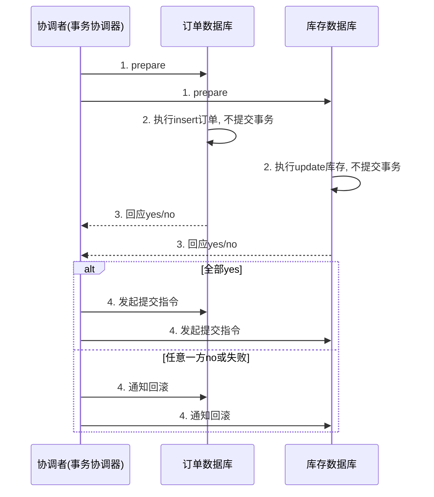
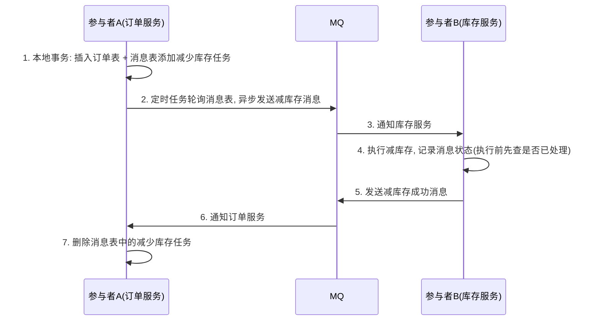

# 分布式事务理论地基：本地事务、CAP、2PC/TCC/消息队列最终一致性

进入司机端、快递员端的开发之前，先补一块理论地基：分布式事务。本篇从复习事务与本地事务入手，界定什么才算分布式事务，再讲 CAP 理论这一理论基础，最后过一遍三种解决方案：两阶段提交协议（2PC）、事务补偿（TCC）、基于消息队列实现最终一致性。三者是方向性的指导思想而非落地技术，具体落地靠本章最后登场的 Seata。

## 先给结论

- 事务是由一组操作组成的工作单元，具备 ACID 四个特性；本地事务就是用关系型数据库控制事务，单体应用一个库多张表的场景全属于它。
- 判断分布式事务只看"多个系统通过网络协同完成一次事务"，不看访问的是不是不同数据库：跨系统操作同一个库也算。
- 关系型数据库只能保证自己节点上的本地事务，跨系统的一致性保证不了，这正是分布式事务要解决的问题。
- CAP 三者不可兼得，只能满足其二；分布式系统里 AP 组合更常见，放弃的是强一致性，追求最终一致性。
- 2PC 追求强一致但性能低下；TCC 在业务层做补偿、灵活但开发成本高；MQ 方案异步协调性能高，代价是频繁读写数据库。
- TCC 的三个接口与 MQ 方案的业务执行方法都必须实现幂等，因为失败后会不断重试。

## 事务与本地事务：一次复习

事务是由一组操作组成的一个工作单元：一个业务可能要操作多张表，这一系列数据库操作整体构成一个事务，具备四个特性：

| 特性 | 含义 | 例子 |
| --- | --- | --- |
| 原子性（atomicity） | 单元中的操作要么全部执行成功，要么全部失败 | 不允许部分成功部分失败 |
| 一致性（consistency） | 执行前后数据都是完整的，从一个正确状态转到另一个正确状态 | 转账：A 减 100 同时 B 加 100；出错则回滚到初始状态，不出现中间状态 |
| 隔离性（isolation） | 事务与事务之间完全隔离 | 未提交的中间数据，其他事务查询不到 |
| 持久性（durability） | 事务完成后对数据的改变永久存储起来 | 即使断电、宕机，数据依然存在 |

本地事务说的是事务控制的方式：用关系型数据库来控制事务。关系型数据库通常都有 ACID 特性，写 SQL 时先 `begin transaction` 开启事务，执行多条 SQL 后 `commit` 提交。传统的单体应用把数据全部存储在一个数据库中，业务再复杂也只是同一个库里的多张表，借助关系型数据库就能完成事务控制，这类场景都属于本地事务。

## 什么才算分布式事务

分布式事务一定出现在分布式系统中，传统单体应用涉及不到它。典型场景是电商下单：一次"创建订单"业务要调用订单系统往订单数据库插入订单，再调用库存系统扣减库存，整个操作由两个系统通过网络协同完成，这就叫分布式事务。

关键判断标准：强调的是"多个系统通过网络协同完成一个事务的过程"，并不强调访问了不同的数据库。即使订单表和库存表都在同一个数据库里，订单系统、库存系统分别部署、协同操作，这依然属于分布式事务。看的是系统数量，不是数据库数量。

难点也在于此：关系型数据库只能保证自己这一份数据的本地事务，保证不了两个库必须一致。订单库提交成功、库存库事务失败的情况完全可能出现，此时整个分布式事务就是失败的，数据已经不一致。

## CAP 理论：分布式事务的理论基础

研究分布式事务的处理方案之前，先要懂 CAP 理论：分布式系统在设计时只能在一致性（Consistency）、可用性（Availability）、分区容忍性（Partition Tolerance）三者中满足两种，无法兼顾三种。

用一个常见架构说明：客户端请求先到 Nginx，负载均衡转发到节点 A、B、C 三个服务，用户数据在每个节点上都存一份。

- 一致性：三个节点存的是同一份用户数据，必须保持同一时刻数据一致。同一个用户的请求这次到 A、下次到 B，返回的数据不能不一样。
- 可用性：一个节点宕机不影响整个集群对外提供服务，只要任意一个节点活着系统就可用；多部署节点正是为了这种高可用。
- 分区容忍性：节点之间难免出现网络中断、延迟，网络不通后数据分散在不同节点上，形成网络分区，与该节点不连通的部分访问不到数据。提高办法是把数据项复制到多个节点：数据存在的节点越多，分区容忍性越高。

矛盾随之而来：副本越多，一致性越难保证；为保证一致性，更新所有节点的时间越长，可用性又降低了。三种特性此起彼伏，只能取舍：

| 组合 | 放弃什么 | 加强什么 | 典型系统 |
| --- | --- | --- | --- |
| CA | 分区容忍性 | 一致性、可用性 | 关系型数据库 |
| AP | 强一致性 | 可用性、分区容忍性 | 很多 NoSQL（非关系型）数据库 |
| CP | 可用性 | 一致性、分区容忍性 | 有强一致性要求的系统，如银行转账 |

分布式系统里 AP 应用比较多，强一致性指写入成功之后立刻要查出最新数据；最终一致性则允许暂时的数据不一致。典型例子是订单退款：今日退款成功，明日账户到账，中间数据不一致，只要在用户可接受的时间内退款事务走完，最终数据就是一致的。

## 三种解决方案：指导思想而非落地技术

先声明一点：下面三种方案并不是具体技术，而是方向性的指导思想；真正落地要靠具体技术，也就是本章最后要讲的 Seata，阿里提供的分布式事务解决方案的具体实现。

### 2PC：两阶段提交协议

2PC（Two-phase Commit Protocol）是为解决分布式系统数据一致性问题出现的协议，由协调者和参与者两部分构成。协调者往往就是一个应用程序，起协调作用；参与者往往是关系型数据库，Oracle、MySQL 本身就支持该协议。

以订单加库存为例，应用程序连接两个数据源，事务协调器居中协调：

第一阶段是准备阶段：参与者执行本地事务但先不提交，然后向协调者投票回应 yes 或 no；第二阶段，两边都是 yes 就发起最终提交，两个库分别提交各自的本地事务，只要有一方 no 或失败，就通知所有参与者回滚。最核心的角色是协调者，相当于大管家，保证两个本地事务要么同时成功，要么同时失败。

优点：实现强一致性，且部分关系型数据库支持。缺点：整个事务执行需要协调者在多个节点之间协调，中间全是网络通信，事务执行时间被拉长，性能低下。

### TCC：事务补偿

TCC 是 Try、Confirm、Cancel 三个单词的首字母，基于两阶段提交协议演化的业务层事务控制方案，把分布式事务分成三个阶段：

- Try：检查及预留业务资源。下单场景中，订单系统检查业务约束（比如存在未完成订单时不允许提交新订单），库存系统检查库存是否足够，并预留、锁定相关资源，从业务上检查数据是否合理合法、资源是否完备。
- Confirm：确认执行业务操作，对 Try 阶段预留的资源正式执行：订单系统插入订单，库存系统扣减库存，执行完事务就已提交。
- Cancel：取消执行业务操作，释放 Try 阶段预留的资源。它不靠事务回滚，而是编程实现反向操作：下单成功但库存扣减失败，就执行 delete 删掉刚插入的订单；库存扣减成功但下单失败，就再执行一个 update 把库存加回去。对已提交的事务做反向操作恢复原状，"事务补偿"因此得名。

优点：最终能保证数据一致，事务控制在业务层实现，灵活性好。缺点：开发成本高，每个事务的每个参与者都要自己实现 try、confirm、cancel 三个接口（实现框架有 Spring Boot 加 Atomikos 或 Bitronix 这类）。

还要注意：恢复数据不靠回滚，靠反复重试反向操作，所以三个接口都必须实现幂等性，即同一个操作无论请求多少次，结果都相同。查询是典型的幂等操作，insert 显然不是；不保证幂等的话，Cancel 重试多次就可能本想加回一个库存、结果加了两三份。常见的保证方式有三种：业务方法中判断是否已执行过（标志位），执行过就不再执行；缓存所有请求和处理的结果，已处理的直接返回结果；数据库中加状态字段（未处理、已处理），只处理未处理状态的数据。

### 消息队列实现最终一致性

第三种方案把分布式事务拆分成多个本地事务来完成，由消息队列异步协调。与前两种的差异在于：2PC 靠事务回滚、TCC 靠补偿机制恢复原始状态，这种方式不允许恢复，分布式事务操作最终只允许成功、不允许失败，靠消息重发机制兜底。

以下单减库存为例（参与者 A 是订单服务，参与者 B 是库存服务）：

流程对应上图：双方先检查并预留资源；订单服务在本地事务中添加订单记录，同时向消息表（需要自己创建）插入一条"减少库存任务"消息；定时任务轮询消息表，表里有数据说明库存还没扣减，就把消息异步发到 MQ 通知库存服务；库存服务扣减库存并记录消息状态（扣减前先查这条消息是否处理过，避免重复执行），再向 MQ 发成功消息；订单服务收到后删除消息表里的任务，分布式事务完成。

若库存没扣减成功，成功消息就发不出来，消息表记录一直存在，定时任务不断轮询重发，库存服务再次尝试扣减直到成功。特点：只许成功，不许失败，失败就重发直到最终成功。

这种方式同样要求业务执行方法实现幂等：预留资源成功理论上要求正式执行成功，失败会重试。优点是由 MQ 异步协调，性能较高，不用实现 try/confirm/cancel 接口，开发成本比 TCC 低；缺点是基于关系数据库本地事务，消息表带来频繁读写库，压力集中在数据库，对高并发不是最佳方案。

三种方案横向对比：

| 方案 | 一致性 | 失败恢复 | 优点 | 缺点 |
| --- | --- | --- | --- | --- |
| 2PC 两阶段提交 | 强一致性 | 事务回滚 | 部分关系型数据库原生支持 | 协调者在多节点间网络协调，执行时间长，性能低下 |
| TCC 事务补偿 | 最终一致 | 业务反向操作（补偿） | 业务层控制，灵活性好 | 每个参与者实现三个接口，开发成本高 |
| 消息队列最终一致性 | 最终一致 | 不回滚，消息重发直到成功 | 异步协调性能高，开发成本低 | 频繁读写数据库，高并发不是最佳方案 |

## 小结

- 本地事务由关系型数据库的 ACID 特性保证；跨系统协同后数据库只能自保，一致性要靠分布式事务方案补齐。
- 判断分布式事务只看"多个系统通过网络协同"，与访问几个数据库无关，同一数据库跨系统操作也算。
- CAP 只能取二，分布式事务通常走 AP 路线：放弃强一致性，追求最终一致性，订单退款今日退、明日到账是典型。
- 2PC 强一致但协调成本高，TCC 业务层补偿灵活但三个接口都要自己写，MQ 最终一致性能好但消息表频繁读写库。
- TCC 与 MQ 方案的重试机制决定了幂等是硬性要求，可以用标志位判断、缓存请求结果、数据库状态字段来保证。
- 三种方案停留在指导思想层面，落地到具体技术就是本章最后要讲的 Seata。
