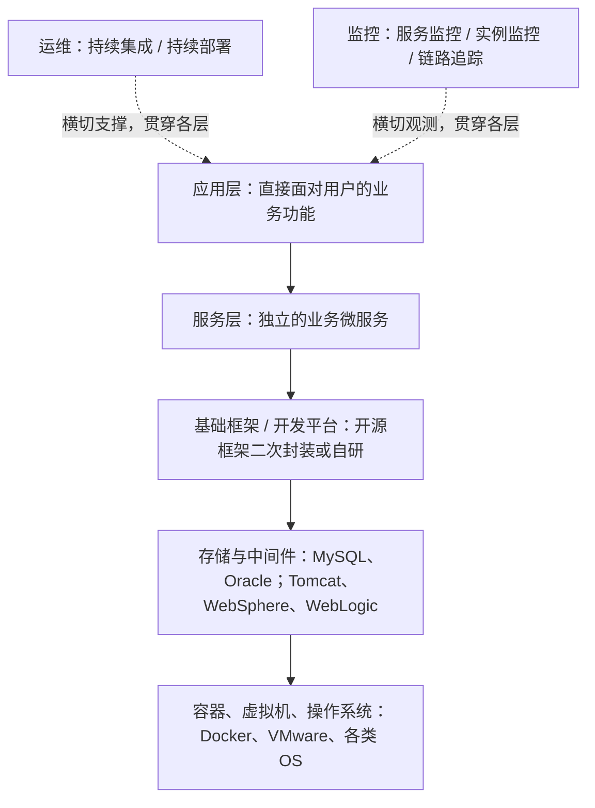

# 品达 TMS 总结①：软件架构体系全景（各端各服务如何分层分工）

进入第十二章项目总结，第一块收拢的内容是软件架构体系。这张图在前面课程里出现过，正因为足够重要，总结阶段才值得单独再讲一遍：一个软件从最底下的操作系统，到用户眼前能看到的功能，中间到底分了哪几层、每层各管什么、谁是谁的基础。本篇把这张图从下往上读一遍，再看横切在体系上的运维与监控两条线，最后回到学习者视角——现阶段该主攻哪几层。

## 先给结论

- 架构体系图要从下往上读：下层是上层的基础，和盖楼一个道理，先打地基，才能一层层往上盖。
- 最底层是容器、虚拟机、操作系统，Docker、VMware、各类 OS 都属于这一层，它是整个软件运行的环境与地基。
- 往上是存储组件与中间件：数据存储用 MySQL、Oracle 这类数据库，服务承载靠 Tomcat、WebSphere、WebLogic 这类容器中间件。
- 再往上是基础框架/开发平台：公司往往基于开源框架二次封装出自己的一套平台，也有完全自研的，这是开发层面的基础。
- 开发平台之上是一个个独立的业务微服务（服务层），最顶上的应用层直接面对用户、暴露给前端调用。
- 运维（持续集成/持续部署）与监控（服务监控、实例监控、链路追踪）不属于某一层，而是横切支撑整个体系；现阶段的主战场是服务层与应用层。

## 读图方法：从下往上，下层是上层的基础

这张软件架构体系图反映的是整个软件架构的层次关系。看图的方式只有一种：从下往上看，下边一层是上边一层的基础。类比盖楼：先打地基，然后才能一层一层往上盖。软件架构同理——没有底层的运行环境，上面的任何东西都跑不起来；没有中间的存储与平台，业务服务无从开发。

整张图的结构如下：

主体是一条自下而上的依赖链，运维与监控两个模块则从侧面贯穿所有层。

## 逐层拆解：每一层各管什么

| 层次 | 图上位置 | 典型内容 | 职责 |
| --- | --- | --- | --- |
| 应用层 | 顶层的"应用"模块 | 用户管理、文章管理等业务功能 | 直接面对用户，暴露给前端调用 |
| 服务层 | 第二层的"服务"模块 | 一个个业务微服务 | 承载具体业务，服务之间相互独立 |
| 基础框架/开发平台 | 蓝色平台模块 | 开源框架二次封装的公司平台，或完全自研 | 统一的开发基础 |
| 存储与中间件 | "存储"、"中间件"两个模块 | MySQL、Oracle；Tomcat、WebSphere、WebLogic | 数据存储与服务运行承载 |
| 容器、虚拟机、操作系统 | 最底层模块 | Docker、VMware、各类操作系统 | 整个软件的运行环境与地基 |

最底下的一层是容器、虚拟机、操作系统。一个软件要运行，先得有运行环境：容器比如 Docker，虚拟机比如 VMware，再加上各种各样的操作系统。这一层是整个软件运行的基础，没有它，上层一切都无从谈起，所以它是图里的地基。

在运行环境之上，是存储组件和中间件。存储解决"数据放在哪"：关系型数据库常用的就是 MySQL、Oracle。中间件解决"服务跑在什么上面"：Tomcat，以及 WebSphere、WebLogic 这类容器中间件，都服务于整个软件环境的运行。

再往上是基础框架/开发平台。这一层的特征是"每个公司都有一套"：常见的做法是基于某些开源框架做二次封装，形成公司自己的开发平台；也有公司完全自研。从开发层面看，它是开发的基础——统一的框架、统一的规约都来自这一层。

有了开发平台，就可以在上面开发各种各样的业务微服务，这就是服务层。这些服务和具体要开发的业务功能相关，一个个相互独立。服务层之上就是应用层：应用层直接面对用户，比如用户管理、文章管理这类业务功能，直接暴露给前端调用。整个体系里离用户最近的，就是这一层。

## 横切的两条线：运维与监控

分层主体之外，图上还有两个不归属任何一层的模块：运维与监控。它们从侧面支撑整个体系。

运维对应的是持续集成、持续部署（CI/CD），课件里列出的工具链分四组：

| 板块 | 工具 | 说明 |
| --- | --- | --- |
| 持续集成 | GitLab、Jenkins、Nexus | 代码托管、构建与制品管理 |
| 容器化 | Docker、Swarm/K8s | 容器与集群编排 |
| 中间件 | Quartz（分布式任务）、Kafka（消息队列）、Redis（缓存存储） | 通用中间件支撑 |
| 数据服务 | ELA（日志系统）、MySQL、Apache Druid（实时统计分析） | 日志、数据库与实时分析 |

监控这条线覆盖三类内容：服务的监控、实例的监控、链路追踪。服务监控盯着每个服务的运行状态，实例监控盯着每一个部署实例，链路追踪把一次请求跨服务调用的完整路径串起来。三者合在一起构成监控体系，是系统上线之后发现问题、定位问题的依靠。

## 小结

- 这张体系图的核心读法是自下而上：容器/虚拟机/操作系统 → 存储与中间件 → 基础框架/开发平台 → 服务层 → 应用层，下层永远是上层的基础。
- 应用层直接暴露给前端，服务层是独立的业务微服务，两者的开发是目前学习阶段的主战场；但只盯着这两层不够，还需要对整个架构体系有整体认识——知道自己的代码落在哪层、依赖哪些下层支撑。
- 开发平台有两种来路：开源框架二次封装，或完全自研；它是团队统一的开发基础。
- 运维（CI/CD）与监控（服务监控、实例监控、链路追踪）横切所有层，工具链从 GitLab、Jenkins、Nexus 到 Docker、Swarm/K8s，再到 Quartz、Kafka、Redis 与 ELA、Druid，各司其职。
- 体系图回答的是"一个软件分几层"的通用问题；下一单元的系统架构图则回答"品达 TMS 这个系统具体怎么分层、一次请求怎么流"。
