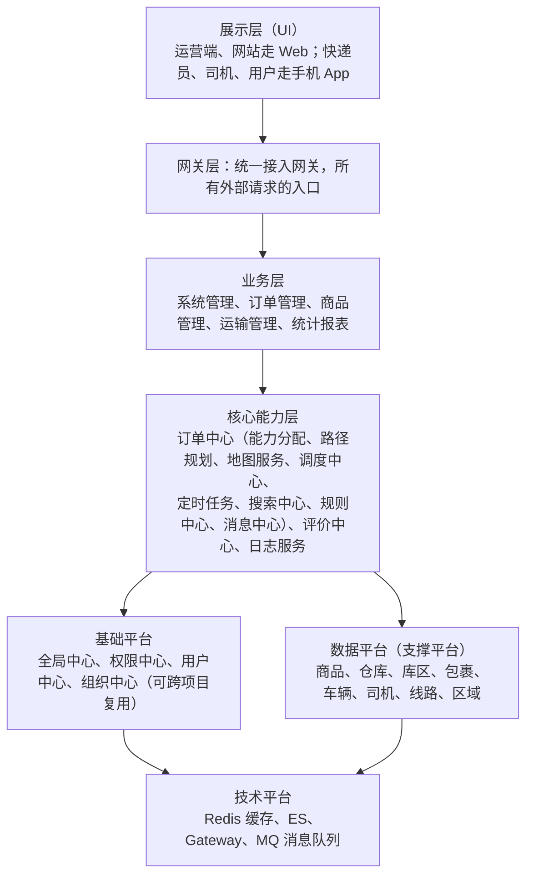

# 品达 TMS 总结②：系统架构全景（链路、中间件与数据流向）

上一节讲的是通用软件的架构体系，这一节落到品达物流 TMS 项目本身：整个系统按什么层次划分、每层放了哪些服务、一次请求从用户端进来之后沿着什么链路流动。整张系统架构图从上到下依次是展示层、统一接入网关、业务层、核心能力层，往下压着基础平台、数据平台和技术平台，右侧另有监控治理与运维平台两条保障线。全图采用微服务模式，强调服务的解耦与独立部署。

## 先给结论

- 系统用分层方式归类：展示层 → 统一接入网关 → 业务层 → 核心能力层 → 基础平台/数据平台 → 技术平台，右侧挂监控治理与运维平台。
- 展示层即 UI 层：Web 端给网点、运营管理端的内部工作人员用；手机 App 分两类，快递员、司机是作业人员端，用户端面向寄件的外部消费者。
- 统一接入网关是所有外部请求的入口，Web 和 App 的流量都从这里进系统。
- 业务层放页面直接对应的功能（系统管理、订单管理、商品管理、运输管理、统计报表）；核心能力层沉淀一个个可复用的服务，订单中心是其中最重的一块。
- 基础平台（全局、权限、用户、组织中心）是外部通用平台，可以整体拿到另一个项目复用；数据平台沉淀车辆、司机、线路等物流主数据。
- 不管是能力还是支撑，最终都落在技术平台上：Redis 缓存、ES、Gateway 网关、MQ 消息队列；运行期由监控治理与运维平台兜底。

## 一条请求的流向：从展示层到技术平台

最上面是展示层，也叫 UI 层，即用户能够直接看到、直接面对用户的部分：Web 界面和手机 App。Web 端应用主要给网点、运营管理端这些内部工作人员使用；手机 App 分两类——快递员（以及司机）属于内部作业人员，用户端则面向外部的消费者，想寄快递的用户有自己独立的 App。所有这些统称展示层。

往下是统一接入网关，也就是网关层。不管流量来自 Web 还是 App，所有请求都从这里进入系统，由它做统一接入。再往下是应用层，放的是系统管理、订单管理这类页面直接对应的业务功能。

应用层之下是能力平台。它由一个个服务构成，所有服务加在一起，构成整个能力平台。订单中心是其中分量最重的部分，包含八项子能力：能力分配、路径规划、地图服务、调度中心、定时任务、搜索中心、规则中心、消息中心；旁边还有评价中心、日志服务。

能力平台需要支撑平台的支撑：车辆、司机、线路这些物流主数据，在图上展开为数据平台——商品、仓库、库区、包裹、车辆、司机、线路、区域。此外还有基础平台，它是外部通用平台：全局中心、权限中心、用户中心、组织中心。这一层是通用的，可以完全拿到另外一个项目里继续用——另一个项目同样会有权限、组织、用户这些需求。

最底下是技术平台。说白了，所有这些能力也好、支撑也好，最终都需要落到相应的某个具体技术上：缓存用 Redis，检索用 ES，接入靠 Gateway 网关，异步靠 MQ 消息队列。

整条链路画出来是这样的：

从上往下看，这就是一次请求在系统里的数据流向：用户从展示层发起请求，经统一接入网关进入业务层，业务层调用核心能力层的能力，能力层又踩在基础平台与数据平台之上，最终所有环节都落到技术平台的具体组件上。

## 技术平台、监控治理与运维平台：三条保障线

主链路之外，架构图右侧还有两块内容，和技术平台一起构成系统的保障体系。

技术平台在图上对应一组具体的基础服务：

| 服务 | 对应能力 |
| --- | --- |
| open-common | 通用基础库 |
| open-cache | 缓存 |
| inner-gateway | 内部网关 |
| Generate-ID | ID 生成 |
| save-code | 代码保存服务 |
| Service-es | 封装 Elasticsearch |
| Service-mq | 封装消息队列 |
| Service-grid | 网格服务 |

监控治理这一块由六部分构成：服务注册（注册中心）、服务监控、配置中心、链路追踪、日志中心、报警中心。服务启动要注册，运行状态要监控，配置统一下发，跨服务调用靠链路追踪串起来，日志集中收拢，异常触发报警——整个这一块合起来就叫监控治理。

运维平台则覆盖构建与发布：Jenkins、Nexus、Git、Swarm/K8s、灰度发布。代码在 Git 托管，Jenkins 做持续构建，Nexus 管制品，Swarm/K8s 负责容器编排，再配合灰度发布控制上线节奏。

| 板块 | 组件 | 作用 |
| --- | --- | --- |
| 技术平台 | open-common、open-cache、inner-gateway、Generate-ID、Service-es、Service-mq 等 | 把上层能力落到具体技术组件 |
| 监控治理 | 服务注册、服务监控、配置中心、链路追踪、日志中心、报警中心 | 运行期观测与治理 |
| 运维平台 | Jenkins、Nexus、Git、Swarm/K8s、灰度发布 | 持续集成与发布保障 |

整个项目就是用分层的这种方式来归类的：每一层职责清楚，上层调用下层，横向由监控治理和运维平台保障。

## 小结

- 品达 TMS 的系统架构按层归类：展示层（Web + 手机 App）→ 统一接入网关 → 业务层 → 核心能力层 → 基础平台与数据平台 → 技术平台，右侧是监控治理与运维平台。
- 请求链路固定：Web/App 发起 → 统一接入网关统一入口 → 业务层 → 核心能力层 → 基础/数据平台，最终落到 Redis、ES、Gateway、MQ 这些技术组件上。
- 核心能力层里订单中心最重，八项子能力覆盖从能力分配、路径规划到调度、搜索、消息的完整过程；评价中心、日志服务与之并列。
- 基础平台的四个中心（全局、权限、用户、组织）是外部通用件，可整体复用到其他项目；数据平台沉淀商品、仓库、库区、包裹、车辆、司机、线路、区域这些物流主数据。
- 技术平台把能力落成具体服务：open-common、open-cache、inner-gateway、Generate-ID、Service-es、Service-mq 等；监控治理与运维平台分别负责运行期保障和构建发布。
- 架构图讲到这里，图的下一节是"技术架构"，具体的技术选型与中间件细节在那里展开。
