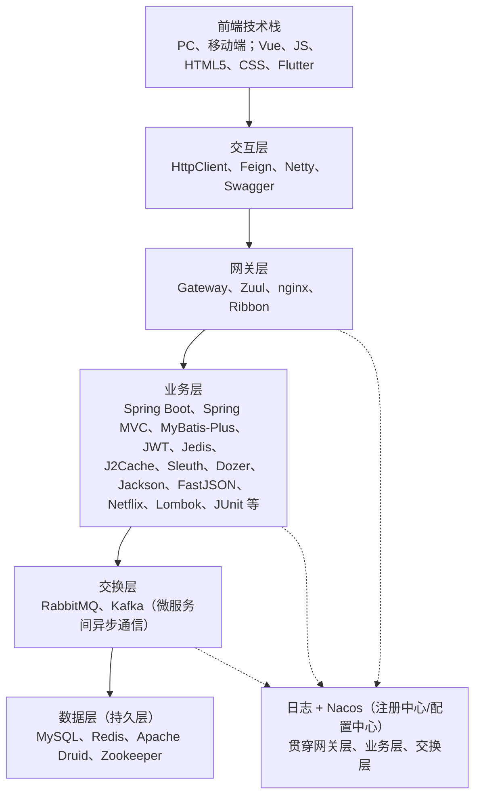

# 品达 TMS 总结③：技术架构全景（微服务技术栈选型与分层落地）

上一节过完了系统架构图，知道系统分成哪几层、每层放什么服务；这一节把镜头再拉近一步，看技术架构：整个项目到底用了哪些具体技术。项目用到的技术非常多，一口气罗列很难记住，所以这里的处理方式是分层归类：把每一个技术归进它所在的层次，从上到下六层看完，整套技术选型自然就清楚了。

## 先给结论

- 技术架构按六层归类：前端技术栈 → 交互层 → 网关层 → 业务层 → 交换层 → 数据层，每个技术都能归进某一层，相当于对全部技术做了一次统一分类。
- 项目重点在后端微服务开发，前端并没有真正去开发，而是直接拿过来使用的，前端技术栈（Vue、HTML5、CSS、Flutter）简单过一遍即可。
- 交互层解决两类交互：前端与后端之间、后端服务与服务之间，用到 HttpClient、Feign、Netty、Swagger；网关层做统一接入，技术栈是 Gateway、Zuul、nginx、Ribbon。
- 业务层是技术最密的一层：地基是 Spring Boot，其上叠着 Spring MVC、MyBatis-Plus、JWT、Jedis、J2Cache、Sleuth、Dozer、Jackson、FastJSON、Netflix、Lombok、JUnit 等一整套。
- 交换层管服务间的异步通信，走 RabbitMQ、Kafka 这类消息中间件；数据层（持久层）管数据的最终落地，是 MySQL、Redis、Apache Druid、Zookeeper。
- 日志与 Nacos 占据的层次最多：网关层、业务层、交换层都要记录日志，Nacos 同时兼任服务注册中心与配置中心，属于跨层的公共底座。

## 从接入到网关：上面三层

先看全景：

最上面是前端技术栈。设备侧分 PC 和移动端，代码侧用到 Vue、JS、HTML5、CSS、Flutter 这些。要说清楚的是，这个项目重点在后端微服务的开发，前端并没有真正去开发，而是直接拿过来使用的，所以前端部分了解用到这些技术就够了，不作重点展开。

往下是交互层，解决的是如何交互的问题，而且两头都有：往前是前端跟后端如何交互，往后是后端的服务跟服务之间如何交互。HttpClient、Feign、Netty、Swagger 都归在这一层。再往下是网关层，负责流量的统一接入，Gateway、Zuul、nginx、Ribbon 是这一层的技术栈，外部请求先过网关，再进业务。

## 业务层与交换层：技术最密的两层

六层里技术数量最多的是业务层。整个项目基于 Spring Boot 这个平台来开发，这是业务层的地基；地基之上叠了全套业务技术：

| 技术 | 在业务层中的角色 |
| --- | --- |
| Spring Boot | 项目的基础开发平台 |
| Spring MVC | Web 层框架 |
| MyBatis-Plus | 数据访问增强 |
| JWT | 登录认证令牌 |
| Jedis | Redis 客户端 |
| J2Cache | 二级缓存（声明式缓存一章的主角） |
| Sleuth | 分布式链路追踪 |
| Dozer | 对象转换 |
| Jackson、FastJSON | JSON 序列化 |
| Netflix | 微服务组件套件 |
| Lombok、Slf4j | 代码简化、日志门面 |
| Validation、Validator | 参数校验 |
| JUnit | 单元测试 |
| Otter | 数据同步（安装配置单独讲过一章） |

这张表里的名字，前面章节基本都单独打过照面：车辆轨迹服务一章的 Netty、分布式链路追踪一章的 Sleuth、声明式缓存一章的 J2Cache、Otter 安装配置一章的 Otter。学完各章再回头看这张架构图，每个标签背后都有对应的那一讲。

业务层往下是交换层。微服务之间的通信分两种：一种是直接调用，比如 Feign，归交互层管；另一种是异步交互，靠消息中间件完成，RabbitMQ、Kafka 就归到交换层。哪些环节走同步调用、哪些环节走异步消息，是整个项目业务代码编写时的一个基本决策，交换层就是为后者准备的。

## 数据层与贯穿组件：存储、日志与 Nacos

最底下是数据层，也叫持久层，回答的是数据最终如何存储。各层落地的技术如下：

| 层 | 技术 | 说明 |
| --- | --- | --- |
| 交换层 | RabbitMQ、Kafka | 微服务间异步通信 |
| 数据层 | MySQL | 业务数据的主力存储 |
| 数据层 | Redis | 基于内存，不做持久化，但存的是数据 |
| 数据层 | Apache Druid、Zookeeper | 与 MySQL 一同构成数据层选型 |

Redis 在这一层里比较特殊：它并不做持久化，主要基于内存工作，但它存的确实是数据，所以也归进数据层，而不是单拎出去。

按层归类之外，还有两类组件不属于某一层，而是横跨多层。一类是日志：不管是网关层、业务层还是交换层，都需要记录日志，Slf4j 这类日志组件到处都在用。另一类是 Nacos：它在系统里同时充当服务注册中心和配置中心，同样跨层使用。所以看这张架构图会发现，Nacos 和日志占据的层次最多。这也是微服务项目的普遍形态：业务技术各归各层，注册配置与日志则是所有层共用的公共底座。

## 小结

- 技术架构的看图方法是分层归类：前端 → 交互层 → 网关层 → 业务层 → 交换层 → 数据层，几十个技术各有归属，混不成一团。
- 接入侧三层各管一段：前端（Vue、HTML5、CSS、Flutter，直接拿来用）、交互层（HttpClient、Feign、Netty、Swagger）、网关层（Gateway、Zuul、nginx、Ribbon）。
- 业务层技术最密，Spring Boot 是地基，其上是 MVC、MyBatis-Plus、JWT、Jedis、J2Cache、Sleuth、Dozer 等全套组件；交换层用 RabbitMQ、Kafka 承担服务间异步通信。
- 数据层是 MySQL、Redis、Apache Druid、Zookeeper；Redis 基于内存而非持久化，但存的确实是数据，仍归入此层。
- 日志与 Nacos 贯穿网关层、业务层、交换层：前者处处要记，后者兼任注册中心与配置中心。
- 技术架构讲完，项目总结还剩最后一块拼图：下一节把从发件人下单到收件人签收的完整业务流程回放一遍。
