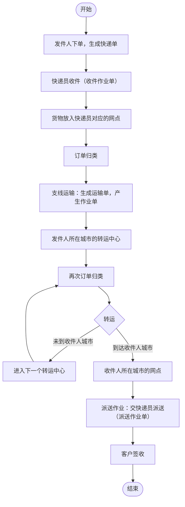

# 品达 TMS 总结④：从下单到签收的业务流程全景回放

技术架构讲完，项目总结走到最后一节：整体业务流程。这条流程比较长，反映的是从最初的发件人下单，一直到最终收件人签收的完整链条。把这条链从头到尾整体走一遍，在订单归类和转运作业这两个关键环节重点停留一下，整个项目在业务上做的事就串起来了。

## 先给结论

- 全链路：发件人下单 → 生成快递单 → 快递员收件 → 货物放入快递员对应的网点 → 订单归类 → 支线运输 → 转运中心 → 再次归类 → 多次转运 → 收件人所在城市的网点 → 派送作业 → 客户签收 → 结束。
- 下单阶段生成快递单；运输阶段先生成运输单，再根据运输单产生作业单，司机完全按作业单干活：作业单指明从某个地方开到某个地方，他收到作业、完成作业，他的作业就是转运。
- 节点分两种：网点处理本地或区域的物流，转运中心处理跨区域的转运；跨省件会依次穿过发件人城市的转运中心、收件人城市的转运中心，路途越长，进的转运中心越多。
- 订单归类是流程里反复出现的动作：网点归一次类，转运中心再归一次，归完类才决定下一程怎么运；前面智能调度一章讲的订单分类，落的就是这类环节。
- 单据与作业配套出现：收件作业单、运输作业单、入库作业单、出库作业单、派送作业单；运输业务类型分支线运输与专干线运输。
- 整条流程的重点就是两个：一个是订单归类，一个是转运作业。

## 全链路回放：从发件人下单到收件人签收

起点是发件人下单，下完单之后生成快递单，随后由快递员收件。收完件的货物放进快递员所对应的网点。在网点这个位置会有一个操作，叫订单归类：对所有的货物进行归类，前面在智能调度那一章其实已经讲过。归完类之后就要转运，也就是运输，先做支线运输，这个过程中会生成相应的运输单，再根据运输单产生作业单。司机怎么知道要把货从某个地方开到某个地方？靠的就是作业单：他接到作业，然后去完成作业，只不过他的作业形式是转运。

第一次转运，通常是从网点运到发件人所在城市的转运中心。发一次跨省的快递，先从网点运到发件人所在城市的转运中心；在转运中心这里，可能还需要再次做订单归类，归完类之后再次转运。跨省的件可能需要转运多次、进入多个转运中心，转运、归类、再转运，如此循环，最终一直转运到收件人所在城市的某个网点。

货到了收件人对应的网点，就由这个网点产生派送作业，说白了就是把货物交给某个快递员去派送，最终派送到客户手上，由客户进行签收。签收完成，整个流程就走完了。

## 节点、单据与业务类型：流程运转的骨架

把这条链拆开看，骨架是三类东西：节点、单据、业务类型。

| 节点 | 处理的业务 |
| --- | --- |
| 网点 | 本地或区域物流：收件入库、订单归类、支线运输的起讫点、产生派送作业 |
| 转运中心 | 跨区域转运：再次订单归类、入库出库、转运决策 |

| 环节 | 单据 |
| --- | --- |
| 发件人下单 | 快递单 |
| 快递员收件 | 收件作业单 |
| 支线运输与转运 | 运输作业单（由运输单产生，指引司机作业） |
| 转运中心出入库 | 入库作业单、出库作业单 |
| 收件人网点派件 | 派送作业单 |

业务类型上，流程图标出了两类运输：支线运输和专干线运输。网点这一侧的流转走支线运输；转运在图上是一个菱形的决策点，根据条件要么流向下一个转运中心继续转运，要么转入专干线运输。跨省的长途件就是这样一段一段接力，最终被送到收件人所在城市的网点，再交给快递员派送。

流程里最值得记住的还是两个关键词。订单归类：每一类节点在分拣下一程之前都要先归类，归类的结果直接决定货物往哪个方向走，这也是智能调度一章里订单分类逻辑的业务落点。转运作业：从网点到转运中心、再到下一个转运中心，每一程都由运输单产生作业单，由作业单驱动司机完成运输，整条链就是靠这种归类、转运的循环跑通的。

## 小结

- 品达 TMS 的业务流程是一条从发件人到收件人的完整链条：下单生成快递单，收件、入库网点、归类、支线运输，一路转运到收件人城市的网点，最后派送、签收。
- 单据驱动作业：快递单、收件作业单、运输作业单、入库出库作业单、派送作业单各对应一个环节，司机的每一程运输都由作业单指引。
- 网点与转运中心是两类节点：网点管本地与区域，转运中心管跨区域转运；跨省件穿过多个转运中心，每过一处先归类再转运。
- 流程的两大重点是订单归类与转运作业；归类决定方向，作业单驱动执行，循环往复直到签收。
- 运输业务类型分支线运输与专干线运输，转运决策节点根据条件在两者之间分流。
- 到这里，项目总结的四节全部走完：软件架构体系、系统架构、技术架构、业务流程。架构回答系统长什么样，流程回答业务怎么跑，两套图合起来就是品达物流 TMS 的全貌。
