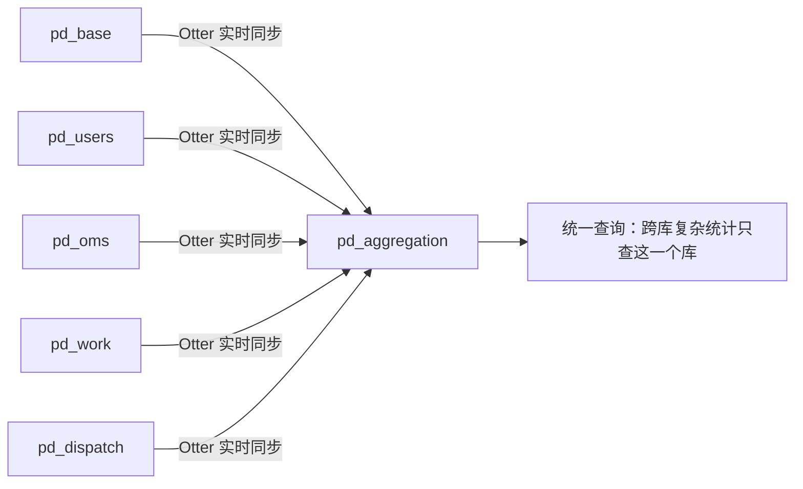

# 品达 TMS 总结⑤：八库数据库设计盘点（各库存什么、为什么这么拆）

项目总结继续推进，这一节看数据库设计。品达物流 TMS 基于微服务架构开发，这种架构下做数据库设计，思路基本上就是针对业务来拆分：一个业务、一个微服务，往往就对应一个数据库。整个项目因此拆出了八个库，这里把它们逐个过一遍，看清楚每个库放什么数据、为什么要这么拆。至于每个库具体有哪些表、表里字段长什么样，属于细节，可以直接去当时创建出来的数据库里查看，本节只从整体上盘点。

## 先给结论

- 数据库按业务拆分，一个业务、一个微服务对应一个数据库，整个 TMS 项目一共涉及八个库。
- 六个业务库各管一摊：pd_base 存基础数据，pd_users 存 C 端用户数据，pd_oms 存订单数据，pd_work 存运输作业数据，pd_aggregation 做数据聚合，pd_dispatch 存智能调度数据。
- pd_aggregation 是为统一查询而生的聚合库：把其他业务库的数据通过 Otter 数据同步技术实时聚合过来，跨库的复杂查询和统计只查它一个就够了。
- pd_dispatch 存的是智能调度过程中产生的数据，比如订单分类、缓存的线路。
- pd_auth 和 customer_auth 严格说不属于 TMS 系统自己的数据库，是通用权限系统、通用 C 端用户体系带过来的。
- 用户分两大体系：企业内部员工用户（司机、快递员）的信息存 pd_auth，C 端消费者用户的信息存 customer_auth。

## 八个库逐个盘点

八个库的清单如下，前六个是 TMS 按业务划分出来的库，后两个是通用体系带过来的库。

| 数据库名 | 定位 | 存储内容 |
| --- | --- | --- |
| pd_base | 基础数据库 | 货物类型、车辆类型、车队、线路、车次等基础数据 |
| pd_users | 用户数据库 | C 端用户相关数据：用户信息、地址簿等 |
| pd_oms | 订单数据库 | 货物信息、订单信息、订单位置信息等 |
| pd_work | 物流作业数据库 | 快递员取派件任务、运输任务、司机作业单、运单等 |
| pd_aggregation | 数据聚合数据库 | 聚合其他业务库的数据，提供统一查询功能 |
| pd_dispatch | 智能调度数据库 | 智能调度服务产生的数据：订单分类、缓存路线等 |
| pd_auth | 通用权限数据库 | 资源、菜单、权限、岗位、组织、角色等权限数据，以及企业内部员工用户数据 |
| customer_auth | 通用 C 端用户数据库 | C 端登录用户数据：用户认证信息、登录记录等 |

前四个库的划分逻辑最直观，完全跟着业务走。pd_base 收纳的是整个系统运转都要引用的基础数据：货物类型、车辆类型、车队、线路、车次，这些数据被各个业务反复使用，单独成库。pd_users 对应 C 端用户，存用户信息、地址簿这类数据。pd_oms 对应订单域，一笔订单带出来的货物信息、订单本身的信息，以及订单位置信息，都放在这里。pd_work 对应运输作业域，凡是跟货物运转、运输相关的数据，快递员的取派件任务、运输任务、司机的作业单、运单，统一放进这个作业库。

pd_dispatch 则对应智能调度。课程里专门有一章讲智能调度，调度过程会产生自己的数据，比如订单的分类、缓存的线路。这些数据不进订单库，而是落在智能调度自己的数据库里，这同样是按业务拆库的体现：哪个业务产生的数据，就归哪个业务的库。

## 两个特殊的库：聚合库与权限库

八个库里有两个需要单独展开，它们的存在逻辑和前面六个业务库不一样。

第一个是 pd_aggregation。前面那些库都按业务划分，好处是职责清晰，代价是查询可能跨库：一个查询操作要从这个库取一些数据，再从那个库取一些数据，跨库的统计做起来很麻烦。为了方便统一查询，项目专门提供了这个数据聚合库，把其他业务数据库里的数据，通过 Otter 这个数据同步技术实时聚合到当前库。有了它，以后再做复杂的、需要跨库操作的统计工作，直接针对这一个库查询就可以了。

第二个是 pd_auth。这个库严格来说不属于 TMS 系统里的数据库，它是通用权限系统带过来的一个库。整个项目关于权限这块并没有自己去实现，而是直接基于通用权限系统来做权限管理；做权限管理就需要存储权限相关的数据，于是有了这个库，里面包括资源、菜单、权限、岗位、组织、角色等内容。同时，这个库存储的也是企业内部用户相关的数据。

说到用户，这里要把两大用户体系说清楚，它直接决定了权限库和用户库的分工：

| 用户体系 | 是谁 | 数据落库 | 典型数据 |
| --- | --- | --- | --- |
| 企业内部员工用户 | 司机、快递员等物流公司内部员工 | pd_auth | 资源、菜单、权限、岗位、组织、角色 |
| C 端用户 | 外部消费者，要登录系统发快递、查运单信息 | customer_auth | 用户认证信息、登录记录 |

司机、快递员这些人是物流公司内部的员工，也是系统的用户，他们的信息存进 pd_auth。另一类是外围的 C 端用户，他们不属于企业内部，而是消费者、是客户，但同样需要登录系统，要发快递，要查自己的运单信息。这类用户的信息存进 customer_auth，也就是通用的 C 端用户数据库，里面是用户认证信息、登录记录这些数据。两套用户体系对应两个库，边界划分得非常清楚。

## 小结

- 微服务架构决定拆库方式：按业务拆分，一个业务、一个微服务对应一个数据库，TMS 一共八个库。
- 六个业务库各司其职：pd_base 基础数据、pd_users C 端用户、pd_oms 订单、pd_work 运输作业、pd_dispatch 智能调度、pd_aggregation 数据聚合。
- pd_aggregation 专为统一查询而生：其他业务库的数据经 Otter 实时同步聚合进来，跨库的复杂查询与统计只查这一个库。
- pd_auth 与 customer_auth 是通用体系带过来的库：前者存权限数据和企业内部员工用户，后者存 C 端登录用户。
- 用户两大体系的划分贯穿整个系统：内部员工走 pd_auth，C 端消费者走 customer_auth。下一篇盘点服务列表时会再次遇到这条分界线，两个网关正是按它拆开的。
- 库的表结构和字段细节，直接去看项目里创建出来的数据库即可。
