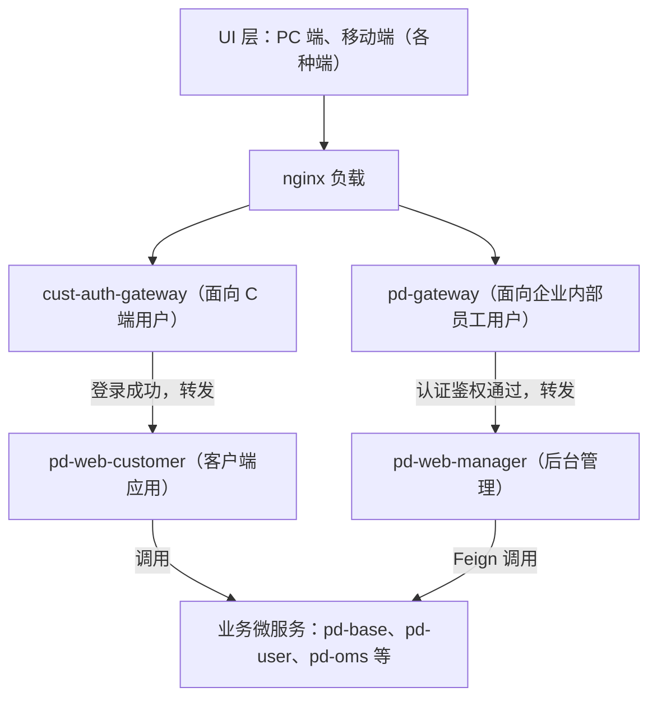

# 品达 TMS 总结⑥：微服务服务列表盘点（分层职责与调用链）

项目总结的最后一个小节是服务列表：整个品达物流 TMS 项目会涉及哪些服务，每个服务承担什么职责，请求又是怎么一层一层调下去的。这些服务画成一张服务架构图，从下往上看是基础微服务、应用层服务、网关服务，再往上经 nginx 负载到 UI 层的各种端。而从用户视角看，这张图最显眼的特点是有两个网关，为什么要放两个，是这一节要回答的核心问题。

## 先给结论

- 网关有两个：cust-auth-gateway 面向 C 端用户，pd-gateway 面向企业内部员工用户。
- 两个网关的根源是两大用户体系：认证鉴权要操作不同的数据库，企业内部员工的数据在 pd_auth，C 端用户的数据在 customer_auth，所以拆成两个网关分别处理。
- pd-gateway 这条链路：前端发请求，经 nginx 负载转发到 pd-gateway，网关做认证鉴权校验，通过后转发到 pd-web-manager，再由它通过 Feign 调用其他微服务完成具体业务。
- C 端链路：请求经 cust-auth-gateway，登录成功后转发到 pd-web-customer，再由它调用具体的业务微服务。
- cust-auth-gateway、pd-gateway、pd-auth-server 这类属于通用组件、通用服务，满足同样的业务场景可以直接拿来用，课上并没有开发；课上重点开发的是 pd-web-* 应用层和 pd-base、pd-user、pd-oms 这些业务微服务。
- 从下往上分层：基础微服务、应用层（pd-web-*）、网关服务、nginx 负载、UI 层（PC 端、移动端）。

## 为什么要两个网关

上一节盘点数据库时提到，用户分成两大体系：一类是企业内部员工用户，比如司机、快递员；另一类是 C 端用户，也就是外部的消费者。不管哪类用户，发送请求时都需要登录、认证鉴权这些操作。问题在于，企业内部员工用户的数据存在 pd_auth 库里，而 C 端用户的数据存在 customer_auth 库里，认证鉴权要操作的是两个不同的数据库。为了把这两条认证路径分开，项目设置了两个网关，各自针对一类用户。

两条链路在架构图上是平行的两条线：

pd-gateway 这条线值得展开看一遍。以登录系统后台为例：前端首先发起请求，通过 nginx 负载转发到 pd-gateway 网关服务；网关在这里做认证鉴权校验，校验通过之后把请求转发给 pd-web-manager；再由 pd-web-manager 这个服务通过 Feign 去调用其他微服务，完成具体的业务操作。pd-gateway 转发的对象是下面这几个应用：pd-web-courier 快递员端、pd-web-driver 司机端、pd-web-manager 后台管理端，正好对应三个端。

C 端用户走的是另一条线：请求经过 cust-auth-gateway，登录成功之后转发到 pd-web-customer，这是客户端应用，再由它去具体调用下面的微服务，完成某个业务操作。两条线各自认证、各自转发，互不干扰。

## 服务分层盘点

按架构图的三个分区把服务列全，每个服务的职责如下。

| 分区 | 服务 | 职责 |
| --- | --- | --- |
| 客户侧服务 | cust-auth-gateway | 客户认证网关 |
| 客户侧服务 | cust-auth | 客户认证服务 |
| 客户侧服务 | pd-web-customer | 客户端 Web 服务 |
| 客户侧服务 | msg_web | 消息 Web 服务 |
| 核心业务服务 | pd-gateway | 核心网关 |
| 核心业务服务 | pd-web-courier | 快递员端服务 |
| 核心业务服务 | pd-web-driver | 司机端服务 |
| 核心业务服务 | pd-web-manager | 后台管理服务 |
| 核心业务服务 | pd-auth-server | 认证服务 |
| 核心业务服务 | pd-file-server | 文件服务 |
| 基础服务 | pd-base | 基础数据服务 |
| 基础服务 | pd-redis | Redis 缓存服务 |
| 基础服务 | pd-user | 用户服务 |
| 基础服务 | pd-oms | 订单服务 |
| 基础服务 | pd-work | 物流作业服务 |
| 基础服务 | pd-netty | Netty 网络服务 |
| 基础服务 | pd-druid | 数据库连接池服务 |
| 基础服务 | pd-earlywarning | 预警服务 |
| 基础服务 | pd-dispatch | 调度服务 |
| 基础服务 | pd-aggregation | 聚合服务 |

这张表里有一部分服务是通用的。cust-auth-gateway、pd-gateway、pd-auth-server 这些注册登录、认证相关的服务，相当于通用的注册登录服务，任何一个项目只要满足这种业务场景，都可以把它拿过来直接用，课上并没有真的去开发这块的功能。课上主要开发的是跟物流、跟这个项目紧密相关的业务：应用层的 pd-web-courier 快递员端、pd-web-driver 司机端、pd-web-manager 后台管理端、pd-web-customer 客户端这几个应用，以及下面具体的业务微服务，pd-base、pd-redis、pd-user、pd-oms 这些。

把架构图竖过来看，分层非常清楚。最下面是一些基础的微服务；往上是 pd-web 开头的应用层服务；再往上就是网关服务；网关再往上是 nginx 做负载；最上面是 UI 层，也就是各种端，包括 PC 端和移动端。各端跟网关交互，请求一层一层往下转发，最终落到具体的业务微服务，完成某个业务操作。通过这张图可以非常直观地看到，项目里具体有哪些服务，以及它们之间是什么样的调用关系。

## 小结

- 服务列表是项目总结的最后一块拼图：基础微服务、应用层、网关三层，往上经 nginx 负载到 UI 层的各种端。
- 两个网关对应两类用户：pd-gateway 服务企业内部员工，对应快递员端、司机端、后台管理端三个端；cust-auth-gateway 服务 C 端用户。根源是认证鉴权要操作两个不同的用户库。
- 内部员工链路：nginx 负载 → pd-gateway 认证鉴权 → pd-web-manager → Feign 调用微服务；C 端链路：cust-auth-gateway → pd-web-customer → 调用微服务。
- cust-auth-gateway、pd-gateway、pd-auth-server 是通用组件，满足业务场景即可拿来复用，课上未开发；课程重点落在物流业务本身的应用层与业务微服务上。
- 到这里，服务列表盘点完毕，品达物流 TMS 的项目总结也随之收官：架构、流程、数据库、服务四条线合起来，就是这个项目的全貌。
