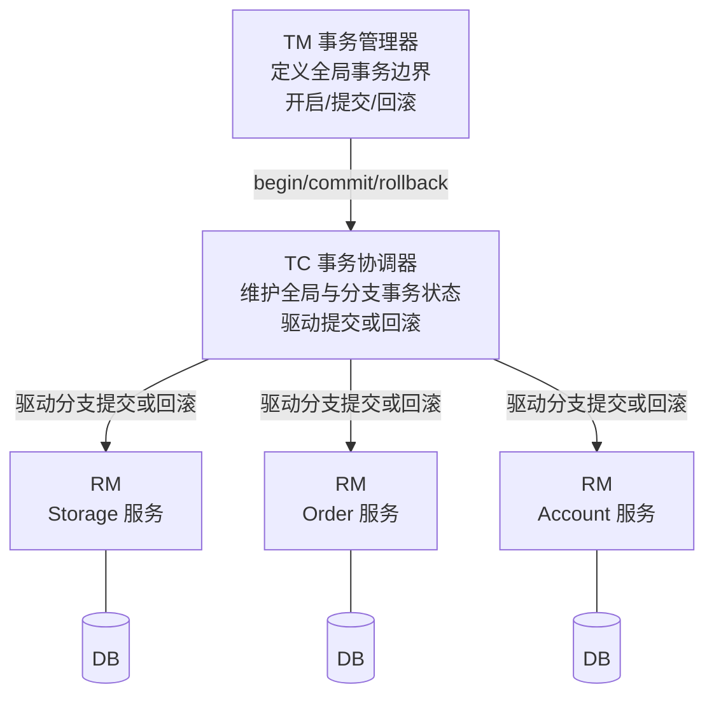
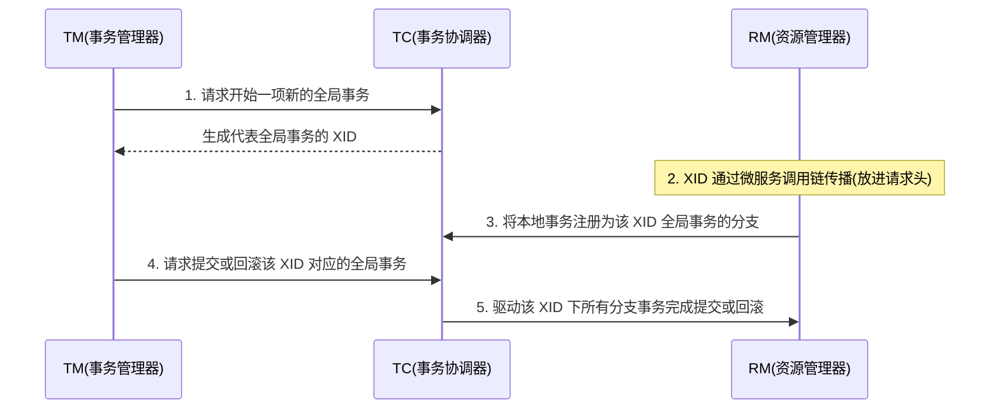

# Seata 入门到接入：TC/TM/RM 三组件、生命周期与司机端工程改造上半

理论方案讲完，该上具体的落地技术了。Seata 是阿里巴巴 2019 年开源的分布式事务解决方案，开源之前的内部版本一直在阿里扮演分布式一致性中间件的角色，支撑过历年双 11。本篇以品达物流 TMS 的客户下单业务为例，先讲清三组件架构与生命周期，再走完工程接入上半程：建库、启动 Seata Server、引依赖、加配置，以及让 XID 在 Feign 调用链上传播的过滤器与拦截器。

## 先给结论

- Seata 针对的就是这种场景：一个业务通过 RPC 依次调用 Storage、Order、Account 等服务，各服务都有自己的数据库，要让这一串数据库操作要么同时成功、要么同时失败。
- 它对分布式事务的定义是一句话：由一批分支事务组成的全局事务，分支事务本质就是一个个本地事务；整体方案类似两阶段提交，但角色从"协调者 + 参与者"细分成 TC、TM、RM 三个。
- 分工明确：TM 定义全局事务范围（事务边界），负责开启、提交、回滚；TC 维护全局/分支事务状态并驱动提交或回滚；RM 管理分支事务，向 TC 注册并报告状态。
- 生命周期围绕一个全局唯一的字符串 XID 展开五步：TM 请求开启全局事务生成 XID → XID 随调用链传播 → RM 注册分支事务 → TM 请求提交或回滚 → TC 驱动所有分支完成。
- 工程接入五步走：建 seata 库（三张表）与业务库 undo_log；Docker 启动 Seata Server 注册进 Nacos；配置 registry.conf 与 file.conf；父工程锁定版本引入 seata-spring-boot-starter；各微服务在 Nacos 配置中心追加 seata 配置。
- XID 的传播靠一对官方模板代码：TxidFilter 从请求头取 XID 绑定到 RootContext（底层 ThreadLocal），RequestHeaderInterceptor 在每次 Feign 调用前把 XID 写回请求头。

## Seata 是什么：三组件架构

Seata 的 GitHub README 上有一张经典图示：一个业务通过 RPC 调用 Storage 服务操作数据库，又调用 Order 服务操作数据库，Order 可能再调用 Account 服务操作数据库——三个服务各自拥有独立的数据库（Database per service 模式），单服务内部的一致性由本地事务天然保证，但整个业务逻辑范围的一致性谁来保证？这就是 Seata 要回答的问题。

使用上分两端：服务端去 GitHub 的 Releases 页面下载，最新 1.4 版，分 Linux、Windows 版与源码包，也有官方 Docker 镜像可以直接跑；程序端在 Maven 项目里引入 `io.seata:seata-all`，同样对应 1.4。

理解它的架构，先把两个名词钉死：Seata 把分布式事务看成一批分支事务组成的全局事务（Global Transaction），所谓分支事务（Branch Transaction）指的就是一个个本地事务。在此之上是三个核心角色：

| 组件 | 全称 | 职责 |
| --- | --- | --- |
| TC | Transaction Coordinator 事务协调器 | 维护全局事务和分支事务的状态，驱动全局事务提交或回滚 |
| TM | Transaction Manager 事务管理器 | 定义全局事务的范围（事务边界），负责开启全局事务、提交或回滚全局事务 |
| RM | Resource Manager 资源管理器 | 管理正在处理的分支事务，与 TC 对话注册分支事务并报告状态，驱动分支事务提交或回滚 |

这套划分与两阶段提交一脉相承：2PC 只有协调者、参与者两个角色，Seata 把参与者一侧拆成了 TM 和 RM，指令链路是 TM 给 TC 发指令，TC 再通知各个 RM 到底提交还是回滚。后面的应用阶段，控制台日志里就能看到这三种角色的字眼。



## 生命周期：XID 如何串起一次全局事务

生命周期图上画了三个微服务，各带一个数据库：第一个执行完数据库操作，通过 RPC 或 REST 调第二个，再调第三个，全部完成整个业务才算完成，要保证的就是这一串本地事务要么同时成功、要么同时失败。完整生命周期五步如下，全程贯穿一个叫 XID 的东西——全局唯一的字符串，全局事务的标识：



逐步拆开看：第一步 TM 要求 TC 开启新全局事务——TM 定义事务边界，知道这次业务涉及哪些分支事务（分支事务是要注册到 TC 的），TC 收到请求后生成唯一的 XID 作为全局事务标识。第二步，XID 通过微服务调用链传播，每次远程调用都在请求头里带上它，标识当前请求属于哪个全局事务。第三步，RM 把本地事务注册为该 XID 全局事务的分支，注册完 TC 就知道全局事务下挂了哪几个分支。第四步，TM 要求 TC 提交或回滚该 XID 对应的全局事务；第五步，TC 驱动该全局事务下所有分支完成提交或回滚——只要有分支提交失败，TC 就给所有 RM 发指令统一回滚，数据恢复到初始状态。

## 工程接入（上）：业务盘点、建库与启动 Server

### 先盘点：下单业务涉及哪些服务

工程改造以客户下单业务为例。客户下单是 pd-web-customer 中的一个服务接口，下单过程主要经 orderFeign 调用 OMS 保存订单信息、位置信息、货物信息，再调用 PDWorker 保存快递员取件任务——下完单要快递员上门取件。整个业务需要 PDAuthServer（权限）、PDUser、PDWebCustomer、PDWorker、PDBase（基础数据）、OMS（订单）外加 Seata Server 支持，其中涉及数据插入的是三个：订单服务保存订单、保存货物信息，作业服务创建快递员取件任务，查询类不用管。Seata Server 是官方提供的服务，直接用 Docker 跑起来，启动后要注册到 Nacos 服务注册中心。

### 第一步：建 Seata 库与业务库 undo_log

使用 Seata 首先要给它建一个数据库（库名随意，后面配置时指定即可，建议就叫 seata），里面有三张表：

```sql
-- 建表语句来自 Seata 官方: GitHub 仓库 script/server/db/mysql.sql
CREATE TABLE `global_table` (
  `xid` varchar(128) NOT NULL COMMENT '全局事务标识',
  `transaction_id` bigint(20) DEFAULT NULL COMMENT '事务ID',
  `status` tinyint(4) NOT NULL COMMENT '事务状态',
  `application_id` varchar(32) DEFAULT NULL,
  `transaction_service_group` varchar(32) DEFAULT NULL,
  `timeout` int(11) DEFAULT NULL,
  `begin_time` bigint(20) DEFAULT NULL,
  PRIMARY KEY (`xid`)
) ENGINE=InnoDB DEFAULT CHARSET=utf8;
```

- `global_table`：保存全局事务相关信息，xid 就是前面说的全局事务标识，还有事务 ID、事务状态等。
- `branch_table`：保存一个个分支事务，核心字段有分支 ID 和对应全局事务的 xid。
- `lock_table`：记录全局锁，需要锁定哪些表，把表名等信息存进去。

三张表不需要手动操作，建出来、把数据源配置上，由 Seata Server 自行读写；建表语句同样来自官方 GitHub 仓库的 script/server/db/mysql.sql。

除了 Seata 自己的库，每个业务数据库里还要加一张 `undo_log` 表（建表语句来自官方 script/client/at/db/mysql.sql），用来做数据回滚：分支事务可能已提交但其他分支失败，此时要把已提交的数据恢复原状，所以操作数据前先把原始数据存一份进去。它不放 seata 库，放业务数据库——本次业务会操作哪些库就在哪些库建；这次下单会操作 OMS 库和 pd_work 库，两个库都要建。

### 第二步：Docker 启动 Seata Server 并注册进 Nacos

Seata Server 本身就是一个服务，最简单的启动方式是基于 Docker 镜像：

```bash
docker run -d --name seata -p 8091:8091 seataio/seata-server:latest
# 本地没有镜像也没关系, 启动时会自动拉取
```

8091 是 Seata 的默认端口：程序是 Seata 的客户端，Server 是服务端，两者通信走这个端口，所以做了端口映射。跑起来之后要配 registry.conf，写好用 docker cp 拷进容器的 resources 目录：

```properties
registry {
  # file, nacos, eureka, redis, zk, consul, etcd3, sofa
  type = "nacos"                  # 注册中心使用 nacos
  nacos {
    application = "seata-server"  # 注册时的服务名
    serverAddr = "68.79.63.42:8848"
    group = "SEATA_GROUP"
    cluster = "default"
    username = "nacos"
    password = "itheima123"
  }
}
config {
  # file, nacos, apollo, zk, consul, etcd3
  type = "file"                   # 配置中心使用本地文件
  file {
    name = "file.conf"            # Seata Server 的配置文件
  }
}
```

registry 段描述注册中心：支持 nacos、eureka、redis、zookeeper、consul 等类型，当前用 nacos，只看 nacos 这一段——服务名 seata-server，注册到 68.79.63.42:8848，分组 SEATA_GROUP，注册进指定命名空间。config 段指定配置中心，当前用 file 类型：Seata 的配置就在本地 file.conf 里，启动时读它。

验证很直接：`docker stop seata` 停掉容器，Nacos 服务列表里 seata-server 立刻消失；`docker start seata` 再启动，又注册回来了——说明生效的确实是这份配置。

### file.conf：事务组名与存储模式

file.conf 是 Seata Server 的配置文件，两个关键段：

```properties
service {
  # 虚拟组名可以自定义, 但必须与程序中 tx-service-group 保持一致
  vgroupMapping.ithema_tx_group = "default"
  disableGlobalTransaction = false
}
store {
  # 存储模式: file, db, redis
  mode = "db"                     # 全局/分支事务信息存数据库
  db {
    datasource = "druid"
    dbType = "mysql"
    driverClassName = "com.mysql.jdbc.Driver"
    url = "jdbc:mysql://68.79.63.42:3306/seata"
    user = ""                     # 按环境填写用户名密码
    password = ""
    globalTable = "global_table"
    branchTable = "branch_table"
    lockTable = "lock_table"
  }
}
```

service 段的 `vgroupMapping` 定义虚拟组名 ithema_tx_group——名字随意起，但程序里还会用到，必须前后一致。store 段的 mode 配成 db，对应第一步建的 seata 库：druid 数据源、MySQL 驱动、URL 指向 68.79.63.42:3306/seata，再配用户名密码和三张表名，Seata Server 就能操作这三张表了。redis 段没用到不用管。file.conf 同样 docker cp 拷进容器，拷完最好 `docker restart seata` 重启生效。

到这里服务端全部就绪，剩下的都是客户端（程序）侧的事：引依赖、加配置、写过滤器拦截器。

## 工程接入（下）：依赖、配置中心与 XID 传递链路

### 第三步：父工程锁版本引入依赖

项目里很多微服务都要用 Seata，各引一份版本不好统一管理，所以在最上层父工程 pinda-tms-java 的 `dependencyManagement` 里统一锁定版本：

```xml
<!-- pinda-tms-java/pom.xml, 在 dependencyManagement 中配置 -->
<dependency>
    <groupId>io.seata</groupId>
    <artifactId>seata-spring-boot-starter</artifactId>
    <version>1.2.0</version>
</dependency>
```

版本锁定在父工程，实际引入放到 pd-common（不写版本号）：其他模块都依赖 common，引一次大家都有：

```xml
<!-- pd-common/pom.xml -->
<dependency>
    <groupId>io.seata</groupId>
    <artifactId>seata-spring-boot-starter</artifactId>
</dependency>
<dependency>
    <groupId>io.github.openfeign</groupId>
    <artifactId>feign-core</artifactId>
</dependency>
```

后边会用到 openfeign 的 jar 包，所以一并提前引入。还要注意一个坑：这种 starter 类的 jar 包不能随便引。项目里只有 pd-druid 服务没使用 Seata——它里面全是查询操作——但因为依赖了 pd-common，Seata 会被传递进来，必须在 pd-druid 的 pom 里用 exclusions 排除掉；不排除的话，启动时会去连接 Seata Server，而它的配置文件里又没配 Seata 相关信息，直接报错。同理，nacos-config 这类用不着的依赖也要排除，否则启动就去连 Nacos。

### 第四步：Nacos 配置中心追加 seata 配置

项目的微服务配置统一放在 Nacos 配置中心管理，所以 seata 配置不写本地文件，而是追加到每个要用 Seata 的微服务在 Nacos 上的配置里（OMS、pd_work 等都加了，内容一样）：

```yaml
seata:
  enabled: true
  application-id: ${spring.application.name}   # 直接取微服务名, 动态取值
  # 事务组名不能随便写, 必须与 file.conf 中 vgroupMapping 的组名一致
  tx-service-group: ithema_tx_group
  registry:
    file:
      name: registry.conf    # 读取已拷入容器的 registry.conf, 里面指向 Nacos
  service:
    grouplist:
      ithema_tx_group: 68.79.63.42:8091   # Seata Server 地址(端口映射 8091)
```

最要紧的是 tx-service-group：必须与 file.conf 里 vgroupMapping 的虚拟组名填同一个，前后一致，分支事务才能管理成功。registry 段配 file 类型并指向 registry.conf——文件已拷进容器，里面配的就是 Nacos，客户端由此知道去哪发现 Seata Server；grouplist 直接指定 Seata 服务地址。配好这段，客户端才能真正跟 Seata Server 连上通信。

### 第五步：过滤器与拦截器，让 XID 挂上请求头

回看生命周期第二步：XID 要通过微服务调用链传播，而项目里微服务之间的调用全部走 Feign 接口，传播载体就是请求头。这需要一对官方提供的模板代码，直接拷过来用，理解它们在干什么即可。

先加过滤器 TxidFilter，负责把请求头里的 XID 绑定到 RootContext：

```java
@Slf4j
@Component
public class TxidFilter extends OncePerRequestFilter {   // SpringMVC 提供
    @Override
    protected void doFilterInternal(HttpServletRequest request,
                                    HttpServletResponse response,
                                    FilterChain filterChain) throws ServletException, IOException {
        String xid = RootContext.getXID();
        String txXid = request.getHeader("TX_XID");
        boolean bind = false;
        if (StringUtils.isBlank(xid) && StringUtils.isNotBlank(txXid)) {
            // 当前上下文没有 XID 且请求头带了, 绑定到 RootContext
            RootContext.bind(txXid);
            bind = true;
            log.debug("绑定 [" + txXid + "] RootContext");
        }
        try {
            filterChain.doFilter(request, response);   // 放行, 整个调用链往下走
        } finally {
            if (bind) {
                // 请求结束解绑; 模板代码里还有 XID 发生变更时的告警日志
                String unbindXid = RootContext.unbind();
                log.debug("解除 [" + unbindXid + "] RootContext");
            }
        }
    }
}
```

为什么要放 RootContext？它的底层封装其实是一个 ThreadLocal——往下翻源码，bind 最终调用的是 ContextCore 的 put，而实现类 ThreadLocalContextCore 里维护着一个 `ThreadLocal<Map<String, String>>`，以本地线程的方式绑定数据。绑定之后，程序任意位置都能通过上下文对象把 XID 取出来。过滤器放在 pd-common 的 filter 包里，继承 SpringMVC 的 OncePerRequestFilter，加上 `@Component` 交给 Spring 管理；所有微服务都依赖 common，所以所有请求都会先经过这个过滤器，进来自动绑定，finally 里解绑。

再加拦截器 RequestHeaderInterceptor，负责把 RootContext 里的 XID 写回请求头：

```java
@Component
public class RequestHeaderInterceptor implements RequestInterceptor {
    @Override
    public void apply(RequestTemplate template) {
        String xid = RootContext.getXID();
        if (StringUtils.isNotBlank(xid)) {
            template.header("TX_XID", xid);   // 放进请求头传给下游
        }
    }
}
```

它实现的是 OpenFeign 包里的 RequestInterceptor 接口：只要是 Feign 接口调用都会被拦截（拦截器底层就是面向切面、动态代理），先执行 apply 这段逻辑，把 XID 通过 header 方法放进请求头，然后 Feign 才真正发 GET 或 POST 请求。这样全局事务 ID 就随请求头到了下一个微服务，下游的 TxidFilter 又会从请求头把它取出来绑定——一条完整的传播链路就闭合了。拦截器同样放在 pd-common 里，别忘了加 `@Component`。

XID 的意义再强调一遍：它标识的是一个局部事务属于哪个全局事务，必须在调用链路上一路传递，否则下游服务的分支事务注册不到同一个全局事务下，前面所有配置就都白做了。

## 小结

- Seata 是阿里 2019 年开源的分布式事务解决方案；模型是"分支事务（本地事务）组成全局事务"，方案类似 2PC 但细分为 TC、TM、RM 三角色。
- TM 圈定事务边界并下发提交/回滚意愿，TC 维护状态、驱动全局事务，RM 管理单个分支事务、负责注册与报告。
- 生命周期五步：开启全局事务生成 XID → XID 随调用链传播 → RM 注册分支 → TM 请求提交或回滚 → TC 驱动所有分支统一完成，失败则全部回滚恢复初始状态。
- 服务端落地：建 seata 库三张表 + 业务库 undo_log，Docker 一条命令跑起 Seata Server（8091），registry.conf 指向 Nacos、file.conf 指定 db 存储与事务组名，docker cp 拷入容器并重启。
- 客户端落地：父工程锁版本、pd-common 统一引入，不用的服务（pd-druid）必须 exclusion 排除；seata 配置段里 tx-service-group 必须与 file.conf 的 vgroupMapping 组名严格一致。
- XID 传播靠 TxidFilter（请求头 → RootContext）与 RequestHeaderInterceptor（RootContext → 请求头）这对官方模板代码，放 pd-common 加 @Component，全链路自动生效。
