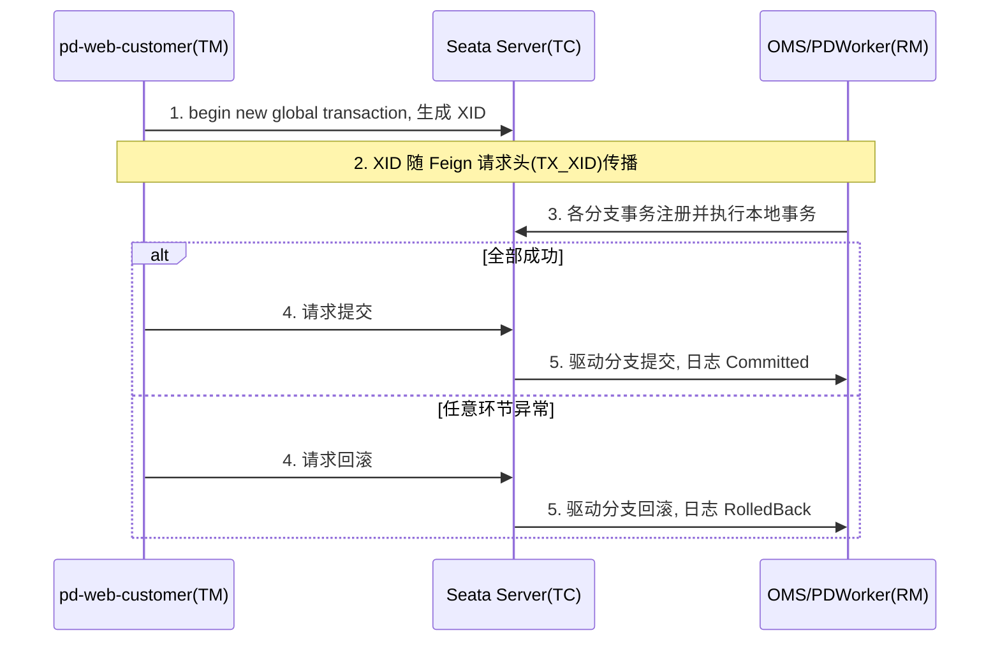

# Seata 落地收官：@GlobalTransactional 全局事务与四轮场景测试

上一篇把服务端和客户端的基础设施都搭好了：Seata Server 跑起来了，依赖、配置、过滤器、拦截器也各就各位。这一篇收官，先补两件小事——给不需要 Seata 的 pd-druid 取消过滤器注册、在下单方法上加 @GlobalTransactional 注解；然后用 Swagger 连打四轮测试，从环境就绪、正常下单、断点观察事务中间状态，一直测到人造异常验证回滚，把整条分布式事务链路真正跑通。

## 先给结论

- 这些准备工作整个项目只做一遍：过滤器、拦截器、Nacos 配置就位之后，以后哪个方法想要分布式事务控制，加一个 @GlobalTransactional 注解就完了。
- pd-druid 因为依赖 pd-common 被动注册了 TxidFilter，它不用 Seata，需要提供一个 FilterRegistrationBean 把 enabled 置为 false，取消过滤器注册。
- @GlobalTransactional 对标 @Transactional：后者一般加在 service 上，底层还是本地事务；前者一般加在 Controller 方法上，圈定的是全局事务边界，name 可指定可不指定，rollbackFor 指定发生异常时回滚。
- 配好 seata 的微服务启动时会向 Seata Server 注册，告诉 TC 自己是 RM、可以进行数据库操作，启动日志里能看到 register RM success。
- 四轮测试依次验证：环境就绪与 RM 注册、Swagger 正常下单（pd_order 从 542 条变 543 条，日志 Begin new global transaction 到 commit status Committed）、断点观察 seata 库三张表的中间状态、人造除零异常验证回滚（数据不落库，日志 rollback status RolledBack）。
- global_table、branch_table、lock_table 的读写完全由 Seata Server 负责，事务执行期间有数据、结束后自动清空，是观察全局事务的天然窗口。

## 收尾第一步：给 pd-druid 取消过滤器注册

过滤器加拦截器这一套，做的事情其实很单一：处理全局事务 ID，让它在整个调用链上传播下去。至于事务内部具体怎么提交、怎么回滚、怎么协调，不用我们管，那是 Seata 服务自己的事，我们只管按它的要求传播 XID。

但有一个服务要特殊处理。TxidFilter 放在 pd-common 里，所有微服务启动时都会把它注册上；而 pd-druid 不需要使用 Seata——它里面全是查询操作。所以要把 pd-druid 已经注册好的过滤器取消掉，其他服务都用到，不用动。做法很简单：提供一个用于注册过滤器的 FilterRegistrationBean，把已经注册的 TxidFilter 注进来，然后调用 setEnabled(false)，这个过滤器就不可用了，相当于取消注册：

```java
// pd-druid: config 包下的 ApacheDruid 配置类
@Bean
public FilterRegistrationBean cancelMyFilterRegistration(TxIdFilter filter) {
    FilterRegistrationBean registration = new FilterRegistrationBean(filter);
    registration.setEnabled(false);   // 置为 false, 取消过滤器注册
    return registration;
}
```

## 收尾第二步：@GlobalTransactional 圈定全局事务

真正应用 Seata，最重要的就是加注解这一步。对比一下熟悉的本地事务：@Transactional 一般加在 service 上，保证整个 service 方法是一个事务，方法里调用多个 DAO，要么全成功要么全失败——但它的底层原理还是本地事务。而现在要加的是 @GlobalTransactional，字面意思就是全局事务，一般加在 Controller 的某个方法上。比如下单，就在下单方法上加这个注解；其他方法也想做分布式事务控制，同样加上就行：

```java
// pd-web-customer: MailingController 下单方法
@GlobalTransactional(name = "saveOrder", rollbackFor = Exception.class)
public Object save(...) { ... }
```

两个参数：name 可指定可不指定，不写 Seata 会默认生成一个；rollbackFor 指定发生异常的情况下回滚。方法内部经过多次 Feign 接口调用，最终调到 OMS 等微服务——这些微服务都已经配置好了 seata，项目启动时就会注册到 Seata Server，等于告诉 TC：我是一个 RM，可以进行数据库操作。TC（也就是 Seata Server）由此感知到每个 RM 的存在，这一点从启动日志上就能看到。注解加上之后，整个方法的分布式事务由 Seata 保证要么全成功、要么全失败，最终数据一致。



## 四轮测试：验证全局事务真的起作用

光配置完不算完，得测。四轮测试的安排如下：

| 轮次 | 场景 | 操作 | 结果 |
| --- | --- | --- | --- |
| 第 1 轮 | 环境就绪 | 启动 OMS 等微服务和权限服务，看启动日志 | transaction manager client 初始化、register RM success |
| 第 2 轮 | 正常下单 | Swagger 提交下单接口，查 pd_order 表 | 返回 success，542 条变 543 条，日志 Begin → Committed |
| 第 3 轮 | 中间状态 | debug 断点停在提交前，查 seata 库三张表 | global_table/branch_table 出现事务记录，放行后清空 |
| 第 4 轮 | 异常回滚 | 下单方法末尾造除零异常，重启后再提交 | 返回除零异常，pd_order 不增加，日志 RolledBack |

### 测试环境与接口参数

测试要有多个微服务支持：PDAuthServer（权限服务，单独放在 pinda-apps 工程里，没有使用 Seata，直接跑起来）、PDUser、PDWebCustomer、PDWorker、PDBase、OMS，外加 Seata Server 必须是启动状态。先起 OMS 看启动日志：里面有 transaction manager client（事务管理器客户端）初始化、全局事务客户端初始化完成，还有一条关键日志 register RM success——注册到的地址就是 Seata Server 的 68.79.63.42，这说明 pd-oms 已经作为 Seata 客户端与 Server 保持连接。其他微服务也都用到了 Seata，启动时同样会去连接，一次起这么多会比较慢。

接口测试用 Swagger：pd-web-customer 跑起来端口是 8164，找到下单接口提交数据。注意数据不能随便写，几个关键参数：

- goodsName 随便写；goodsWeight 写 1 也无所谓。
- goodsType 是货物类型 ID，正常在手机端是下拉框选中后带过来的，现在没有界面，要去 pinda_base 数据库的 pd_goods_type 表随便查一个 ID 贴过去。
- payMethod 固定写 1；pickupTime 取件时间段随便写；pickupType 写 2。
- receiptAddress（收件地址）和 sendAddress（发件地址）是两个很长的串，其实是地址簿表的主键值——这张表是 pd_user 库里的 pd_address_book，之前讲 PDUser 模块时维护过，里面存着收件人、寄件人信息，需要从表里找两个真实 ID。

```json
{
  "goodsName": "电话",
  "goodsType": "1209411984412801024",
  "goodsWeight": "1",
  "payMethod": 1,
  "pickupTime": "14:00-18:00",
  "pickupType": 2,
  "receiptAddress": "315143f35b128e6ad5496c409c340dd",
  "sendAddress": "9cdbace3a522f4eebd4d4a5628f72beb"
}
```

提交之前先分析：下单成功会写 pd_order、订单位置、货物表（都在 OMS 库），以及 pd_work 库的取件任务表。观察口径就选 pd_order 一张表，按订单创建时间降序排列，方便对比。

### 第 1、2 轮：服务就绪与正常下单

正常提交，接口返回 success。刷新 pd_order，从 542 条变成 543 条，整个流程跑通了。重点看控制台日志：开头一条 `Begin new global transaction [172.18.0.5:8091:7524111994119444]`——开始一个新的全局事务，方括号里就是 XID，由 IP 地址加端口号再加一串数字构成，全局唯一；中间是 Controller 输出的业务日志，多次 Feign 调用，调 OMS、调 Worker 往各库插数据；最后一条是 `commit status: Committed`，已提交。从 Begin 到提交，这就是整个分布式事务的边界，中间调用了多个微服务、操作了多个数据库。XID 末尾那截相同的数字（8944 结尾），就标识它们属于同一个事务。

### 第 3 轮：断点观察事务中间状态

事务没提交之前，Seata 会往 seata 库的三张表里写中间状态数据，提交完就清空了。用 debug 方式启动，在下单方法的 return 前加断点——前面的分支事务都执行完了，方法没执行完所以还没统一提交。此时三张表原本都是空的；提交一次，断点停下，global_table 里出现一条记录：xid（IP 加端口号加那串数字）、transaction_id（和 XID 尾段非常像，就是全局事务 ID）、status 是 1、application_id 是 pd-web-customer、transaction_service_group 就是之前配置的那个事务组名、transaction_name 是 saveOrder——因为注解里写了这个名字——还有超时时间。

想看分支事务，就在分支服务（pd_work 或 OMS）的保存订单处加断点，再提交一次，停到 OrderController 时 branch_table 里能看到：branch_id 分支 ID、xid 全局事务 ID、transaction_id、resource_id 资源 ID（当前操作的是 OMS 库）、branch_type 是 AT，还有 client_id。断点一放过去，这些数据立刻被删掉，刷新就没了——它们只是中间状态，全局事务记录放行后同样消失。也就是说，全局事务执行过程中，Seata Server 会把全局事务、分支事务、锁信息写进这三张表；整个流程跑完、分布式事务结束，中间状态数据全部清除。操作这些表的是 Seata Server，不是我们的代码。

### 第 4 轮：人造异常验证回滚

正常情况跑通了，最后一轮反过来：人为构造异常，看数据能不能回滚。在下单方法（已加注解）的最后制造一个除零异常，期望的效果是：一旦发生异常，这批数据全部回滚、不能插入成功；如果订单数据照样插进去了，说明分布式事务没起作用。改完代码只重启 pd-web-customer，其他服务不动。

pd_order 还是 543 条，再次提交同样的数据，接口返回 ArithmeticException: / by zero。刷新表——数据没有进来，这正是希望看到的效果，说明事务起作用了。控制台日志同样完整：先是 `Begin new global transaction` 开启新全局事务，接着执行、调用各种微服务，到发生异常的位置，出现 `rollback status: RolledBack`——回滚状态是已回滚，后面跟着这次事务的 XID。至此，开启、传播、注册、提交、回滚整条链路全部验证完毕，分布式事务测试到此结束。

## 小结

- Seata 的使用门槛集中在一次性搭建；日常使用只有一个 @GlobalTransactional，加在 Controller 方法上圈定全局事务边界，name 可选、rollbackFor 指定异常回滚。
- 不用 Seata 的服务（pd-druid）要两层善后：pom 里 exclusion 排除依赖，代码里用 FilterRegistrationBean 的 setEnabled(false) 取消 TxidFilter 注册。
- 配好 seata 的微服务启动即向 Seata Server 注册为 RM，启动日志 register RM success 是连通性验证的第一信号。
- 四轮测试由浅入深：环境就绪看注册日志、正常下单看 Begin 到 Committed 的完整日志与落库结果、断点看三张表的中间状态、人造异常看数据回滚与 RolledBack 日志。
- global_table、branch_table、lock_table 只在事务执行期间有数据、结束即清空，且完全由 Seata Server 读写，是排查全局事务问题的现成窗口。
- 测试数据有讲究：goodsType、收发地址都是真实主键（pd_goods_type、pd_address_book），接口返回异常但数据未落库，才是分布式事务生效的判定标准。
