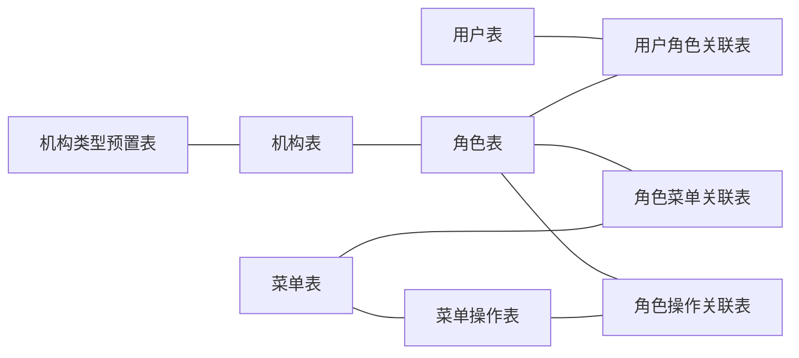
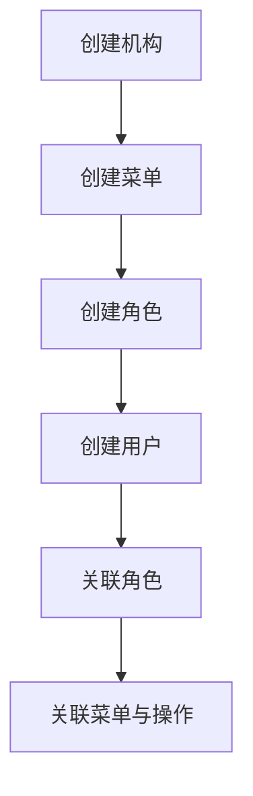

# 智牛股权限管理开篇：库表设计、业务功能拆解与后台管理工程搭建

智牛股交易平台的权限管理从这里开始。这一章前半段是设计：库表 ER 关系、业务流程、字段定义，再对着原型过菜单、角色、用户三个模块；后半段动代码，建表、生成实体、搭后台管理工程，立起 Spring Data REST 数据层接口。

## 先给结论

- 用户、菜单、角色是三张核心表：用户与角色、角色与菜单、角色与操作都是多对多，各派生一张关联表；菜单与操作是多对一，一个菜单下挂 N 个操作。
- 机构是整套权限的骨架：机构类型预置表预置集团、运营中心、交易商三种类型，各身份明细存各自的表，机构表用关联 ID 与名称做关联和冗余。
- 业务主流程六步：创建机构、创建菜单、创建角色、创建用户、关联角色、关联菜单与操作；建机构的同时要生成唯一管理用户，否则没人有权限创建后续数据。
- 用户可以同时拥有集团、运营中心、交易商三个层级的角色，但不能拥有相同层级的两个角色；多角色按最大权限处理，集团 > 运营中心 > 交易商。
- 接口按菜单、角色、用户三大块组织；实现用 Spring Data REST（HATEOAS，管增删改查）加 Spring Boot（管复杂业务逻辑）两套互补。
- 工程落地：SQL 建 t_authority 表并初始化数据，8 个实体入 stock-entity，新建 bulls-stock-admin-user 模块，Repository 继承两个接口即暴露 REST 服务。

## 库表设计：三张核心表拉出一张关联网

核心表是用户表、菜单表、角色表，其余表围绕它们的关联展开。用户和角色多对多，产生用户角色关联表；角色跟机构关联，必然归属某一个机构，不可能凭空产生。

开放菜单表容易被忽略：平台要接入用户就得开放一定接口，若所有接口都做权限校验系统没法操作，注册接口必须对外开放。角色跟菜单多对多产生角色菜单关联表；菜单的新增修改删除等操作存在菜单操作表，角色跟菜单操作也多对多，靠角色操作关联表控制：管理人员有完整增删改权限，文职人员只能查看。



| 表 | 核心字段 | 要点 |
| --- | --- | --- |
| 机构表 | id、institutionTypeId、detailInstitutionId、detailInstitutionName | 关联 ID 指向运营身份明细表（如交易商的 t_company），名称为冗余 |
| 机构类型预置表 | institutionTypeId、institutionTypeName、sort | 预置三种机构类型，sort 做排序 |
| 角色表 | id、institutionTypeId、institutionId、roleName、roleDec、isAdmin | isAdmin（0 否 1 是）区分管理角色与普通角色 |
| 用户表 | userAccount、userPassword、userName、电话/邮箱、登录时间/IP、status、isAdmin、remark | userAccount 是后台登录账号 |
| 菜单表 | id、parentId、institutionTypeId、menuCode、menuName、menuUri、menuLevel | parentId 记上级菜单 id，可串出多层级菜单 |
| 菜单操作表 | id、menuId、operationName、operationUri、operationIcon、status | operationUri 是操作对应的后台接口地址，拦截靠它；status 0 无效 1 有效 |
| 用户角色关联表 | userId、roleId、institutionTypeId、institutionId、institutionName | 后三项冗余，免反查用户表和角色表 |
| 角色菜单关联表 | roleId、menuId | 决定角色可见菜单 |
| 角色操作关联表 | roleId、operationId | 实现按钮级操作控制 |

冗余是刻意为之：关联表属性不多，直接拿机构名称等信息可少反查、减少交互。菜单操作表还给前端预留了模块标识属性，前后端分离时前端用自己的标识比数据库 ID 方便，不存值也无妨。isAdmin 意思而得名：管理员默认分配 admin 角色，普通操作员对应普通角色。

## 业务功能拆解：六步流程与统一管理平台

智牛股交易平台有三种运营身份：集团、运营中心、交易商，重点掌握集团和交易商两个核心业务主体。三种身份都属于机构，可把机构理解为其中某个运营身份；每个运营组织有自己的 ID 标识，映射到不同的数据表，通过机构 ID 关联且机构下唯一。



每个机构有自己的菜单，支持多机构共用统一管理平台。每种身份各开一套后台就要各自部署服务节点，维护麻烦；统一接入后，新增身份只需加一条机构数据。整套权限也支撑集团化 SaaS 运作：系统可提供给券商，大券商可独立运行、再分配业务中心、代理中心等运营中心，也可面向所有券商开放。

角色与用户按机构走：每个机构管理各自的角色，集团有管理中心、交易商有推广中心；集团拥有最高权限，能查看所有角色和用户。创建机构的同时要创建唯一管理用户，新开交易商必须先有管理人员，否则角色和用户都没人创建。

预置菜单按身份划分：集团有订单管理、公司管理、基础数据管理；运营中心有用户管理、公司管理，不能碰基础数据（底层重要数据只由集团操作）；交易商有用户管理、活动管理，不能有公司管理，A 公司不能管 B 公司的数据。管理员分配完预置菜单后，创建管理角色（分配菜单与操作权限，如订单管理下的修改删除）和只读角色（只能查看），再分别配上用户。顶层集团管理员可跨机构管理下级管理员，下级密码忘了由顶层重置。各层级横向流程一致：分配预置菜单、创建管理员、分配角色、创建子用户。业务形态上是集团最高管理员加机构管理员两层，机构内多部门由机构管理员分角色控制；特殊需要可扩到三层但粒度变细，一般两层就够。

## 原型与权限规则：最大权限处理原则

原型层面过三个模块：后台首页的代办信息含客户统计管理（APP 注册用户）和系统用户统计管理（后台操作用户），另有订单统计列表、公司运营报表（后面细讲）；权限功能集中在机构权限管理和系统操作员用户管理里。

菜单管理页面有菜单编号、名称、机构类型、菜单 URL。这些数据不能随意填写，改了 URL 点击菜单可能无响应甚至 404，由系统内置或开发人员维护，不对应用人员开放，新增菜单走开发人员或 SQL 脚本内置。菜单下的操作（如公司管理下的新增修改删除）在菜单操作维护界面维护。

角色管理页面有角色 ID、角色名称、机构类型（Global 代表集团、Company 代表交易商）、是否管理角色。权限分配是树形层级，列出所有菜单及每个菜单下的操作，逐项勾选：只读角色只勾查看，管理角色勾上新增修改删除。

操作员用户管理页面有账号（后台登录账号）、姓名、机构名称、机构类型。操作员创建后必须分配角色，否则登录后台什么菜单都看不见。一个用户可关联 N 个角色，但硬规则是不能拥有相同层级的角色：可以同时关联集团、运营中心、交易商的角色，却不能同时关联交易商 A 和交易商 B 的角色。用户属于交易商 A 就只能看 A 的数据，若再分配 B 的角色，同一个菜单呈现 A 还是 B 的数据系统无法区分，违反 SaaS 数据隔离原则、埋下安全隐患；要跨公司看数据，分配集团权限即可，它是最高角色权限，能维护任何层级的数据。

多角色时按最大权限处理：有集团权限就看最大范围的数据；只有运营中心和交易商，最大是运营中心下的数据；只有交易商就只看交易商 A 的数据。优先级集团 > 运营中心 > 交易商，后台查询按这个原则实现。另一组区分：系统操作员用户管理管后台操作人员，客户管理管 APP 或终端注册的终端用户；注册完成生成用户数据和账户数据（用户注册及开户），投资客户账户管理对应用户数据，客户账户列表管理对应交易账户数据，一个用户对应 N 个交易账号（一对多）。

## 接口清单与技术选型

第 2 章转入代码实现，目标是完成权限业务接口，步骤五步：创建表结构、初始化数据、创建实体、创建后台管理工程、权限核心逻辑接口实现。接口分三大块：

| 模块 | 接口 |
| --- | --- |
| 菜单管理 | 菜单增删改查（查询支持分页）；菜单操作增删改查（支持分页）；根据菜单查询操作信息 |
| 角色管理 | 角色增改查（查询支持分页）；角色与权限分配接口；根据角色查询关联权限接口 |
| 用户管理 | 用户增改查（查询支持分页）；重置密码接口；根据用户查找分配角色接口 |

菜单和菜单操作是两个不一样的东西，两者是包含关系：一个菜单下可能有多个操作，所以要提供根据菜单查所有操作信息的接口。角色跟权限多对多，一个角色可包含多个菜单和操作，菜单或操作也可挂多个角色，分配接口让运营人员自由维护权限，分配完想查询走根据角色查关联权限的接口。重置密码接口针对用户长时间未操作忘记密码的场景；按用户查分配角色接口，则是因为权限控制时要拿到用户已分配的角色。

技术实现上，管理后台服务用 Spring Data REST 与 Spring Boot 两套技术实现对外接口，只用一套也可以，但两套互补。Spring Data REST 遵循 HATEOAS 模型（REST 的最高阶形态），基于 Spring Data JPA 负责增删改查，按接口名称就能快速实现接口功能，不用像 MyBatis 那样写过多 SQL。Spring Boot 同样遵循 REST 风格，负责实现复杂的业务逻辑接口，这类查询用 Spring Data REST 比较麻烦，用 Spring Boot 更灵活。

## 工程落地：表、实体与后台管理工程

第一步建表初始化：导入资料里整理好的 SQL 脚本，创建 t_authority 开头的表并初始化数据便于功能验证；打开 t_authority_menu 能看到菜单数据说明导入没问题。

第二步创建实体：用 MyBatis Generator 生成后逐个调整，加 JPA 注解和 Swagger2 文档描述注解。8 个实体放 stock-entity 工程：AuthorityMenu、AuthorityMenuOperation、AuthorityNoLimitUri、AuthorityRole、AuthorityRoleMenu、AuthorityRoleOperation、AuthorityUser、AuthorityUserRole。实体一开始报错，因为用到 Swagger2 注解，pom 补上 springfox-swagger2 依赖即可，版本号 ${swagger.version} 放父工程 properties，选 2.9.2。注解是固定套路：

```java
@Api(value = "HATEOAS接口--菜单管理(AuthorityMenu)")
@Entity
@Table(name = "t_authority_menu")
public class AuthorityMenu extends BaseEntity {
    private static final long serialVersionUID = -1L;
}
```

@Api 提供接口级文档描述，HATEOAS 接口要提供操作说明；@Entity 和 @Table 完成 JPA 映射、指定表名；@Data 是 Lombok 注解，生成 get/set 方法。所有实体的父类 BaseEntity 封装公共属性，@MappedSuperclass 标明它是父类，id 用 IDENTITY 自增策略：

```java
@MappedSuperclass
public class BaseEntity implements Serializable {
    @Id
    @GeneratedValue(strategy = GenerationType.IDENTITY)
    private Long id;
}
```

AuthorityUserRole 这类实体上还有 @ApiModel 和 @ApiModelProperty，描述返回对象；@Api 描述接口。

第三步创建后台管理工程：在智牛股服务工程新建模块 bulls-stock-admin-user，包结构为 config、controller（Spring Boot 接入层）、repository（JPA 数据层）、service 加启动类。pom 依赖重点关注 Spring Data JPA 和 Spring Data REST，另有 JSON 组件（jackson-datatype-hibernate5 2.9.8、jackson-dataformat-xml 2.9.0）、Apache Commons 工具、Nacos 注册发现、数据层、实体与公用 web 层依赖，Swagger2 和 OAuth2 相关依赖集成时再加。

数据层接口实现非常简单，以用户为例，在 repository 包下 new 一个接口：

```java
@RepositoryRestResource(path = "/authorityUser")
public interface AuthorityUserRepository extends PagingAndSortingRepository<AuthorityUser, Long>,
        JpaSpecificationExecutor<AuthorityUser> {
}
```

继承两个接口就完成：PagingAndSortingRepository 支持分页排序，泛型传实体和主键；JpaSpecificationExecutor 是 JPA 规范接口；@RepositoryRestResource 配置对外访问路径。对比 Controller 定义接口、Service 写实现、再定义数据层接口的老写法，Spring Data REST 以对象为中心，消除繁杂的增删改查代码、减少重复劳动，让精力专注核心业务；它少 Controller 和 Service 两层，直接由 JPA 数据层对外提供接口。其余实体的 Repository 同套路补齐，用到时再讲。

拷贝其余 Repository 后工程报错，原因是没加 QueryDSL 依赖（可实现 JPA 高级查询，后面细讲）。把插件依赖和构件依赖加到 stock-entity，构件依赖放 dependencies 下，位置没配对会报错。QueryDSL 要编译生成 Q 开头的代码，在 Maven 视图对 stock-entity 执行 clean package；首次打包报版本配置不支持，工程和 SDK 改成 1.8、确认 JDK 是 8 系列后重新打包成功，报错消失。

最后创建启动类 stock-admin-user-application：

```java
@SpringBootApplication
@EnableDiscoveryClient
@ComponentScan(basePackages = {"com.itcast"})
@EntityScan(basePackages = {"com.itcast"})
@EnableJpaRepositories(basePackages = {"com.itcast"})
@EnableTransactionManagement
public class StockAdminUserApplication {
    public static void main(String[] args) {
        SpringApplication.run(StockAdminUserApplication.class, args);
    }
}
```

注解一个都不能少：JPA 注解必须开启，@EnableJpaRepositories 指定数据层扫描路径；JPA 操作方法依存于事务，@EnableTransactionManagement 要记得加上；@EntityScan 指定实体扫描路径，@ComponentScan 指定服务扫描路径，@EnableDiscoveryClient 负责注册发现。到这里，工程搭建和数据层接口配置完成。

## 小结

- 库表以用户、菜单、角色为轴，多对多派生用户角色、角色菜单、角色操作三张关联表，菜单与操作多对一；机构与机构类型预置表撑起多机构骨架，开放菜单表保证注册接口不拦截。
- 业务流程六步走，机构创建时同步生成唯一管理用户；预置菜单按三种机构类型划分，顶层集团管理员可跨机构管理权限数据、重置下级密码。
- 权限规则两条硬线：同一用户不能拥有相同层级的两个角色；多角色按最大权限处理，集团 > 运营中心 > 交易商。
- 菜单数据由系统内置或开发人员维护，乱改 URL 会 404；权限分配在树形层级里逐项勾选。
- 接口三大块，Spring Data REST 管增删改查、Spring Boot 管复杂业务逻辑，两套互补。
- 工程侧：SQL 建表初始化数据，8 实体补 JPA 与 Swagger2 注解入 stock-entity，Repository 继承 PagingAndSortingRepository 与 JpaSpecificationExecutor 即暴露 REST 接口，QueryDSL 与 JDK 1.8 打包踩坑后由启动类收尾。
