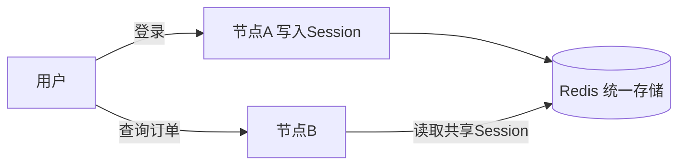

# 后台用户权限管理：创建用户、Spring Session 统一会话、Spring Cache 缓存登录与密码重置

智牛股第十一章的第一个模块是后台用户权限管理。上一章已经实现了权限管理的基本与核心接口，但登录接口、创建用户接口、后台产品管理接口还空着——这些是后续核心业务依赖的基础数据，必须先补齐。本章在补接口的同时引入两块基础设施：Spring Session Redis 解决多节点会话共享，Spring Cache 为登录后的权限数据提供缓存支撑。这两块做扎实了，下一章的全局权限过滤器才有数据可用。

## 先给结论

- 本章目标两项：完成后台创建用户、密码重置、产品与分类管理相关接口；掌握 Spring Cache 与 Spring Session Redis 分布式会话的集成使用。
- 创建用户不走 Spring Data REST 自动生成的接口——它只把客户端数据直接落库，不做业务校验；自定义 addUser 按四步走：账号查重、密码加密、组装冗余信息、保存。
- 微服务随机负载下，登录落在 A 节点、查订单落在 B 节点，B 节点拿不到会话；Spring Session Redis 用统一存储解决，配置三步（依赖、store-type、@EnableRedisHttpSession），Session 读写代码零改动。
- 客户端真实 IP 按 x-forwarded-for → Proxy-Client-IP → WL-Proxy-Client-IP → getRemoteAddr 优先级逐级获取；127.0.0.1 与 IPv6 回环地址要过滤，多级代理取逗号分割后的第一个 IP。
- 登录接口五步：查用户、密文比对密码、记录登录时间与 IP、按「集团 > 运营中心 > 交易商」优先级取最大权限角色、菜单操作权限按请求类型分组写入 Redis。
- 密码重置虽非核心但实用：管理员标识校验加 JPQL @Modifying 更新；JPA 的 update/delete 必须开 @Transactional，否则抛 TransactionRequiredException。
- 产品与分类接口走 Spring Data REST + QueryDSL：customize 里配置 contains 模糊查询，自动获得 HATEOAS 规范的增删改查接口。

## 创建用户接口：查重、加密与参数校验

用户实体 AuthorityUser 用 JPA 注解映射 t_authority_user 表，核心属性包括登录账号 userAccount、机构类型 institutionTypeId、机构 ID institutionId、用户密码 userPassword。密码字段加 @JsonIgnore，避免接口响应把敏感信息带出去；每个属性用 @ApiModelProperty 做文档说明，不想暴露的属性用 @Hidden 隐藏。

为什么不用 Spring Data REST（HATEOAS）自带的新增接口？因为它只会把客户端传递过来的数据直接保存，不做任何业务校验和逻辑判断。所以 Service 层自定义 addUser，处理逻辑四步：

```java
public void addUser(AuthorityUser user, AuthorityUser loginUser) throws ComponentException {
    // 1. 根据账号查重，已存在则抛异常
    Optional<AuthorityUser> opt = authorityUserRepository.findOne(equalsUsername(user.getUserAccount()));
    if (opt.isPresent()) {
        throw new ComponentException(ApplicationErrorCodeEnum.ADMIN_USER_ACCOUNT_EXIST);
    }
    // 2. 后台管理用户密码加密，密文入库
    user.setUserPassword(EncryptUtil.encryptSigned(user.getUserPassword()));
    // 3. 组装冗余信息：机构类型、创建人、默认激活可用状态
    user.setInstitutionTypeId(loginUser.getInstitutionTypeId());
    user.setCreatorAccount(loginUser.getUserAccount());
    user.setCreateTime(new Date());
    // 4. 保存后台管理用户
    authorityUserRepository.save(user);
}
```

按账号查重依赖 JPA Specification 与 CriteriaBuilder 的动态查询：

```java
private Specification<AuthorityUser> equalsUsername(String userAccount) {
    return (root, query, builder) -> builder.equal(root.get("userAccount"), userAccount);
}
```

条件不能随便拼接、返回任意对象，要走 javax.persistence.criteria 包下的规范。要扩展其他条件查询，在 Specification 里继续加属性即可，也支持 like 等多种操作符，灵活实现动态条件查询。

Controller 层逻辑不多：@Api、@RestController、@RequestMapping("/authorityUser") 定义接口，方法里先 getUser() 拿当前登录用户作为操作人，调 service 的 addUser，try-catch 把 ComponentException 转成 ApiRespResult.error，其余异常转 sysError。参数校验要用两个注解配合：类上加 @Validated，参数对象前加 @Valid，实体属性上配 @NotBlank、@Size 等约束（common-web 里通过 Hibernate Validator 做校验）。Service 接口用 IDEA 的 Refactor 抽取出来，保持面向接口编程。

## Spring Session Redis：多节点下的统一会话

微服务集群里有多个节点，负载均衡采用随机策略时，用户的请求并不能保证固定落到某一台机器。问题场景是这样的：用户在登录接口落到了 A 节点，接着去查订单时请求落到了 B 节点——权限拦截要查用户之前的登录态，可登录信息记录在 A 节点上，B 节点拿不到，拦截就失效了。



解决方案是 Spring Session Redis：基于统一缓存实现统一会话，做分布式微服务节点的会话管理。它还有可用性上的好处——某个节点出问题不影响其他节点对 Session 的操作，节点重启恢复后还能继续使用上次的 Session 数据。

集成三步：

1. 后台管理服务 pom 追加 Spring Session 依赖；
2. 工程配置文件里加存储配置：

```yaml
spring:
  session:
    store-type: redis
```

Spring Session 是封装层，不固定局限于某一种存储引擎，按业务需要也可以配置 MongoDB 等不同的存储方式。

3. 启动类加 @EnableRedisHttpSession 开启功能。这个注解还有更细的属性：maxInactiveIntervalInSeconds 配置 Session 过期时间，默认半个小时；redisNamespace 控制 Redis 命名空间；还有清理周期，支持 cron 表达式，默认一分钟检测清理一次。

集成完成后代码零侵入：BaseController 里的 getUser() 依旧从容器拿 Session、读属性，一行不用改，按原来的方式处理即可。

## 获取客户端真实有效 IP

登录要记录客户端 IP，但经过代理、转发后，直接 getRemoteAddr 拿到的往往是代理节点地址。BaseController 里的 getClientIP() 按优先级逐级获取：

```java
HttpServletRequest request = ((ServletRequestAttributes) RequestContextHolder.getRequestAttributes()).getRequest();
String ip = request.getHeader("x-forwarded-for");
if (ip == null || ip.length() == 0 || "unknown".equalsIgnoreCase(ip)) {
    ip = request.getHeader("Proxy-Client-IP");
}
if (ip == null || ip.length() == 0 || "unknown".equalsIgnoreCase(ip)) {
    ip = request.getHeader("WL-Proxy-Client-IP");
}
if (ip == null || ip.length() == 0 || "unknown".equalsIgnoreCase(ip)) {
    ip = request.getRemoteAddr();
}
```

Nginx 代理是最常见的场景：对外是 Nginx，下面转发到具体的应用服务。Nginx 要做配置，把它接收到的客户端 IP 放进头部（X-Forwarded-For 这类转发标识），应用服务从头部解析出来的才是用户的实际 IP；不做这个配置，直接取到的就是 Nginx 节点的 IP。如果有多台 Nginx 节点，每一层都要加对应的转发配置，应用服务从最上层 Nginx 拿到真正的 IP。头部取不到时才落到 getRemoteAddr，所以部署了 Nginx 时可以把 x-forwarded-for 的优先级提到最前面。

两个特殊处理：

- 同机部署：Nginx 和应用在同一台机器上，取到的是 127.0.0.1 或 0:0:0:0:0:0:0:1 这类回环地址，对业务没有意义。过滤逻辑：先尝试 InetAddress.getLocalHost()，取不到再读主机地址——局域网 IP 也比本地回环地址更好。
- 多级代理：头部值可能是「客户端IP, 代理1, 代理2」的长串，逗号分割，第一个才是真实客户端 IP，截取即可：

```java
if (null != ip && ip.length() > 15 && ip.indexOf(",") > 0) {
    ip = ip.substring(0, ip.indexOf(","));
}
```

边界要认清：用户经过多层 VPN 转发时，服务端无法追踪真实 IP——服务端只能追溯到上一个节点，VPN 不在头部携带真实用户 IP。要拿只有逆向追踪一类方案，比如浏览器 JS 插件在接口请求时额外附带用户 IP，逐层转发，最终服务端才能拿到真实值。这个手段做不到百分之百，只能按部署情况调整优先级，尽可能获取有效 IP。另外课程里顺手强调了一个工程习惯：异常要用 log.error 记录进日志文件，别直接打印异常栈，否则事后没法追溯。

## Spring Cache：登录权限缓存与密码重置

Spring 从 3.1 开始定义 org.springframework.cache.Cache 与 CacheManager 接口，统一不同的缓存技术，并支持 JCache（JSR-107）规范。核心接口两个：Cache 定义缓存操作，具体实现有 RedisCache、基于 EhCache 的 EhCacheCache、ConcurrentMapCache 等；CacheManager 管理各种缓存组件，注入后 getCache 拿到 Cache 对象，再按 key 读写缓存内容。

常用注解一览：

| 注解 | 作用 |
| --- | --- |
| @Cacheable | 方法级缓存，按请求参数缓存返回值，下次直接从缓存取 |
| @CachePut | 保证方法被调用，同时更新缓存，常用于更新操作 |
| @CacheEvict | 清空缓存 |
| @EnableCaching | 加在启动类，开启注解缓存 |
| @CacheConfig | 类级统一配置本类的缓存注解属性 |

主要参数：

| 参数 | 说明 |
| --- | --- |
| value | 缓存名称，必须至少指定一个，否则无法存储 |
| key | SpEL 表达式；缺省按方法所有参数组合 |
| condition | SpEL 条件，为 true 才缓存 |
| unless | 否定条件，为 true 时不缓存 |
| allEntries | @CacheEvict 是否清空全部缓存，缺省 false，指定 true 要慎重 |
| beforeInvocation | 是否方法执行前清空；缺省 false 时方法抛异常不清缓存 |

项目在 OAuth2 认证时已经用过：认证服务 loadClientByClientId 上加 @Cacheable(value = OAUTH_KEY_CLIENT_DETAILS, key = "#clientId")，把 ClientDetails 缓存起来。本次在后台管理服务 pom 加 spring-boot-starter-cache 依赖（底层依赖 spring-context-support），启动类加 @EnableCaching。注意它与 Spring Session 的分工：一个处理业务缓存，一个处理会话，互不替代。

登录接口把这套缓存真正用起来。userLogin(userAccount, password, clientIp) 五步处理：

1. 按账号查用户，isPresent 为 false 抛 ADMIN_USER_ACCOUNT_NOT_FOUND；
2. 密码加密比对：EncryptUtil.encryptSigned(password) 与库里密文不一致抛 ADMIN_USER_ACCOUNT_PASSWORD_ERROR；
3. 记录登录信息：setLastLoginTime 当前服务器时间、setLastLoginIp（从上层 Controller 把 clientIp 传下来），然后 save——对象是从数据库查出来的带 ID，JPA 走更新而非新增；
4. 取角色列表并筛选最大权限角色；
5. 获取角色菜单操作权限，存入缓存，供后面的权限控制使用。

角色可能分配多个机构，优先级规则是集团最高，其次运营中心，再往下交易商。实现方式：把三个机构类型按优先级顺序放进集合，最大权限的放前面，再用 Stream 过滤匹配：

```java
List<InstitutionType> types = Arrays.asList(
        GlobalConstants.INSTITUTION_GROUP,      // 集团，优先级最高
        GlobalConstants.INSTITUTION_OPERATION,  // 运营中心
        GlobalConstants.INSTITUTION_TRADER);    // 交易商
AuthorityUserRole maxRole = types.stream()
        .flatMap(type -> roleList.stream()
                .filter(item -> item.getInstitutionTypeId().equals(type)))
        .findFirst()
        .orElse(roleList.get(0));               // 匹配不到按默认处理
```

第五步拿最大角色的菜单操作权限列表后，要按请求类型分组。原因是平台走 HATEOAS 规范，同一个地址可以对应 POST、GET、PUT、DELETE 不同操作类型，而用户可能只有 POST 权限没有 DELETE 权限，操作级控制必须「URL + 操作类型」一起判断：

```java
Map<String, Set<String>> optUrlSets = optList.stream().collect(
        Collectors.groupingBy(AuthorityMenuOperation::getOperationIcon,
                Collectors.mapping(AuthorityMenuOperation::getOperationUri, Collectors.toSet())));
```

有个细节：operationIcon 字段原本存操作图标，项目没用到图标，改存接口请求类型（POST、PUT、DELETE）。写 Redis 时不直接存 Map 结构，key 变成「userId:操作类型」，value 是逗号拼接的 URI 串，比 Set 结构更便于处理：

```java
Cache cache = cacheManager.getCache(GlobalConstants.AUTHORITY_MENU_KEY);
optUrlSets.forEach((operationType, uriSet) -> {
    String uris = String.join(",", uriSet);
    cache.put(authorityUser.getId() + GlobalConstants.SPLIT + operationType, uris);
});
```

把权限放缓存有两个作用：一是服务无状态化，二是提升处理性能。Redis 里实际的 key 是「前缀常量 + 参数」拼出来的完整键值，比如菜单前缀常量拼接 userId——GlobalConstants 里定义的只是前缀，这点要在功能测试时用 Redis 工具看一眼真实存储来加深理解。菜单和操作分开存储，URI 统一记录并用 Set 去重。这套存储格式要记牢，下一章权限过滤器全靠它。

密码重置接口 resetPwd 相对简单：按账号查用户，判断操作者是否管理员（用户表 isAdmin 标识，非管理员抛 ADMIN_NOT_ADMIN），生成新密码——格式是「账号 + 固定串」加密，即 EncryptUtil.encryptSigned(userAccount + "123")，最后更新。更新走自定义 JPQL：

```java
@Transactional
@Modifying
@Query("update AuthorityUser usr set usr.userPassword = :password where usr.userAccount = :account")
int updateUserPwdByAccount(@Param("account") String account, @Param("password") String password);
```

三个注意点：@Transactional 用 Spring Framework 包下的，别导错；JPQL 按参数名绑定（@Param），不是占位符索引，这是和 MyBatis 的用法差别；自定义 @Modifying 修改必须开事务，否则 JPA 执行 update/delete 时抛 TransactionRequiredException，提示执行更新或删除操作时未开启事务。Controller 层 POST /resetPwd 只需传 account 一个参数，操作者权限在内部校验。

## 小结

这一章把权限模块的地基打完了：创建用户接口（Specification 查重 + 密文入库 + 冗余信息组装）、登录接口（五步处理，权限缓存落 Redis）、密码重置（管理员校验 + JPQL 事务更新）、产品与分类管理接口（Spring Data REST 自动暴露 HATEOAS 增删改查，customize 配置 contains 模糊查询；新增实体后要 clean package 重新生成 QueryDSL 的 Q 类，途中遇到实体编译报错是第三方 jar 冲突，排除依赖重新打包解决）。基础设施侧，Spring Session Redis 让多节点共享会话且无侵入，Spring Cache 的注解体系（@Cacheable / @CachePut / @CacheEvict 及 value、key、condition、unless 等参数）撑起了登录权限的高速读写。

缓存里的权限数据格式——userId:操作类型 对应 URI 串——是承上启下的关键。下一章实现全局权限过滤器：先做流程设计说明，再创建过滤器做白名单与权限匹配，配置使用，Spring Boot 启动时初始化加载菜单缓存数据，初始化数据库表数据，最后启动服务做功能验证。
