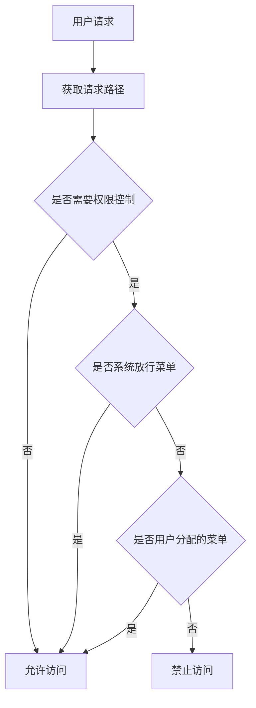

# 全局权限过滤器：白名单放行、权限匹配校验与 HATEOAS 验证，行情服务开篇

上一章把登录时的权限缓存写进了 Redis，这一章的全局权限过滤器就是它的消费方。后台系统菜单和操作众多，并非每个用户都能请求访问，而是按角色控制对应菜单，这个校验就由一个全局过滤器统一完成：白名单放行公开接口，权限匹配拦截未授权请求。验证环节顺带跑通了 Spring Data REST 的 HATEOAS 接口，并收束出下一章行情服务设计的开篇（PostgreSQL 选型）。安全和性能两条线贯穿全章：先大范围前缀判断缩小拦截对象，再逐层匹配权限，缓存把校验压到毫秒级。

## 先给结论

- 权限控制流程三层递进：请求路径是否需要权限控制 → 是否系统放行菜单（白名单）→ 是否用户分配的菜单；范围由大至小逐层控制，前面命中就不进后面的判断。
- 过滤器只对统一前缀的接口做鉴权：authority、auth 开头的路径纳入控制，正则配置让新增接口自动纳入，不用改过滤器。
- 白名单与用户权限都用「Set 全路径匹配优先，正则逐条兜底」的策略，contains 全匹配效率高，正则便于一个功能下配置一串接口。
- Filter 抛出的异常 ControllerAdvice 捕获不到（Filter 在请求接口的上层），所以过滤器内部直接 returnJson 输出统一 JSON。
- 公开菜单（白名单）存数据库表，服务启动时通过 ApplicationRunner 一次性加载进缓存；用户权限在登录时写入，改权限必须重新登录才生效。
- HATEOAS 接口查不到数据返回 404，语义是「数据不存在」而非「接口不存在」，前端要按这个规范处理。

## 权限控制流程：三层判断

流程设计一句话：获取请求路径，决定是否纳入权限控制；纳入后先过白名单，再匹配用户权限。用流程图表达：



白名单类似注册、登录这类对外开放接口的集合。从性能角度考虑，权限判断不能一上来就查数据库——每个请求都查库开销巨大，严重影响处理效率。所以登录时就把权限数据写进缓存，过滤器全程读缓存，这个设计在上一章已经铺好。

## GlobalSecurityFilter：白名单与权限匹配的实现

过滤器创建在 stock-admin-user 的 configure 目录下，实现 Servlet 的 Filter 接口，类上加 @Log4j2 并注入 CacheManager。init 是初始化接口，需要预加载数据可以在里面做，本项目不需要，重点在 doFilter 的拦截逻辑，整体五步：

```java
public void doFilter(ServletRequest servletRequest, ServletResponse servletResponse, FilterChain filterChain)
        throws IOException, ServletException {
    // 1. 获取请求相对路径，同时去除 contextPath
    HttpServletRequest request = (HttpServletRequest) servletRequest;
    String uri = getActRequestUri(request);
    // 2. 只针对需要权限判断的路径拦截，提升处理性能
    if (isNeedAuth(uri)) {
        filterChain.doFilter(servletRequest, servletResponse);
        return;
    }
    // 3. 白名单（系统忽略的菜单/公开菜单）放行
    Cache cache = cacheManager.getCache(GlobalConstants.AUTHORITY_MENU_KEY);
    if (null == cache) {
        return;
    }
    // 4. 校验用户是否登录，拿到用户分配的权限菜单缓存并匹配
    // 5. 权限都不符合规则，输出统一异常提示
}
```

getActRequestUri 的意义：拿相对路径并去掉 contextPath。服务以后修改了 contextPath，过滤器代码不用跟着调。isNeedAuth 里是两个正则前缀——authority 开头和 auth 开头，后面拼任意接口地址。约定规范很重要：需要纳入权限控制的接口统一前缀命名，路径五花八门就没法统一管理；有了前缀正则，新加接口只要符合规则就自动纳入，过滤器无需调整。

白名单匹配两级：先 Set contains 全路径匹配，效率比正则高；匹配不成功再遍历正则逐条 Pattern.compile(noLimitUrl).matcher(uri).matches()。白名单集合来自缓存里的 AUTHORITY_NO_LIMIT_KEY——缓存里定义了哪些接口不做权限拦截，支持正则，比如把注册接口配置进去直接放行。

登录校验从 Session 里取用户对象（SessionId 关联，未登录时为 null），为空就返回统一 JSON，错误码 ADMIN_USER_NOT_LOGIN，提示需要登录，然后退出。用户已登录则拼缓存 key 取权限数据：

```java
// key：userId + 分隔符 + 请求类型（统一转大写）
String userOptKey = authorityUser.getId() + GlobalConstants.SPLIT + request.getMethod().toUpperCase();
Cache.ValueWrapper userUriWrapper = cache.get(userOptKey);
if (userUriWrapper == null) {
    ApiRespResult respResult = ApiRespResult.validError(ApplicationErrorCodeEnum.SYS_NOT_VALID_REQUEST.getMessage());
    returnJson(servletResponse, respResult);
    return;
}
Set<String> userUris = (Set<String>) userUriWrapper.get();
if (userUris.contains(uri)) {
    // 完全匹配成功，放行
    filterChain.doFilter(servletRequest, servletResponse);
    return;
}
// 完全匹配不成功，进入模糊（正则）匹配
for (String userUri : userUris) {
    if (Pattern.compile(userUri).matcher(uri).matches()) {
        filterChain.doFilter(servletRequest, servletResponse);
        return;
    }
}
// 以上逻辑都不符合，提示异常
ApiRespResult respResult = ApiRespResult.validError(ApplicationErrorCodeEnum.SYS_NOT_VALID_REQUEST.getMessage());
returnJson(servletResponse, respResult);
```

缓存无权限数据说明没法进行接口请求；完全匹配走 contains，正则兜底支持权限数据里配置通配规则——一个功能操作下面包含一系列操作接口时，正则能一次配完，后续新增接口也不用维护每一条记录。正则属于 CPU 密集型运算，性能损耗不大，换来的是灵活管控。

returnJson 的实现要点：JSONObject.toJSONString 序列化、设置 UTF-8 与 application/json 响应头、PrintWriter 写出、try-catch-finally 里关闭流，异常同样走 log.error。为什么要在过滤器里自己捕获异常？之前写过的统一异常拦截器基于 ControllerAdvice，只能拦到请求方法里的异常；Filter 在请求接口的上层，还没进接口就抛了异常，ControllerAdvice 捕获不到，只能在 Filter 内部处理并返回统一封装的 JSON——前端不管成功失败都拿到统一的数据格式，便于对接。

## 让过滤器生效：配置与启动加载

过滤器配置走注解方式，比写一系列 XML 简洁。三件事：

1. 过滤器类上加 @WebFilter(urlPatterns = "/*")——urlPatterns 是过滤器能拦截的请求路径，/* 代表拦截所有接口请求，和以前 web.xml 里配 Filter 一个意思，只是换成注解自动扫描。
2. 启动类加 @ServletComponentScan(basePackages = "com.itcast")，指定基础扫描路径。只有加了扫描，@WebFilter、@WebListener、@WebServlet 这些 Servlet 组件才会被注册，过滤器才能真正生效；扫描路径必须包含过滤器所在包。
3. 检查 Redis 依赖：过滤器内部用 CacheManager 操作缓存，pom 里要确认 spring-boot-starter-data-redis 与 spring-session-data-redis 都已加入，才能操作对应的缓存数据。

白名单数据本身存数据库公开菜单表，由系统预设、管理人员维护，上线后一般不随意调整——要调整也跟着版本更新一起发布。因此正常情况不需要刷新缓存；确有紧急的动态调整需求，可以设定时任务（比如半个小时）定期加载更新。而用户权限数据在登录时加载，改了菜单权限必须重新登录才生效。

启动加载靠 GlobalSystemConfiguration 实现 ApplicationRunner：

```java
@Configuration
@Log4j2
public class GlobalSystemConfiguration implements ApplicationRunner {
    @Autowired
    private CacheManager cacheManager;
    @Autowired
    private AuthorityNoLimitUriRepository authorityNoLimitUriRepository;

    @Override
    public void run(ApplicationArguments args) throws Exception {
        log.info("初始化加载公开菜单数据");
        Cache cache = cacheManager.getCache(GlobalConstants.AUTHORITY_MENU_KEY);
        List<AuthorityNoLimitUri> noLimitMenuList = authorityNoLimitUriRepository.findAll();
        Set<String> noLimitSet = noLimitMenuList.stream()
                .map(noLimit -> noLimit.getNoLimitUri())
                .collect(Collectors.toSet());
        cache.put(GlobalConstants.AUTHORITY_MENU_NO_LIMIT_KEY, noLimitSet);
    }
}
```

ApplicationRunner 的 run 方法在 Spring Boot 容器成功启动之后自动执行；启动过程出现异常或还没启动完成，run 不会执行，这个时机要理解清楚。Repository 不需要写任何接口方法，直接 findAll 查出全部公开菜单，Stream 转换只取 URI 属性存入 Set，再 put 进缓存，key 为 AUTHORITY_MENU_NO_LIMIT_KEY。这一步完成后，过滤器第 3 步的白名单判断才有数据可查。

## 功能验证与 HATEOAS：404 的语义不一样

验证前先备数据，权限模块关联表多，任何一张缺数据都会让测试失真：

| 表 | 准备内容 |
| --- | --- |
| t_authority_no_limit_uri | 登录、重置密码、获取用户权限信息等公开接口 |
| t_institution / t_institution_type | 机构数据，三个层级的运营身份 |
| t_authority_menu / t_authority_menu_operation | 菜单与菜单操作数据 |
| t_authority_role / t_authority_role_operation | 角色（如 10171）及角色关联的菜单操作 |

测试策略是先把 addUser 接口的权限从角色里拿掉，验证过滤器是否真的拦截。启动顺序：先确保 Redis、Nacos 中间件正常，再启动后台管理服务，控制台无报错，Swagger 上能看到新加的产品管理与产品分类接口。

验证过程分三个阶段，也是三个典型场景：

1. 未登录直接调新建用户接口。最初服务还带着 OAuth2 统一认证配置，返回 401 要求认证；后台管理服务本次不走 OAuth2，把 security.oauth2 配置和依赖去掉、导入生效并重启后，再调接口返回的是过滤器封装的提示——参数不合法，请重新登录。这证明请求在进入接口之前就被过滤器拦下了。
2. 登录后无权限调用。用 test2020 账号、密码 123456 走 POST /admin/authority/User/login，登录信息存入 Session；Swagger 里各接口共享同一个 Session，再次调 addUser，返回「非法请求，未授予的菜单权限」——过滤器拿缓存里的权限数据匹配不到请求接口，走进最后一段提示逻辑。
3. 补配权限后调用成功。给该用户的角色配置正则规则：addUser 是 POST 请求，后缀路径 addUser，把菜单操作的 URI 配成匹配 authorityUser 后面任意接口地址的正则。在数据库确认链路完整：查用户 ID → 用户角色关联表拿到角色 10171 → 角色操作表里有对应的菜单操作记录。重新登录后再调 addUser，请求进入接口内部逻辑，拦截提示消失，权限控制正常生效。

中途还排掉一个 JPA 的坑：新增用户时报错，检查发现 roleId 字段有 @Transient 注解不持久化，但日志里 SQL 却向用户角色关联表插入了一条全 null 的数据——根因在 AuthorityUser 实体上配置的一对多关联映射，保存时把关联表也带出来了。解决：保存前将关联对象置为 null，明确保存用户时不对关联表做任何操作。

重启服务后不重新登录，接口照常操作——Session 信息保存在 Redis 缓存里，服务重启不影响登录态，这正是上一章 Spring Session 统一会话的实证。数据库里也能查到 test2020 已正常落库。产品管理、分类管理、菜单管理等其他接口可按同样思路自行验证。

HATEOAS 的 REST 服务验证要手工做：Swagger 对 Spring Data REST 的支持不够完善，它生成的增删改查接口在 Swagger 里不能完全识别。REST 是面向资源的服务，路径会附带资源信息——按 ID 查询、修改时 ID 是动态值拼在 URL 后面，不像 Spring Boot 接口固定路径加 POST 参数，所以菜单权限要靠正则配置来匹配；生产环境建议做多条精细配置，ID 是数值就跟数值规则，防止其他接口一并暴露。

浏览器访问 http://127.0.0.1:10691/admin/authorityTradeStock/search，返回的 _links 里列出 findByCode、findByCategoryId（templated 为 true）和 self。按 REST 方式调用 http://127.0.0.1:10691/admin/authorityTradeStock/search/findByCode?code=601318，返回 601318 的完整股票数据带 links；参数随便换一个不存在的编号，返回 404。注意这个 404 和 Spring Boot 接口的 404 不一样：Spring Boot 的 404 表示接口压根不存在，这里的 404 表示接口存在但数据没找到，前端要按 HATEOAS 规范做相应处理。此外还支持 PUT、DELETE 等操作。

行情服务的开篇也在此收束出下一章方向：第 3 章行情服务的功能设计，目标两点——理解专业生产级行情服务的整体功能设计，掌握 PostgreSQL 的安装与配置。PostgreSQL 作为交易数据库存储交易相关信息，业务相关信息仍在 MySQL；PostgreSQL 相对 MySQL 在大数据量下有较好的性能表现，所以交易核心数据放 PG。实现步骤：专业行情服务功能设计（行情怎么订阅、怎么分发、如何承载大数据量用户）→ 数据库结构设计 → PostgreSQL 服务端配置 → PostgreSQL 客户端连接配置与验证。

## 小结

本章从安全和性能两头完善权限控制：流程上先大范围统一前缀判断，再白名单放行，最后逐条匹配用户分配的菜单操作权限，逐步缩小判断范围提升处理速度；性能上权限数据全程走缓存——白名单启动时由 ApplicationRunner 加载，用户权限登录时写入，避免每个请求查库。工程细节同样关键：@WebFilter 加 @ServletComponentScan 才能生效；Filter 层异常要自己 returnJson 输出统一格式；改权限必须重新登录；HATEOAS 的 404 是「数据不存在」。到此权限模块闭环，下一章进入行情服务功能设计与 PostgreSQL 环境。
