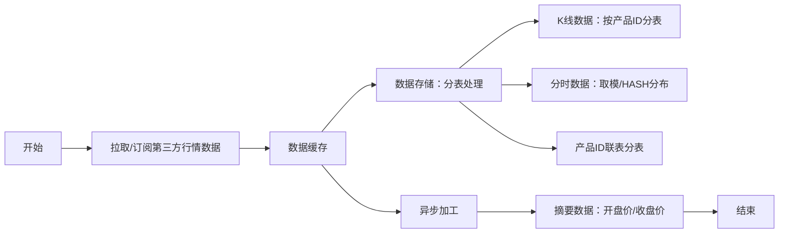

# 智牛股行情服务设计：缓存分表策略与 PostgreSQL 全套部署

智牛股交易平台的两个共振点是交易与行情：交易负责撮合，行情负责订阅与呈现。行情的加工处理涉及大量专业细节，课程选择从第三方拉取行情数据，把重心放在行情服务内部的核心链路上——缓存、分表、概要数据加工，以及承载这些数据的 PostgreSQL 从安装到建表的全套操作。这一章的尾部还开启了 RocketMQ 的学习：先认识它的架构与术语，再把单机服务跑起来。

## 先给结论

- 行情服务的两大功能是加工与代理转发，客户端不直接对接行情源：行情源故障或换平台时，服务端一处调整即可，客户端无需升级。
- 拉取到的行情先入缓存再异步落库，存储与下发分离、不同线程处理互不干扰，保证行情下发的即时性。
- 分表策略按数据特性区分：K 线数据按产品 ID 一表（只存一分钟基础周期，再衍生五分钟、小时、日 K、周 K），分时数据按产品 ID 取模散落到多张表（只保留当天），开盘价收盘价抽离概要表便于结算。
- 分表用 Sharding-JDBC 实现：比 MyCat 更轻量、更易用，还规避了 MyCat 对 PostgreSQL 支持不完善的问题。
- 库的选择做分库设计：行情与交易数据用 PostgreSQL，业务库用 MariaDB，互不干扰、各自扩展；演示环境安装 PostgreSQL 11.2，管理员与业务用户密码均为 654321，端口 5432。
- RocketMQ 是阿里 2012 年开源的分布式消息中间件，集群由 NameServer、Broker、Producer、Consumer 四个模块组成；单机部署时先改三个启动脚本的 JVM 参数，再按"先 NameServer 后 Broker"的顺序启动。

## 行情服务怎么设计：缓存扛下发，分表扛存储

行情服务整体流程是：从第三方数据源拉取/订阅行情 → 存入数据缓存 → 异步加工落库 → 生成概要数据。数据源可以是第三方聚合平台、交易所或券商，按项目实际需要选择订阅方式。完整链路如下图：



缓存在这里承担两个职责。其一是提升行情订阅与下发的处理性能：行情数据进缓存后可以直接下发给用户，处理速度快，实时性高。其二是支撑异步存储：存储与下发分离，由不同线程处理，相互之间不产生干扰——下发线程追求即时性，落库线程慢慢做加工，两边互不拖累。

落库环节的核心是分表。股票产品多达几千个，峰值时每秒行情有多口报价，一般行情系统每秒要支持四到五口报价，做得优秀的能达到每秒数十口，一天仅单个交易市场的行情数据就多达上千万条。要扛住这个量级，K 线与分时两类数据采用不同的分表路由：

| 数据类型 | 分表策略 | 保留粒度 | 说明 |
| --- | --- | --- | --- |
| K 线数据 | 按产品 ID 一表 | 分钟 | 只存最小周期，基于一分钟数据可加工五分钟、一小时、日 K、周 K 等 |
| 分时数据 | 按产品 ID 取模（HASH 平均分布） | 当天 | 如划分五张表，数据平均散落，避免单表压力瓶颈，必要时可扩表 |
| 概要数据 | 独立一张概要表 | 每日 | 存开盘价、收盘价，便于行情结算（计算用户收益、杠杆账户保证金） |

分时数据只保留当天——行情时刻在变，存得过多会让性能严重下降，拖累行情的即时性。开盘价收盘价有的行情源会直接下发，有的只给盘口信息需要自行加工，最终都落到概要表供结算。

课程在实现上做了一个取舍：交易数据暂不做分表——交易的重点在撮合处理与深度成交，先掌握核心业务逻辑，之后再参照行情分表的实现自行扩展即可；行情数据则用 Sharding-JDBC 真正落地分表。

## 三张表撑起行情库

数据库结构设计的物理视图里有三张表：股票 K 线表、股票报价概要表、股票分时行情报价表。

**股票 K 线表**：产品 ID，开盘价、最高价、最低价、收盘价四个必要价格，再加成交量、成交金额和时间周期。只存按分钟产生的 K 线数据，时间字段是加工多周期 K 线的基础。

**股票报价概要表**：产品 ID、开盘价、收盘价，以及开盘和收盘对应的时间。这些信息主要服务于结算处理，App 端只需要 K 线数据和分时行情报价。

**股票分时行情报价表**：字段最多，因为要装下整个盘口——买方五档报价与五档委托数量（priceBid1~5、volumeBid1~5）、卖方五档报价与五档委托数量（priceAsk1~5、volumeAsk1~5）、当前价格 lastPrice、当前成交量、当前成交金额，以及记录实时行情的报价时间。

| 表 | 关键字段 | 用途 |
| --- | --- | --- |
| 股票 K 线表 | stockId、priceOpen/High/Low/Close、volume、amount、time | 分钟级 K 线存储与多周期加工 |
| 股票报价概要表 | stockId、openPrice、closePrice、openPriceTime、closePriceTime | 结算处理 |
| 股票分时行情报价表 | 五档买卖报价与委托量、lastPrice、volume、amount、time | 实时盘口呈现 |

所有价格字段都采用长整型（bigint）存储，避免计算过程中的精度丢失与误差——金融领域哪怕错一分钱，对平台可信度都是严重打击，数值运算一般都用长整型处理。

## PostgreSQL 从安装到建表

### 为什么是 PostgreSQL

行情与交易服务对数据库性能和吞吐量要求较高，在目前免费开源的数据库方案中，PostgreSQL 一直是各种规模企业的首选——它最显著的优点是核心算法的效率，处理大型数据集时优势更明显。数据量小的场景下，它和 MySQL、MariaDB 的体感差别不大，所以选库并非性能越高越好，合适才重要。项目里的分库设计正是基于这一点：行情与交易数据用 PostgreSQL，业务库用 MariaDB。这样交易数据不受业务数据干扰，高峰压力也不会传导至业务库；如果都塞进同一个库，很容易出现 IO 瓶颈，拖慢整个服务。

### 安装与初始化

讲义原用 10.2 版本，官方下载连接已失效，改为 11.2 版本演示。采用 yum 方式安装，共五条指令，依次安装 libs 插件、PostgreSQL 主程序、contrib 组件、devel 组件和 server：

```bash
yum -y install https://download.postgresql.org/pub/repos/yum/11/redhat/rhel7-x86_64/postgresql11-libs-11.2-2PGDG.rhel7.x86_64.rpm
yum -y install https://download.postgresql.org/pub/repos/yum/11/redhat/rhel7-x86_64/postgresql11-11.2-2PGDG.rhel7.x86_64.rpm
yum -y install https://download.postgresql.org/pub/repos/yum/11/redhat/rhel7-x86_64/postgresql11-contrib-11.2-2PGDG.rhel7.x86_64.rpm
yum -y install https://download.postgresql.org/pub/repos/yum/11/redhat/rhel7-x86_64/postgresql11-devel-11.2-2PGDG.rhel7.x86_64.rpm
yum -y install https://download.postgresql.org/pub/repos/yum/11/redhat/rhel7-x86_64/postgresql11-server-11.2-2PGDG.rhel7.x86_64.rpm
```

官方源在国外，在线安装速度慢；网络不稳时提示打不开网址，重新执行即可，也可以切换阿里云镜像源，或者先把 RPM 包下载到本地再用 `rpm -ivh` 安装，效果一样。安装完成后初始化数据并启动（CentOS 6 与 7 的指令不同，演示环境是 CentOS 7）：

```bash
service postgresql-11 initdb      # 初始化数据库
chkconfig postgresql-11 on        # 设置开机自启
service postgresql-11 start       # 启动服务
```

验证两点：`ps -ef | grep postgres` 能看到 postgres 用户的进程；`netstat -anp | grep 5432` 能看到默认端口 5432 已被 PostgreSQL 进程监听。

### 服务端配置

先改管理员密码，再建一个专用于业务操作的数据库用户——业务用户和管理用户要区分开：

```bash
su postgres
psql -U postgres
```

```sql
alter user postgres with password '654321';
create user office password '654321';
alter user office superuser createrole createdb replication;
```

教学演示给了 office 超级用户权限以避免操作中的权限问题；实际项目里应按需分配。接下来配置远程访问，编辑两个配置文件（注意路径中带版本号，11 系列就是 `11`）：

```bash
vi /var/lib/pgsql/11/data/postgresql.conf   # listen_addresses = '*'，允许所有 IP 连接
vi /var/lib/pgsql/11/data/pg_hba.conf       # 末尾追加一行
```

```ini
host    all    all    0.0.0.0/0    md5
```

`md5` 表示通过密码访问；如果只想放开指定网段或单台 IP，把 `0.0.0.0/0` 换成对应地址即可。改完重启生效——CentOS 6 用 `service postgresql-11 restart`，CentOS 7 用 `systemctl restart postgresql-11.service`——再用 `ps -ef | grep postgres` 确认进程正常。

### 客户端连接与建表

用数据库连接工具新建 PostgreSQL 连接：主机指向虚拟机真实 IP，端口 5432，初始数据库先用默认的 postgres（此时还没有业务库），用户名 office、密码 654321。首次连接报"无法连接到远程 IP 和端口"，回到虚拟机检查防火墙——`systemctl status firewalld` 显示防火墙处于激活状态，外部连接进不来；演示环境直接停掉防火墙后连接成功，生产环境建议通过防火墙配置开放指定端口。

连上之后做三件事。第一，创建业务数据库 trade_stock，拥有者指定 office，编码指定 UTF-8。第二，创建 office 模式（schema）：PostgreSQL 的模式相当于命名空间，不同模式下可以创建相同表名，访问表对象时用"模式名.表名"，类似 Java 里的包名加类名；不指定模式时，以当前登录用户的模式作为隐含模式——用 office 登录访问 t_trade_stock_kline，实际访问的就是 office.t_trade_stock_kline。第三，建表前先建序列，这一点不同于 MySQL：MySQL 的 ID 自增由数据库自动维护，PostgreSQL 不先建序列，建表脚本会直接报错：

```sql
CREATE SEQUENCE t_trade_stock_kline_id_seq
    INCREMENT BY 1 MINVALUE 1 NO MAXVALUE START WITH 1;
```

序列自增步长 1、最小值 1、无上限、起始值 1。随后执行建表脚本创建 t_trade_stock_kline 表，并用 `COMMENT ON TABLE` / `COMMENT ON COLUMN` 给表和字段补上中文注释（如"成交金额""报价时间"），生成的 DDL 与讲义脚本一致。其余交易和行情相关的表按物理模型照此办理即可。

## RocketMQ 开篇：认识架构，跑起单机

行情数据要在服务之间流转，这一章顺势引入 RocketMQ。它的定位是内部服务之间的消息交互：相比接口调用，能提升数据吞吐量、处理性能与数据可靠性，并实现异步解耦、流量削峰。它由阿里巴巴在 2012 年开源，历经三代，历年双十一承载阿里生产系统 100% 的消息流转——2017 年双十一完成 1.2 万亿条消息的精准低延迟投递，交易峰值吞吐能力高达 17 万笔/秒（这靠的是集群，不是单机能力），目前有 100 多家公司及科研机构在使用。

集群物理架构有四个核心模块：NameServer 类似注册中心，存储当前集群所有 Broker 信息以及 Topic 与 Broker 的对应关系，Producer、Consumer、Broker 都指向它做统一管理；Broker 是最核心的模块，负责 Topic 消息存储和消费位点管理——消费位点就是消费进度，队列结构里记录当前消费到哪条消息，集群中断或节点信息丢失后可以据此追溯未处理完成的消息；Producer 与 Consumer 分别是消息的生产者和消费者，各自有 ID 编号，同集群多个实例可共用一个 ID 组成生产者/消费者集群，行情提供方与行情订阅方就是典型的两侧。

开发前还需要吃透几个术语：Topic 是消息的逻辑分类（订单类、库存类、账户日志各归各的 Topic）；Message 是消息载体，必须指定 Topic（相当于收件地址），可选设置 Tag 便于消费端过滤；Tag 是对 Topic 的进一步细化，在同一业务模块内标记不同用途（如订单未支付、已支付、下单成功）；Producer Group / Consumer Group 把发送或消费同一类消息的多个实例编成一组，Group 机制让 RocketMQ 天然支持负载均衡——一个 Topic 下 9 条消息、消费组 3 个实例，每个实例均摊 3 条；Broker 则是中转角色，承接消息的存储、管理与分发下发。

单机部署的要点：下载 4.4.0 安装包（可用腾讯云镜像 mirrors.cloud.tencent.com/apache/rocketmq），`unzip -qo rocketmq-all-4.4.0-bin-release.zip` 解压后即可运行，环境要求 JDK 1.8 以上。默认配置会占用 4G 内存，学习环境要手动改小——runserver.sh、runbroker.sh、tools.sh 三个脚本里的 JAVA_OPT 都把原行注释掉、替换为小内存参数（例如 runbroker.sh 改为 `-Xms256m -Xmx1024m -Xmn1024m`）。服务端配置改 conf/broker.conf：把 namesrvAddr 与 brokerIP1 指向虚拟机对外 IP（演示环境 10.10.20.251），ACL 权限控制学习阶段先关掉。启动顺序有讲究——NameServer 存储着 Broker 信息，必须先起 NameServer 再起 Broker：

```bash
# 先启动 NameServer（默认端口 9876）
nohup /usr/local/rocketmq_4.4/bin/mqnamesrv > /dev/null 2>&1 &
tail -f ~/logs/rocketmqlogs/namesrv.log   # 出现 The Name Server boot success 即成功

# 再启动 Broker，-n 指定 NameServer 地址
nohup /usr/local/rocketmq_4.4/bin/mqbroker -n 127.0.0.1:9876 > /dev/null 2>&1 &
tail -f ~/logs/rocketmqlogs/broker.log    # broker boot success 且已注册到 NameServer
```

`nohup` 让服务后台运行，`> /dev/null 2>&1` 屏蔽控制终端日志输出；启动出问题时把这一段去掉，看具体报错排查。真正的运行日志记在启动用户家目录的 `~/logs/rocketmqlogs/` 下——哪个用户启动，日志就生成在哪个用户目录。关闭顺序与启动相反：先 `mqshutdown broker`，再 `mqshutdown namesrv`。怕记错顺序，可以在 bin 目录封装自己的 start.sh 与 shutdown.sh（内容就是按序调用 mqshutdown），`chmod 777` 赋权后即可一条命令启停。

## 小结

这一章把行情服务从设计讲到落地：整体链路上用缓存把存储与下发解耦，用 Sharding-JDBC 按数据特性分表——K 线按产品 ID 一表只存分钟周期，分时取模散落只留当天，概要独立成表服务结算；三张行情表的字段与长整型价格存储都围绕金融精度展开。PostgreSQL 侧完成了 11.2 的安装、服务端用户与远程访问配置、客户端连接与库表初始化，注意版本差异与多网卡时的 IP 指定，避免客户端连不上。RocketMQ 部分完成了认知铺垫与单机运行：四个模块的分工、核心术语、JVM 参数裁剪与启停顺序。控制台部署、功能验证与管理命令在下一章继续。
