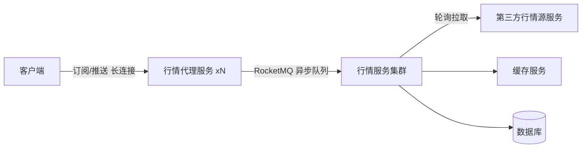

# 智牛股行情与代理服务搭建：聚合数据行情源接入与 Http 连接池、Json 封装

上一章完成了行情服务的设计推演与 PostgreSQL、RocketMQ 的部署，这一章进入动手搭建：创建行情服务与代理服务两个工程模块，生成行情实体，随后开启第二章——第三方行情源接入。行情源选定聚合数据平台，先摸清它的接口规范与数据格式，再把对接要用的两件基础工具封装出来：HTTP 连接池与 Gson 解析工具，最后为行情服务配好 JPA 多数据源。

## 先给结论

- 整条行情链路的分工：客户端只与代理服务建立长连接，代理服务无状态、可水平扩容；行情服务集群从第三方行情源轮询拉取数据，加工后一份进缓存、一份持久化入库；代理与行情服务之间用 RocketMQ 异步队列衔接。
- 行情源服务要从底层设计上支撑多个第三方行情源接入：不同交易所（上交所、深交所、港交所）、不同产品（外汇、贵金属、期货、股票）的数据格式差异很大，一套行情系统最好能接两个以上来源，某个行情源中断时可基于已有数据继续服务或动态切换。
- stock-quote 与 stock-proxy 搭建套路一致：引入多环境配置与日志配置，pom 补 Web、Nacos、公用组件、RocketMQ 与 Redis 依赖，finalName 与模块名保持一致；代理服务的行情消息消费组配置了并发 10、最大尝试 1 次。
- 实体生成走 MyBatis Generator：为 PostgreSQL 单独新建 generatorConfig_pgsql.xml（连接 office 库），生成 K 线、实时行情、行情概要三张表的实体与 Mapper，调整后归入公用实体工程。
- 聚合数据沪深股市接口每天 100 次免费调用；股票代码 gid 必须带市场前缀（沪 sh、深 sz）；股票返回买卖五档盘口，指数因不可交易而没有盘口信息，gopicture 里的 K 线图片抓取自新浪行情源。
- 对第三方行情源的频繁 HTTP 调用要上连接池，重试策略必须保证幂等性（GET 可重试、POST/PUT 不可）；JSON 解析选 Google 的 Gson，封装为线程安全的单例工具。

## 行情链路：代理扛连接，行情服务扛加工



客户端发起订阅，首先连接的是行情代理服务，而不是行情服务本身。代理服务与客户端建立长连接传输数据，保证高效稳定；它是无状态设计，只负责行情分发，前端连接出现压力瓶颈时水平扩充节点即可提升整体吞吐性能。

行情代理服务通过 RocketMQ 异步队列与行情服务集群建立连接。RocketMQ 是强一致性队列，数据安全与可靠性高，保障行情数据快速稳定分发；扩充集群节点还能提升整体存储能力。

行情服务集群是整条链路的核心，负责行情的加工与转换处理，以集群方式运作，兼顾高可用与处理性能。它以订阅或拉取的方式对接第三方行情源——正式行情需要收取巨额费用，教学演示接入的是免费第三方行情源，只能通过轮询拉取获取行情信息。行情源服务要支撑多个不同第三方行情源的接入：不同交易所（上交所、深交所、港交所等）、不同产品报价（外汇、贵金属、期货、股票等），接口数据格式与属性各不相同，这要求从底层代码上做好设计。一套行情系统最好能支撑两个以上的不同行情源，即便某个第三方行情中断，也能基于已获取的行情数据继续提供服务，实时数据还可以动态切换。

加工完成的数据存两处：一份放缓存服务，一份持久化到数据库。缓存支撑行情下发的处理性能；持久化保障数据稳定性，满足交易服务、持仓服务、资金服务等其他服务对行情数据的要求。

## 两个服务模块的搭建与实体生成

行情服务模块叫 stock-quote，代理服务模块叫 stock-proxy（包名 com.icast.bulls.stock.proxy）。两个模块的搭建动作完全一致：

**引入配置文件**。多环境配置（bootstrap.yml 与 dev/uat profile，代理服务多一个 prd）与日志配置 logback-spring.xml，从已实现工程 copy 过来；Nacos 注册与配置中心地址演示环境是 127.0.0.1:8848。

**补 pom 依赖**。两个模块都需要 Web、Nacos 服务注册发现与公用组件、实体的依赖：

```xml
<dependency>
    <groupId>org.springframework.boot</groupId>
    <artifactId>spring-boot-starter-web</artifactId>
</dependency>
<dependency>
    <groupId>com.alibaba.cloud</groupId>
    <artifactId>spring-cloud-starter-alibaba-nacos-discovery</artifactId>
</dependency>
<dependency>
    <groupId>com.icast.trade</groupId>
    <artifactId>bulls-stock-common-utils</artifactId>
    <version>${project.stock.version}</version>
</dependency>
<dependency>
    <groupId>com.icast.trade</groupId>
    <artifactId>bulls-stock-entity</artifactId>
    <version>${project.stock.version}</version>
</dependency>
```

工程要用到缓存与消息通信能力，再追加 RocketMQ 消息组件与 Spring Data Redis 依赖（公用组件里还有基于 Redis 实现的缓存封装）。多环境 profile 配合 maven-resources-plugin 的 `${*}` 分隔符配置，在打包时完成资源占位符替换。

**代理服务的消费配置**。代理服务要消费行情消息，bootstrap.yml 里除了端口 10693 与 Nacos 地址，还给行情消费绑定配置了并发与重试参数：

```yaml
stream:
  bindings:
    quote:
      consumer:
        concurrency: 10   # 并发数
        maxAttempts: 1    # 最大尝试次数
```

**finalName 与模块名一致**。build 里的 finalName 与模块名保持一致，与其他应用服区分开。

**实体生成**。行情实体用 MyBatis Generator 生成。之前生成实体连的是 MariaDB，为不与原 generatorConfig.xml 冲突，针对 PostgreSQL 新建了独立的 generatorConfig_pgsql.xml：JDBC 连接指向 PostgreSQL（驱动 org.postgresql.Driver，连接串 jdbc:postgresql://localhost:5432/office，账号 postgres/123456），pom 引入 42.2.5 版的 PostgreSQL 驱动，javaModelGenerator、sqlMapGenerator、javaClientGenerator 指定实体与 DAO 的目标包，table 配置三张行情表——K 线数据表、实时行情数据表（t_trade_stock_quote_last）、行情概要信息表：

```xml
<table schema="office" tableName="t_trade_stock_quote_last" enableCountByExample="false">
    <property name="useActualColumnNames" value="true" />
    <generatedKey column="ID" sqlStatement="MySql" identity="true" />
</table>
```

启动类把配置文件路径从 generatorConfig.xml 调整为 generatorConfig_pgsql.xml，清空输出目录后运行即生成 DAO 与实体代码。生成代码并非立即可用：要检查表名映射是否正确、补上注解、核对属性与 SQL 字段一致，再放进公用实体工程 bulls-stock-entity 的行情 pojo 包下，供行情功能实现使用。

## 聚合数据行情源：接口规范与数据格式

行情源选定聚合数据平台：接口格式比较规范，每天提供 100 次免费调用，学习测试够用，不够可以多申请两个账号。动手封装前，先在它的 API 测试工具里把接口调一遍，摸清数据格式规范。

请求参数两个：gid 是股票代码，必须带市场前缀——深圳股市以 sz 开头、上海股市以 sh 开头（拼音简写），不带前缀查询不到；type 是指数参数，不查指数就不用填。

股票数据的外层结构是 resultcode 返回码（200 正常）、reason 返回描述信息、result 数组，data 包体里是具体属性：

| 字段 | 含义 | 字段 | 含义 |
| --- | --- | --- | --- |
| gid | 股票编号（sh601009） | nowPri | 当前价格 |
| increPer / increase | 涨跌百分比 / 涨跌额 | todayStartPri | 今日开盘价 |
| name | 股票名称 | yestodEndPri | 昨日收盘价 |
| todayMax / todayMin | 今日最高 / 最低价 | competitivePri / reservePri | 竞买价 / 竞卖价 |
| traNumber / traAmount | 成交量 / 成交金额 | date / time | 日期 / 报价时间 |
| buyOne~buyFive | 买一至买五委托量与报价 | sellOne~sellFive | 卖一至卖五委托量与报价 |

result 里还有两块扩展数据。dapandata 是大盘数据，可通过 type 参数单独查询；gopicture 返回图片地址——分时 K 线图、日 K 线图、周 K 线图、月 K 线图各一个 URL，从地址（image.sinajs.cn）能看出这些图片抓取自新浪行情源。

指数行情把 type 传 0 查询（如上证综合指数），返回成交量 dealNum、成交额 dealPri、最高/最低价 highPri/lowpri、当前价 nowpri、今开 openPri、昨收 yesPri、涨跌幅 increPer/increase 等。指数与股票不同：指数是某部分股票的加权平均数，本身没法交易（除非基金 ETF 这类产品），不能交易就没有盘口，信息量比股票少很多——少了买卖五档的盘口报价。

## 基础工具封装与 JPA 多数据源配置

### Http 连接池封装

对接第三方行情源走 HTTP + JSON。频繁或大量的 HTTP 请求最好加连接池：极大减少连接开销、提升交互效率、减少调用错误；调用次数少直连也没关系，高并发大数据量场景必须上连接池。工具放在公用工程 bulls-stock-common-utils 下：http 包的 HttpPoolUtil 负责连接池，json 包的 GsonConvertUtil 负责 JSON 解析，pom 引入 httpclient 与 gson 组件。

连接管理器 PoolingHttpClientConnectionManager 有两个最大数：

```java
connectionManager.setMaxTotal(maxTotalConn);             // 全局最大连接数
connectionManager.setDefaultMaxPerRoute(maxConnPerHost); // 每个路由的最大连接数
```

maxTotal 指客户端与所有服务端（服务 A、服务 B 等）建立连接的总和上限；maxPerRoute 指对单个主机能发起的最大并发连接数——前者是全局口径，后者是单点口径。

超时配置有三项：连接超时默认 20 秒左右，不能设太长，否则服务响应慢、大量连接被占用带来内存开销；读取超时对应服务端处理业务逻辑再返回数据的过程；connection request timeout 是从连接池获取有效连接的等待超时，高频场景下申请频繁、存在竞争开销，内存 CPU 内计算极快，一般配 500 毫秒足够。连接存活策略定义空闲有效时间：连接数据交互完成后仍保持存活的时间，并非交互过程中计时。

单例采用懒加载实现，volatile 修饰避免并发时的原子性资源竞争，再配合同步锁保证并发下不产生多个实例：

```java
private volatile static HttpPoolUtil httpPoolUtil = null;

public static HttpPoolUtil getSingleton() {
    if (httpPoolUtil == null) {
        synchronized (HttpPoolUtil.class) {
            if (httpPoolUtil == null) {
                httpPoolUtil = new HttpPoolUtil();
            }
        }
    }
    return httpPoolUtil;
}
```

工具里准备了浏览器代理标识（User-Agent）：一些网站有反爬机制，请求带上头部信息、模仿火狐或苹果或谷歌等浏览器即可绕开。

请求重试策略是连接池封装的重点。重试次数一般配 3 次；InterruptedIOException（超时）、UnknownHost、ConnectionRefused 等异常返回 false，不进入重试；NoHttpResponseException——没有收到服务端响应——会触发重试。更关键的是幂等性判断：POST/PUT 这类 HttpEntityEnclosingRequest 带请求体，重试可能造成重复数据，不能保证幂等性，不进入重试策略；GET 只做查询，查一次与查两次结果一致，不影响服务器数据，可以进入重试机制。并非所有场景都适合重试：重试必须保证接口幂等性，否则会产生垃圾或冗余数据。

请求发送的封装套路：POST 请求附带头部信息（浏览器代理标识），参数经 StringEntity 包装后附在请求体里发送，client.execute 拿到响应码与数据体后统一包装成 HttpResult（响应码 + 字符串数据体），便于调用方处理结果；打印远程调用耗时日志便于排查问题；最后释放相关资源。另有 GET 封装，以及通过 UrlEncodedFormEntity 提交的 POST 变体——区别在于服务端能接收的数据形式，按需选择。

### Gson 解析封装

Gson 是 Google 开源的 JSON 解析组件，处理性能较高。GsonConvertUtil 同样是单例 + 懒加载 + 同步锁，Gson 解析对象支持并发调用、没有线程安全问题，直接放在成员变量中复用。初始化做两项配置：

```java
gson = new GsonBuilder()
        .setDateFormat("yyyy-MM-dd HH:mm:ss")  // 日期按指定格式返回
        .enableComplexMapKeySerialization()    // 开启 Map 解析转换支持
        .create();
```

开启 Map 支持后，Map 数据可直接与 JSON 相互转换。常用方法：cvtJson2Obj(json, class) 泛型转换——把订单 JSON 串与 Order.class 传进去，直接返回 Order 对象；cvtJson2List 完成 JSON 到 List 的转换，省去手工遍历迭代；cvtJson2Map 借助 TypeToken 把 JSON 字符串转成 Map，注意 Map 值的类型包装要与实际数据一致（数值就包数值类型）；toJson 把对象转回 JSON；还有直接读取 JSON 串中指定属性值的方法——不想为取一个属性定义整套对象时用它最快。高级用法（getJsonArray、生成参数名值对形式的 JSON 字符串、从指定 JsonObject 中找出 subJsonName 命名的值对象等）需要时再回过头研究。写了个测试把 Map 字符串转 Map 对象，运行输出正确，工具即封装完成。

### JPA 多数据源配置

行情服务的数据层要跨两个库：行情表在交易数据库（PostgreSQL），加工行情 K 线数据要读写它；产品与配置表在业务数据库（MariaDB），读取行情产品基础配置要用它。多数据源实现方案不少，比较简单的是国内开源 baomidou 的 dynamic-datasource：深度封装、代码侵入性低、配置简单。课程选择较为复杂的原始配置方式，把多数据源怎么配置讲透。

先在行情服务工程创建包结构：config 配置类、mq（RocketMQ）、repository 数据层、service 服务层、datasource（对接聚合数据源平台），以及启动类。

数据源连接池配置类 DruidSystemDataSourceConfiguration 里定义两个 Druid 数据源 Bean：业务数据源 bizSystemDataSource 与交易数据源 tradeSystemDataSource，用 @ConfigurationProperties 分别绑定 biz.datasource 与 trade.datasource 前缀读取配置文件属性；交易数据源再加 @Primary 注解标识为默认数据源——不指定默认数据源，数据层接口就不知道优先用哪个。

交易数据源的完整配置类 TradeSystemDataSourceConfiguration：@EnableJpaRepositories 扫描数据层接口路径（repository 下分 biz 与 trade 两个子包，交易配置扫描交易路径），并指定 entityManagerFactoryRef 与 transactionManagerRef；注入 JpaProperties 与 HibernateProperties（JPA 底层基于 Hibernate 实现）；用 @Qualifier("tradeSystemDataSource") 注入交易数据源——这个别名名称必须与 Druid 配置里的 Bean 名称一致，不能配错。

```java
@Bean
public LocalContainerEntityManagerFactoryBean tradeEntityManagerFactoryBean(
        EntityManagerFactoryBuilder builder) {
    return builder
            .dataSource(tradeSystemDataSource)
            .properties(getVendorProperties(tradeSystemDataSource)) // Hibernate 方言等配置
            .packages("com.icast.trade.quote.entity")               // 实体扫描路径
            .persistenceUnit("tradePersistentUnit")
            .build();
}
```

getVendorProperties 读取 Hibernate 的配置信息——Hibernate 映射不同数据库有不同的语法（方言）。EntityManagerFactory 类似 Hibernate 的 SessionFactory、MyBatis 的 SqlSessionFactory：执行操作之前必须先获取 EntityManager，这是 JPA 必须依赖的组件。最后配置事务管理器 PlatformTransactionManager（JpaTransactionManager），注入上面的 EntityManagerFactory 即完成交易数据源配置；业务数据源按同样套路再配一份。

## 小结

这一章把行情平台的两块地基立了起来：工程层面，stock-quote 与 stock-proxy 按统一套路搭好（多环境配置、日志、依赖、finalName 对齐模块名），行情实体经 generatorConfig_pgsql.xml 生成并归位公用实体工程；数据层面，聚合数据行情源的接口规范与数据格式摸清后，HTTP 连接池与 Gson 工具封装到位，JPA 多数据源先把交易库这一侧打通。下一讲继续业务数据源配置，随后进入行情源接口的封装实现。
