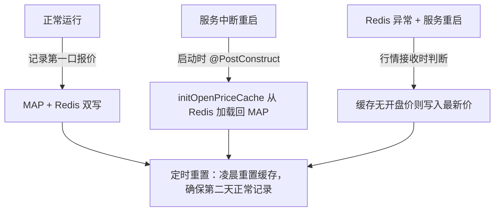

# 智牛股第三方行情源全链路实现：业务层核心逻辑、缓存持久化与定时任务拉取验证

上一章把交易数据源与两件基础工具封装到位，这一章完成第三方行情源的全链路落地：先补齐业务数据源配置，让行情服务同时读写交易库与业务库；然后封装聚合数据 API，在业务层实现开盘价、涨跌幅与缓存更新；外层由 ApplicationRunner 启动后台线程轮询拉取行情，定时任务负责把缓存行情持久化入库；最后用一次真实启动把整条链路（连同两处 bug）跑通验证。

## 先给结论

- 业务数据源配置照抄交易数据源再改名：basePackages 指向 repository.biz，实体指向股票产品实体包，关键是方言——业务库 MariaDB 用 MySQL5InnoDBDialect，交易库 PostgreSQL 用 PostgreSQL95Dialect；配置文件里 spring.datasource 多出一层 tradesystem/bizsystem 层级。
- 聚合 API 封装在 sources 包的 JuheThirdApi：appkey 与 url 走配置注入（IP 变化只改 quote.url）；内部市场用数字编号、聚合平台用拼音简写，靠 StockMarketEnum 枚举转换，拼出 sh601398 这类完整编号。
- getStockReal 只处理单个产品，多产品行情由上层遍历控制；状态码异常内部忽略，实际生产要加预警或上报；带精度的价格转长整型，date 与 time 分离的时间合成秒级时间戳。
- 开盘价存两处：JVM MAP 用于本节点业务逻辑，Redis 供跨节点共享，对应三条保障——正常运行记录第一口报价；重启后 @PostConstruct 从 Redis 加载；Redis 异常叠加重启则在行情接收时判断缓存为空就写入。
- 涨跌幅公式是（最新价 − 昨收价）/ 昨收价 × 100%，分母用昨收价而不是开盘价，正、零、负三种情况分别处理。
- 外层入口是 ApplicationRunner + 后台线程 while(true) 循环，按市场编号分组后线程池加并行流拉取（演示环境 30 秒一轮，受免费账号限制，生产可一秒一轮）；持久化任务每分钟把缓存行情经"查库去重 → save → evict"落库。

## 业务数据源配置：补齐第二只手

交易数据源上一章已打通，业务数据源配置与它基本一致，copy TradeSystemDataSourceConfiguration 改成 BizSystemDataSourceConfiguration，调整四处：basePackages 指向 repository.biz；entityManagerFactoryRef 与 transactionManagerRef 改为 biz 开头；@Qualifier 注入 bizSystemDataSource；packages 指向股票产品实体包路径（行情服务还要读取产品基础配置），持久化单元改为 bizPersistentUnit。

关键差异在 Hibernate 方言。业务数据源是 MariaDB，协议与 MySQL 一致，在 getVendorProperties 返回的属性 Map 里显式指定方言：

```java
private Map<String, Object> getVendorProperties(DataSource dataSource) {
    Map<String, Object> props = hibernateProperties
            .determineHibernateProperties(jpaProperties.getProperties(), new HibernateSettings());
    props.put("hibernate.dialect", "org.hibernate.dialect.MySQL5InnoDBDialect");
    return props;
}
```

同时回头把交易数据源的方言改成 PostgreSQL95Dialect，两个库各用各的方言。

配置文件同样要多一层：spring.datasource 下拆出 tradesystem 与 bizsystem 两个层级（不同于单数据源配置），DruidSystemDataSourceConfiguration 按前缀读取到不同的数据源：

```yaml
spring:
  datasource:
    tradesystem:
      type: com.alibaba.druid.pool.DruidDataSource
      driver-class-name: org.postgresql.Driver
      username: office
      password: 654321
      url: jdbc:postgresql://192.168.19.150:5432/trade_stock
    bizsystem:
      type: com.alibaba.druid.pool.DruidDataSource
      driver-class-name: com.mysql.jdbc.Driver   # MariaDB 与 MySQL 协议一致
      # url/username/password 指向业务库
```

Druid 连接池参数两个数据源都要配：initial-size 5、min-idle 5、maxActive 20、maxWait 60000；检测周期 60000、连接最小生存时间 300000；validationQuery 配 SELECT 1、testWhileIdle true、testOnBorrow 与 testOnReturn false；打开 PSCache（poolPreparedStatements true，每连接 20），filters 配 stat 与 wall，connectionProperties 打开 mergeSql、慢 SQL 阈值 5000 毫秒。注意 PostgreSQL 与 MariaDB 的连接配置存在差异，驱动包都要导入——用 Maven Helper 检查行情服务工程发现 PostgreSQL 驱动缺失，在公用父工程 pom 里补 org.postgresql:postgresql 依赖即可。

## 对接实现与业务层核心逻辑

### 聚合 API 封装

第三方行情源的接入统一放在 sources 包下，将来扩展其他行情源都在这里实现。聚合数据的 API 实现类 JuheThirdApi 加 @Component 与 @Log4j2，三个属性从配置文件注入：

```java
@Component
@Log4j2
public class JuheThirdApi {
    @Value("${quote.appkey}")
    private String APPKEY;    // 第三方行情源密钥信息
    @Value("${quote.url}")
    private String url;       // 第三方行情源地址
    @Value("#{'${quote.url}'.concat('/hs')}")
    private String url_hs;    // 沪深股市行情接口地址
}
```

url_hs 采用拼接方式实现，参数外层用单引号避免引号冲突。聚合行情源有多个行情接口（沪深股市、美股、港股），本项目只对接沪深股市；将来 IP 变化只需调整 quote.url 一处。

调用前先解决编号转换：内部系统用数字定义市场，聚合 API 用拼音简写（sh/sz），在 common-utils 的 constant 目录建 StockMarketEnum 枚举做映射——marketNo 内部市场编号、marketFlag 远程市场标识、marketName 市场名称描述；本期只实现上交所、深交所两个标识，并提供静态方法 parseByMarketNo 按编号取枚举。getStockCodeByMarket 先做非空判断，再把枚举的 marketFlag 小写形式拼接股票编号，组出符合聚合规范的完整编号。

核心调用方法 getStockReal(stock) 返回实时行情对象 TradeStockQuoteLast：params 放 gid（完整编号）与 key（APPKEY），HttpPoolUtil.getSingleton().postWithAgent(url_hs, params) 发送请求（附浏览器代理头部）；整个方法体包 try-catch 捕获未知异常打日志。状态码 200 时先打印包体日志便于排查，再用 GsonConvertUtil 单例解析——getJsonObject 拿到外层 JSON，json.getJSONArray("result").getJSONObject(0) 取第一个索引得到 data 节点，交给 parseFromJson 转换。parseFromJson 设置成交量 traNumber、成交额 traAmount、更新时间，然后是卖方五档（sellOnePri~sellFivePri 对应 priceAsk1~5）与买方五档（buyOnePri~buyFivePri 对应 priceBid1~5）；所有价格经 cvtLong 转为长整型（默认保留两位精度），date 与 time 两个分离的字段经 cvtDateTime 合成精确到秒的长整型时间戳——每一口行情报价必须带时间。

两个注意点：getStockReal 接受单个股票产品对象，多产品行情由上层遍历调用控制，方法内部不做遍历；状态码错误内部是忽略处理，实际当中要加入预警或上报机制更为稳妥——行情是比较重要的信息。

### 开盘价的三重保障

业务实现类 StockQuoteServiceImpl（@Service @Log4j2 实现 IStockQuoteService）里，getReal(stock, closeDiffMins) 是行情获取主流程，收盘时间差参数用于收盘价处理（后面章节讲解）。五步走：调第三方接口拿最新报价（内部已捕获异常，外层不用再包）→ 非空判断 → 行情放入 K 线加工缓存（STOCK_QUOTE_GENERATE_KLINE_KEY，以产品编号加分隔符加报价时间为 key，为 K 线加工提供必要信息）→ 收盘后五分钟内更新收盘价（closeDiffMins 在 0 到 5 之间，时间差由外层传入）→ 更新开盘价。

聚合平台其实已提供开盘价，但课程仍把计算流程讲透——行情源没提供时要知道怎么处理。A 股 9:30 开盘、下午 3:00 休市，开盘价一般是开市的第一口报价，存两处：JVM MAP 用于本节点业务逻辑，Redis 供跨节点共享。由此推出三条保障：



清除时机有讲究：必须在下午三点休市之后、第二天九点半开盘之前的区间内（一般设凌晨一点）——三点前清除会让当天开盘价丢失；三点之后可能还有调度任务要拿当天开盘价做报表统计，所以安排在调度任务完成之后的凌晨。updateOpenPrice 实现第三条保障：从 MAP 按产品 ID 拿开盘价，为空则双写——Redis 的 STOCK_QUOTE_OPEN_PRICE_CUR_KEY 缓存与 MAP 都放入最新价（相当于第一口行情报价）；它不保证百分之百准确，但兜住了数据完全丢失的场景。initOpenPriceCache 用 @PostConstruct 在服务启动时初始化：RedisCacheManager 没法扫描所有 key，改用更底层的 RedisTemplate.keys 模糊匹配，遍历 key 时替换前缀拿 stockId（Spring Cache 存 key 默认附带引号，要去掉），再把开盘价放回 MAP。

### 涨跌幅与最新价缓存

涨跌幅公式：（最新价 − 昨收价）/ 昨收价 × 100%——讲师特别强调用昨收价而不是开盘价，这才是当天的涨跌幅；有涨就有跌，可能出现负数。calcPriceRate 做三层判断：差值为正（上涨）除后乘 100；等于零返回 0；为负（下跌）取负号计算。算完涨跌幅，再把最新报价存入 STOCK_QUOTE_LAST_PRICE_KEY 缓存，行情源的订阅与缓存处理至此完成。

## 外层调度、缓存持久化与定时任务

### ApplicationRunner 启动轮询

行情源对接完成后要有入口触发调用，这个环节在容器启动后执行。config 包下 GlobalSystemConfiguration 实现 ApplicationRunner，启动完成后执行 run 方法：后台线程 while(true) 无限循环调用 getStockQuotes，外层与内部都加 try-catch 防止异常终止调用；每次获取后 Thread.sleep(30000) 休眠 30 秒——教学测试受免费账号限制放长间隔；HTTP 主动拉取一般一秒一到两次，生产可加快到一秒一轮；若是 Socket 长连接或订阅 MQ，服务端一秒推送多口报价都没问题。

getStockQuotes 的处理链：先 findAllValidStocks 拿所有有效股票产品（日志打出总数量，非空判断）→ 按市场编号分组汇总 stockList.stream().collect(Collectors.groupingBy(TradeStock::getMarketNo))——股票支持多个市场，分组后不同市场并行处理互不干扰；虽然只实现了沪深两市，仍按多市场逻辑编写保留扩展性 → 遍历分组，用市场编号换枚举取 categoryCode 查股票产品分类（分类里有交易时间、佣金比例等设置信息），查不到打印占位符日志退出方法 → isOpenTime 判断是否处于开盘时间，并计算距收盘的分钟差（供收盘价处理）→ 每个市场交给线程池 taskExecutor.execute，内部用并行流 parallelStream 遍历调用 getReal 抓取行情，外层再做一层异常捕获。

两点提醒：线程池加并行流提升并发处理速度，但不保证处理有序性——逻辑性强的业务用并行流要慎重；后台线程无论最外层还是内部都要加 try-catch。

### 缓存持久化：每分钟一次的落库

先集成 Redis 配置：RedisConfiguration 定义 RedisTemplate 模板并配置序列化方式（字符串方式），类上加 @EnableCaching 开启缓存功能；pom 加 spring-boot-starter-cache 与 spring-boot-starter-data-redis 两个依赖。Spring Cache 是缓存封装组件，Redis 只是其中一种实现，还支持 Memcache 等中间件；不采用中间件时默认放在本地 JVM 内存。

持久化方法 schedulePersistCache 由定时任务调度，一分钟执行一次，业务逻辑五步：

1. redisTemplate.keys(GENERATE_KLINE_KEY 加通配符) 模糊搜索所有行情缓存 key，做非空判断；
2. 获取缓存对象，keys 排序后流式遍历（行情顺序没有业务要求，排不排都行），强转 SimpleValueWrapper 取值，key 替换前缀并去掉两个引号，得到股票编号与报价时间；
3. 按股票 id 与报价时间查数据库（JPA 自动生成查询实现），已存在则把数据库记录的 id 设置到缓存对象上——这是去重判断，防止记录重复的行情数据；
4. save 的是缓存中获取的行情对象（不是查回来的 db 对象）：JPA 按 id 判断，有 id 做更新，无 id 插入新数据；
5. cache.evict(股票编号加分隔符加报价时间) 删除已持久化的缓存数据，key 格式与写入缓存时保持一致。

### 定时任务整合

开盘价重置与行情持久化都靠 Spring Boot 注解式定时任务。重置开盘价缓存：遍历 stockOpenCache 按 stockId 将缓存置空；调度安排在每天凌晨一点开始执行，担心没执行成功就给一小时缓冲——凌晨一点到两点每十分钟执行一次，重复清除不影响数据，cron 为 0 0/10 1-2 * * ?（秒位 0、分钟位 0/10、小时位 1-2）；行情持久化任务 cron 为 0 0/1 * * * ?，每分钟一次。启动类 StockQuoteApplication 上加 @SpringBootApplication、@ComponentScan 扫描基础包，再加 @EnableScheduling 开启定时任务。

## 测试验证：两个 bug 换来的全链路确认

数据准备：业务库 t_trade_stock 产品表配三条有效状态的产品——工商银行、中国平安、美利集团；启动前 Redis、Nacos 中间件先启动成功，再运行行情服务观察日志。

第一次启动就报错：日志提示"没有找到对应的股票产品分类，股票市场编号为 1（另一处编号为 0）"。按日志定位业务层代码，发现判断条件写反了——不等于空要改成等于空：分类为空时才打印日志并退出方法。这类细节在业务实现过程中要留意。

修正后行情抓取正常：日志显示通过 HTTP 远程调用了聚合数据源平台并返回行情，数据结构与接口文档格式一致（盘口信息、K 线图片数据都在）；中国平安的 XD 前缀代表当天分红除息状态，只是名称变化，股票编号不变。

持久化验证暴露第二个 bug：日志走了"行情持久化开始执行"却没有插入语句，说明没进入内层逻辑——对比代码发现获取缓存管理器用的 key 与写入时的 GENERATE_KLINE_KEY 不一致，缓存永远找不到；改成一致后重启，日志打出执行语句与插入记录，行情报价表从 156 条新增 3 条，正是产品表配置的三只股票，盘口数据完整入库——同时验证了 JPA 双数据源配置可用。最后用 Redis 客户端查缓存：GenerateKline 的 key 前缀与代码一致，LastPrice（最新价缓存）同样三条数据，缓存与持久化全部跑通。

## 小结

这一章把第三方行情源从接口到落库整条链路跑通：业务数据源补齐多数据源拼图（方言各归各，配置文件多一层层级）；JuheThirdApi 完成对接封装（枚举转换编号、五档盘口、长整型价格、秒级时间戳），业务层实现开盘价三重保障、涨跌幅计算与最新价缓存；外层 ApplicationRunner 后台线程按市场分组轮询，缓存经每分钟的定时任务去重落库。测试环节修掉两个真实 bug（分类判空写反、缓存 key 不一致），比一次跑通更有参考价值。延伸来看：新浪免费行情源基于交易所数据加工而来，聚合数据又是新浪之上再加工——行情源怎么变，只要吃透接口格式与规范，就可以按配置动态切换，甚至开多个线程接入多种行情源。调度任务少用注解方式即可，多了要上 XXL-Job、Elastic-Job 这类分布式调度框架。下一章把 RocketMQ 集成进来：行情服务发布行情报价到消息队列，代理服务订阅获取，行情下发就通了。
