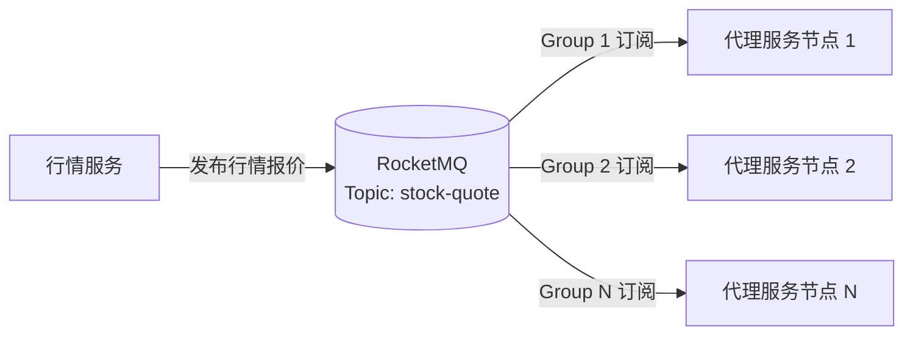

# 行情/代理双服务接入 RocketMQ：发布订阅配置与收发验证

智牛股第十二章的收尾工作：把行情服务和代理服务双双接入 RocketMQ。行情服务作为生产者，把加工好的行情报价发布到消息队列；代理服务作为消费者，从队列订阅行情并分发给客户端。本篇覆盖双服务的集成配置（依赖、YAML、绑定代码）以及端到端的收发验证，是典型的 Spring Cloud Stream + RocketMQ 实操。

## 先给结论

- 行情与代理之间不直接通信，统一走 RocketMQ：行情服务往同一个 Topic（`stock-quote`）发，所有代理节点都订阅这个 Topic。
- 多个代理节点用**同一个 Topic、不同的 Group** 订阅，形成广播式消费——每个节点都能拿到完整的行情数据，节点可以水平扩充。
- 集成方式是 Spring Cloud Stream：生产端 `@EnableBinding` 绑定 `@Output` 通道发消息，消费端 `@StreamListener` 监听 `@Input` 通道收消息，配置项名称（`quote`）必须与 YAML 里的 bindings 保持一致。
- 生产行情用同步发送（`sync: true`）保证行情报价有序不错乱；发送方法封装了带 Tag 和不带 Tag 两个重载，行情业务单一，用的是不带 Tag 的接口。
- 消费端配置 `concurrency` 并发线程数、`maxAttempts: 1` 避免重复消费，每个代理节点的 `group` 名称必须唯一，否则消息会被同组节点分摊。
- 验证通过：代理服务控制台打印出工商银行、美的集团、中国平安的实时行情，RocketMQ 控制台能看到 `stock-quote` 主题和 `stock-quote-proxy` 分组的消费记录。

## 广播式行情分发：同 Topic、不同 Group

先看行情服务和代理服务的交互处理流程。行情服务将行情报价数据从 MQ 消息队列发布到所有代理服务；代理服务从 MQ 中订阅获取对应的行情消息。每个代理服务采用统一的消息队列（同一个 Topic），通过不同的分组来区分，保障每个节点都能获取到相同的行情数据。



关键点在于分组设计。每个代理服务都要拿到实时完整的行情数据，所以各节点用不同的 Group 标识：节点 1 是 Group 1，节点 2 是 Group 2，以此类推。不同的 Group 都可以消费到相同 Topic 的消息，这就是广播消费的模式，类似 CDN 的分发思路。反过来，如果多个节点的分组名称相同，数据会被同组内的其他消费端分摊消费，节点就收不到完整的行情了。

代理服务本身是无状态设计，支持水平扩展：单个节点出现瓶颈时，直接水平扩充节点提升整个集群的分发能力。如果用户所属区域分布比较分散，还可以把代理服务部署到多个不同区域，类似 CDN 节点，缩短行情数据的传输链路。集群消费和广播消费的更多区别，可参考 RocketMQ 的相关资料文档。

## 行情服务（生产者）集成配置

### 依赖与 YAML

行情服务先引入 RocketMQ 消息组件依赖，它是通过 starter 实现自动化配置的：

```xml
<dependency>
    <groupId>org.springframework.cloud</groupId>
    <artifactId>spring-cloud-starter-stream-rocketmq</artifactId>
</dependency>
```

配置文件 `bootstrap-dev.yml` 里定义名为 `quote` 的绑定配置，队列名称（Topic）为 `stock-quote`，数据内容通过 JSON 传递，`name-server` 是 RocketMQ 的服务地址和端口：

```yaml
spring:
  cloud:
    stream:
      bindings:
        quote:
          content-type: application/json
          destination: stock-quote
      rocketmq:
        binder:
          name-server: 10.10.20.15:9876
        bindings:
          quote:
            producer:
              group: binder-group
              sync: true
```

注意 `sync: true`：采用同步方式发送。行情报价对顺序是有要求的，不能错乱，必须保持同步有序的状态。这套配置层级比较多，写的时候千万不要把层级搞错，否则调用时会出现各种问题。如果担心手写 YAML 出错，可以先写成 properties 格式，再用 IDEA 插件转换成 YAML：把插件下载到 IDEA 的 plugin 目录解压、重启，之后右键选中文件点 Convert Properties To YAML 即可（插件地址 properties-to-yaml-converter）。

### 消息通道绑定与发送封装

代码侧先定义 `QueueSource` 接口，绑定消息通道：

```java
public interface QueueSource {

    String QUOTE = "quote";

    @Output(QUOTE)
    MessageChannel quoteQueue();
}
```

`@Output` 绑定的名称 `quote` 对应的就是工程配置文件里 `bindings.quote` 的配置信息，两边的名称必须一致，否则找不到对应的配置。再写生产者配置类，开启绑定：

```java
@Configuration
@EnableBinding(QueueSource.class)
public class RocketMqProduceConfiguration {
}
```

发送功能封装成 `QuoteSender`，注入 `QueueSource` 作为发送通道：

```java
@Service
public class QuoteSender {

    @Autowired
    private QueueSource source;

    /** 发送对象消息，附带 tag 标记信息 */
    public <T> void sendObject(T msg, String tag) throws Exception {
        Message message = MessageBuilder.withPayload(msg)
                .setHeader(MessageConst.PROPERTY_TAGS, tag)
                .setHeader(MessageConst.CONTENT_TYPE, MimeTypeUtils.APPLICATION_JSON)
                .build();
        source.quoteQueue().send(message);
    }

    /** 直接发送对象消息，不带 tag */
    public <T> void sendObject(T msg) throws Exception {
        Message message = MessageBuilder.withPayload(msg)
                .setHeader(MessageHeaders.CONTENT_TYPE, MimeTypeUtils.APPLICATION_JSON)
                .build();
        source.quoteQueue().send(message);
    }
}
```

两个重载对应两种发送方式：带 Tag 的版本在消息头里放 `PROPERTY_TAGS`，Tag 是在 Topic 基础上再做一层消息标记和分类，便于消费端按 Tag 过滤处理；不带 Tag 的版本直接发。消息体用 `MessageBuilder` 构建，通过泛型支持不同对象类型，内容类型设为 JSON——当然也可以用二进制序列化、流式方式等其他格式，最终不管什么样的业务数据，都会包装为一个 `Message` 再发送。

有一个容易踩的坑：`MessageBuilder` 要从 Spring Framework 的 messaging 包导入，导错了包编译就报错，这里专门重新导入过一次。

业务上如何选择：如果发送时指定了 Tag，那么只有订阅了对应 Tag 的消费端才会接收，其他 Tag 的消息不会被消费。行情数据的业务处理功能比较单一，暂时不需要通过 Tag 区分不同业务逻辑，所以行情消息采用不带 Tag 的接口直接发送。

## 代理服务（消费者）集成配置

代理服务的依赖和生产端相同，同一个 `spring-cloud-starter-stream-rocketmq`。要注意它的 `groupId` 做过调整——组件从之前的 groupId 独立迁移到了 `org.springframework.cloud` 下，工程里要对应修正，不要沿用旧值。

消费端配置和生产端思路一致，但多了消费策略部分。`concurrency` 是并发数，即消费端最多多少个线程同时从队列消费消息；`maxAttempts` 是最大尝试次数，设为 1 避免重复消费；`group` 是消费分组，多节点时各节点分组名不同；另外还配置了 orderly 项保证接收的消息有序处理：

```yaml
spring:
  cloud:
    stream:
      bindings:
        quote:
          consumer:
            concurrency: 10
            maxAttempts: 1
          content-type: application/json
          destination: stock-quote
          group: stock-quote-proxy-1
      rocketmq:
        binder:
          name-server: 10.10.20.15:9876
```

`group` 取值 `stock-quote-proxy-1`，编号后缀就是给多节点准备的：节点 2 用 `stock-quote-proxy-2`，以此类推，确保每个代理服务节点都能收到行情服务下发的完整数据。

消费代码先写监听器，参数对象是最新行情数据 `TradeStockQuoteLast`：

```java
@Service
public class ProxyQuoteConsumer {

    @StreamListener("quote")
    public void receiveInput(@Payload TradeStockQuoteLast receiveMsg) {
        System.out.println("receive quote: " + receiveMsg);
    }
}
```

`@StreamListener` 指定监听的配置队列（对应配置文件里 `quote` 的消费项配置）；`@Payload` 标识参数传输对象以 JSON 格式做序列化，必须和服务端发送消息时的类型保持一致——行情服务那边正是用 payload 的方式包装传递消息的。

再写消费端的消息通道绑定，用订阅方式的通道接口：

```java
public interface RocketMqMessageSource {

    @Input("quote")
    SubscribableChannel quoteQueue();
}

@Configuration
@EnableBinding(RocketMqMessageSource.class)
public class RocketMqConsumerConfiguration {
}
```

这个配置类的作用是让消费端绑定到监听队列，从队列中读取和消费消息；`@Input` 绑定的 `quote` 同样要和 YAML 里定义的名称保持一致。

最后是启动类：

```java
@SpringBootApplication
@EnableDiscoveryClient
@EnableCaching
@ComponentScan(basePackages = "com.ictast.bulls.stock.proxy")
public class StockProxyApplication {

    public static void main(String[] args) {
        SpringApplication.run(StockProxyApplication.class, args);
    }
}
```

`@ComponentScan` 指向基础包，`@EnableCaching` 先把缓存功能开启，后面的业务功能可能会用到。

## 端到端验证与常见问题

验证前先把中间件启动好：RocketMQ 服务，以及相关联的 Redis、Nacos。然后启动代理服务和行情服务——先启动代理服务（消费者先就位），再启动行情服务。通过代理服务的控制台可以看到，行情服务发布的行情数据已经被接收并打印出来：工商银行、美的集团、中国平安三只股票的实时行情都成功接收，详细信息也做了日志输出。

再看 RocketMQ 的控制后台。执行 `rocketmq-console` 的可执行 jar 启动控制台，访问 9800 端口，进入 Topic 页面找到配置的主题 `stock-quote`，点击 ConsumerManager 查看消费信息：能看到 `stock-quote-proxy` 的分组信息和消费情况，最后一次消费时间与代理服务后台日志的时间点一致。行情消息的订阅和下发就此确认正常。

还有一处不能漏：行情服务对行情数据的处理过程中要接入消息发送。找到原来第三方行情源对接的处理逻辑，在最下面注入 `QuoteSender` 接口，在行情数据处理流程中调用发送方法，确保行情数据能正常发送到 MQ 消息队列当中。

实操中两个高频报错的排查思路：

1. **No route info of this topic**：先检查 Broker 启动命令是否加了自动创建 Topic 的参数（`autoCreateTopicEnable`，发送或接收时指定的队列即使没有预创建也会自动创建）；如果仍出现，检查 RocketMQ 发送端和消费端的配置是否正确。YAML 层级容易错乱，可以用 properties 文件配置，或者用上面提到的 properties 转 YAML 插件（下载到 IDEA 插件目录解压、重启，右键选中文件点转换）。
2. **PSQLException：关系 "dual" 不存在**：数据源连接校验报错时检查 `validationQuery` 配置。不同数据源的验证查询语句语法有差异，MySQL 和 PostgreSQL 不一样；`SELECT 1 FROM DUAL` 在 PostgreSQL 下不被支持，一般改成 `SELECT 1` 即可通用。

## 小结

- 行情数据流转采用「行情服务发布 → RocketMQ → 代理服务订阅」的链路，代理多节点用同 Topic 不同 Group 实现广播式消费，每个节点都能拿到完整行情。
- 生产端集成三件套：starter 依赖、`quote` 绑定配置（`sync: true` 同步保序）、`QueueSource` + `@EnableBinding`；发送封装了带 Tag 和不带 Tag 两个方法，行情业务用不带 Tag 的。
- 消费端在同样的骨架上追加消费策略：`concurrency` 并发数、`maxAttempts: 1` 防重复消费，`group` 每节点唯一（如 `stock-quote-proxy-1`），`@StreamListener` + `@Payload` 接收 JSON 消息。
- 两端的绑定名称（`quote`）都必须与配置文件的 bindings 一致，这是配置不出错的第一原则。
- 验证分两路：代理控制台看行情日志，RocketMQ 控制台（9800 端口）看 Topic 消费管理里 `stock-quote-proxy` 分组的消费记录。
- 代理服务无状态、可水平扩展，还能按地域多部署做类 CDN 分发；遇到 No route info 或 validationQuery 报错按 FAQ 排查。
