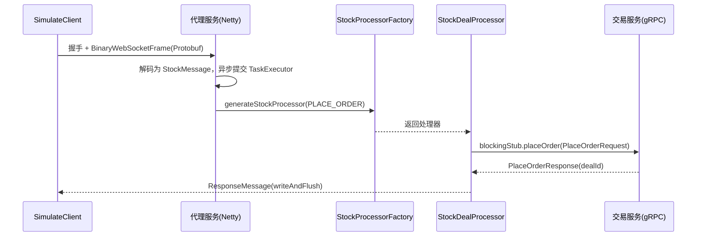

# 简易下单链路：代理服务 gRPC 调用封装与 Netty WebSocket 客户端交互实现

智牛股第十三章的简易下单是一条跨三个节点的链路：终端通过 WebSocket+Protobuf 长连接打到代理服务，代理服务内部再以 gRPC+PB 调用交易服务完成下单落库。本篇按课程十个小节把这条链路拆完：交易服务 gRPC 组件的自动化装配、代理服务的处理器工厂与 Netty WebSocket 服务端管道、gRPC 调用方配置，以及一个能脱离前端自测联调的 Netty 模拟客户端。

## 先给结论

- gRPC 依赖主要面向 Spring Boot，对 Spring Cloud Alibaba 的服务注册发现支持不完善：自建 stock-starter-grpc Starter，在 GrpcNacosConfiguration 里把 gRPC 服务端口写进 Nacos 元数据（discovery.metadata.port），注册发现才走得通；grpc.version 统一取 2.5.0.RELEASE。
- 代理服务用工厂模式分发处理器：StockProcessorFactory 按 StockHead 的 RequestType 用 switch 返回 IBaseStockProcessor（接口多时不要用 if），查不到抛 ComponentException(ApplicationErrorEnum.NOT_FOUND_PROCESSOR)；case 分支必须 break，否则坠入 default 的异常逻辑。
- Netty 服务端管道的添加顺序即语义：LoggingHandler（debug 开关控制）→ HttpObjectAggregator + ChunkedWriteHandler → WebSocketServerProtocolHandler("/stock") → Protobuf 编解码 → WebSocket 帧编解码 → 自定义 StockProxyServerHandler。WebSocket 不能直接承载 Protobuf 二进制，业务数据必须包成 BinaryWebSocketFrame。
- StockProxyServerHandler 加 @Sharable 供多 Channel 安全共享；channelRead0 把业务处理丢进 TaskExecutor 异步执行（不要求严格顺序才可如此）；ChannelGroup 以 public static 暴露，承担全量连接管理与消息推送广播。
- 代理服务作为 gRPC 调用方，bootstrap-dev.yml 中 grpc-trade-server 指向 discovery:///stock-deal 走注册中心（支持负载均衡），单节点也可 static://127.0.0.1:19998；enableKeepAlive 与 keepAliveWithoutCalls 维持长连接，negotiationType 取 plaintext（协商类型，并非数据传输格式）。
- 模拟客户端五件套：Bootstrap 启动配置、WebSocket V13 握手、ClientBoundHandler 接收处理、BusinessHandler 组包发送、控制台菜单指令交互——后续业务接口都在 BusinessHandler 里持续扩充。

## 交易服务 gRPC 组件的自动化装配

交易服务 stock-deal 对内提供 gRPC 下单接口。为了让微服务之间使用方便、gRPC 组件集中统一管理、便于后续维护，先把它做成自动化装配。做法是在父工程下新建 stock-starter-grpc 模块，pom 中引入 grpc-spring-boot-starter 相关依赖，grpc.version 在根工程 properties 里统一定义为 2.5.0.RELEASE。

这里有一个必须处理的兼容性问题：这批 gRPC 组件主要面向 Spring Boot，对 Spring Cloud Alibaba 的支持并不完善，冲突集中在服务注册发现——不做调整，编写的 gRPC 服务在注册中心上无法被正常发现。解法是在 com.itcast.bus.stock.grpc 包下写一个 GrpcNacosConfiguration 配置类，三步完成改造：

- @Configuration 加 @EnableConfigurationProperties 开启配置属性扫描，再加 @ConditionalOnClass——项目中必须存在 Nacos 组件，这个配置才生效；
- 注入 Nacos 的注册发现类 NacosRegistration（必需）与 GrpcServerProperties（读取 gRPC 服务端配置）；
- @PostConstruct 初始化方法里修改 gRPC 服务信息注册至 Nacos 的处理逻辑：nacosRegistration 为空直接 return；取 grpcProperties.getPort() 拿 gRPC 服务声明的端口，端口不等于 -1（配置存在）时，把端口转成字符串放进 Nacos 元数据的 discovery.metadata.port 属性。

封装完成后，交易服务用 stock-starter-grpc 替换原生 gRPC 依赖即可生效。其他节点服务要引入 gRPC 组件同样简单：添加依赖，配置文件里服务端配端口相关信息、消费端配消费端的连接信息。

## 代理服务：处理器工厂与 WebSocket 服务端

代理服务对交易服务下单接口的调用做了一层工厂封装。Processor 包下新建 StockProcessorFactory，@Component 注册为容器组件，@Log4j2 打日志，注入 IBaseStockProcessor 类型的 stockDealProcessor。按请求类型获取处理器的核心方法：

```java
public IBaseStockProcessor generateStockProcessor(StockHeadProto.RequestType requestType)
        throws ComponentException {
    IBaseStockProcessor processor = null;
    switch (requestType) {
        case PLACE_ORDER:
            processor = stockDealProcessor;
            break;
        default:
            log.error("Process in StockProcessorFactory.generateStockProcessor method, not found processor!");
            throw new ComponentException(ApplicationErrorEnum.NOT_FOUND_PROCESSOR);
    }
    return processor;
}
```

接口多的时候建议用 switch 而不是 if 做判断；case 处理完必须 break，否则会继续掉进 default。异常类型从 Exception 细化为 ComponentException(ApplicationErrorEnum.NOT_FOUND_PROCESSOR)，调用方能按错误码做精细化处理。处理器本体 StockDealProcessor 继承 AbstractStockProcessor 实现 IBaseStockProcessor，@GrpcClient("grpc-trade-server") 注入 StockTradeDealServiceBlockingStub：processRequest 里从 StockMessage 提取 PlaceOrderData，构建 PlaceOrderRequest，blockingStub.placeOrder(request) 调用交易服务下单接口，把返回的 dealId 封进 PlaceOrderResp 与 ResponseMessage，channelHandlerContext.writeAndFlush 写回客户端。

H5 终端需要通过 WebSocket 长连接获取行情数据，代理服务因此要作为 WebSocket 的服务端。pom 引入 netty-all，netty 包下建 StockProxyServerInitializer 继承 ChannelInitializer&lt;SocketChannel&gt;，@Value("${socket.netty.debug:false}") 读取调试开关。initChannel 里按顺序组装管道：

```java
ChannelPipeline pipeline = ch.pipeline();
if (debug) { pipeline.addLast(new LoggingHandler()); }          // 调试日志
pipeline.addLast(new HttpObjectAggregator(Integer.MAX_VALUE));  // HTTP 支持
pipeline.addLast(new ChunkedWriteHandler());                    // 大数据流写入
pipeline.addLast(new WebSocketServerProtocolHandler("/stock", null, true, Integer.MAX_VALUE));
pipeline.addLast(new ProtobufVarint32FrameDecoder());           // PB 聚合解析
pipeline.addLast(new ProtobufVarint32LengthFieldPrepender());   // PB 长度编码
```

WebSocketServerProtocolHandler 的参数依次是访问路径（/stock，类似 Tomcat 服务里的服务后缀）、子协议（不指定传 null）、是否允许扩展、帧包最大大小。链路以 Protobuf 作为数据载体，所以要有 Varint32 的一对编解码器。WebSocket 帧的编解码以内部类实现：解码器 MessageToMessageDecoder&lt;WebSocketFrame&gt; 按 instanceof 分流——TextWebSocketFrame 文本帧直接处理；BinaryWebSocketFrame 才是业务数据，读取 content（ByteBuf 二进制）交由 Protobuf 解码封装成业务对象；PingWebSocketFrame 用于检测连接健康状态，打印日志即可；CloseWebSocketFrame 到来说明客户端连接已中断，关闭通道。编码器 MessageToMessageEncoder&lt;MessageLite.Builder&gt; 反向操作：客户端不能直接解析 Protobuf 编码生成的数据，必须转成字节数组再包成 WebSocket 的二进制流，前端按 WebSocket 数据包格式接收后再按 Protobuf 协议还原业务数据。管道尾部挂上 ProtobufDecoder 声明最终的业务对象类型 StockMessage，最后是自定义数据处理器。

自定义处理器 StockProxyServerHandler 继承 SimpleChannelInboundHandler&lt;StockMessage&gt;，@Component 加 @Sharable：代理服务作为服务端会接入不同终端，每个终端一个 Channel，@Sharable 保证处理器被多个 Channel 并发共享而不产生线程安全问题。三个关键点值得记录：

- public static 的 ChannelGroup（new DefaultChannelGroup(GlobalEventExecutor.INSTANCE)）：作用类似 Web 体系的 Session，收集服务端与所有客户端建立的 Channel，Netty 已实现线程安全控制，连接中断会自动释放；声明成 public 静态是因为后续消息推送、广播随处要用。
- channelRead0 里 taskExecutor.execute(() -> {...}) 把业务处理提交到 Spring 线程池异步执行，避免阻塞 IO 线程——这些接口调用不需要保证严格顺序，才允许这么加；要求严格顺序的接口不能进线程池。
- 异常分两类：ComponentException 业务异常打印日志后包装错误码与错误消息返回给客户端；Exception 系统异常没有具体错误码，包装异常提示信息返回。handlerRemoved 里清理失效通道并关闭（ChannelGroup 会自动处理，写上也无妨），exceptionCaught 打印 "exception on socket" 日志后关闭通道上下文——出现异常说明通道已失效、无法正常使用。

Netty 的启动借用 Spring Boot 容器：StockProxyApplication 实现 ApplicationRunner，Spring Boot 服务启动完成后回调 run 方法，在那里拉起 socket 服务——Spring Boot 应用与 socket 服务是分开的，监听不同端口。创建 boss、worker 两个 NioEventLoopGroup，ServerBootstrap 绑定 childHandler 后 boot.bind(nettyPort).sync() 启动，finally 中优雅关闭两组线程。配置文件里 socket.netty.port 配 19999，debug 设为 true。

作为 gRPC 调用方，代理服务还要在 bootstrap-dev.yml 里声明远程服务信息：

```yaml
grpc:
  client:
    grpc-trade-server:
      # address: 'static://127.0.0.1:19998'   # 单节点静态指向
      address: 'discovery:///stock-deal'       # 走注册中心，支持负载均衡
      enableKeepAlive: true
      keepAliveWithoutCalls: true
      negotiationType: plaintext
```

address 用三个斜杠接服务名 stock-deal，通过服务注册发现找到交易服务；enableKeepAlive 保持空闲连接的有效存活状态，keepAliveWithoutCalls 不依赖回调维持连接有效状态、减少不必要的资源开销（网络波动大的场景可以关闭它）；negotiationType 是数据传输的协商类型而非传输格式，取 plaintext 纯文本。

## 模拟客户端：从握手到菜单交互

test 目录下的 SimulateClient 用来联调自测，提升验证效率。main 调 startClient(null)，参数是启动时立即执行的预置请求方法（比如登录），传了就不必每次手动指定。serverIp 取 127.0.0.1，serverPort 取 19999。Bootstrap 配 NioSocketChannel，TCP 参数 TCP_NODELAY 与 SO_KEEPALIVE 都置 true，LoggingHandler 打 info 级日志；initChannel 里依次添加 HttpClientCodec、HttpObjectAggregator（HTTP 客户端调用配置），ProtobufVarint32FrameDecoder、ProtobufDecoder（PB 解码），名为 client_handler 的 ClientBoundHandler，以及 WebSocket 帧的编解码内部类——与服务端同构：Text 帧打印、Binary 帧转 Protobuf、Pong 帧打印、Close 帧关闭，编码把 MessageLite 转字节数组再包成 BinaryWebSocketFrame 输出。

WebSocket 一定要完成握手，才能建立一个有效的长连接。连接侧代码：

```java
URI websocketURI = new URI(String.format("ws://%s:%d/stock", serverIp, serverPort));
HttpHeaders httpHeaders = new DefaultHttpHeaders();
WebSocketClientHandshaker handshaker = WebSocketClientHandshakerFactory.newHandshaker(
        websocketURI, WebSocketVersion.V13, null, true, httpHeaders, Integer.MAX_VALUE);
Channel channel = bootstrap.connect(websocketURI.getHost(), websocketURI.getPort()).sync().channel();
```

握手器取 V13 协议版本，子协议为空，允许扩展。拿到 channel 后从 pipeline 里按名字取出 client_handler，把 handshaker set 进去；ClientBoundHandler 内部持有 ChannelPromise handshakeFuture——握手无论成功失败都有消息响应，通过 handshakeFuture().sync() 阻塞等待结果，完成后打印 handshake complete。

ClientBoundHandler 的 channelRead0 处理服务端下发的各类消息。消息接收是异步的，连接建立过程中服务端可能发来各种类型，先看握手：未完成时收到的是握手响应，强转 FullHttpResponse，finishHandshake 结束握手，handshakeFuture.setSuccess() 标记成功；若抛 WebSocketHandshakeException，拼出 "WebSocket Client failed to connect, status: %s" 后 setFailure。握手已完成却还收到 HTTP 响应，直接抛 IllegalStateException。业务数据走二进制帧：frame.content() 拿 ByteBuf，ByteBufferUtil.getBytes 按 byteBuffer 剩余可读大小直接读取（不 copy，读完后 ByteBuf 里不再有二进制数据），ResponseMessage.parseFrom 还原成业务对象交给 recvProtoMsg。Pong 帧打印，Close 帧打印后关闭通道。

recvProtoMsg 先打印头部——seqId、requestType（用来识别是哪个接口的返回）、status、message，再按请求类型分流：本篇只实现了下单接口，PLACE_ORDER 时取出返回的订单 ID。BusinessHandler 负责组包发送：static 的 seqId 自增长充当消息序列号，sendMsg 里判断通道非空、消息非空且 isWritable() 才 writeAndFlush。placeOrder 的参数都给了演示值：direct 下单方向默认 0；execPrice 委托价格 6.5——价格用长整型表示，实际进度按 100 折算（传 650）；volume 成交量 100 股；stockId 选第一支股票；type 为委托类型。组装顺序是 StockHead（setSeqId(seqId++) 自增，setRequestType(PLACE_ORDER)）→ PlaceOrderData → StockMessage → sendMsg。

channelActive（通道激活、与服务端建立正常连接）里初始化 businessHandler、打印 Server connected，并异步起一个线程跑菜单循环：showMenu 列出 1 用户登录、2 用户下单、M 返回主菜单、0 退出客户端；readlnInput 用 System.in.read 阻塞读取用户输入直至回车，读到指令后分发——"2" 调 businessHandler.placeOrder()，"m"/"M" 大小写都支持，重新打印主菜单，未识别的指令给提示。整条链路串起来如下：



## 小结

本篇把简易下单链路从两头到中间拆完。交易服务侧用自研 Starter 解决 gRPC 与 Spring Cloud Alibaba 的注册发现兼容问题，核心是把 gRPC 端口写进 Nacos 元数据；代理服务侧用工厂模式分发处理器，用 Netty 搭起 WebSocket 服务端管道，Protobuf 数据包在 WebSocket 帧里二次封装，处理器共享靠 @Sharable、业务处理异步靠 TaskExecutor、连接管理靠 public static 的 ChannelGroup；模拟客户端补齐握手、收发与菜单交互，让整条链路可以脱离前端自测。对外的 WebSocket+Protobuf、对内的 gRPC+PB，两端都是长连接高性能通讯——这套基座搭稳之后，下一章的登录鉴权、行情推送都会长在同一个骨架上。
