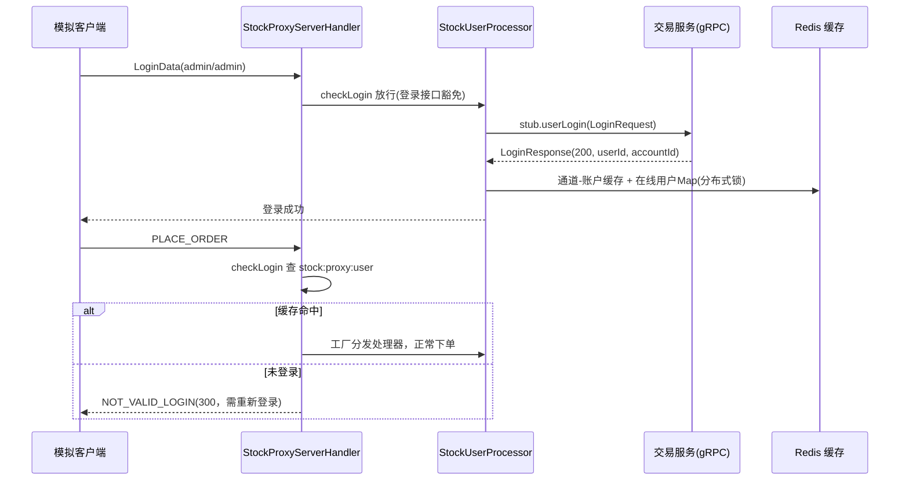

# 交易服务 MyBatis 双数据源与全链路验证 + 代理服务登录鉴权落地

本篇是智牛股第十三章的下半场：先把简易下单收尾——交易服务换用 MyBatis 双数据源方案，三节点联调验证走通整条链路；再进入第三章代理服务登录鉴权——交易服务实现 gRPC 登录接口，代理服务完成调用、缓存与鉴权拦截。传统 HTTP 通讯用 Session 控制登录鉴权，Socket 长连接没有这套机制，得换一种思路：登录成功记缓存，业务请求先过拦截。

## 先给结论

- 交易服务选 MyBatis 而非 JPA 做双数据源：交易逻辑不是单纯的增删改查，同时要求较高的处理性能，MyBatis 轻量、对数据处理没有过度封装。套路与 JPA 双数据源一致——Druid 两个 DataSource bean，各自配 SqlSessionFactory、SqlSessionTemplate、TransactionManager；交易数据源是主数据源，相关 bean 全部加 @Primary；差异细节在 @MapperScan 扫数据层接口和 mapperLocations 扫 mapper XML。
- 测试前的启动顺序与一个坑：中间件（Nacos、Redis）先启动；用户登录接口实现之前，业务数据源的 mapperLocations 扫描要先注释掉，否则目录下没有 mapper 文件、启动报错；登录接口实现后再恢复。
- 下单链路验证完整走通：下单前记录订单最大 ID 2518，模拟客户端发指令，握手交互完成说明 WebSocket 长连接有效，服务端返回状态 200 与新订单 ID，数据库新增订单 ID 2519。
- 长连接鉴权方案：登录成功后以 channelId 为 key 写 Redis 缓存（通道 ID 与账户 ID 关联缓存 + 在线用户 Map），所有业务请求在业务处理之前 checkLogin 查缓存，查不到抛 NOT_VALID_LOGIN；登录接口本身必须在拦截前放行，否则永远拿不到登录缓存。
- 在线用户缓存允许同一账号多端同时登录，并发更新存在数据不一致风险，recordCache 里用基于 Redis 的分布式锁 tryLock 加 finally unlock 兜底（此处先移植使用，细节后面章节展开）；Spring Cache 需要缓存自动化依赖与基于 Redis 的缓存实现依赖，启动类加 @EnableCaching。
- 鉴权验证按异常流加正常流：未登录直接下单被拦（错误码 300，提示重新登录）→ 发登录指令成功 → 再下单成功返回订单 ID，代理服务与交易服务日志均符合预期。

## 交易服务 MyBatis 双数据源配置

前面课程讲过基于 JPA 的双数据源方案，交易服务这里换成 MyBatis：它的数据逻辑不是单纯增删改查，还要求较高的处理性能，而 MyBatis 是轻量级 ORM 框架，数据处理方面没有过度封装，整体性能表现好。第一步先在 config 目录下创建 Druid 数据源配置，一个指向交易数据源，一个指向业务数据源：

```java
@Bean(name = "bizSystemDataSource")
@ConfigurationProperties(prefix = "spring.datasource.bizsystem")
public DataSource bizSystemDataSource() {
    return new DruidDataSource();
}

@Bean(name = "tradeSystemDataSource")
@Primary
@ConfigurationProperties(prefix = "spring.datasource.tradesystem")
public DataSource tradeSystemDataSource() {
    return new DruidDataSource();
}
```

交易数据源配置类上 @Configuration 加 @MapperScan，basePackages 指向 com.itcast.trade.stock.deal.dao.trade，sqlSessionTemplateRef 指向自己的 SqlSessionTemplate；内部三个 bean 成套出现：SqlSessionFactory 基于交易数据源创建，setMapperLocations 指定 mapper 文件路径（classpath:/com/itcast/trade/stock/deal/mapper/*.xml），TransactionManager 与 SqlSessionTemplate 都注入同一数据源。交易服务里交易数据源是主数据源，这些 bean 全部加 @Primary 作为默认首选项。JPA 双数据源里的实体管理器、hibernate 属性在这里一概不需要。

业务数据源配置类结构完全同构，只是扫描路径换成 dao.biz、bean 名称全部带 bizSystem 前缀，检索确认不冲突即可。配置文件里的两个数据源与 JPA 时期一致，不用调整：

```yaml
datasource:
  tradesystem:
    type: com.alibaba.druid.pool.DruidDataSource
    driver-class-name: org.postgresql.Driver
    username: office
    password: 654321
    url: jdbc:postgresql://192.168.19.150:5432/trade_stock
    druid:
      initial-size: 5
      min-idle: 5
      max-active: 20
```

两个路径要分清：上面 @MapperScan 的路径扫描数据层接口（DAO），下面 mapperLocations 扫描的是 map 文件。对比行情服务里 JPA 双数据源的配置，流程基本一样，差异只在细节——MyBatis 要扫 Mapper 接口并配置 mapper 文件，JPA 只需配置 DAO（repository）路径。

## 简易下单链路的全链路验证

启动顺序：中间件 Nacos 等先就绪，再启动交易服务 stock-deal、代理服务 stock-proxy，最后启动 Netty 模拟客户端。一个启动细节：交易服务的业务数据源 mapper 文件扫描要先注释掉（BizSystemDataSourceConfiguration 里 bean.setMapperLocations 那一段）——此时还没实现用户登录接口、没有使用业务数据源，目录下没有 map 文件，保留配置启动会报错；测试完恢复。

测试前先查后台数据库的订单数据，用一条 SQL 对订单倒序查询，当前最新 ID 是 2518，记录下来作为比对基准。模拟客户端出现交互菜单后输入下单指令：握手信息交互完成，说明 WebSocket 长连接有效；下单数据包发送执行完成，控制台打出下单参数，服务端响应处理状态 200（处理成功），并返回新生成的订单 ID。

三个节点的日志对得上：代理服务侧，作为 WebSocket 服务端接收到客户端发来的是 binary 二进制数据包，经 Protobuf 解码器转换解码为自定义消息对象，转发给交易服务的处理结果响应状态 200，收到交易服务返回的订单 ID 后再回传给模拟客户端；交易服务侧，gRPC 接口的处理日志打印出请求参数，与模拟客户端发送的完全一致。再查数据库，新订单 ID 2519 生成，简易下单功能验证完成。

回头总结本章，目标有三：完成交易服务搭建与配置；完成简易下单并熟悉内外两套交互流程——对外 Netty+Protobuf、对内 gRPC+PB；掌握 Spring Boot 2.X 加 gRPC、Netty、WebSocket、Protobuf 的集成通讯方案。全程长连接通讯，传输效率表现好，这套方案在微服务通讯领域有较好的性能表现，后续章节的业务接口都建立在它之上。

## 登录鉴权：登录接口、缓存与拦截

第三章的目标两个：完成用户登录鉴权功能（基础且必要），掌握长连接通讯的鉴权方案。实现路径四步：交易服务登录接口实现、代理服务登录接口调用实现、代理服务增加鉴权拦截处理、测试验证。

**交易服务侧：gRPC 登录接口。** 先在公用 PB 数据结构工程新建 StockUserService.proto：syntax 取 proto3，java_multiple_files 允许生成多个 Java 文件，java_outer_classname 与文件名保持一致。服务接口 StockUserService 里先定义 rpc UserLogin(LoginRequest) returns (LoginResponse)，这个文件后续还能扩展用户资料查询等接口。LoginRequest 两个字段：userNo 用户账号、userPwd 用户密码；LoginResponse 最初定义处理状态与返回消息（异常时给错误提示）。用封装好的 PB 工具脚本一键生成代码。交易服务 service 包下新增 GrpcStockUserService，继承 StockUserServiceGrpc.StockUserServiceImplBase，重写 userLogin。

登录流程四步：根据用户编号查找用户对象（stockUserDao.getByUserNo），校验判断，不存在则返回错误提示；用户密码校验，密码是密文存储，用 EncryptUtil.encryptSigned 对传入密码加密后与库中比对；鉴权成功返回用户账号信息——PB 结构补充用户 ID（int64 长整型）与交易账户 ID（用户表与交易账户表是一对多关系，返回账户 ID 便于前端功能交互处理），重新生成 protobuf 代码；更新用户登录相关信息（登录时间、登录 IP 等，mapper 里就是按用户 ID 修改最后登录时间）。异常不直接抛给框架，而是包装成 LoginResponse（状态置 STATUS_ERROR，消息如"用户不存在""密码不一致"）通过 responseObserver.onNext 输出给调用方，提示更明确，最后 onCompleted。注意：查询用户数据属于业务数据源、需要跨数据库处理，必须先把 MyBatis 双数据源配置实现好，DAO 接口直接从已有代码拷贝。

**代理服务侧：调用与缓存。** 对外 PB 的 StockMessage 里增加 LoginData 数据结构（序号 3，不改动原有序号），字段同样是用户账号、用户密码；再定义登录响应包 LoginDataResp 记录用户 ID 与交易账户 ID，用 netty 脚本（负责代理服务与外部用户的接口通讯）生成代码。Processor 包下新建 StockUserProcessor，继承抽象处理器、实现公用处理器接口，@GrpcClient 注入指向交易服务的用户服务 stub。processRequest 的主流程：

```java
// 1. 转换组装请求参数
LoginData loginData = stockMessage.getLoginData();
LoginRequest loginRequest = LoginRequest.newBuilder()
        .setUserNo(loginData.getUserNo())
        .setUserPwd(loginData.getUserPwd())
        .build();
// 2. 调用远程gRPC登陆接口
LoginResponse response = stockUserServiceStub.userLogin(loginRequest);
if (GlobalConstants.STATUS_OK.equalsIgnoreCase(response.getStatus())) {
    // 3. 缓存处理：记录登录用户信息
    recordCache(channelHandlerContext.channel().id(), response);
    // 4. 返回成功处理消息
    stockHead = generateStockHead(stockMessage.getStockHead(), GlobalConstants.STATUS_OK);
    LoginDataResp loginDataResp = LoginDataResp.newBuilder()
            .setUserId(response.getUserId()).build();
    responseMessage = ResponseMessage.newBuilder()
            .setStockHead(stockHead).setLoginDataResp(loginDataResp).build();
}
```

recordCache 记录两类缓存：一是通道 ID 与账户 ID 的关联缓存，cacheManager.getCache(STOCK_PROXY_USER_KEY) 后 cache.put(channelId.asLongText(), response.getAccountId())，缓存管理器定义在抽象父类中；二是在线用户缓存（STOCK_PROXY_USER_KEY_ONLINE），对象是一个 Map 结构——消息下发或广播时要按用户在线缓存推送、必须拿到用户的连接通道，所以账户 ID 与通道的关联必须留底。系统允许用户同时登录（手机、iPad、PC 浏览器），极端情况下多个线程同时修改在线用户缓存会拿到旧值再更新，造成数据不一致，所以加基于 Redis 的分布式锁：tryLock 拿锁，finally 里 unlock 释放，缓存非空则更新 accountInfos、不存在则新增 HashMap，账户 ID 与通道关联后 cache.put 回写。这部分先移植过来建立初步认识，分布式锁方案后面章节细讲。登录成功后还要把当前 channel 加入统一管理的 ChannelGroup，拿到接收广播消息的权限。为了提升鉴权处理速度，代理服务引入 Spring Cache：pom 添加缓存自动化依赖与基于 Redis 的缓存实现依赖，启动类开启 @EnableCaching。

**拦截：checkLogin。** 鉴权必须在接收数据之后、业务逻辑执行之前处理，所以逻辑放在 StockProxyServerHandler 里，channelRead0 一进来先调 checkLogin：

```java
private void checkLogin(ChannelHandlerContext channelHandlerContext, StockMessage stockMessage)
        throws ComponentException {
    if (stockMessage.getStockHead().getRequestType() != StockHeadProto.RequestType.USER_LOGIN) {
        String channelId = channelHandlerContext.channel().id().asLongText();
        Cache cache = cacheManager.getCache(GlobalConstants.STOCK_PROXY_USER_KEY);
        if (null == cache || cache.get(channelId) == null) {
            throw new ComponentException(ApplicationErrorCodeEnum.NOT_VALID_LOGIN);
        }
    }
}
```

三个要点：先排除登录接口——USER_LOGIN 这个枚举需要去 PB 头部文件里补充接口请求类型定义并重新编译，登录方法必须暴露公开，否则连登录请求都进不来、永远不会有用户缓存信息，鉴权无从谈起；处理顺序必须严格在业务之前，否则做不到严格管控；判断依据就是查缓存，channelId 转长整型文本后到 stock:proxy:user 里取，取不到就抛异常中断后续逻辑。有登录缓存记录，用户退出时也要清缓存，这个逻辑在后面实现 APP 预警通知推送功能时再做。

**验证。** 模拟客户端补两件事：BusinessHandler 封装 userLogin()——登录账号 admin、密码同样 admin，打印参数，组装 StockHead（seqId 自增，请求类型 USER_LOGIN）、LoginData、StockMessage 后发送；菜单 1 对应调用它。启动时注意：交易服务已实现业务数据源接口，要把之前注释的 mapper 扫描路径恢复打开，否则登录功能没法正常使用。测试流程按预期设计：连接建立后先直接发下单指令——被鉴权拦截，返回"用户未登录或已过期，需要重新登录"（错误码 300）；发起登录指令——服务端返回登录成功；再发下单指令——处理成功并返回订单 ID。代理服务日志抛出登录鉴权提示，说明拦截控制正常生效；交易服务的登录接口处理成功、无异常。异常流与正常流都符合预期，代理服务登录鉴权功能验证完成。



## 小结

本篇收掉两件事。第一，交易服务的存储层：MyBatis 双数据源与 JPA 版套路同构，主数据源 @Primary、按包分包扫描、mapperLocations 指 XML，交易与业务两条库互不干扰，为跨库查询铺好路。第二，长连接上的登录鉴权：交易服务出 gRPC 登录接口（查用户、加密比对密码、返回用户与账户 ID、更新登录信息），代理服务出 StockUserProcessor 做调用方，登录成功后以 channelId 为锚写两类 Redis 缓存并加分布式锁防并发，checkLogin 卡在业务处理之前查缓存——HTTP 的 Session 思路在 Socket 世界里的等价物，就是"登录写缓存、请求先验缓存"。全链路用异常流加正常流双路验证，简易下单与登录鉴权两条线就此闭环。
