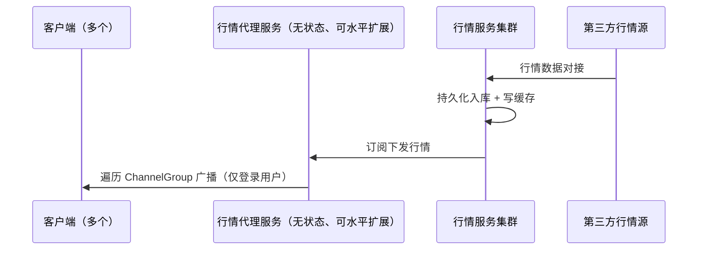

# 打通行情订阅最后一公里：代理服务广播下发与 K 线分表的 Sharding-JDBC 落地

智牛股项目第 14 天的课有两个主题。前半段是第 1 章客户端行情订阅：行情服务到代理服务的订阅链路此前已经打通，这一章要补上最后一环——由代理服务把行情广播给客户端，再用 Netty 模拟客户端做单实例与多实例的测试验证。后半段进入第 2 章行情 K 线数据处理：先定分表方案，讲清为什么选 ShardingSphere 体系，再在多数据源的行情服务里集成 Sharding-JDBC、做单库分片配置，最后解决分表绕不开的全局序列 ID 问题。这两件事其实是一根线：行情要持续落库，K 线数据会按周期无限增长，分表方案必须在写代码之前设计好。

## 先给结论

- 代理服务的改造集中在 `ProxyQuoteConsumer` 的行情监听方法里，四步走完：生成消息序列 ID → 构造 Protobuf 行情包并复制属性 → 组装消息头与响应消息 → 遍历登录时记录的 `channels` 广播下发。
- 序列 ID（`seqId`）不只是个编号：它既是消息的唯一标记，也承担连续性校验——中间出现中断或丢包，靠它能发现问题、追踪排查。
- 行情只推给登录过的客户端：未登录的模拟终端收不到任何数据，登录后立即开始接收；广播对客户端数量没有限制，开多少个终端都一样。
- K 线分表选 Sharding-JDBC 3.1.0，按行情周期分表：60 秒、300 秒、1800 秒三个周期分别落到 `t_trade_stock_kline_1`、`_5`、`_30` 三张表，分片键是实体上的 `dataType` 字段。
- Sharding-JDBC 不支持自增序列，分表场景必须换雪花算法生成全局唯一 ID；同时把 JPA 实体的 `@GeneratedValue` 去掉、列名映射全部小写，否则 PostgreSQL 会直接报错。

## 代理服务改造：从"收行情"到"发行情"

先回顾整条链路的设计。客户端向行情代理服务发起订阅，代理服务从行情服务集群拉取行情，行情服务的数据来自第三方行情源的对接；行情服务同时负责行情的持久化，把行情数据加工后存入数据库，并写入缓存。代理服务被设计成无状态服务，可以水平扩展节点，以此支撑海量用户接入。



代理服务在用户登录成功时已经把客户端 Channel 记录进 `StockProxyServerHandler.channels`，由 ChannelGroup 统一管理，行情下发就是拿这些通道往外写。改造落在 `ProxyQuoteConsumer` 的 `receiveInput` 方法——它通过 `@StreamListener("quote")` 监听行情服务推送的数据，实现分四步：

```java
@StreamListener("quote")
public void receiveInput(@Payload TradeStockQuoteLast receiveMsg) {
    // 1. 生成消息序列ID：唯一性标记 + 连续性校验，便于追踪、维护和排查
    long stockSeqId = seqId++;

    // 2. 构造行情数据包，复制接收到的行情数据
    StockQuoteProto.QuoteRealtimeResp.Builder realtimeResp =
            StockQuoteProto.QuoteRealtimeResp.newBuilder();
    BeanUtils.copyProperties(receiveMsg, realtimeResp);

    // 3. 设置消息头：请求类型、序列ID、状态
    StockHeadProto.StockHead stockHead = StockHeadProto.StockHead.newBuilder()
            .setRequestType(StockHeadProto.RequestType.QUOTE_REALTIME)
            .setSeqId(stockSeqId)
            .setStatus(GlobalConstants.STATUS_OK)
            .build();

    // 4. 组装完整响应消息，广播给所有登录在线的客户端
    ResponseMessage responseMessage = ResponseMessage.newBuilder()
            .setStockHead(stockHead)
            .setQuoteRealtimeResp(realtimeResp.build())
            .build();
    StockProxyServerHandler.channels.forEach(channel -> {
        channel.writeAndFlush(responseMessage);
    });
}
```

`BeanUtils.copyProperties` 复制两个对象之间的属性，前提是属性名和属性类型都一致：源头是行情服务推来的 `TradeStockQuoteLast`，目标是下发给客户端用的 PB 结构。消息头里特意保留了请求类型 `QUOTE_REALTIME`——虽然实时行情是服务端主动推送、并非客户端请求，但客户端会同时收到下单响应、行情推送等多种消息，靠请求类型才能分拣处理。

Protobuf 侧同步做了扩展。`QuoteRealtimeResp` 定义了实时行情的盘口信息：产品 id、产品编号、买方报价、买方数量、卖方报价等下发必要字段；同一份 proto 脚本里还预定义了行情 K 线的数据信息，属性与 K 线表基本一致——开盘价、最高价、最低价、收盘价等组成 K 线的必要属性。K 线行情是一个响应集合，用 `repeated` 关键字实现。消息头部则新增了两个接口号：实时行情数据下发接口和获取 K 线数据接口。实时行情由服务端主动推送，不需要请求消息体；获取 K 线要传自定义参数，所以保留了请求体的定义。

## 模拟客户端接收与多实例验证

客户端侧的改造很轻，只需在 `ClientBoundHandler` 的 `recvProtoMsg` 方法里按请求类型分拣打印：

```java
private void recvProtoMsg(ResponseMessage msg) throws Exception {
    StockHeadProto.StockHead stockHead = msg.getStockHead();
    System.out.println("******* Receive Server Message *******");
    System.out.println("== seqId: " + stockHead.getSeqId());
    System.out.println("== requestType: " + stockHead.getRequestType());
    if (stockHead.getRequestType() == StockHeadProto.RequestType.PLACE_ORDER) {
        System.out.println("== order id: " + msg.getPlaceOrderResp().getDealId());
    } else if (stockHead.getRequestType() == StockHeadProto.RequestType.QUOTE_REALTIME) {
        System.out.println("== 实时行情【" + msg.getQuoteRealtimeResp().getStockName() + "】:");
        System.out.println(msg.getQuoteRealtimeResp().toString());
    }
}
```

验证前的启动顺序有讲究：先确保 Redis、Nacos 等中间件启动完成，然后依次启动 stock-deal 交易服务、stock-quote 行情服务、stock-proxy 代理服务，最后启动 Netty 模拟客户端。要模拟多个客户端并发订阅，得让模拟客户端支持并行运行——在 IDEA 的 Run → Edit Configurations 里选中模拟客户端的运行程序，勾选 Allow parallel run，就能多实例同时启动。

测试设计了对比场景：启动两个模拟终端，第一个先登录，第二个不登录。结果第一个终端登录后立刻打印出实时行情（美的集团的行情报价数据），第二个终端没有任何行情输出，符合"行情必须登录后才能接收"的预期；随后第二个终端也执行登录，行情接收有一定时间间隔，之后同样收到了中国平安的实时行情数据。广播对客户端数量没有限制，无论开多少个终端，登录即收。此外，代理服务与客户端之间的行情下发若遇网络波动或中断，还需增加重试等容错机制，保障行情服务的可用性与下发稳定性。

## K 线分表：为什么是 Sharding-JDBC

第 2 章的目标有三点：实现 K 线数据生成并理解不同周期的加工规则；实现行情服务与代理服务的分 K 数据获取接口——分 K 就是以一分钟为周期生成的 K 线，客户端拿到它就能加工出不同周期的 K 线图；编写模拟请求验证 K 线获取功能与缓存是否生效。

K 线数据按周期持续生成、只增不减，单表迟早撑不住。项目选择 ShardingSphere 体系：它的前身 Sharding-JDBC 由当当网应用框架 dd-frame 中的 rdb 模块演进而来，抽离独立后开源，如今是一套开源分布式数据库中间件解决方案，生态圈由三款相互独立的产品组成——Sharding-JDBC、Sharding-Proxy、Sharding-Sidecar，均提供标准化的数据分片、读写分离、柔性事务和数据治理功能。智牛股侧重使用其中的 Sharding-JDBC：它直接封装 JDBC API，适用于任何基于 Java 的 ORM 框架（JPA、Hibernate、MyBatis、Spring JDBC Template 都支持），也兼容 DBCP、C3P0、BoneCP、Druid 等第三方数据库连接池。这对本项目很关键——行情服务此前用的是 JPA 多数据源配置，交易服务用的是 MyBatis 多数据源配置，两者都能接。

它的工作流程值得细看：业务代码发起 SQL 后，Sharding-JDBC 并不直接转发查询，而是按"分片规则配置 → JDBC 规范重写 → SQL 解析 → SQL 改写 → SQL 路由 → SQL 执行 → 结果归并"的顺序处理。比如一张订单表分成了三张表，业务层的一条 SQL 会被改写成三条，按预设的分片规则路由到三个不同数据源执行，拿到三个结果集后归并为一个再返回。业务层完全不用知道底下有多少张分表，只管写业务逻辑。

分表组件天然有代价，Sharding-JDBC 的限制清单要提前记住：

| 限制 | 说明 |
| :--- | :--- |
| 子查询 | 有限支持 |
| `HAVING` | 不支持 |
| `OR` / `UNION` / `UNION ALL` | 不支持 |
| 特殊 `INSERT` | 每条只能插入一条数据，不支持 VALUES 后多行 |
| `DISTINCT` 聚合 | 不支持 |
| dual 虚拟表查询 | 不支持 |
| `SELECT LAST_INSERT_ID()`、自增序列 | 不支持——分表后无法靠表自身序列保持全局唯一 |
| `CASE WHEN` | 不支持 |

大部分业务操作场景不受影响；真遇到需要特殊语法的 SQL，走独立数据源绕开 Sharding-JDBC 实现即可。其中自增序列这条对 K 线场景影响最大，后面专门用全局序列 ID 解决。

## 单库分片与全局序列 ID 配置

### 分表策略：按行情周期映射表名

行情 K 线的分表规则很直白：根据行情周期条件生成不同时间周期的 K 线数据——1 分钟、5 分钟、30 分钟各一张表，日 K、周 K、月 K 以此类推，在交易数据库里针对行情数据表生成不同周期的分表。如果数据量确实大、按周期分表不够用，还可以叠加产品维度：表名加上股票编号前缀，后面再跟时间周期；单表压力仍然大，就按年度归档，每一年划分一个表，单个产品单个周期最多存一年的数据。本项目侧重周期分表，其余维度留作实际业务中的扩展思路。

集成从依赖开始：行情服务的 POM 引入 `io.shardingsphere:sharding-jdbc-core`，版本 3.1.0 定义在父工程的 properties 标签里统一管理。动手前有个前提要想清楚：Sharding-JDBC 只是数据源的路由代理，官方不建议通过它操纵或修改数据库、执行建表类 DDL 语句。如果业务需要动态建表（比如 SaaS 平台新开一家公司就建一套表），要预先建好——通过后台管理功能提供菜单操作，或者用初始化语句实现表的动态创建。

分片算法两个类，放在行情服务 config 下新建的 sharding 包里。先看分库算法，实现 `PreciseShardingAlgorithm<String>` 接口：

```java
public class DataSourceAlg implements PreciseShardingAlgorithm<String> {
    @Override
    public String doSharding(Collection<String> collection,
                             PreciseShardingValue<String> shardingValue) {
        // collection：分库信息；shardingValue：分片信息
        // 单库分片：固定返回默认库即可
        return "ds_0";
    }
}
```

参数里的 `collection` 是所有可用分库，`shardingValue` 是分片键的值。单库场景直接返回 0 号数据库；如果做了多库，就要拿 `shardingValue` 与 `collection` 做匹配关联——比如订单表 1、2 归数据库 1，订单表 3、4 归数据库 2，这种对应关系就在这里判断并返回对应的库。

分表算法实现 `PreciseShardingAlgorithm<Integer>`，按 K 线周期类型映射表名：

```java
public class DataSourceTableAlg implements PreciseShardingAlgorithm<Integer> {
    @Override
    public String doSharding(Collection<String> collection,
                             PreciseShardingValue<Integer> preciseShardingValue) {
        // 逻辑表名 + "_" 后缀；周期常量以秒为单位
        String tableName = preciseShardingValue.getLogicTableName() + "_";
        Integer type = preciseShardingValue.getValue();
        try {
            if (type.equals(GlobalConstants.KLINE_PERIOD_60)) {          // 60秒 = 1分钟
                tableName = tableName + "1";
            } else if (type.equals(GlobalConstants.KLINE_PERIOD_300)) {  // 300秒 = 5分钟
                tableName = tableName + "5";
            } else if (type.equals(GlobalConstants.KLINE_PERIOD_1800)) { // 1800秒 = 30分钟
                tableName = tableName + "30";
            } else {
                throw new Exception("Not Match Table Rule, type: " + type);
            }
        } catch (Exception e) {
            log.error(e.getMessage(), e);
            throw new RuntimeException(e);
        }
        return tableName;
    }
}
```

分片键是 K 线实体的 `dataType` 字段，取值即周期常量；超出规则的类型直接抛异常，把类型值打印出来便于排查。

### 表规则与多数据源集成

接下来把分表规则挂进 Spring 的多数据源配置。行情服务原本就有 Druid 双数据源：`bizSystemDataSource` 业务数据源、`tradeSystemDataSource` 交易数据源（带 `@Primary`）。这次只针对交易数据源的行情 K 线表做分片，所以新增一个由 Sharding-JDBC 代理的数据源 Bean，与原有名称区分开：

```java
@Bean(name = "tradeDruidSystemDataSource")
public DataSource tradeDruidSystemDataSource(@Autowired DataSource tradeDruidDataSource) throws Exception {
    // 定义 Sharding-JDBC 配置处理规则，加入K线行情表的分表规则
    ShardingRuleConfiguration shardJdbcConfig = new ShardingRuleConfiguration();
    shardJdbcConfig.getRuleConfigs().add(getKlineTableRule());
    // 单库场景：默认数据源名称指向 ds_0
    shardJdbcConfig.setDefaultDataSourceName("ds_0");

    // 分库信息配置：多个分库时逐个 put 进有序 Map
    Map<String, DataSource> dataSourceMap = new LinkedHashMap<>();
    dataSourceMap.put("ds_0", tradeDruidDataSource);
    dataSourceMap.put("ds_1", tradeDruidDataSource);

    Properties properties = new Properties();
    properties.put("sql.show", true); // 开启 SQL 日志打印

    return ShardingDataSourceFactory.createDataSource(dataSourceMap, shardJdbcConfig, new HashMap<>());
}

// K线行情表分表配置处理规则
private TableRuleConfiguration getKlineTableRule() {
    TableRuleConfiguration result = new TableRuleConfiguration();
    result.setLogicTable("t_trade_stock_kline");                 // 逻辑表名，即原始映射表名
    result.setActualDataNodes("ds_0.t_trade_stock_kline_1, "
            + "ds_0.t_trade_stock_kline_5, ds_0.t_trade_stock_kline_30"); // 实际分表节点
    result.setTableShardingStrategyConfig(
            new StandardShardingStrategyConfiguration("dataType", new DataSourceTableAlg()));
    return result;
}
```

逻辑表是原始映射的表名 `t_trade_stock_kline`，实际数据节点把三张分表以逗号分割写上去。要扩展成多库多片，只需改表达式：比如五个库写成 `ds_${0..5}`（从 0 开始到 5 结束），一张表分 10 片就写 `t_trade_stock_kline_${0..9}`，再把对应的数据源逐个 put 进 `dataSourceMap`，不同数据库可以设定不同的连接配置。

### 全局序列 ID：雪花算法补位

Sharding-JDBC 不支持自增序列，如果每张分表沿用表自身的自增主键，不同表的序列必然冲突，ID 就会重复。解法是项目前面讲过的全局序列方案——雪花算法。因为 K 线数据层是通过 JPA 操作的，实体要配合调整：去掉 `@GeneratedValue(strategy = GenerationType.IDENTITY)` 注解，不让数据库自动生成 ID，直接用 `@Id` 定义。

还有一个 PostgreSQL 的坑要提前防：交易数据源用的是 PostgreSQL，表属性采用小写命名，所以实体的列映射必须全部小写逐一标注。Sharding-JDBC 在做 SQL 映射处理时没有针对 PostgreSQL 做大小写转换适配，如果发起驼峰命名的查询，执行时无法识别，会报出 `java.lang.IndexOutOfBoundsException: Index: 0, Size: 0` 这类错误。用 `@Column` 直接映射属性后，Sharding-JDBC 发出去的 SQL 用的就是这里定义的小写列名。

```java
@Entity
@Table(name = "t_trade_stock_kline")
public class TradeStockKline implements Serializable {
    @Id
    @ApiModelProperty(hidden = true)
    private Long id;                       // 不再使用 @GeneratedValue
    @Column(name = "stockid")
    private Long stockId;
    @Column(name = "stockcode")
    private String stockCode;
    @Column(name = "stockname")
    private String stockName;
    @Column(name = "priceopen")
    private Long priceOpen;
    @Column(name = "datatype")
    private Integer dataType;              // 分片键：K线周期类型
    // ...
}
```

ID 生成器注册在 `RedisConfiguration` 里，从工程配置读取雪花算法的两个参数：

```java
@Configuration
@EnableCaching
public class RedisConfiguration extends CachingConfigurerSupport {
    @Value("${snowflake.workerId}")
    private Long workerId;
    @Value("${snowflake.datacenterId}")
    private Long datacenterId;

    @Bean
    public GlobalIDGenerator globalIDGenerator() {
        if (null == workerId || null == datacenterId) {
            return new GlobalIDGenerator();
        }
        return new GlobalIDGenerator(workerId, datacenterId);
    }
}
```

`workerId`、`datacenterId` 配置在工程配置最下面的 snowflake 段里，属于全局唯一 ID 的分布式标识配置，保证各节点取值唯一。业务侧的使用很简单——注入生成器，保存前赋值 ID：

```java
@Autowired
private GlobalIDGenerator globalIDGenerator;

// 保存K线数据时
kline.setId(globalIDGenerator.nextId());
tradeStockKlineRepository.save(kline);
```

K 线生成的处理逻辑此时还没有实现，保存的数据层接口不用调整，等行情服务的 K 线生成功能落地时再补齐。Sharding-JDBC 更完整的用法可参考官方文档 shardingsphere.apache.org。

## 小结

这一章其实干了两件事。行情订阅链路上，代理服务从"接收行情"升级为"分发行情"：生成序列 ID、构造 PB 包、属性复制、Channel 广播四步实现，配合模拟客户端按请求类型分拣打印，"登录才推送、广播无上限"的语义在多实例实测中得到确认；代理服务无状态设计带来的水平扩展能力，是这套订阅架构能扛海量客户端的前提，而网络波动下的重试容错机制则是生产化前必须补齐的一环。K 线数据侧，先于编码把分表方案定下来：Sharding-JDBC 3.1.0 + 单库分片 + 按周期（1/5/30 分钟）映射 `t_trade_stock_kline` 三张分表，业务层对分表完全透明；限制清单（不支持自增序列、HAVING、OR、UNION 等）直接决定了配套设计——雪花算法全局 ID、实体列名全小写映射、特殊 SQL 走独立数据源。分片配置是否真正生效，要等 K 线生成功能写完、数据落进分表才能见真章。
