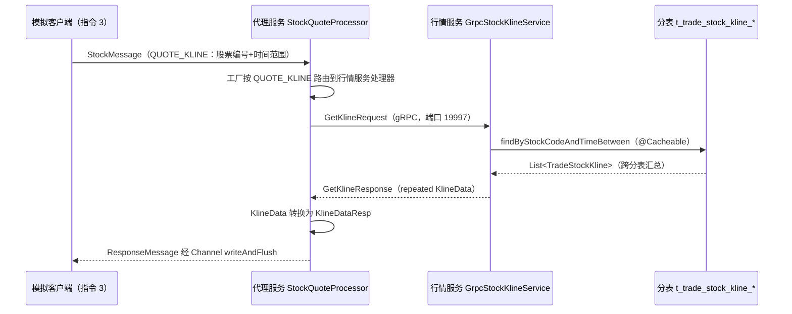

# 把 K 线交给客户端：K 线生成、四层接口链路验证与市价下单开篇

智牛股项目这一章的主线是把 K 线真正做出来、交出去。分表方案与 Sharding-JDBC 配置已就位，接下来依次是：行情服务在定时任务里把实时行情加工成 1 分钟周期的 K 线；定义内部 gRPC 与外部 Netty 两套 Protobuf 数据结构；行情服务提供 K 线获取接口，代理服务经 gRPC 调用转发，模拟客户端发指令验证——四层链路从数据库直达客户端控制台。功能验证完毕后，课程切入第 3 章市价下单：先回顾"注册即开户"，再改造下单入口的外围逻辑。

## 先给结论

- K 线在 `scheduledPersistCache` 定时任务（每 1 分钟一次）里生成，调用链是"保存最新行情 → 生成 K 线 → 删除行情缓存"，K 线处理必须放在清缓存之前，否则拿不到行情数据。
- 生成规则三句话：缓存里没有就新建 K 线，四个关键价格（开、收、高、低）都等于第一口最新报价；周期内更新最低价、最高价、收盘价；超过 60 秒就持久化旧 K 线并生成新 K 线。
- 成交金额与成交量要做差值：行情源里是当日累计总量，减去 K 线已记录部分才是当前周期的实际值。
- 接口分两套数据结构：内部 gRPC 用 `StockKlineService.proto`，外部 Netty 用 `StockMessage.proto` 的 oneof 挂上 `KlineDataRespLists`；代理服务遍历转换时不能用并行流，Protobuf 内部集合是普通 List，非线程安全。
- K 线查询接口加了 `@Cacheable` 缓存，并重写 JPA 的 save 方法在更新时让缓存失效，保证数据最新。
- 验证三件事全部通过：K 线按分片规则落进 `t_trade_stock_kline_1`，查询自动跨三张分表汇总（7 条不差），Redis 按股票编号与周期生成接口缓存。

## K 线生成：一分钟周期、四种价格、一个差值

K 线生成挂在行情服务既有的定时任务里。`StockQuoteServiceImpl` 的 `scheduledPersistCache` 由 `@Scheduled(cron = "0 0/1 * * * ?")` 标记，每分钟执行一次，在最新行情保存方法之后追加 `processKline`，传入行情数据。位置有讲究：必须在删除实时行情缓存之前，处理 K 线时才能拿到所需的行情缓存信息，先删缓存 K 线就没法生成。

K 线的中间态放在内存 Map 里：key 是股票 ID，value 是 `TradeStockKline`，用 `ConcurrentHashMap` 保障线程安全。`processKline` 先按股票 ID 查找，找不到就调 `newKline` 生成一条新 K 线并放入 Map——这种情况真实存在：服务重启过，或者新的一天行情开始，之前的缓存已经清除。

`newKline` 把 `TradeStockQuoteLast` 的属性转换为 `TradeStockKline`，关键在四个价格：开、收、高、低全部设置为最新的行情报价。新 K 线只接到第一口报价，四个价格自然一致——此时它就是一根"线"；随着交易推进，价格从 10 块变成 11 块，收盘价开始变化，价差拉开后才形成 K 线实体。

如果 K 线已存在，就判断时间差是否超出周期：最新行情报价时间减去 K 线存储的报价时间得到 `diffTime`；配置 1 分钟就用 60 秒判断，配置 5 分钟就以 5 分钟为单位。周期之内更新 K 线数据，周期之外持久化并生成新 K 线：

```java
// 时间差在K线周期范围内：更新K线
if (diffTime > 0 && diffTime < GlobalConstants.KLINE_PERIOD_60) {
    if (quoteLast.getLastPrice() < kline.getPriceLow()) {
        kline.setPriceLow(quoteLast.getLastPrice());   // 更新最低价
    }
    if (quoteLast.getLastPrice() > kline.getPriceHigh()) {
        kline.setPriceHigh(quoteLast.getLastPrice());  // 更新最高价
    }
    kline.setPriceClose(quoteLast.getLastPrice());     // 收盘价跟随最新价
    // 成交金额/成交量做差值：行情源是当日累计总量，
    // 减去K线已记录部分才是本周期实际值
    kline.setAmount(quoteLast.getAmount() - kline.getAmount());
    kline.setVolume(quoteLast.getVolume() - kline.getVolume());
    kline.setTime(cvtMinuteTime(quoteLast.getTime())); // 时间按分钟转换记录
} else if (diffTime >= GlobalConstants.KLINE_PERIOD_60) {
    // 超过K线周期：需要持久化，并生成新的K线数据
    long lastClosePrice = kline.getPriceClose();       // 记录上一个周期收盘价
    kline.setId(globalIDGenerator.nextId());           // 全局唯一ID（Sharding-JDBC分表）
    tradeStockKlineRepository.save(kline);             // 数据层接口无需任何变化
    kline = newKline(quoteLast, lastClosePrice);       // 新K线的"昨收"即上一周期收盘价
    klineMap.put(quoteLast.getStockId(), kline);
} else {
    // 时间差等于当前周期或计算错误：不需要处理，打日志提示
}
```

两点要特别注意。一是成交量的口径：行情源里的成交金额、成交量都是当日累计总量，必须做差值才是当前周期的实际值。二是"昨收价"指的是上一根 K 线的收盘价格，不是昨日收盘价。持久化时注入全局唯一 ID 生成器，`nextId()` 赋值后照常调 save——Sharding-JDBC 分表对业务完全透明，业务层感知不到写进了哪张表。K 线以 1 分钟为最小粒度，客户端拿到分 K 数据就能加工 5 分钟、日 K、周 K、月 K 等不同周期的 K 线图，处理机制一样。

## 两套 Proto，四层链路

对外提供 K 线获取接口，先把通讯数据结构定下来，分内部与外部两层：内部是行情服务与代理服务之间的 gRPC 通讯，外部是代理服务与客户端之间的 Netty 传输。

内部结构定义在公用 PB 数据结构工程的 `StockKlineService.proto` 里：

```protobuf
syntax = "proto3";
option java_multiple_files = true;
option java_package = "com.itcast.bulls.stock.struct.grpc.quote";
option java_outer_classname = "StockKlineServiceProto";

service StockKlineService {
  rpc getKline(GetKlineRequest) returns (GetKlineResponse) {}
}

message GetKlineRequest {
  int64 stockId = 1;
  string stockCode = 2;
  int64 timeStart = 3;
  int64 timeEnd = 4;
}

message GetKlineResponse {
  string status = 1;
  string message = 2;
  repeated KlineData klineData = 3;
}

message KlineData {
  int64 stockId = 1;
  string stockCode = 2;
  string stockName = 3;
  int64 priceOpen = 4;
  int64 priceHigh = 5;
  int64 priceLow = 6;
  int64 priceClose = 7;
  int64 volume = 8;
  int64 amount = 9;
  int64 time = 10;           // 报价时间
  int64 lastClosePrice = 11; // 上周期收盘价
}
```

请求带股票 ID、编号和时间范围——时间范围让接口更灵活，查当天还是一年的 K 线都行。响应是处理状态加 `KlineData` 集合，覆盖组成 K 线的全部必要数据。

外部结构在 `StockMessage.proto` 里扩展：获取 K 线的请求包属性与 gRPC 版本基本一致（股票 ID、编号、时间范围）；响应侧 oneof 里增加 `KlineDataRespLists`，与 loginData、placeOrderData、quoteRealtimeResp 并列，靠请求类型分拣。两份 proto 都用 protoc 生成代码，gRPC 与 Netty 两层通讯代码各自就位。

整条链路的调用关系如下：



## 三段实现：行情服务、代理、模拟客户端

**行情服务提供接口。** POM 加入 gRPC 公用数据结构依赖 `stock-struct-proto` 和组件依赖 `bulls-stock-starter-grpc`，配置文件声明 gRPC 服务端端口 19997。新建 grpc 包，`GrpcStockKlineService` 继承 `StockKlineServiceGrpc.StockKlineServiceImplBase`，加 `@GrpcService` 注解，注入 JPA 数据层接口 `TradeStockKlineRepository`。

数据层两个要点。一是查询加了缓存：`@Cacheable(value = STOCK_QUOTE_KLINE_KEY)` 的 `findByStockCodeAndTimeBetween(stockCode, begin, end)`——所有客户端都直接查数据库会给服务器巨大压力，缓存提升 K 线检索速度。二是重写 save 方法：K 线保存更新时让缓存失效，下次查询发现缓存没有数据，就从数据库加载最新内容更新到缓存，一致性靠这一步兜住。

`getKline` 的实现是三步：按股票代码与时间范围查询 K 线；遍历转换为 PB 对象；返回给 gRPC 调用客户端。设置 `STATUS_OK` 状态后判空——K 线必须有数据才能遍历——然后流式转换：

```java
klineList.stream().forEach(kline -> {
    KlineData.Builder klineData = KlineData.newBuilder();
    BeanAssistant.copyNotNullProps(kline, klineData); // 排除null属性的对象复制
    response.addKlineData(klineData.build());
});
responseObserver.onNext(response.build());
responseObserver.onCompleted();
```

用自定义工具 `BeanAssistant.copyNotNullProps` 而不是 Spring 的 BeanUtils，原因是 PB 数据结构对基础类型没有包装：proto 里的 int64 生成的就是基础 long 类型，不支持 null；Spring 的复制方法会把 null 属性一并拷贝，包装类型的 null 塞进基础 long 就会报错。

**代理服务实现调用。** processor 包下新建 `StockQuoteProcessor`，继承 `AbstractStockProcessor` 实现 `IBaseStockProcessor`。行情服务的 gRPC 接口用 `@GrpcClient("grpc-quote-server")` 注入 `StockKlineServiceBlockingStub`——注意这不是 `@Autowired`，需要指向工程配置里的 gRPC 服务端。`processRequest` 六步走：取客户端请求参数 `KlineData`（同名类有两个包，要导 Netty 下的这个）；构造 gRPC 请求，设置股票 ID、编号、起始与结束时间；调用远程行情服务并打印结果；生成响应头部，状态 OK；把返回的 K 线数据转换为客户端响应结构——判空后流式遍历转成 `KlineDataResp`，集合 Builder 定义在外层避免循环内重复创建；最后组装 `ResponseMessage`，经连接通道 `writeAndFlush` 输出。

一个容易踩的坑：遍历转换不能采用并行流，必须用普通 stream——Protobuf 里的集合是普通 List，非线程安全。工厂侧同步扩展：`StockProcessorFactory` 注入新处理器，switch 增加 `QUOTE_KLINE` 分支返回它，不影响原有的登录、下单流程。配置文件最下面增加 `grpc-quote-server` 段，结构与交易服务配置一致，区别只是服务名：stock-deal 指交易服务，stock-quote 指行情服务。

**模拟客户端增加接口。** `BusinessHandler` 新增 `getKline` 方法：股票编号固定传 601398，起始时间往前放宽确保能查到数据，结束时间取当前系统时间；头部请求类型改成 `QUOTE_KLINE`，参数体用 Netty 包下的 `KlineData`（不是 gRPC 包）设置股票编号与时间范围，组装进 `StockMessage` 发送。通道已注入属性，方法不用再传 `ChannelHandlerContext`；方法最初写成 private 导致菜单调用不到，改成 public 解决。接收侧 `ClientBoundHandler` 增加判断：类型为 `QUOTE_KLINE` 时打印"获取K线数据"及集合内容；菜单增加指令 3，主循环输入 3 就调用 `businessHandler.getKline()`。

## 验证：分表落库、跨表汇总、缓存生效

先验证 K 线生成，等行情接收满一分钟再查库。但有个时段问题：行情收盘后不会再生成新 K 线——代码按时间做了去重处理，数据层接口按股票 ID 和时间获取对象，收盘后行情时间不再变化，自然不会产生新数据。课程为此提供了模拟行情推送：行情拉取原本走聚合数据平台，受交易时间限制；模拟行情从行情缓存拉数据加工，生成随机价格、时间取当前系统时间，能源源不断产生行情——前提是缓存里先有第三方平台拉来的真实行情数据。

分片规则也要在测试前确认：`processKline` 里给 K 线 `setDataType` 指定周期——60 是一分钟，五分钟周期就改 300。这个 `dataType` 正是分表算法 `getValue` 取到的分片键，决定数据落进哪张表。

启动行情服务前先确认 `t_trade_stock_kline_1` 表没有数据；启动后控制台日志出现 `INSERT INTO t_trade_stock_kline_1`，插入了中国平安的 K 线，刷新后表里有两条——产品表配置了两只股票，一分钟后各生成一条，分片落库生效。

接着验证接口链路。先把 K 线生成方法注释掉避免产生新数据，重启行情服务，再依次启动交易服务、代理服务（控制台显示代理已收到推送的模拟行情，暂不用管），最后启动模拟客户端登录。三张分表现状：kline_1 有 2 条，kline_5 有 6 条，kline_30 无数据；模拟终端传的股票编号是 601398，在 kline_5 里有 6 条、kline_1 里有 1 条，共 7 条。客户端发送指令 3，成功收到响应消息，逐条清点 7 条，size 也是 7——业务接口的查询没做任何调整，Sharding-JDBC 自动把所有分表数据汇总成完整结果。

最后看缓存。用 Redis 客户端连接服务器，能看到 K 线接口的缓存 key：`stock:quote:kline::SimpleKey [601398, 1]`，按股票编号与周期参数生成；结束时间一改再请求，又生成一条新缓存记录——参数变了缓存重新生成，这正是 `@Cacheable` 按 key 缓存的语义。

## 市价下单开篇：账户先行，入口改造

功能验证收尾后，课程进入第 3 章市价下单。目标两点：掌握市价单处理与深度成交逻辑，学会复杂逻辑代码的封装与扩展；掌握均价、买卖方向成本价等业务计算。步骤是：用户注册即开户 → 市价下单接口逻辑实现 → 代理服务改造调用 → 功能自测验证。

下单分两种：市价按市场成交价格下单，限价委托按自己指定的价格下单，实现逻辑不一样，本章先做市价。开户是下单的基础，先回顾注册即开户。`StockUserServiceImpl` 的 `userRegister` 流程：校验用户是否已注册（按用户编号与邮箱查重，已存在抛业务异常）；校验公司信息合法性（查不到抛异常）；构造用户信息并冗余机构、公司等属性——用户编号和交易账户编号都通过 `getNextSeqId` 从数据库序列生成全局唯一值，`String.format("%08d")` 保持 8 位、不足补 0，密码加密存储。开户开关由全局配置 `REG_OPEN_ACCOUNT` 控制：值为 true 才生成交易账户，改成 false 就只注册用户。交易账户用系统默认分组，状态有效，冗余机构、公司、用户名称等信息，余额初始为 0；交易账户与用户是多对一关系，当前账户体系适用智牛股平台，将来对接第三方平台可再生成另外的交易账户。

接着是下单入口的外围改造。`GrpcStockDealService` 的 `placeOrder` 原是简易下单，没有业务逻辑，这次深度改造，外层流程四步：

```java
// 1. 获取实时行情：从缓存读取最新报价
Cache lastPriceCache = redisCacheManager.getCache(GlobalConstants.STOCK_QUOTE_LAST_PRICE_KEY);
Cache.ValueWrapper quoteLastWrapper = lastPriceCache.get(request.getStockId());
if (quoteLastWrapper == null) {
    throw new ComponentException(ApplicationErrorCodeEnum.QUOTE_LAST_PRICE_NOT_FOUND);
}
TradeStockQuoteLast tradeStockQuoteLast = (TradeStockQuoteLast) quoteLastWrapper.get();

// 2. 按下单类型分派：市价单走业务层处理
if (request.getType() == GlobalConstants.ORDER_TYPE_MARKET) {
    BaseOrderResponse response = stockDealService.processMarketOrder(request, tradeStockQuoteLast);
    // 3. 包装处理结果返回调用方
    PlaceOrderResponse placeOrderResponse = PlaceOrderResponse.newBuilder()
            .setStatus(GlobalConstants.STATUS_OK)
            .setDealId(response.getId())
            .setMessage("下单成功")
            .build();
    responseObserver.onNext(placeOrderResponse);
}
// 4. 限价委托单（LIMIT）留标记，后面章节实现
```

异常用 try-catch 统一封装返回，分两类：业务异常拿对应的错误码，系统异常拿返回消息包装。市价单的具体逻辑下沉到 service 层：新建 `IStockDealService` 接口定义 `processMarketOrder`，传入请求参数与实时行情，实现类 `StockDealServiceImpl` 的内部处理——生成交易订单、成交记录、持仓信息、深度报价处理等——留给后面章节展开。方法拆分是有意为之：市价下单处理的业务内容多，逻辑必须封装，不能一个方法写到底；按功能流程拆开后，实现限价委托时还能直接复用。

## 小结

这一章把 K 线从"方案"推进到了"可用"。生成侧记住四点：四价同源、周期判断（时间差对比 60 秒）、累计量差值、执行顺序在清缓存之前。链路侧的设计：内部 gRPC 与外部 Netty 两套 proto 各司其职，行情服务 `@Cacheable` 加缓存、重写 save 保持一致性，代理服务靠工厂模式扩展 `QUOTE_KLINE` 处理器，遍历避开并行流的线程安全坑。验证结论三条：分片落库生效、跨表查询自动汇总、接口缓存按参数生成——客户端收到的 7 条 K 线与三张分表的数据分布对得上。市价下单刚开了头：账户体系与下单入口已经就位，深度成交、均价与成本价计算才是这套交易功能真正的硬骨头。
