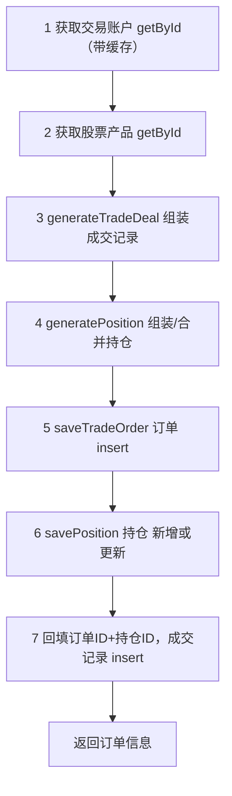

# 市价单闭环：业务层、成交记录、持仓记录三表联动与全链路测试

市价单是交易系统里最"不挑食"的单型：不跟价格纠缠，按盘口对手方的档位从优到劣逐档吃进，一笔请求完全可能成交在四五个价位上。智牛股这个单元把市价下单一次做透：先在 `StockDealServiceImpl` 里把 `processMarketOrder` 的七步主流程排清楚，再逐个实现深度成交撮合、持仓合并、订单状态计算，最后改造 Netty 代理服务，用模拟客户端打穿全链路，对着数据库里的订单、成交、持仓三张表逐项核对。

## 先给结论

- 主流程七步：取交易账户 → 取股票产品 → 生成成交记录 → 生成持仓信息 → 保存订单 → 保存持仓 → 保存成交记录。"生成"只负责组装对象，落库集中在后三步。
- 保存顺序是外键关系倒逼出来的：成交记录要回填订单ID和持仓ID，所以订单、持仓先 insert，成交记录最后落库。
- 深度成交的核心结构是有序 `Map<Long, Long>`（价格→数量），买方订单存的是卖1~卖5的对手盘报价；逐档遍历，档位吃得下就一次成交并退出，吃不下就整档吃掉继续下一档。档位将来扩到十档百档，这套逻辑不用改。
- 持仓合并两套公式：买入成本价 =（原成本价×持仓数量 + 本次均价×本次数量）÷ 总数量，成交均价 =（上一次均价 + 本次均价）÷ 2；卖出方向成本价 =（原成本总价 − 本次成交金额）÷ 剩余数量，盈利足够大时它可以是负数。
- 订单状态按请求数量与实际成交数量的关系计算：相等即完全成交（2），大于即部分成交（1），否则默认等待成交（0）。
- 代理服务两处改造：`AbstractStockProcessor` 增加 `getUserAccountId`（从登录时写入的"通道ID→账户ID"缓存里取），`StockDealProcessor` 外层捕获业务异常与系统异常，封装成带错误码的 `ResponseMessage` 回传客户端。

## 主流程七步走：先组装，后落库

服务层的入口方法是 `processMarketOrder`，入参是下单请求 `PlaceOrderRequest` 和最新报价 `TradeStockQuoteLast`。整个方法按注释切成七段：

```java
private TradeOrder processMarketOrder(PlaceOrderRequest request,
                                      TradeStockQuoteLast quoteLast) throws ComponentException {
    // 1. 获取交易账户信息（数据层实现里加了缓存，提升账号信息获取速度）
    TradeAccount tradeAccount = tradeAccountDao.getById(request.getAccountId());
    // 2. 获取股票产品信息
    TradeStock tradeStock = tradeStockDao.getById(request.getStockId());
    // 3. 生成成交记录（只组装对象，不落库）
    TradeDeal tradeDeal = generateTradeDeal(quoteLast, request, tradeAccount, tradeStock);
    // 4. 生成持仓信息（同样只组装）
    TradePosition tradePosition = generatePosition(tradeDeal, request, tradeAccount, tradeStock);
    // 5. 保存订单信息
    TradeOrder tradeOrder = saveTradeOrder(tradeDeal, request, tradeAccount, tradeStock);
    // 6. 保存持仓记录
    savePosition(tradePosition);
    // 7. 保存成交记录：回填订单ID与持仓ID后再 insert
    tradeDeal.setTradeOrderId(tradeOrder.getId());
    tradeDeal.setPositionId(tradePosition.getId());
    tradeDealDao.insert(tradeDeal);
    return tradeOrder;
}
```

容易看岔的是第 3、4 步和第 7 步的关系。`generateTradeDeal`、`generatePosition` 名字里虽然带着"生成"，但它们只做对象组装，方法内部不碰数据库——成交记录真正落库在最后一步。之所以把成交记录放到订单、持仓之后才保存，是因为成交记录上要记录订单ID和持仓ID两个关联字段：订单先 insert 拿到 ID，持仓先落库拿到 ID，成交记录才能把两个外键填上。



类里注入的都是数据层接口（交易账户、成交记录、交易订单等 DAO）加缓存管理器，另有一组辅助方法：深度报价的转换处理、订单状态的计算转换。先把必要的属性和辅助方法就位，再集中讲主逻辑，复杂业务这么拆节奏才不乱。

## 深度成交：有序 Map 逐档撮合

成交记录是三张表里计算量最大的一张，难点全在深度成交：买卖两侧各有买1~买5、卖1~卖5五个档位，一笔市价单可能吃穿多个档位，最终均价怎么算、买卖方向怎么处理，牵扯的业务点不少。实现思路分三步：

1. **按买卖方向把报价深度转成有序 Map**。Key 是价格（长整型），Value 是该档位的数量（长整型）。注意存的是对手方向：买方向订单存卖1~卖5的盘口，卖方向订单存买1~买5——撮合本来就是拿自己的方向去对对手方的报价。
2. **逐档遍历撮合**，一边累加成交总价 `amount` 和成交总数 `volume`，一边维护剩余待成交数量 `needVolume`（初始值就是请求数量）。
3. **总价除以总量得出均价**，再组装成交记录。

```java
Map<Long, Long> deepOffers = cvtDeepOffer(quoteLast, request.getDirection());
long amount = 0;      // 成交总价
long volume = 0;      // 成交总数
long needVolume = request.getExecVolume();  // 剩余待成交数量

for (Map.Entry<Long, Long> deepOffer : deepOffers.entrySet()) {
    if (needVolume <= deepOffer.getValue()) {
        // 当前档位吃得下：一次成交，直接退出
        amount += needVolume * deepOffer.getKey();
        volume += needVolume;
        needVolume = 0;
        break;
    }
    // 吃不下：整档吃掉，继续下一档
    amount += deepOffer.getKey() * deepOffer.getValue();
    volume += deepOffer.getValue();
    needVolume -= deepOffer.getValue();
}
```

循环里只有两个分支：请求量小于等于当前档位挂单量，说明卖1一个档位就能满足（比如卖1挂了 1000 手，买 100 手），填进总价总量后 `needVolume` 清零、`break` 退出，不触发深度成交；否则把这一档整体吃掉（价格×数量累加进总价，数量累加进总量），减去已吃数量，继续看下一档。这就是敢用有序 Map 做核心结构的原因——将来盘口扩展到十档、上百档，遍历逻辑和存储结构一行都不用动。

均价和佣金在循环结束后算。均价就是总价除以总量，佣金比例挂在交易账户组上，所以要先按账户ID查出账户组再计算（工具方法内部转长整型运算、保留精度）：

```java
deal.setExecPrice(MathUtils.divLong(amount, volume)); // 均价 = 总成交金额 ÷ 总成交数量
TradeGroup tradeGroup = tradeAccountDao.getTradeGroupByAccountId(request.getAccountId());
deal.setCommission(MathUtils.calcCommission(amount, tradeGroup.getCommissionRate()));
```

成交记录对象组装完（账户、股票编号/名称/市场、成交数量、成交均价、成交时间、买卖方向、佣金、状态）直接返回，先不保存——留给主流程第 7 步统一落库。

## 持仓合并与订单状态：两套公式，三种状态

持仓处理 `generatePosition` 先按账户ID+股票ID查现有持仓，再按买卖方向分两条路。

**买方向**：持仓不存在就新增，组装必要属性直接返回。这里有个业务口径要留意：模拟盘默认采用股票的 CFD 合约形式，支持 T+0，当天买当天能卖，所以可卖数量直接填本次成交数量；要是接深交所、上交所做实盘，A股是 T+1 制度，当天买入第二天才能卖，可卖数量就不能把本次成交加进去。持仓已存在则做合并更新，两套公式：

- 成本价 =（原持仓总金额 + 本次成交总金额）÷（原持仓数量 + 本次成交数量），其中原持仓总金额 = 原成本价 × 原持仓数量，本次成交总金额 = 本次成交均价 × 本次成交数量；
- 成交均价 =（上一次成交均价 + 本次成交均价）÷ 2，无论成交多少次都是这个算法；
- 最后把持仓数量、可卖数量分别累加本次成交数量。

```java
long origAmount = MathUtils.mul(tradePosition.getCostPrice(), tradePosition.getVolume());
long curAmount  = MathUtils.mul(tradeDeal.getExecPrice(), tradeDeal.getExecVolume());
// 成本价 = (原持仓金额 + 本次金额) / 总数量
long costPrice = MathUtils.divLong(MathUtils.add(origAmount, curAmount),
        MathUtils.add(tradePosition.getVolume(), tradeDeal.getExecVolume()));
tradePosition.setCostPrice(costPrice);
// 成交均价 = (上一次均价 + 本次均价) / 2
tradePosition.setAvgPrice(MathUtils.divLong(
        MathUtils.add(tradePosition.getAvgPrice(), tradeDeal.getExecPrice()), 2));
```

**卖方向**：先校验再合并。持仓记录不存在，说明业务逻辑有异常——卖股票必须有持仓，直接抛 `ComponentException`（无持仓数据）；可卖数量不足同样抛异常（持仓不足）。校验通过做合并，与买方向基本一致，唯独成本价算法不同：原持仓总金额减去本次卖出成交金额，再除以剩余持仓数量，可卖数量做对应扣减。

成本价在卖出方向可能算出负数，这不是 bug。课程里举了个例子：10 元买入 1000 手，涨到 50 元后逐步卖出只剩 1 手，每股价差 40 元，累计盈利 400 万。剩下这 1 手如果还按 10 元记成本，以现价 50 元算的价差只有 40 元/股，和已落袋的 400 万对不平；只有把成本价算成负数，账才能持平。

订单落库在 `saveTradeOrder` 里，组装完订单属性后关键是算状态，常量集中在 `GlobalConstants`：

| 常量 | 值 | 含义 |
| --- | --- | --- |
| ORDER_STATUS_WAIT | 0 | 等待成交（默认） |
| ORDER_STATUS_PART | 1 | 部分成交 |
| ORDER_STATUS_ALL | 2 | 完全成交 |
| ORDER_STATUS_MANUAL_CANCEL | 3 | 手工撤单 |
| ORDER_STATUS_SYS_CANCEL | 4 | 系统撤单 |

`calcOrderStatus` 的规则：请求数量等于实际成交数量，完全成交；请求数量大于实际成交数量，部分成交；都不符合就默认等待成交。状态设好后 `tradeOrderDao.insert(order)` 落库。持仓保存 `savePosition` 则按 ID 判断：ID 不为空说明记录已存在，走更新；ID 为空说明是新仓位，走新增。最后回到主流程，成交记录回填两个外键后 insert，`processMarketOrder` 返回订单信息，市价单的服务层闭环完成。

## 代理服务改造与全链路测试

服务层闭环之后还差最后一跳：客户端请求先过 Netty 代理服务，代理服务再调交易服务的 gRPC 接口。改造分两件事。

**第一件，增加获取用户账号的方法。** 交易记录要关联交易账户ID，但这个 ID 不该让客户端传——登录时已经把"通道ID→交易账户ID"的关联写进了缓存（`StockUserProcessor` 的 `recordCache` 里做的关联缓存），代理服务端自己就能查到。方法具有普遍性，封装在 `AbstractStockProcessor` 里：

```java
protected Long getUserAccountId(ChannelHandlerContext ctx) throws ComponentException {
    // 缓存 key 是通道 ID 的长文本，value 是登录时关联的交易账户 ID
    Cache cache = cacheManager.getCache(GlobalConstants.STOCK_PROXY_USER_KEY);
    String channelId = ctx.channel().id().asLongText();
    // ... 通过 channelId 反查交易账户 ID
    // 取不到有效账户则抛业务异常
    throw new ComponentException(ApplicationErrorCodeEnum.SYS_NOT_ACCESS_USER);
}
```

**第二件，下单处理器补异常捕获。** 市价下单接口会抛业务异常，代理服务端如果不捕获，客户端就拿不到异常提示。`StockDealProcessor` 在外层加 try-catch，两类异常分别封装响应：

```java
try {
    // 组装 PlaceOrderRequest，调 getUserAccountId 设置 accountId
    // 调 gRPC：stockTradeDealServiceBlockingStub.placeOrder(...)
    // 封装 PlaceOrderResponse 返回
} catch (ComponentException e) {
    // 业务异常：按错误码重建协议头，把提示信息带回客户端
    log.error(e.getMessage(), e);
    stockHead = generateStockHead(stockMessage.getStockHead(), e.getErrorCodeEnum().getCode());
    responseMessage = ResponseMessage.newBuilder()
            .setStockHead(stockHead)
            .setMessage(e.getErrorCodeEnum().getMessage())
            .build();
} catch (Exception e) {
    // 系统异常：统一错误状态 + 提示信息
    log.error(e.getMessage(), e);
    responseMessage = ResponseMessage.newBuilder()
            .setStockHead(stockHead)
            .setMessage(e.getMessage())
            .build();
}
```

全链路测试按"备数据 → 起服务 → 模拟下单 → 查库核对"四步走：

| 准备项 | 检查点 |
| --- | --- |
| 交易账号 `t_trade_account` | 已有账户可用，user_id=1、关联 trade_group_id=1 |
| 交易账户组 `t_trade_group` | 存在默认组，佣金比例已设为 1.2% |
| 持仓表 `t_trade_position` | 先清空，从零验证开仓 |

服务启动交易服务和代理服务即可；缓存里已经有实时行情的话，行情服务可以不启，省内存。测试用例的设计点是**下一笔超出第一档的买单**——只有吃穿卖一，均价才会偏离卖一价，深度成交才算真的被验证。以中国平安（601318，股票ID=1）为例，查 `t_trade_stock_quote_last` 倒序拿最新报价：卖一 ASK_ONE 价格 7223、数量 19168；模拟客户端委托数量 5 万，远超卖一。注意委托类型 `type` 要设 0（市价单），别设成 1——限价单逻辑还没实现；请求价格随便填，市价单不生效。

下单成功返回订单ID 2525，逐表核对：

- `t_trade_order`：最新订单 2525，成交均价 7224，不等于卖一的 7223——因为 5 万股吃穿了卖1到卖4四个档位（7223→7226，每档价差一分钱），均价按总成交金额÷总成交数量落在 7224；
- `t_trade_deal`：生成一条成交记录，订单ID 2525、数量 5 万、均价 7224，与订单表一致，`commission` 字段已按账户组比例算出佣金；
- `t_trade_position`：新增一条持仓，成本价、成交数量、成交均价、可卖数量齐全。

第二个场景验证仓位合并：同样参数再发一单，拿到订单 2526，回查持仓表——没有生成第二条记录，而是在原记录上更新，成交数量累加到 10 万。无持仓开仓、有持仓合并两个场景都过，市价单从客户端到三张表的全链路就算闭环了。课程留的扩展方向也顺理成章：交易时间内跟着实时行情多成交几笔，观察成本价随成交变化。

## 小结

- `processMarketOrder` 七步主流程的精髓是"生成与保存分离"：成交、持仓两个 generate 只组装对象，订单、持仓、成交的落库集中在后三步，顺序由外键关系倒逼。
- 深度成交用有序 `Map<Long, Long>` 承载对手方档位，逐档"吃得下就停、吃不下就整档吃"，档位扩展不改核心逻辑；均价 = 总价 ÷ 总量，佣金按账户组比例计算。
- 持仓合并记三条公式：买入成本价加权平均，成交均价两次平均，卖出成本价 =（原总成本 − 本次金额）÷ 剩余数量——卖出方向成本价可以为负，用于和已实现盈利对平。
- 订单状态三档由请求数量与实际成交数量的关系决定；持仓保存按 ID 区分新增与更新。
- 代理服务两个改造点：账户ID从登录缓存反查（不依赖客户端传参），处理器外层按业务/系统异常分别封装 `ResponseMessage`。
- 测试的关键设计是"超出第一档的大单"：均价偏离卖一价才证明多档撮合生效，第二单验证持仓合并在原记录上更新。业务逻辑先理清思路再封装代码，测试多换场景，缺陷尽量消灭在自测阶段。
