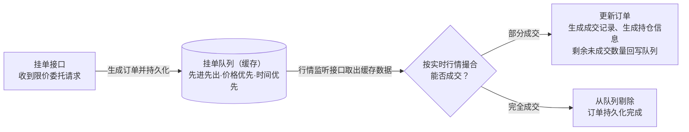

# 挂单服务工程搭建：双数据源、行情队列、缓存、线程池与限价委托开篇

市价单在交易服务里同步撮合、当场出结果，限价单却完全不同：委托价没到就得出队等着，行情走到位了才成交。所以智牛股为限价委托单设了一个独立服务 `stock-pending`（挂单服务），专门处理限价挂单、部分成交、撤单和挂单状态。这个单元做两件事：先把工程搭起来，双数据源、行情消息队列、缓存、线程池四件套集成配置到位；再进入限价委托下单的开篇，定义 proto 数据结构、梳理挂单处理流程、搭出 gRPC 接口骨架。

## 先给结论

- 挂单服务是独立运行的微服务，工程骨架（多环境配置、日志文件、pom 依赖、启动类）直接从交易服务拷贝改造，gRPC 服务端端口 19996，包结构按 config/dao/grpc/mq/service/vo 划分。
- 双数据源沿用 MyBatis 方案：业务数据源（MySQL）+ 交易数据源（PostgreSQL，`@Primary` 默认数据源），三个配置类从已有工程拷贝；MapperScan 扫描路径和 mapper 文件路径不能配错，否则服务起不来。
- 行情队列用 Spring Cloud Stream 绑 RocketMQ：`@Input("quote")` 订阅 `stock-quote` 主题，消费组按节点区分（stock-pending-1 起步、多节点按序号递推），每个挂单服务对应一个队列缓存，互不干扰、支持集群水平扩展。
- Redis 缓存的 CacheManager 默认 24 小时过期，正好对齐交易平台按天结算的节奏：挂单队列里未成交的数据到期自动失效清空，不用手工维护。
- 线程池四个参数（核心 5 / 最大 10 / 队列 500 / 存活 60 秒），拒绝策略用 `CallerRunsPolicy`——队列塞满后任务转交调用者线程执行，不丢请求；线程数并非越大越好，受 CPU 核心数约束。
- 限价委托开篇：`StockPendingService.proto` 定义 `limitPlaceOrder` 接口；挂单接口只做两件事——持久化订单 + 放入缓存队列，撮合由行情监听异步驱动，最终结果（部分成交/完全成交/待成交）只能异步获取。

## 工程骨架：从交易服务"抄"出来的独立服务

挂单服务在整个交易流程里的定位很清楚：用户下限价委托单，先由它接收、落库、入队；行情到达委托价后由它撮合；期间的部分成交、撤单、状态查询也都归它管。作为独立服务，第一步是新建模块 `bulls-stock-pending`。

创建完空模块，讲师的做法是把已实现工程里的多环境配置文件（dev/prd/uat 三套 `bootstrap-*.yml`）、日志文件 `logback-spring.xml`、pom 依赖整批拷过来再做裁剪。dev 环境里逐段过一遍：服务基本配置、RocketMQ 消费端配置（消费组名称 `stock-pending-1`，多节点按序号递推；订阅主题 `stock-quote`；NameServer 地址）、双数据源配置、Redis 缓存配置、JPA 与 MyBatis 配置、gRPC 调用配置、线程池配置、日志配置。有两处直接删掉：Spring 分布式搜索本服务没用到；调用资金服务的 gRPC client 配置——资金服务还没实现，等后面章节再做。

依赖清单里除了 Spring Boot、Nacos 服务注册发现、实体包、RocketMQ 消息组件、缓存自动化配置，还有一个关键项：gRPC 服务端依赖。因为挂单服务要提供限价委托的 gRPC 接口，由交易服务反过来调用它。对应的服务端端口在 dev 配置里显式声明：

```yaml
grpc:
  server:
    port: 19996
```

包结构在 `com.itcast.bulls.stock.pending` 下按职责划分：`config` 配置、`dao` 数据层接口、`grpc` 实现 gRPC 服务端接口、`mq` 订阅并接收推送的行情数据、`service` 业务处理层、`vo` 封装参数对象供 service 层交互。启动类是标准三件套：

```java
@SpringBootApplication
@EnableDiscoveryClient
@ComponentScan(basePackages = {"com.itcast"})
public class StockPendingApplication {
    public static void main(String[] args) {
        SpringApplication.run(StockPendingApplication.class, args);
    }
}
```

到这里，挂单服务的"毛坯房"就交付了：模块、配置、依赖、启动类齐活，剩下的全是往里填组件配置。

## 四件套配置：双数据源、行情队列、缓存、线程池

### 双数据源：业务库与交易库分开接

挂单服务要生成交易订单、维护持仓信息，两边数据不在一个库里，所以需要双数据源。方案和交易服务里讲过的 MyBatis 双数据源一致，三个配置类（`BizSystemDataSourceConfiguration`、`DruidSystemDataSourceConfiguration`、`TradeSystemDataSourceConfiguration`）从已实现源码直接拷进 `config` 目录。核心是 Druid 配置类里定义两个数据源 bean：

```java
@Configuration
public class DruidSystemDataSourceConfiguration {
    @Bean(name = "bizSystemDataSource")
    @ConfigurationProperties(prefix = "spring.datasource.bizsystem")
    public DataSource bizSystemDataSource() {
        return new DruidDataSource();
    }

    // 交易数据源：加 @Primary，作为工程默认数据源
    @Bean(name = "tradeSystemDataSource")
    @Primary
    @ConfigurationProperties(prefix = "spring.datasource.tradesystem")
    public DataSource tradeSystemDataSource() {
        return new DruidDataSource();
    }
}
```

交易数据源一侧再把 MyBatis 的会话体系接上，`@MapperScan` 指向挂单服务自己的 dao 目录，mapper XML 的扫描路径一并配好：

```java
@Configuration
@MapperScan("com.itcast.bulls.stock.pending.dao.trade")
public class TradeSystemDataSourceConfiguration {
    @Autowired
    @Qualifier("tradeSystemDataSource")
    private DataSource tradeSystemDataSource;

    @Bean(name = "tradeSystemSqlSessionFactory")
    @Primary
    public SqlSessionFactory tradeSystemSqlSessionFactory(
            @Qualifier("tradeSystemDataSource") DataSource dataSource) throws Exception {
        SqlSessionFactoryBean bean = new SqlSessionFactoryBean();
        bean.setDataSource(dataSource);
        bean.setMapperLocations(new PathMatchingResourcePatternResolver()
                .getResources("classpath:/com/itcast/bulls/stock/pending/mapper/*.xml"));
        return bean.getObject();
    }

    @Bean(name = "tradeSystemSqlSessionTemplate")
    @Primary
    public SqlSessionTemplate tradeSystemSqlSessionTemplate(
            @Qualifier("tradeSystemSqlSessionFactory") SqlSessionFactory sqlSessionFactory) {
        return new SqlSessionTemplate(sqlSessionFactory);
    }
}
```

两个坑都在路径上：MapperScan 扫描路径、mapper 文件扫描路径配错，服务直接起不来。DAO 层接口同样从交易服务拷贝（用户与 trade 两个目录放到 dao 下），这批接口和市价下单用到的基本类似，后面限价委托流程直接复用。配置文件里两个数据源都是 Druid 连接池，连接信息按演示环境口径如下：

| 数据源 | 数据库 | 连接信息 |
| --- | --- | --- |
| bizsystem（业务） | MySQL | `jdbc:mysql://192.168.19.150:3306/trade_stock`，root/654321 |
| tradesystem（交易） | PostgreSQL | `jdbc:postgresql://192.168.19.150:5432/trade_stock`，office/654321，initial-size 5、max-active 20、max-wait 60000 |

### 行情队列：@Input("quote") 接实时行情

挂单撮合的驱动源是实时行情，所以挂单服务必须监听行情队列。Spring Cloud Stream 绑定 RocketMQ 的配置类只有一个内部接口：

```java
@Configuration
@EnableBinding({RocketMqConsumeConfiguration.QueueSource.class})
public class RocketMqConsumeConfiguration {
    public interface QueueSource {
        @Input("quote")
        SubscribableChannel quote();
    }
}
```

通道名 `quote` 必须和工程配置里 RocketMQ 消费端的配置名称对上，这是最容易弄错的一处。消费端配置里，`destination` 指向 `stock-quote` 主题，并发 10、重试 1 次、json 编解码；RocketMQ 的 name-server 配置演示环境地址 `10.10.20.15:9876`。

消息监听处理类 `PendingQuoteConsumer` 放在 mq 包下，本讲只搭骨架、留 TODO，业务逻辑后面实现，但三个成员已经把设计意图交代清楚了：

```java
@Service
public class PendingQuoteConsumer {
    @Autowired
    private IStockTradePendingService stockTradeService;
    @Autowired
    private TaskExecutor taskExecutor;
    // 当前服务端口：每个挂单服务端口不同，用于标识各自的缓存队列
    @Value("${server.port}")
    private String serverPort;
    // 挂单队列的锁容器：按订单维度加锁，保障队列有序处理
    public static Map<Long, Long> lockKeys = new ConcurrentHashMap<>();

    @StreamListener("quote")
    public void receiveInput1(@Payload TradeStockQuoteLast quoteLastMsg) {
        // TODO 行情驱动的撮合逻辑，后续实现
    }
}
```

`lockKeys` 是给挂单队列里不同订单做锁处理的容器，保障整个队列有序处理，避免并发产生的数据一致性问题；`serverPort` 标识挂单服务的缓存队列，让每个节点的数据互不干扰——每个挂单服务处理自己的消息，同时也提升了整体吞吐能力；`taskExecutor` 就是下一节要配的线程池。业务层接口 `IStockTradePendingService` 和实现类 `StockTradePendingServiceImpl`（`@Service` + 日志注解）在这一讲一并创建出来，作为核心逻辑的落脚点。

### 缓存：24 小时过期对齐按天结算

Redis 配置类两件事：`RedisTemplate` 的 key 用 `StringRedisSerializer` 序列化；`CacheManager` 设置默认过期时间：

```java
@Configuration
@EnableCaching
public class RedisConfiguration extends CachingConfigurerSupport {
    @Bean(value = "redisTemplate")
    public RedisTemplate<String, Object> redisTemplate(RedisConnectionFactory factory) {
        RedisTemplate<String, Object> redisTemplate = new RedisTemplate<>();
        redisTemplate.setKeySerializer(new StringRedisSerializer());
        redisTemplate.setConnectionFactory(factory);
        return redisTemplate;
    }

    @Bean
    public CacheManager cacheManager(RedisConnectionFactory factory) {
        // 默认 24 小时过期
        Duration expiration = Duration.ofSeconds(3600 * 24);
        return RedisCacheManager.builder(factory)
                .cacheDefaults(RedisCacheConfiguration.defaultCacheConfig().entryTtl(expiration))
                .build();
    }
}
```

这个 24 小时不是随手配的：交易平台一般每天做一次结算，挂单队列里未成交的订单信息要清除处理。把缓存超时设成一天，挂单缓存队列的数据到期自动失效清空，省掉了手工清除维护的活。

### 线程池：CallerRunsPolicy 兜底不丢任务

线程池的目的是提升挂单服务的处理速度、避免任务执行时产生阻塞：

```java
@Configuration
@EnableAsync
public class TaskExecutorConfiguration {
    @Value("${task.executor.corePoolSize:5}")
    private int corePoolSize;
    @Value("${task.executor.maxPoolSize:10}")
    private int maxPoolSize;
    @Value("${task.executor.queueCapacity:500}")
    private int queueCapacity;
    @Value("${task.executor.keepAliveSeconds:60}")
    private int keepAliveSeconds;

    @Bean
    public Executor taskExecutor() {
        ThreadPoolTaskExecutor executor = new ThreadPoolTaskExecutor();
        executor.setCorePoolSize(corePoolSize);
        executor.setMaxPoolSize(maxPoolSize);
        executor.setQueueCapacity(queueCapacity);
        executor.setKeepAliveSeconds(keepAliveSeconds);
        executor.setThreadNamePrefix("PendingAsyncTaskExec-");
        executor.setRejectedExecutionHandler(new ThreadPoolExecutor.CallerRunsPolicy());
        return executor;
    }
}
```

| 参数 | 默认值 | 含义 |
| --- | --- | --- |
| corePoolSize | 5 | 核心线程数 |
| maxPoolSize | 10 | 最大线程数 |
| queueCapacity | 500 | 任务队列容量：线程不够用时任务先进队列，队列大小就是这里的吞吐量 |
| keepAliveSeconds | 60 | 线程空闲存活时间 |

队列容量按实际负荷配：压力不大可以配小，并发量高就适当扩大，避免任务丢失或执行失败。真正值得琢磨的是拒绝策略 `CallerRunsPolicy`——线程和队列都塞满时，任务不丢弃，而是挪到调用者的主线程里继续执行，目的是保障客户请求总能被处理。另外提醒一句：线程数并非越大越好，最终受实际硬件的 CPU 核心数约束。

四件套配完，本章收尾时讲师也点破了方法论：挂单服务的搭建配置与交易服务类似，配置文件可以从交易服务工程引用或参考，前面章节讲过的组件集成直接拷源码快速落地——要学会融会贯通，在任意工程里都能把这套组件配置搭起来。挂单服务集成组件多，是因为挂单逻辑本身有业务复杂度；基础组件先配好，后面的章节才能专注核心业务逻辑。

## 限价委托开篇：proto 定义、异步撮合流程与 gRPC 骨架

第二章限价委托挂单处理的目标有三条：实现限价挂单委托功能（对照之前已完成的市价单）；掌握模拟盘挂单撮合交易的处理逻辑，学会用缓存队列承载核心流程；掌握同步全局对象锁，保障挂单队列数据处理的线程安全。锁的粒度要慎重——范围太大拖累整体性能，这里基于股票产品 ID 做对象锁控制，把粒度缩到具体标的，数据安全与处理性能兼顾。实现路径四步：定义接口数据结构 → 挂单服务实现限价委托接口 → 交易服务增加挂单调用 → 功能验证。

### proto：限价委托的数据契约

在 PB 数据结构工程的 proto/grpc 目录下新建 `StockPendingService.proto`，包路径调整到 quote 目录下，定义服务与请求/响应结构：

```protobuf
syntax = "proto3";

option java_multiple_files = true;
option java_package = "com.itcast.bulls.stock.struct.grpc.quote";
option java_outer_classname = "StockPendingServiceProto";

service StockPendingService {
  // 限价委托下单接口
  rpc limitPlaceOrder (LimitPlaceOrderRequest) returns (LimitPlaceOrderResponse) {}
}

// 限价委托的请求数据结构
message LimitPlaceOrderRequest {
  int64 accountId = 1;   // 交易账户ID
  int64 stockId = 2;     // 股票产品ID
  int32 direction = 3;   // 买卖方向
  int32 type = 4;        // 下单类型
  int32 execVolume = 5;  // 请求数量
  int64 execPrice = 6;   // 请求价格
}

// 限价委托的返回数据结构
message LimitPlaceOrderResponse {
  string status = 1;   // 处理状态
  string message = 2;  // 返回消息
  int64 orderId = 3;   // 生成的订单ID
}
```

这里只定义对内传输的 gRPC 数据结构；对外 Netty 与客户端之间的传输结构，仍然沿用之前下单的结构体。执行 `proto_grpc.bat` 脚本（for 循环遍历 grpc 目录下所有 proto 文件，protoc 加 grpc 插件编译输出到 `src/main/java`），控制台提示 Pending Service 限价委托数据结构生成完成，grpc 目录下能看到 `LimitPlaceOrder` 相关的 Java 类。

### 处理流程：接口只管接单，撮合交给行情

限价委托与市价单最大的差别在时序上，流程图把这一点画得很直白：



挂单缓存队列遵循先进先出，按价格优先、时间优先的原则处理——和之前讲的撮合匹配业务原则一致；每个挂单服务对应一个队列缓存，互不干扰，同时支持集群水平扩展。

理解这套流程的关键在于承认一件事：挂单请求接口返回时，订单的最终结果是未知的。行情不断变化，同一笔委托可能是部分成交、完全成交，也可能一直停在待成交状态，所以挂单接口不可能同步给出最终处理结果——结果只能异步获取，要么服务端推送，要么客户端查询订单时拉取状态。因此挂单委托接口实质上只做两部分事情：生成订单信息做持久化，然后把数据放进挂单队列缓存。撮合发生在行情监听接口：根据实时行情判断比较，取出队列里的下单缓存数据做撮合匹配；部分成交就更新订单、生成成交记录和持仓信息，同时把剩余未成交部分更新回队列；完全成交后从队列剔除，持久化完成后订单即处理完毕。

### gRPC 接口骨架：四步主流程加两个业务方法

grpc 包下创建 `StockPendingServiceGrpcImpl`，继承 gRPC 生成的服务基类，重写 `limitPlaceOrder`，加上 `@GrpcService` 与日志注解；请求参数 VO 对象从已实现源码拷进 vo 包。接口主逻辑四步：

```java
@Override
public void limitPlaceOrder(LimitPlaceOrderRequest request,
                            StreamObserver<LimitPlaceOrderResponse> responseObserver) {
    LimitPlaceOrderResponse response = null;
    try {
        // 1. 根据股票ID，获取实时行情的最新报价信息
        TradeStockQuoteLast stockQuoteLast =
                stockTradePendingService.getTradeStockQuoteLast(request.getStockId());
        // 2. 创建挂单接口的请求 VO 参数对象，复制 gRPC 参数
        // 3. 调用挂单服务接口，创建并保存订单信息（持久化）
        // 4. 放入缓存队列，等待订单撮合处理
    } catch (ComponentException e) {
        // 业务异常
        log.error(e.getMessage(), e);
        response = LimitPlaceOrderResponse.newBuilder()
                .setStatusCode(GlobalConstants.STATUS_ERROR).build();
    } catch (Exception e) {
        // 系统异常封装返回
        log.error(e.getMessage(), e);
        response = LimitPlaceOrderResponse.newBuilder()
                .setStatusCode(GlobalConstants.STATUS_ERROR).build();
    }
}
```

第一步依赖业务层的取报价方法，实现直白：注入 Redis 缓存管理器，从 `STOCK_QUOTE_LAST_PRICE_KEY` 缓存里按 stockId 取最新报价对象，判空后没有拿到就抛业务异常（错误码 QUOTE_LAST_PRICE_NOT_FOUND），拿到则强转成 `TradeStockQuoteLast` 返回——行情数据本来就是行情服务推送进缓存的，这里直接读缓存，不再回源。

第三步的订单落库定义为 `createTradeOrder(PlaceOrderRequestVO request)`，抛业务异常；实现前注入三个数据层接口：股票产品、交易账户、交易订单。实现步骤六条：创建订单对象 → 组装冗余股票信息 → 组装冗余账户编号信息 → 组装订单的下单信息 → 保存订单数据至数据库 → 返回新生成的订单ID。本讲把接口流程和订单保存步骤梳理清楚，具体实现留到下一讲展开。

## 小结

- 挂单服务工程是典型的"抄作业"式搭建：多环境配置、日志、pom、启动类从交易服务拷贝裁剪，gRPC 服务端端口 19996，包结构 config/dao/grpc/mq/service/vo 各司其职。
- 双数据源 = 业务库（MySQL）+ 交易库（PostgreSQL，`@Primary` 默认），MyBatis 会话按数据源各配一套；两个扫描路径配错服务起不来，是这一节唯一的雷区。
- 行情队列让挂单服务成为行情驱动的撮合器：`@Input("quote")` 绑 `stock-quote` 主题，消费组按节点编号区分；`lockKeys` 锁容器与端口标识为后面的并发控制和多节点扩展预留了伏笔。
- 缓存 24 小时过期不是技术偏好，是业务节奏：平台按天结算，挂单队列的未成交数据到期自动清空。
- 线程池 `CallerRunsPolicy` 保证队列满了也不丢任务，任务退回调用者线程执行；参数 5/10/500/60 是默认基线，按压力调整，上限受 CPU 核心数约束。
- 限价委托开篇立住了三个设计要点：接口只做"落库 + 入队"两件事，撮合异步交给行情监听，最终结果只能异步获取；对象锁按股票产品 ID 缩小粒度。下一讲进入挂单服务接口与撮合逻辑的具体实现。
