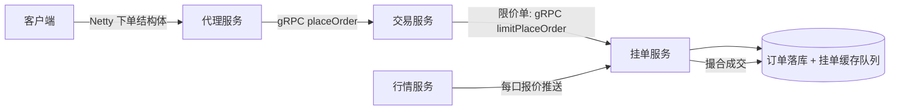

# 限价委托全链路：挂单 gRPC 接口、行情监听撮合、并发锁验证与功能联调

市价单是一次性成交，限价委托则要把订单挂进队列，跟着实时行情反复撮合。这一章把整条链路完整实现了一遍：挂单服务对外提供 gRPC 限价委托接口，订单落库并进入按股票分组的缓存队列；行情每推送一口报价，监听器就撮合一轮；交易服务在统一下单接口里按订单类型分流；最后用一次性成交和多次撮合两类请求做联调验证。

## 先给结论

- 挂单接口只做两件事：把订单持久化到数据库（状态待成交，成交价、成交量都是 0），再把请求放进按股票 ID 分组的缓存队列；队列 key 带上服务端口，为后续水平扩展留了口子。
- 新挂单入队前必须按"价格优先、时间优先"重排，一个 Stream sorted 就够：价格降序在前、时间升序在后，买方向价高者排最前，同价按请求时间先后。
- 行情监听是撮合的驱动源：@StreamListener 收到每口报价后交给线程池处理，先按股票 ID 拿 synchronized 对象锁（锁的是静态 Map 里的对象引用，锁值并不生效），再遍历队列逐单校验价格、撮合成交，execVolume 归零就从队列剔除并回写缓存。
- 撮合与市价单的核心差异在成交记录的生成：限价必须逐档校验深度报价，当前档位数量不够就吃下一档；订单可能部分成交，要回算剩余委托量，订单查不到时还会做一次补偿构造。
- 并发锁方案用自测验证过：10 线程各 1000 次随机累加，不加锁两套计数对不上，加对象锁后普通累加与 AtomicInteger 完全一致。
- 联调口径：即使请求价格符合当前行情，也必须走挂单接口，防止档位流通量不足时丢单；16000（小于卖一量 19168）一次撮完，26000 分两笔成交 19168 加 6832。

## 挂单接口：生成订单、重排入队

先看整体链路，客户端到挂单服务要经过三层转发，真正的撮合发生在挂单服务内部：



限价委托接口是挂单服务内部给交易服务用的 gRPC 接口，外层 Netty 与客户端仍然沿用之前的下单结构体，不需要新定义。接口处理分五步：取行情报价、组装请求 VO、创建订单、放入缓存队列、返回响应。

```java
@Override
public void limitPlaceOrder(LimitPlaceOrderRequest request,
                            StreamObserver<LimitPlaceOrderResponse> responseObserver) {
    // 1. 根据股票ID获取实时行情报价
    TradeStockQuoteLast stockQuoteLast =
            stockTradePendingService.getTradeStockQuoteLast(request.getStockId());
    // 2. 创建委托单请求VO，复制gRPC参数
    LimitPlaceOrderRequestVo placeOrderRequestVo = new LimitPlaceOrderRequestVo();
    BeanUtils.copyProperties(request, placeOrderRequestVo);
    // 3. 创建并保存订单信息
    stockTradePendingService.createTradeOrder(placeOrderRequestVo);
    // 4. 放入缓存队列，等待撮合处理
    // 5. 组装响应返回调用方
}
```

createTradeOrder 是订单落库的关键：先设置买卖方向、股票 ID、交易账户 ID，再查出股票和账户的完整信息做冗余（股票编号、股票名称、账户编号）。下单信息里 requestPrice 记录请求价格，此时还没撮合，成交价和成交量都先置 0，状态记为 ORDER_STATUS_WAIT 等待成交，成交时间取当前服务器时间，最后 insert 入库并把生成的订单 ID 回填到请求 VO，方便后续队列撮合时关联。

缓存队列按两个维度组织。外层 key 是 GlobalConstants.STOCK_PENDING_LIMIT_ORDER 拼上 serverPort（通过 @Value("${server.port}") 注入），每个挂单服务实例只处理自己的队列；内层再按股票产品 ID 分组，中国平安的下单请求归中国平安的队列，工商银行的归工商银行的队列。新请求进来时如果该股票的队列已存在，就取出 List、重排后追加；不存在就新建 ArrayList，先排序再 put 进缓存。

重排就是"价格优先、时间优先"，代码量很少：

```java
private static List<LimitPlaceOrderRequestVo> sortPlaceOrderRequestVoList(
        List<LimitPlaceOrderRequestVo> placeOrderRequestVoList) {
    return placeOrderRequestVoList.stream()
            .sorted(Comparator.comparing(LimitPlaceOrderRequestVo::getExecPrice).reversed()
                    .thenComparing(LimitPlaceOrderRequestVo::getExecTime))
            .collect(Collectors.toList());
}
```

排序前有个细节：对成交价格做判空兜底（空值默认 0），成交时间为空就取当前毫秒，避免排序时空指针。每来一张新挂单都要重新比较排序，因为新单价格可能高于队头，不重排就破坏了盘口档位。

这个重排是核心逻辑，值得马上自测。main 方法里构造四条数据（注意 execPrice 是长整型，不支持双精度，测试值改成 118、119）：p1 价格 118、时间取当前；p2 价格 118、时间加 30 毫秒；p3 价格 119、时间加 90 毫秒；p4 价格 118、时间加 30 毫秒。给每条设置订单 ID 1 到 4，运行后输出顺序是 3、1、2、4：119 价格最高排第一；剩下三条都是 118，p1 时间最早居首，p2 与 p4 价格时间完全一致，按接收顺序 p2 在前。卖方向的重排价格反过来，价低者优先，可以照此自行扩展。

课程里反复强调一个习惯：重要核心功能要养成单元测试或自测验证的习惯。像撮合这种依赖行情场景的功能，等进入测试阶段再造符合条件的批量数据，时间和成本都高，写代码时就自测能极大减少后期排查成本。

## 行情监听：对象锁、线程池与撮合循环

挂单服务订阅行情数据，每收到一口行情报价，都要检测挂单队列并撮合匹配成交条件的订单。监听入口在 PendingQuoteConsumer：

```java
@StreamListener("quote")
public void receiveInput(@Payload TradeStockQuoteLast quoteLastMsg) {
    log.info("Process in PendingQuoteConsumer.receiveInput method, quoteLastMsg: " + quoteLastMsg);
    taskExecutor.execute(() -> {
        // 撮合处理逻辑
    });
}
```

整个处理流程六步：按股票 ID 加锁、取挂单缓存队列的 key、按股票 ID 取队列数据、定义队列变更标记、遍历队列逐单匹配、按标记回写缓存。为了提升处理速度用了线程池，但修改缓存必须保证线程安全，外层的锁就是干这个的：

```java
private static Long getLock(Long stockId) {
    if (null == lockKeys.get(stockId)) {
        lockKeys.put(stockId, stockId);
    }
    return lockKeys.get(stockId);
}
```

锁对象必须用 static 存储，静态对象常驻内存。更关键的一点：synchronized 传对象引用才能锁住，只传一个值是不会真正生效的，所以这里返回的是 Map 里存的 stockId 对象本身。

撮合循环的主体：

```java
synchronized (getLock(stockId)) {
    String cacheKey = GlobalConstants.STOCK_PENDING_LIMIT_ORDER + "_" + serverPort;
    Cache cache = cacheManager.getCache(cacheKey);
    ValueWrapper stockCache = cache.get(stockId);
    if (null != stockCache && null != stockCache.get()) {
        List<LimitPlaceOrderRequestVo> voList = (List<LimitPlaceOrderRequestVo>) stockCache.get();
        boolean listChange = false;
        for (Iterator<LimitPlaceOrderRequestVo> itr = voList.iterator(); itr.hasNext(); ) {
            LimitPlaceOrderRequestVo placeOrder = itr.next();
            boolean matchPrice = stockTradePendingService.checkMatchPrice(placeOrder, quoteLastMsg);
            if (matchPrice) {
                stockTradePendingService.processMarketOrder(placeOrder, quoteLastMsg);
                if (placeOrder.getExecVolume() == 0) {
                    itr.remove();   // 完全成交，从队列剔除
                    listChange = true;
                }
            }
        }
        if (listChange) {
            cache.put(stockId, voList);
        }
    }
}
```

每个挂单的匹配处理单独包一层异常捕获：某张挂单出问题不能阻塞队列里后面挂单的运行。价格匹配和成交信息生成放在 service 层实现，下一节展开。

锁方案到底有没有效，光看代码说不算，要验证。客户端联调很难模拟并发：得开大量客户端同时发挂单，数据还必须与实时行情匹配。所以这里直接写自测：构造 10 个行情对象（stockId 从 60000 到 60009），开 10 个线程各循环 1000 次，每次随机选一个对象，在 synchronized(getLock(stockId)) 里同时做两种累加，普通方式 volume 加 1，线程安全方式用对象里的 AtomicInteger 调 incrementAndGet。主线程 sleep 5 秒等任务跑完，再逐个打印 total（原子计数）和 actual（普通累加）。不加 synchronized 时两个值不一致，出现了线程安全问题；加上与挂单队列完全相同的锁逻辑后，两者完全一致，说明对象锁方案真实生效。有些对象 total 是 900 多、有些 1000 多，只是随机选取造成的次数不均，关注点始终是两套计数是否相等。课程里演示用 main 方法只是为了简化，正规项目建议用 JUnit 做单元测试。

## 撮合核心：逐档校验与部分成交

挂单撮合与市价下单的整体流程相似，差异要从概念上分清：市价单不指定价格，有充足数量就一次性成交；限价挂单必须匹配价格，可以挂在队列里多次成交，只要不撤单，就一直跟随实时行情撮合。

价格校验按买卖两个方向判断：买方向的请求价格要大于等于第一档卖盘价格（卖方最低报价）才能撮合；卖方向的请求价格要小于等于第一档买盘价格（买方最高出价）。匹配结果反馈为布尔值，不符合直接跳过。

processMarketOrder 的流程与市价单基本一致：获取交易账户、获取股票产品、生成成交记录、生成持仓信息、生成订单信息、保存订单、保存持仓，方法上加 @Transactional 保证异常回滚。真正的差异集中在 generateTradeDeal 和 generateTradeOrder 两个方法。

generateTradeDeal 先把最后一口行情报价转换为深度报价结构，再逐档处理：

```java
long amount = 0;
long volume = 0;
long needVolume = request.getExecVolume();
for (Map.Entry<Long, Long> deepOffer : deepOffers.entrySet()) {
    if (!checkMatchDeepPrice(request, deepOffer.getKey())) {
        continue;   // 该档位价格不匹配，看下一档
    }
    if (needVolume <= deepOffer.getValue()) {
        amount += needVolume * deepOffer.getKey();
        volume += needVolume;
        needVolume = 0;
        break;      // 当前档位量够，吃完结束
    } else {
        needVolume = needVolume - deepOffer.getValue();
        amount += deepOffer.getKey() * deepOffer.getValue();
        volume += deepOffer.getValue();
    }
}
```

成交均价按档位加权：各档位价格乘数量求和，除以总数量。当前档位满足不了请求数量就扣减后进入下一档，迭代循环直到吃满。

generateTradeOrder 处理部分成交的订单更新。订单查不到时会构造新订单，这是一层补偿：正常情况下挂单接口已经把订单持久化，这段逻辑防的是挂单接口持久化失败时这里还能补救。订单成交价格为 0 说明是待成交状态的第一次处理，直接记录成交均价；价格不为 0 说明之前已撮合成交过，要按上一次成交均价与本次成交均价再求平均更新均价，同时累计成交量、更新订单成交状态。持仓成本价的更新同样要区分买卖方向做加权计算，与市价单的处理一致。

最后更新挂单剩余请求数量保存进缓存队列，供下一次撮合使用，这就是部分成交的支撑。另外两点背景值得记住：实际应用里撮合还要判断是否在交易时间内、账户资金是否充足（资金逻辑在后面章节）；真实交易所每一口报价都会影响行情，具备撮合资质的正规机构很少，本课程基于第三方行情源做的是模拟盘撮合，但机制与实盘一致，实盘撮合每成交一笔价格就会变化，需要同步修改行情数据，可以基于现有逻辑配合双队列方案去改造。

## 交易服务接入与功能联调

交易服务的下单接口此前只处理市价单，客户端对两种单统一走一个下单接口，所以只需要在 GrpcStockDealService.placeOrder 里按订单类型分流，增加限价单分支：

```java
if (request.getType() == GlobalConstants.ORDER_TYPE_MARKET) {
    // 市价单：直接撮合，返回成交记录ID
} else if (request.getType() == GlobalConstants.ORDER_TYPE_LIMIT) {
    LimitPlaceOrderRequest.Builder orderRequest = LimitPlaceOrderRequest.newBuilder();
    BeanUtils.copyProperties(request, orderRequest);
    LimitPlaceOrderResponse limitResp =
            stockPendingServiceBlockingStub.limitPlaceOrder(orderRequest.build());
    response = PlaceOrderResponse.newBuilder()
            .setStatus(limitResp.getStatus())
            .setOrderId(limitResp.getOrderId())
            .setMessage(limitResp.getMessage())
            .build();
}
```

两个容易踩的点：一是挂单此时只是进了缓存队列，还不知道能不能成交，所以响应里只能带订单 ID，拿不到成交记录 ID；二是 PlaceOrderResponse 与 LimitPlaceOrderResponse 是两个类型，不能直接赋值，要逐字段重新组装。gRPC 客户端用 @GrpcClient 注入指向挂单服务的 BlockingStub，工程配置里补上对应调用配置：

```yaml
grpc:
  client:
    grpc-pending-server:
      address: 'discovery://stock-pending'
      enableKeepAlive: true
      keepAliveWithoutCalls: true
      negotiationType: plaintext
```

接入前还有个必须想清楚的设计问题：如果实时行情价格已经符合限价委托的价格，还要走挂单接口吗？答案是必须走。因为存在流通量不足的情况，当前档位数量满足不了请求数量时要跨多个档位成交，按市价逻辑处理只会成交一部分，剩下的数据可能就丢了，所以限价单一律进挂单队列统一处理。

功能验证启动行情、交易、挂单、代理四个服务，外加 Nacos、Redis 中间件，测试主机内存最好加大。验证分两个维度。

第一个维度模拟一次性成交：挂单数量不超过当前档位数量。查中国平安（股票 ID 为 1）的实时行情，卖一档价格 7223、卖一量 19168。模拟器 placeOrder 设置 direction 为 0、execPrice 为 7223、volume 为 16000、stockId 为 1、type 为 1（0 市价、1 限价）。下单成功返回订单 ID 2530，查 t_trade_order 表：初始数量 16000，成交数量和成交价格都是 0，这正对应挂单接口的两件事，生成订单加放入挂单队列。等行情推送撮合后再查，2530 已写入实际成交数量和成交价格，t_trade_deal 表生成一条订单 ID 为 2530 的成交记录，金额数量与订单信息一致。

第二个维度模拟多次撮合：委托数量改成 26000，大于卖一量 19168。下单返回订单 2531，等待行情推送后查询，初始数量 26000、实际成交数量 26000，成交记录生成了两条：第一笔 19168（第一档的最大数量），第二笔 6832（剩余委托量），两笔相加正好是 26000。两个场景都通过，限价委托挂单的处理链路验证完成。

## 小结

本章的学习目标有三点：实现限价委托挂单的处理功能、掌握模拟盘挂单撮合的交易处理逻辑与缓存队列运用、掌握 synchronized 全局对象锁在高并发场景下对线程安全的保障。落到实现上，挂单服务有两个核心环节：挂单接口负责生成订单和入队重排；行情监听负责每口报价驱动下的匹配撮合，部分成交更新订单并生成成交记录，完全成交直接从队列剔除。撮合的核心逻辑与市价单同源，差异在深度报价逐档校验和剩余量的处理。

几条工程经验值得沉淀：核心功能写代码时就自测，测试阶段再造数据成本太高；锁要按股票 ID 细粒度控制，盲目扩大锁范围会拖垮性能；缓存队列 key 带服务端口，每个实例只处理自己的队列，彼此互不干扰，为水平扩展打好基础。
