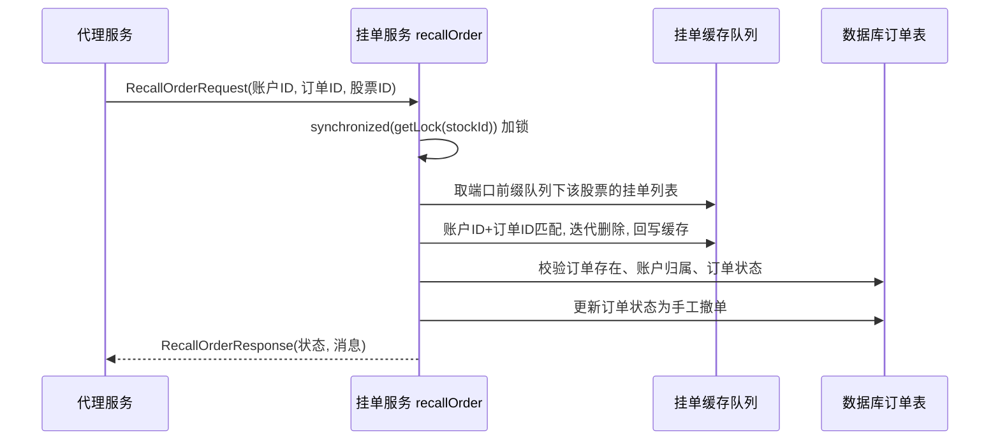

# 用户撤单闭环：流程设计、挂单/代理双服务实现与验证

市价单一次撮完没有撤回的余地，限价挂单不一样，订单挂在队列里等待撮合，用户随时可以撤回。市场交易中用户大多采用限价委托挂单，撤单接口因此成了必需品。这一章把撤单从协议定义做到功能验证：挂单服务实现 recallOrder 的 gRPC 接口，代理服务增加处理器透传客户端请求，最后用待成交和部分成交两种订单状态验证闭环。

## 先给结论

- 撤单要定义两层数据结构：Netty 与客户端交互层的 RecallOrderData 只带订单 ID 和股票产品 ID，响应复用 Head 头部的状态位；内部 gRPC 层的 RecallOrderRequest 多一个交易账户 ID，因为撤单必须做账户归属校验。
- 挂单服务 recallOrder 的核心动作：加锁后从缓存队列里按账户 ID 加订单 ID 匹配，命中就迭代删除并回写缓存，再由 service 层校验订单状态后把数据库订单改为手工撤单。
- 权限红线：队列匹配和数据库校验都必须带上交易账户 ID，否则随便传一个订单号就能撤掉别人的单；只有待成交和部分成交状态允许撤回，完全成交直接拒绝。
- 调用顺序有讲究：先处理缓存再操作数据库。缓存清完数据库失败时，恢复后重试仍然能成功；反过来先改库，重复调用时条件校验就通不过了。
- 代理服务沿用工厂模式扩展：新增 StockRecallOrderProcessor 处理器，工厂方法按撤单请求类型路由，配置里加挂单服务的 gRPC 调用信息。
- 验证结论：待成交订单 2533 撤单后状态变为 3（手工撤单）；多次撮合的订单 2534 部分成交后同样撤单成功，两种主要场景都通过。

## 接口设计：Netty 与 gRPC 两层数据结构

撤单接口的参数本身很简单，但协议要分两层定义，一层是 Netty 与客户端的对外传输结构，一层是微服务之间的内部 gRPC 通讯结构。

对外层修改 StockMessage.proto，在消息体的 oneof 里增加撤单请求包：

```protobuf
oneof StockData {
  LoginData loginData = 2;
  PlaceOrderData placeOrderData = 3;
  KlineData klineData = 4;
  RecallOrderData recallOrderData = 5;   // 撤单的请求包
}

message RecallOrderData {
  int64 orderId = 1;   // 订单ID
  int64 stockId = 2;   // 股票产品ID
}
```

撤单响应不需要单独定义包体，通过 Head 头部消息标示处理状态，客户端知道撤单是否成功就够了。股票产品 ID 必须传，因为挂单数据是按股票产品 ID 分组汇总的，靠它才能定位到对应的挂单队列缓存。

对内层修改 StockPendingService.proto，在挂单服务里新增撤单接口：

```protobuf
service StockPendingService {
  // 限价委托下单接口
  rpc limitPlaceOrder (LimitPlaceOrderRequest) returns (LimitPlaceOrderResponse) {}
  // 撤单接口
  rpc recallOrder (RecallOrderRequest) returns (RecallOrderResponse) {}
}

message RecallOrderRequest {
  int64 accountId = 1;   // 交易账户ID
  int64 orderId = 2;     // 订单ID
  int64 stockId = 3;     // 股票产品ID
}

message RecallOrderResponse {
  int32 status = 1;      // 处理状态
  string message = 2;    // 响应消息
}
```

内部 gRPC 请求比 Netty 层多了账户 ID，响应只需要标记接口处理成功或失败。定义完成后在 proto 目录打开终端，先执行 protoc 的批处理脚本生成 gRPC 层代码，再执行 Netty 层对应的 bat 脚本。有个小坑：两层数据结构各自有自己的生成脚本，跑同一个脚本只会生成一边，生成后要分别刷新工程确认 RecallOrderRequest、RecallOrderResponse 和 RecallOrderData 都在。

## 挂单服务：加锁、匹配清除与状态校验

挂单服务的撤单接口做两件事：匹配并清除缓存队列里的挂单，以及撤回数据库里的订单。整条链路如下：



第一步是加锁，防止队列缓存数据不一致。撤单接口和挂单接口、行情监听都要操作同一批缓存队列，锁必须共用同一套：把 PendingQuoteConsumer 里的 getLock 方法改成 public 复用，仍按股票产品 ID 锁对象引用，挂单接口对队列的操作和撤单接口的操作之间就不会出现并发安全问题。

外层方法整体是 try-catch 结构，业务异常 ComponentException 和系统异常分开捕获，各自组装错误响应，最后统一 onNext 返回并 onCompleted 标记完成。核心处理逻辑：

```java
synchronized (PendingQuoteConsumer.getLock(request.getStockId())) {
    // 缓存key不存在或队列为空，抛业务异常：订单已处理
    ValueWrapper stockCache = cache.get(request.getStockId());
    if (null != stockCache && null != stockCache.get()) {
        List<LimitPlaceOrderRequestVo> voList = (List<LimitPlaceOrderRequestVo>) stockCache.get();
        boolean isModify = false;
        for (Iterator<LimitPlaceOrderRequestVo> itr = voList.iterator(); itr.hasNext(); ) {
            LimitPlaceOrderRequestVo placeOrder = itr.next();
            // 账户ID与订单ID双条件匹配
            if (placeOrder.getOrderId().equals(request.getOrderId())
                    && placeOrder.getAccountId().equals(request.getAccountId())) {
                itr.remove();
                isModify = true;
                break;
            }
        }
        if (isModify) {
            cache.put(request.getStockId(), voList);
        }
    }
}
```

队列匹配的条件是账户 ID 加订单 ID 双重比较。课程里特别强调：必须加上交易账户 ID 的比较，否则随便传入一个订单 ID 就能把别人的挂单撤掉，这是权限控制的红线。匹配成功就迭代删除、置位变更标记并跳出；没有匹配则不动队列也不更新缓存。挂单队列缓存不存在时抛出业务异常，提示订单已处理，因为订单可能已被撮合，或者根本没收到过这张挂单。

数据库侧的撤回放在 service 层实现，重点是三层条件校验：

```java
public void recallOrder(RecallOrderRequest request) throws ComponentException {
    TradeOrder order = tradeOrderDao.getById(request.getOrderId());
    if (null == order) {
        throw new ComponentException(ApplicationErrorCodeEnum.ORDER_NOT_FOUND);
    }
    if (!order.getAccountId().equals(request.getAccountId())) {
        throw new ComponentException(ApplicationErrorCodeEnum.ACCOUNT_NOT_MATCH);
    }
    if (order.getStatus() == GlobalConstants.ORDER_STATUS_WAIT
            || order.getStatus() == GlobalConstants.ORDER_STATUS_PART) {
        // 待成交、部分成交才允许撤回
        tradeOrderDao.updateOrderStatusById(request.getOrderId(),
                GlobalConstants.ORDER_STATUS_MANUAL_CANCEL);
    } else {
        // 完全成交不允许撤回
        throw new ComponentException(ApplicationErrorCodeEnum.ORDER_NOT_RECALL);
    }
}
```

订单不存在抛订单未找到；账户 ID 与订单归属不一致抛账户不匹配；状态只有待成交和部分成交两种允许撤回，完全成交的订单不允许撤。更新状态用的是手工撤单常量，它和系统撤单不同：手工撤单是用户主动操作，系统撤单是系统结算时自动进行的，两者含义要分清。

处理顺序的设计值得单独说一笔：这里是先处理缓存、再处理数据库。如果缓存清除成功但数据库操作异常，等数据库恢复正常后重新调用仍然能成功，保证了一致性；反过来先操作数据库，重复调用时条件校验就通不过，会直接抛异常。接口调用不能保证百分之百成功，容错路径要在设计时想清楚。

## 代理服务接入与功能验证

代理服务的调用处理相对简单，职责是把客户端的撤单请求透传给挂单服务。在 processor 包下新建撤单处理器 StockRecallOrderProcessor，实现统一的处理器接口，处理流程三步：从 StockMessage 里取出 RecallOrderData，组装 gRPC 调用请求（交易账户 ID、订单 ID、股票产品 ID），通过 BlockingStub 调用挂单服务的 recallOrder，最后组装响应包文经 Channel 连接通道传回客户端。业务异常与系统异常分开捕获，分别用 generateStockHead 生成响应头回写状态。

处理器要接到工厂里才生效：StockProcessorFactory 注入撤单处理器，generateStockProcessor 方法里按请求类型增加撤单分支，收到撤单类型的请求就返回这个处理器。配置文件补上挂单服务的调用信息，客户端名称要和 @GrpcClient 里写的保持一致：

```yaml
grpc:
  client:
    stock-pending-server:          # 与 @GrpcClient 名称一致
      address: 'discovery://stock-pending'
      enableKeepAlive: true
      keepAliveWithoutCalls: true
      negotiationType: plaintext
```

验证前先改造模拟器。BusinessHandler 里新增撤单调用方法，参数是订单 ID，这样终端测试时可以输入不同订单号；请求里的股票产品 ID 默认置 1，撤其他股票的订单要记得改。ClientBoundHandler 的 showMenu 增加菜单项 4（recall order），指令处理里用 readInput 接收用户输入的订单 ID 字符串，转成 Long 后调用撤单方法。

测试启动交易服务、挂单服务、代理服务和模拟客户端（服务地址 127.0.0.1），分两个场景验证。

场景一验证待成交订单撤单：登录后下一笔订单，返回订单 ID 2533；输入指令 4，再输入订单 ID 2533 确认，控制台返回撤单处理成功。查数据库 t_trade_order 表，2533 的订单状态已改为 3，对照表结构的状态说明：0 是待成交，1 是部分成交，3 是手工撤单。

场景二验证部分成交订单撤单：部分成交需要行情驱动，先启动行情服务，推送频率是 30 秒一次。下单数量沿用之前限价委托验证的口径 26000，能触发多次撮合。模拟客户端下单得到订单 2534，此时成交数量 0、状态待成交；刷新后订单进入部分成交状态。这里有个测试技巧：马上停掉行情服务，防止下一口行情推送把订单推成完全成交。确认状态是 1 后，输入指令 4 加订单 ID 2534 撤单，返回处理成功，数据库里 2534 的状态同样变为 3。

两种主要场景都验证通过。课程还留了几道自测题：对已完全成交的订单再次撤回看处理结果，对已经撤回的订单重复发撤单请求看返回，多维度验证能加深对业务的理解，也能发现实现里的缺陷。

## 小结

撤单的处理逻辑比挂单接口和市价单都简单，真正的难点在条件校验和调用顺序上。条件校验避免数据错乱：订单存在性、账户归属、订单状态三道关卡一个都不能少；调用顺序上先缓存后数据库，为异常场景留出重试空间；账户信息的判断关系到权限安全，所有和用户相关的接口都要做必要的账号检查，不能出现越权，这是数据安全问题。

实现层面还有两点要照顾到：撤单会修改缓存队列数据，必须用同步锁保障线程安全，这里沿用按股票 ID 的对象锁方案；接口调用无法保证百分之百成功，某些场景下要考虑容错性。学撤单不只是完成这一个功能，更重要的是掌握这种处理思路：把条件校验、权限控制、线程安全、容错设计都想到位，才能写出健壮稳定、高性能、数据安全性高的接口。
