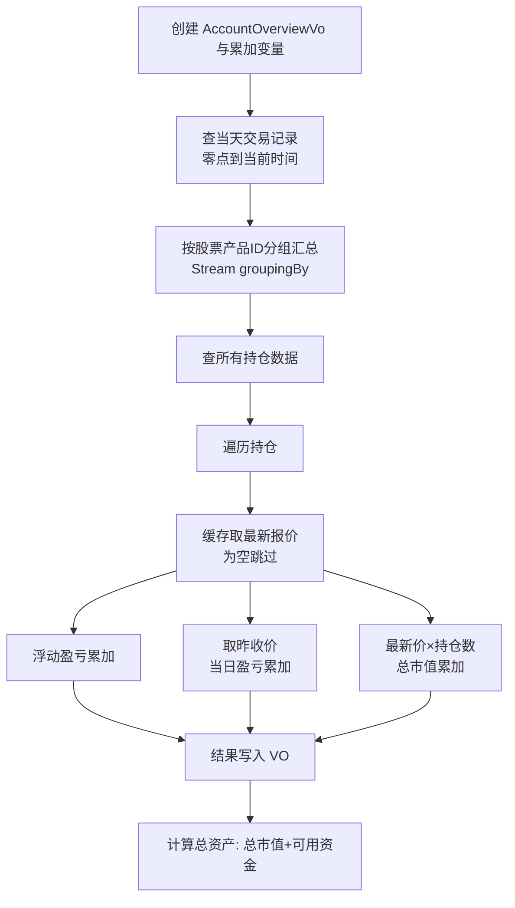

# 仓位总览联调验证 + 账户资金总览：计算公式、gRPC 接口与业务层实现

仓位总览的服务端实现上一篇已经完成，这一篇先收尾：代理服务加处理器透传，客户端发指令联调，把盈亏数据真正跑出来，过程中会撞上两个典型问题。随后进入第三章账户资金总览：搭建资金服务、理清总资产到当日持仓盈亏的计算公式，再走一遍协议定义、gRPC 接口与业务层主流程的实现。资金总览这一章的重点在金融业务本身，代码反而是围绕公式展开的。

## 先给结论

- 代理侧是标准套路：新建 StockPositionProcessor 继承 AbstractStockProcessor，@GrpcClient 注入 BlockingStub，账户 ID 从通道缓存取、客户端不传，工厂 switch 加 GET_POSITION 分支，配置里挂 discovery://stock-position。
- 联调撞到两个坑：盈亏为 0 时 proto3 不序列化默认值字段，客户端看起来像没有盈亏；模拟行情只产生随机价格、不更新行情缓存，切到真实行情源刷新缓存后盈亏才会变化。
- 资金服务多引入 Seata 分布式事务：下单流程横跨订单服务与资金服务，课程选了相对稳定的 0.9.0 版本，启动类同时开启事务管理。
- 资金总览五个指标全部用长整型：总资产 = 总市值 + 可用资金，总市值 = Σ(最新价 × 持仓股数)，持仓盈亏与浮动盈亏同口径，当日持仓盈亏还要叠加当日买卖产生的收益。
- 当日持仓盈亏的难点在还原原持仓数量：持仓表存的是最新数量，要用当前数量加当日卖出减当日买入追溯昨日持仓，再乘(最新价 - 昨收价)。
- 业务层的性能设计：一次性查出当天全部交易记录，按股票产品 ID 分组后再遍历持仓，避免循环里逐条查库；总资产依赖总市值与可用资金，放到最后计算。

## 仓位总览收尾：代理转发与功能验证

代理服务在 processor 包下新建 StockPositionProcessor，继承抽象类 AbstractStockProcessor 并实现公用接口 IBaseStockProcessor，用 @GrpcClient 注入持仓服务的 BlockingStub：

```java
@Service
@Log4j2
public class StockPositionProcessor extends AbstractStockProcessor implements IBaseStockProcessor {

    @GrpcClient("grpc-position-server")
    private StockPositionServiceGrpc.StockPositionServiceBlockingStub stockPositionServiceStub;

    @Override
    public void processRequest(ChannelHandlerContext channelHandlerContext, StockMessage stockMessage) {
        ResponseMessage responseMessage = null;
        try {
            // 构造请求: 账户ID从通道缓存获取, 客户端不需要传递
            GetAllPositionRequest request = GetAllPositionRequest.newBuilder()
                    .setAccountId(getUserAccountId(channelHandlerContext))
                    .build();
            // 调用gRPC持仓服务
            GetAllPositionResponse response = stockPositionServiceBlockingStub.getAllPositions(request);
            if (null != response && response.getGetAllPositionDataList().size() > 0) {
                // 遍历转换成Netty传输的响应数据包(集合结构)
                GetAllPositionList.Builder positionListBuilder = GetAllPositionList.newBuilder();
                for (int pos = 0; pos < response.getGetAllPositionDataList().size(); pos++) {
                    GetAllPositionData.Builder positionData = GetAllPositionData.newBuilder();
                    BeanUtils.copyProperties(response.getGetAllPositionDataList().get(pos), positionData);
                    positionListBuilder.addGetAllPositionData(positionData);
                }
                // 组装完整返回报文
                StockHeadProto.StockHead stockHead =
                        generateStockHead(stockMessage.getStockHead(), response.getStatus());
                responseMessage = ResponseMessage.newBuilder()
                        .setStockHead(stockHead)
                        .setGetAllPositionList(positionListBuilder)
                        .build();
            }
        } catch (ComponentException e) {
            // 业务异常返回
            log.error("业务异常", e);
            StockHeadProto.StockHead stockHead =
                    generateStockHead(stockMessage.getStockHead(), e.getErrorCodeEnum().getCode());
            responseMessage = ResponseMessage.newBuilder()
                    .setStockHead(stockHead).setMessage(e.getErrorMessage()).build();
        } catch (Exception e) {
            // 系统异常返回
            log.error("系统异常", e);
            StockHeadProto.StockHead stockHead =
                    generateStockHead(stockMessage.getStockHead(), GlobalConstants.STATUS_ERROR);
            responseMessage = ResponseMessage.newBuilder()
                    .setStockHead(stockHead).setMessage(e.getMessage()).build();
        }
        // 通过Channel通道输出给客户端
        channelHandlerContext.writeAndFlush(responseMessage);
    }
}
```

处理流程与之前的处理器一致：构造请求，账户 ID 从通道缓存里取；调用 gRPC 拿到持仓集合后遍历转换成 Netty 传输的响应数据包；业务异常 ComponentException 与系统异常分开捕获，各自用 generateStockHead 回写状态；最后 writeAndFlush 输出。接着做两件收尾：工厂 StockProcessorFactory 注入持仓服务处理器，switch 里为 GET_POSITION 类型返回它；工程配置增加 gRPC 持仓服务的调用信息，客户端名称与 @GrpcClient 保持一致：

```yaml
grpc:
  client:
    grpc-position-server:            # 与 @GrpcClient 名称一致
      address: 'discovery://stock-position'
      enableKeepAlive: true
      keepAliveWithoutCalls: true
      negotiationType: plaintext
```

客户端侧在 BusinessHandler 增加获取持仓数据的调用，这个接口不需要传任何参数，只要把请求类型标成获取所有持仓即可；交互菜单加一行查询用户持仓数据的入口，操作指令是 6，同样没有输入参数。

联调时依次启动交易服务、持仓服务、代理服务和模拟客户端。登录后先看数据库持仓表：当前两条记录，股票 ID 为 1 和股票 ID 为 4 的持仓。输入指令 6，客户端收到两条持仓数据，与数据库对得上，但此时看不到浮动盈亏。这是第一个坑：当前行情报价与持仓成本价一致，浮动盈亏都是 0，而 PB 数据结构对为 0 的属性并不会展示。于是启动行情服务，推送模拟行情，价格产生随机变化后再查持仓，还是没有盈亏。这是第二个坑：行情服务开的是模拟行情推送，模拟行情生成随机价格后并不会更新最新的缓存行情报价，翻看它的发送处理逻辑，生成完随机价格后没有更新缓存的操作。解决办法是切到真实行情源推送，让行情服务抓取最新行情、把缓存里的价格刷新掉。切完再启动行情服务，客户端收到最新行情后，先停掉行情服务防止继续推送，再发指令 6，盈亏金额和盈亏比例就出来了，股票 ID 1 的持仓盈亏信息也发生了变化。课程没有现场核对盈亏数值，留了作业：按实时行情价格和公式自行验证计算结果。

## 资金服务搭建：依赖、配置与 Seata

第三章账户资金总览要掌握两点：一是实现资金总览功能，用户能看到总资产、总市值、可用资金等信息；二是理解持仓盈亏与当日持仓盈亏这两条计算规则的区别，这块偏金融业务知识。步骤是：资金服务搭建与配置、计算公式介绍、定义接口数据结构、资金服务实现总览接口、昨收价生成机制、客户端实现与验证。

资金服务 bulls-stock-finance 负责账户资金功能处理，包含账户总览、资金调整与变动等功能。新建模块与基础包 com.itcast.bulls.stock.finance，子包建 config、dao、grpc、service、startup、vo。依赖清单与持仓服务基本同款：Spring Boot、Nacos 注册发现、公用数据层/服务层/工具类/实体组件、RocketMQ（要监听实时行情数据）、Redis 缓存、gRPC。多出来的是 Seata 分布式事务依赖：下单流程中订单服务处理订单信息，资金服务管理账户资金，两边分属不同服务，必须用分布式事务保证一致。Seata 迭代快，课程在父级工程定义 seata.version 属性，选了相对稳定的 0.9.0 版本，它在项目里的集成运用后面还会专门讲。

配置文件用 bootstrap.yml 挂 spring.profiles 动态变量实现多环境，开发环境放 bootstrap-dev.yml。要点包括：服务端口 10699、服务名 stock-finance、RocketMQ 消息订阅配置（group 组别注意不要与其他服务冲突）、双数据源（交易数据源加业务数据源）、Redis 缓存、JPA 与 MyBatis 配置（资金服务同样采用 MyBatis 双数据源方案）、gRPC 服务端配置和线程池配置。双数据源的三个配置类、DAO 数据层接口、Redis 配置都从已实现工程拷贝，重点核对 Mapper 接口扫描路径与 map 文件扫描路径都指向 finance 目录，Redis 使用配置里默认超时时间 24 小时。启动类 StockFinanceApplication 比持仓服务多一个注解：@SpringBootApplication、@EnableDiscoveryClient 之外，还要加 @EnableTransactionManagement 开启事务管理器，包扫描指向 com.itcast。

## 资金总览的计算公式

账户资金总览是从账户的资金维度，统计股票与资金关联的概要性数据，属于宏观汇总信息，包含总资产、总市值、持仓盈亏、当日持仓盈亏、可用资金这些交易用户最关心的指标。逐个看公式：

| 指标 | 计算公式 | 说明 |
|---|---|---|
| 总资产 | 总市值 + 可用资金 | 可用资金与所有股票市值两部分之和 |
| 总市值 | Σ(股票最新价 × 持仓股数) | 所有持仓股票按最新价计算后累加，随行情波动变化 |
| 持仓盈亏 | Σ(现价 - 持仓成本价) × 持仓股数 | 与之前浮动盈亏算法一致，逐只累加得总盈亏 |
| 当日持仓盈亏 | 原持仓当日收益 + 当日卖出收益 + 当日买入收益 | 与持仓盈亏概念相近，差别在时间维度：持仓盈亏是买入至今的总盈亏，当日盈亏只算当天行情变化的部分 |

前三条都直白，复杂在当日持仓盈亏。它的第一部分原持仓当日收益公式是：

```
原持仓当日收益 = (当前仓位总数量 + 当日卖出数量 - 当日买入数量) × (最新价格 - 昨日收盘价)
当日卖出收益 = (成交价格 - 昨收价格) × 卖出数量
当日买入收益 = (最新价格 - 成交价格) × 买入数量
```

用一个例子过一遍：昨天买 1000 股中国平安，今天当前仓位总数量就是 1000 股；当日卖出 500 股又买入 500 股，数量买卖抵消，当前仍是 1000 股。若最新价比昨收价涨了 1 元，原持仓当日收益就是 1000 × 1 = 1000 元。当日买入的部分：今天买入 500 股，成交价 11 元，最新价 12 元，价差 1 元的正收益，当日买入收益 500 元。

为什么原持仓当日收益不能直接拿当前仓位总数量乘价差？因为持仓表里的仓位数量是最新的持仓数量，并不是昨天的持仓数量。要算昨天那部分仓位的当日收益，必须先做还原：根据持仓记录表里当前持仓的最新数量，加上成交记录里当日的卖出数量、减去当日的买入数量，追溯出昨日持仓总数量，再乘最新价与昨收价的价差。这也是当日盈亏计算相对繁琐的原因，它多了一层时间范围的限定。

## 协议定义、gRPC 接口与业务层实现

数据结构照例分两层。Netty 对外层在 StockMessage.proto 里增加资金总览的返回数据结构 GetFinanceOverviewResponse，字段为总资产 totalAssets、总市值 totalMarketAmount、持仓盈亏 positionProfit、当日持仓盈亏 dayProfit、账户可用余额 balance，全部用长整型表示，避免计算和精度丢失问题；响应包里增加获取资金总览的数据包（序号 8）。请求侧不需要定义数据结构，不传任何参数属性，只在请求类型枚举里定义资金总览的接口号 DATA_FINANCE_OVERVIEW（序号 7），代理服务靠它取到交易账户 ID，后台再按账户 ID 返回数据。

对内 gRPC 层新建 stock_finance_service.proto，头部 option 的 java 类名改成 Finance，然后声明服务与消息体：

```protobuf
service StockFinanceService {
  // 获取账户资金总览接口
  rpc getFinanceOverview (GetFinanceOverviewRequest) returns (GetFinanceOverviewResponse) {}
}

message GetFinanceOverviewRequest {
  int64 accountId = 1;   // 交易账户ID, 由代理服务从缓存获取
}

message GetFinanceOverviewResponse {
  string status = 1;             // 处理状态
  string message = 2;            // 响应消息
  int64 totalAssets = 3;         // 总资产
  int64 totalMarketAmount = 4;   // 总市值
  int64 positionProfit = 5;      // 持仓盈亏
  int64 dayProfit = 6;           // 当日持仓盈亏
  int64 balance = 7;             // 账户可用余额
}
```

响应里的业务属性直接从 StockMessage 的返回结构拷贝过来，序号顺延为 3 到 7。分别执行 gRPC 与 Netty 的批处理脚本生成代码，确认 finance overview 相关类都生成到位。

资金服务的 gRPC 接口层先注入业务接口。业务接口 IStockFinanceService 此时还没有实现，先定义出来，实现类 StockFinanceServiceImpl 落在 service 包。grpc 包下新建 GrpcStockFinanceService 继承 StockFinanceServiceGrpc.StockFinanceServiceImplBase，加 @GrpcService 与 @Log4j2，重写 getFinanceOverview：

```java
@Override
public void getFinanceOverview(GetFinanceOverviewRequest request,
                               StreamObserver<GetFinanceOverviewResponse> responseObserver) {
    GetFinanceOverviewResponse response = null;
    try {
        // 调用业务接口获取账户资金总览的信息
        AccountOverviewVo accountOverviewVo = stockFinanceService.calAccountSummary(request.getAccountId());
        response = GetFinanceOverviewResponse.newBuilder()
                .setDayProfit(accountOverviewVo.getDayProfit())
                .setPositionProfit(accountOverviewVo.getPositionProfit())
                .setTotalMarketAmount(accountOverviewVo.getTotalMarketAmount())
                .setTotalAssets(accountOverviewVo.getTotalAssets())
                .setBalance(accountOverviewVo.getBalance())
                .setStatus(GlobalConstants.STATUS_OK)
                .build();
    } catch (ComponentException e) {
        // 业务异常返回
        log.error(e.getMessage(), e);
        response = GetFinanceOverviewResponse.newBuilder()
                .setStatus(e.getErrorCodeEnum().getCode())
                .setMessage(e.getErrorMessage()).build();
    } catch (Exception e) {
        // 系统异常返回
        log.error(e.getMessage(), e);
        response = GetFinanceOverviewResponse.newBuilder()
                .setStatus(GlobalConstants.STATUS_ERROR)
                .setMessage(e.getMessage()).build();
    }
    responseObserver.onNext(response);
    responseObserver.onCompleted();
}
```

注意 response 类型要导入 gRPC 包下面的类，别导成 Netty 层的同名结构。业务层返回值用一个 VO 对象承载，vo 包下新建 AccountOverviewVo，加 lombok 的 @Data 标记，属性五个：positionProfit 总持仓盈亏、dayProfit 当日持仓盈亏、totalMarketAmount 总市值、totalAssets 总资产、balance 账户余额，全部 long 类型。

业务层的实现按七步走，前两步是建 VO 和查交易记录，核心方法 calAccountSummary 的主流程如下：



对应到代码：

```java
@Override
public AccountOverviewVo calcAccountSummary(long accountId) throws ComponentException {
    // 1. 创建资金总览的VO返回对象
    AccountOverviewVo accountView = new AccountOverviewVo();
    long positionProfits = 0L;     // 持仓盈亏
    long dayProfits = 0L;          // 当日持仓盈亏
    long totalMarketAmount = 0L;   // 总市值

    // 2. 根据账户ID与时间范围获取今天的所有交易记录
    List<TradeDeal> dealList = tradeDealDao.getTradeDealByAccountAndTime(accountId,
            DateUtils.getFmtTodayStart(), DateUtils.getFmtTodayEnd());
    // 3. 按股票产品ID分组汇总, 便于遍历并减少SQL查询次数
    Map<Long, List<TradeDeal>> groupByDeals = dealList.stream()
            .collect(Collectors.groupingBy(TradeDeal::getStockId));
    // 4. 根据账户ID获取所有持仓数据
    List<TradePosition> positionList = tradePositionDao.getAllByAccountId(accountId);

    // 5. 遍历持仓, 计算资金总览信息
    for (TradePosition position : positionList) {
        TradeStockQuoteLast quoteLast = getTradeStockQuoteLast(position.getStockId());
        if (null == quoteLast) {
            continue;
        }
        // 浮动盈亏: (最新价-成本价)×持仓数量, 长整型保留两位小数
        long diffPrice = MathUtils.sub(quoteLast.getLastPrice(), position.getCostPrice());
        long profit = MathUtils.mul(diffPrice, position.getVolume());
        positionProfits += profit;
        // 当日盈亏: 先取昨收价, 再按交易记录计算单笔当日盈亏后累加
        long lastClosePrice = getStockQuoteClose(position.getStockId());
        dayProfits += calcTodayTradeDealProfits(groupByDeals, quoteLast, position, lastClosePrice);
        // 总市值: 最新价×持仓数量, 单笔累加
        totalMarketAmount += MathUtils.mul(quoteLast.getLastPrice(), position.getVolume());
    }

    // 6. 计算结果存入VO返回对象
    accountView.setDayProfit(dayProfits);
    accountView.setPositionProfit(positionProfits);
    accountView.setTotalMarketAmount(totalMarketAmount);
    // 7. 最后计算总资产
    calcTotalAssets(accountId, accountView);
    return accountView;
}
```

时间范围的口径值得注意：起始时间是当天零点，结束时间取当前时间点。交易时间内查询就是零点到当前的全部交易记录；交易结束之后数据不会再变，因为收盘后不能再买卖，所以结束时间传当前时间点即可。

第 3 步的分组是性能关键：不逐一查询数据库里的交易记录，而是先把当天所有交易记录全部查出，按股票产品 ID 用 Stream 的 groupingBy 分组，遍历持仓时直接从分组结果里取对应记录，减少 SQL 查询次数。总资产放最后一步，因为公式是总市值加可用资金，前面的市值算完它只剩一次加法：

```java
private void calcTotalAssets(long accountId, AccountOverviewVo accountView) throws ComponentException {
    // 获取交易账户信息, 账户里记录了可用资金
    TradeAccount account = tradeAccountDao.getById(accountId);
    if (null == account) {
        throw new ComponentException(ApplicationErrorCodeEnum.ACCOUNT_NOT_FOUND);
    }
    // 账户可用资金
    long balance = account.getBalance();
    accountView.setBalance(balance);
    // 总资产 = 总市值 + 可用资金
    accountView.setTotalAssets(accountView.getTotalMarketAmount() + balance);
}
```

账户不存在要抛 ComponentException，错误码用 ACCOUNT_NOT_FOUND，接口层的方法签名也要同步追加异常抛出。单笔当日盈亏的 calcTodayTradeDealProfits 与昨收价获取的 getStockQuoteClose 两个方法在这里先占位定义，具体实现连同昨收价生成机制放到后续章节展开；如果第三方行情源没有提供昨收价，就需要自己生成处理。

## 小结

仓位总览至此收尾。整个功能串起来是：持仓服务实现 getAllPositions，浮动盈亏逐条计算；代理服务 StockPositionProcessor 透传，工厂按 GET_POSITION 路由；客户端指令 6 验证。联调暴露的两个问题都有普遍性：proto3 默认值不序列化，为 0 的字段在客户端"消失"，排查时先确认数据是不是 0；模拟行情不回写缓存，依赖缓存行情的计算就拿不到新价格，测试时要走真实行情源。

课程最后给了生产环境的实现思路，比代码本身更有分量。风控要求高的系统如果要实现强平，就要监控所有账户所有仓位的实时盈亏变化：平台接入几百万用户、每人持有十来只股票，再叠加每秒多口的行情报价，数据量会到千万级，服务必须有极大的负载能力。所以仓位服务采用无状态设计支撑水平扩展，单节点有瓶颈就加节点提升吞吐；同时结合缓存，把仓位信息写入缓存做同步处理，浮动盈亏的计算从缓存取数加工，异步线程处理，相比查库有极大性能提升。金融业务服务的原则是先准确性后性能，不能本末倒置，数据的准确与安全在金融行业尤为重要，这个层面保不住，再好的性能也没有意义。IO 资源的使用同样要克制：能一次性查询的不要多次查询，能不查的尽量用缓存。资金总览的业务层实现也遵循同一套思路，剩余的当日盈亏明细与昨收价生成留待下一篇完成。
