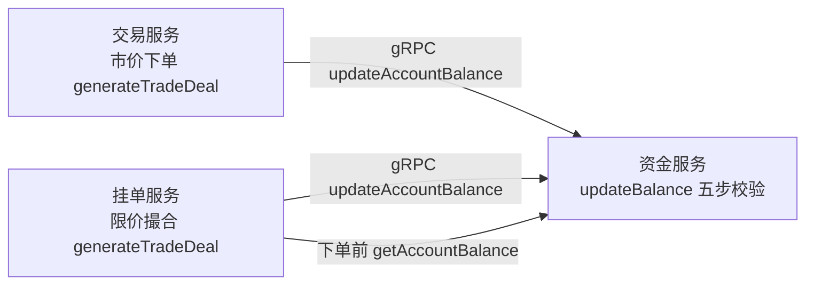

# 资金额度调整：资金、交易、挂单三服务联动与功能验证，SEATA 集成开篇

之前的下单和挂单只完成了业务逻辑，账户上的可用资金动都没动。第十七章把这块补上：由资金服务提供额度调整接口，交易服务的市价下单、挂单服务的限价撮合在生成成交记录时联动扣款，挂单前再做一道可用资金校验。三个服务围绕一个资金接口联动的结果是——功能跑通了，但跨服务、跨数据源的资金操作靠本地事务兜不住，于是本章末尾顺势切入第二章：引入 SEATA 做分布式事务。

## 先给结论

- 额度调整接口由资金服务提供，只对内不对外暴露：gRPC `updateAccountBalance`，请求带账户 ID、调整金额和 `xid`（为 SEATA 预留），响应把更新后的可用资金返回给调用方；适用场景除了下单扣款，还有入金（充值）、出金（提现）。
- 资金服务 `updateBalance` 固定五步：查账户、判空余额、`balance += adjustBalance`、余额小于 0 抛资金不足、更新数据库；方法加 `@Transactional(rollbackFor = Exception.class)`。
- 交易服务与挂单服务都在生成成交记录的 `generateTradeDeal` 方法最后追加资金调整调用，金额正负由买卖方向决定：买入为负扣资金，卖出为正加资金。
- 挂单服务在下单前还要调 `getAccountBalance` 校验：订单所需资金（数量 × 价格）大于可用资金就拒绝挂单；课程没采用冻结金额方案，但生产环境必须有。
- 三场景验证全部通过，不过 460 万的订单出现了 44 元误差，根因是成交均价四舍五入保留四位导致精度丢失；做对账和报表建议增加"实际总成交金额"字段。
- 跨服务资金一致性要靠分布式事务，第 2 章选 SEATA 0.9.0：服务端 `file.conf` 改三处，`db_store.sql`、`db_undo_log.sql` 两个脚本初始化数据库。

## 接口定义与资金服务的五步实现

额度调整功能与账户资金有关，通过资金服务实现。它是给内部服务调用的接口，不对外暴露——凡是操作账户资金的接口，都应放在内部调用处理。在公用 PB 数据结构工程的 `StockFinanceService.proto` 里追加接口与两个消息体：

```protobuf
// 更新账户资金的接口
rpc updateAccountBalance(UpdateBalanceRequest) returns (UpdateBalanceResponse);

// 更新资金请求的数据结构
message UpdateBalanceRequest {
    int64 accountId = 1;      // 交易账户 ID
    int64 adjustBalance = 2;  // 要调整的资金额度
    string xid = 3;           // SEATA 分布式事务全局事务 ID，后续章节使用
}

// 更新资金的返回数据结构
message UpdateBalanceResponse {
    string status = 1;
    string message = 2;
    int64 accountId = 3;
    int64 balance = 4;        // 更新后的可用资金，返回给调用方
}
```

保存后右键 Open in Terminal 执行 `proto-grpc.bat` 生成交易代码。第一次执行报 `UpdateBalanceRequest` 未定义，是消息体名称拼写不一致导致的，修正后重新执行即生成成功，grpc 目录下可以看到对应的数据结构类。

资金服务的 gRPC 层重写 `updateAccountBalance`：先打印请求里的 xid，通过 `RootContext.bind(request.getXid())` 绑定分布式事务的全局标识 ID（这一步本章可以先去掉，到分布式事务章节再详细讲）；然后调用业务层的 `updateBalance`，用返回的 balance 组装响应；异常统一捕获，封装成业务异常或系统异常后输出给调用方。业务层实现严格按五步走：

```java
@Transactional(rollbackFor = Exception.class)
@Override
public long updateBalance(long accountId, long adjustBalance) throws ComponentException {
    // 1. 根据账户 ID 获取账户信息
    TradeAccount tradeAccount = tradeAccountDao.getById(accountId);
    if (null == tradeAccount) {
        throw new ComponentException(ApplicationErrorEnum.ACCOUNT_NOT_FOUND);
    }
    // 2. 检查账户可用资金，为 null 时置 0，避免后续判断空指针
    long balance = tradeAccount.getBalance() == null ? 0 : tradeAccount.getBalance();
    // 3. 调整可用资金：扣款时 adjustBalance 为负值
    balance += adjustBalance;
    // 4. 可用资金不足则报错
    if (balance < 0) {
        throw new ComponentException(ApplicationErrorEnum.BALANCE_NOT_ENOUGH);
    }
    // 5. 更新账户资金
    tradeAccountDao.updateBalanceById(accountId, balance);
    log.info("update balance, accountId: {}, adjustBalance: {}", accountId, adjustBalance);
    return balance;
}
```

资金是用户最敏感的数据，必须谨慎操作：严格意义上账户资金更新要加分布式锁，防止网络堵塞高峰或用户频繁下单、调整额度时线程并发带来的数据错乱，分布式锁的控制与实现留到后面章节。另有一个环境小坑：实现时报错是 JDK 版本问题，把版本改成 1.8 系列后消失。

## 交易服务与挂单服务的联动改造

两个服务的改造思路完全一致。先说一个全局调整：所有浮点计算改为长整型处理，从接口结构到业务层、实体和数据结构都要相应调整。

交易服务定位到 `StockDealServiceImpl` 的 `generateTradeDeal`（生成成交记录）方法，注入资金服务的 gRPC 客户端：

```java
@GrpcClient("grpc-finance-server")
private StockFinanceServiceGrpc.StockFinanceServiceBlockingStub stockFinanceServiceBlockingStub;
```

在方法最后追加资金调整调用：

```java
// 更新账户资金
UpdateBalanceRequest updateBalanceRequest = UpdateBalanceRequest.newBuilder()
        .setAdjustBalance(getAdjustBalance(request.getDirection(), amount, deal.getCommission()))
        .setAccountId(request.getAccountId())
        .build();
UpdateBalanceResponse updateBalanceResponse =
        stockFinanceServiceBlockingStub.updateAccountBalance(updateBalanceRequest);
if (!GlobalConstants.STATUS_OK.equals(updateBalanceResponse.getStatus())) {
    log.warn("update balance error => code: {}, message: {}",
            updateBalanceResponse.getStatus(), updateBalanceResponse.getMessage());
    throw new ComponentException(
            ApplicationErrorCodeEnum.parseByCode(updateBalanceResponse.getStatus()));
}
```

`getAdjustBalance` 根据买卖方向判断额度调整金额的正负：买方向为负数、扣除账户资金；卖出则资金增加。响应状态不是 OK 时，先打 warn 日志把错误码和消息记录下来便于排查，再抛出 `ComponentException`——错误码通过在枚举里新增的 `parseByCode` 方法转换，遍历 `values()` 比较状态码，找不到就返回失败错误码。方法签名上也要声明抛出该异常。

挂单服务的改造是把这段调用逻辑从交易服务复制到 `StockTradePendingServiceImpl` 的 `generateTradeDeal` 最后，同样注入 gRPC 客户端、同样追加调用——挂单服务要做撮合交易处理，同样需要调整账户资金。工程配置里增加资金服务的调用配置：

```yaml
grpc-finance-server:
  address: 'discovery:///stock-finance'
  enableKeepAlive: true
  keepAliveWithoutCalls: true
  negotiatetype: 'PLAINTEXT'
```

服务名要与资金服务的 `stock-finance` 保持一致，传输格式配置成文本方式，配错了调用时会抛异常。

三服务的调用关系如图：



这里必须正视事务一致性问题：市价下单既要生成订单信息，又要修改账户资金，这不是同一个服务、同一个数据源的操作。可以把资金调整放在方法最后、整个方法加事务控制——资金调整接口调用失败就整体回滚，成功则提交。但这样要求严格的顺序控制，业务使用场景受限；一旦跨越多个服务、又有严格的处理顺序要求，就必须引入分布式事务，这正是下一章要解决的问题。

## 挂单前的资金校验

挂单时如果资金不足，扣款会在撮合成交环节才失败，订单却已经进了系统。所以挂单服务要在创建订单之前增加资金校验：资金充足挂单才能成功处理。课程没有采用冻结金额的方式，而是在成交判断上加一层资金校验；但实际生产当中必须有冻结金额的处理——目的就是防止交易所接收到虚拟的交易信息。不冻结金额的话，用户可以随意发送任何金额的下单数据，而交易所里每笔挂单必须真实有效，不能发送虚假的价格和委托数量。

实现分三步。第一步在 proto 里定义获取账户资金的接口并重新生成代码：

```protobuf
// 获取账户资金的请求数据结构
message GetBalanceRequest {
    int64 accountId = 1;
}

// 获取账户资金的返回数据结构
message GetBalanceResponse {
    string status = 1;
    string message = 2;
    int64 balance = 3;
}
```

第二步资金服务增加查询实现：gRPC 层做一层封装，调用业务层 `getBalance`——按账户 ID 查交易账户对象，为空抛 `ACCOUNT_NOT_FOUND`；余额为 null 时返回 0 而不是 null，否则返回实际可用资金。

第三步挂单服务在 `createTradeOrder` 方法最上面加判断：

```java
// 调用资金服务，获取账户可用资金
GetBalanceResponse getBalanceResponse =
        stockFinanceServiceBlockingStub.getAccountBalance(getBalanceRequest);
if (!GlobalConstants.STATUS_OK.equals(getBalanceResponse.getStatus())) {
    log.warn("get account balance error, code: {}, message: {}",
            getBalanceResponse.getStatus(), getBalanceResponse.getMessage());
    throw new ComponentException(
            ApplicationErrorCodeEnum.parseByCode(getBalanceResponse.getStatus()));
}
// 计算该笔订单所需资金：参考成交数量 × 请求价格
long needAmount = MathUtils.mul(volume, request.getPrice());
if (needAmount > balance) {
    throw new ComponentException(ApplicationErrorEnum.PENDING_BALANCE_NOT_ENOUGH);
}
```

状态非 OK、或所需资金大于可用资金，都会中断挂单流程，错误码 `PENDING_BALANCE_NOT_ENOUGH` 对应的提示是"挂单资金余额不足：请重新检查！"。

## 三场景验证与 44 元误差的根因

功能验证分三个场景：交易服务额度调整、挂单服务额度调整、挂单服务资金校验。

**场景一，市价单验证。** 启动交易服务、资金服务、代理服务和模拟器，登录账户 ID 为 1 的交易账户，先到数据库记录当前可用资金。发送市价单：买入方向、成交数量 6000、股票 ID 4、类型 0（模拟器指令 2）。下单成功返回订单 ID 2537；查数据库，成交记录已生成，账户余额发生变化。核算差值：原余额减去当前余额，与"成交数量 × 成交价格再加佣金"完全对得上，交易服务额度调整符合预期。注意佣金别漏算——扣款金额里包含按佣金率计算的手续费。

**场景二，挂单验证。** 启动挂单服务时先踩了一个坑：日志提示资金服务的配置信息有问题，检查发现是配置里服务名称拼写错误，修正后启动成功——编写配置时属性和值一定要写对。查行情：股票 ID 4（美的集团）第一档卖价 5800、数量 69902。模拟器参数：委托类型改成 1（限价委托）、股票 ID 4、成交量 6000——第一档卖单数量很大，放大数量让它多次撮合匹配、至少成交两次；请求价格大于等于卖一档位（挂单条件）；买入方向。第一次发送挂单，返回订单 ID 为 0，后台处理失败，提示挂单资金余额不足——这其实是场景三的资金校验在生效；到数据库把账户资金放大后再次发送，处理成功，订单 ID 2538。此时成交记录表查不到记录（尚未撮合），订单表 2538 已生成。启动行情推送服务，等待行情推送后撮合：订单先成交一次，随后完全成交，成交记录里产生两笔，实际成交价格分别是 5713 和 5714。

**场景三，误差核算。** 把"原可用资金 − 当前可用资金"与按订单信息计算的资金做比对，发现对不上。第一次用订单上的固定成交价 5713 计算误差更大，因为两笔成交价格并不相同；改用每笔的实际成交价格分别计算、再逐笔累加并加上两笔佣金后，仍有 4400 的长整型误差，换算成两位小数是 44 元。订单实际总成交金额约 460 万，44 元的误差已经比较小，但根因值得剖析：

| 环节 | 说明 |
| --- | --- |
| 成交均价计算 | 挂单会匹配多个档位，先累加总金额，再用总金额 ÷ 成交总数得出均价 |
| 精度丢失 | 该计算做了四舍五入，默认保留四位精度，除非不四舍五入记录原始值 |
| 扣款口径 | 实际扣款按总金额加佣金传递，而比对时用"四舍五入后的均价 × 数量"累加，两者天然不一致 |
| 生产建议 | 对账、统计报表场景增加一个字段记录订单的实际总成交金额，不参与四舍五入计算，就不会产生金额误差 |

资金校验同样在测试中得到了验证：资金不足的那次挂单被直接拒绝，放大资金后成功，说明校验逻辑生效。

## SEATA 集成开篇

回看本章的总结：额度调整涉及下单、挂单、出入金等众多业务功能，功能虽已实现，但还不足以保障生产环境使用——没有分布式锁、没有处理线程安全问题，跨服务的资金一致性也没有着落。第 2 章"分布式事务集成运用"由此展开，目标有三：实现资金额度调整的分布式事务控制，用全局统一事务保障数据一致性；改造交易、挂单、资金三个服务以支持分布式事务；掌握 SEATA 组件的运用，了解基本原理，解决实际应用中的问题。实现步骤是：SEATA 服务端安装配置 → 三个服务分别集成 → 交易服务下单接口、挂单服务撮合功能、资金服务额度调整接口逐一修改 → 整体功能验证。SEATA 的前身叫 FESCAR，前面章节已经讲过它的使用，这次是真正运用到项目里。

服务端安装选版是第一个决策点：SEATA 之前的版本存在一些问题，课程测试过好几个版本后建议采用 0.9.0——不用最新的，也不要太陈旧的，0.9.0 相对稳定。下载解压后进入 config 目录修改 `file.conf`，共三处：

```properties
store {
    # file 改为 db，数据库的事务日志存储相对稳定
    mode = "db"
    db {
        # MySQL 驱动、url 连接串、用户名、密码
    }
}
# lock 的 mode 同样设置为 db
```

接着初始化两个数据库脚本：

| 脚本 | 初始化位置 | 内容 |
| --- | --- | --- |
| `db_store.sql` | 新建 seata 数据库（供 SEATA Server 连接） | `global_table`、`branch_table`、`lock_table` 三张表 |
| `db_undo_log.sql` | 参与分布式事务的业务数据库 | `undo_log` 日志表 |

初始化时有一个已知坑：如果使用 SEATA Server 时出现 `Data too long for column 'transaction_name'` 这类错误，需要调整脚本字段长度——`global_table` 的 `transaction_name` 字段改为 varchar(2048)，`branch_table` 的 `lock_key` 字段同样调整为 varchar(2048)。SEATA Server 还在不断完善，会存在一些 bug 和小问题，遇到按此处理即可。最后执行运行脚本启动服务：Windows 执行 bin 目录下的 bat，Linux 执行 sh，控制台出现 `Server Started` 提示即说明 SEATA Server 启动成功，下一讲开始把三个服务接入这套分布式事务体系。

## 小结

本章以一个额度调整接口串起了三个服务：资金服务按五步实现扣款与加款，交易服务在下单生成成交记录时扣资金，挂单服务在撮合成交时扣资金、并在下单前校验可用资金；浮点计算全面长整型化，异常通过错误码枚举跨服务传递。三场景验证确认功能正确，也暴露了成交均价四舍五入带来的精度误差——做对账就补一个不参与舍入的实际总成交金额字段。同时要清醒认识到：资金操作在生产环境还需要分布式锁防并发，跨服务的一致性需要分布式事务保障。第 2 章的 SEATA 集成已经就位——0.9.0 服务端安装配置完成，事务表与 undo_log 初始化完毕，接下来就是把三个服务真正纳入全局事务。
