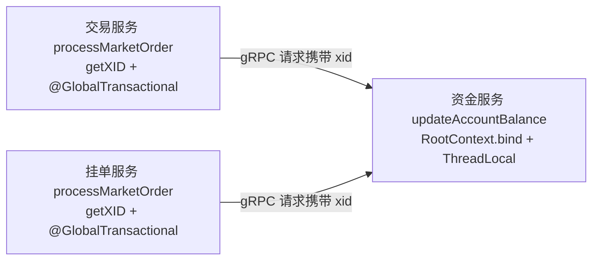

# SEATA 集成运用：交易、资金、挂单三服务接入与全局事务验证，XXL-JOB 开篇

上一章末尾装好了 SEATA Server，本章把分布式事务真正接进智牛股的交易、资金、挂单三个服务：先做统一集成配置，再改造三个核心接口加全局事务注解、手动传递 XID，最后用模拟异常验证全局回滚是否生效。分布式事务收尾后，本章顺势开启第 3 章分布式任务调度：选定 XXL-JOB，完成框架对比与管理端搭建，为交割单任务调度铺路。

## 先给结论

- 集成前两个兼容性前提要清楚：SEATA 对 Dubbo、Feign 的支持靠拦截器封装传递 XID（全局事务唯一标识），0.9.0 对 gRPC 还不支持，调用方要手动传 XID；数据库只支持 MySQL，0.8 版本起扩展支持 Oracle，项目业务数据源基于 MySQL 可直接接入，交易数据源是 PostgreSQL，不做调整。
- 三个服务的集成是同一套模板，四件套：resources 下 registry.conf 与 file.conf（注册、配置都用 file 模式）、pom 增加 io.seata:seata-all 0.9.0 依赖、SeataConfiguration 创建 GlobalTransactionScanner、业务数据源包一层 DataSourceProxy 并替换 SqlSessionFactory 与事务管理器的数据源引用。
- 接口改造三个动作：交易服务市价单与挂单服务撮合接口加 `@GlobalTransactional(timeoutMills = 5000)`；资金服务 gRPC 接口加一行 `RootContext.bind(request.getXid())`；XID 底层用 ThreadLocal 存储，三服务靠它共享同一个全局事务。
- 验证方式是在资金调整调用之后模拟抛业务异常：交易服务（QUOTE_LAST_PRICE_NOT_FOUND）与挂单服务（ACCOUNT_NOT_MATCH）两个场景，资金服务都收到请求、日志里 XID 与发起方一致，随后触发两阶段提交回滚，账户资金分文未动。
- XXL-JOB 与 Quartz、Elastic-Job-Cloud、Antares、OpenCron 逐维度对比：依赖轻（统一数据源 MySQL）、接入简单、文档完善、高级功能丰富；缺点是靠 DB 锁保证集群任务唯一性，适合任务耗时长、数量不繁多的场景，与本项目匹配。
- 管理端落地：2.1.0 源码导入 IDEA，执行 doc/db/tables_xxl_job.sql 初始化 xxl_job 库，改 application.properties 数据库连接，启动后访问 http://127.0.0.1:8080/xxl-job-admin/ 进入调度中心。

## 三服务集成配置：一套模板照方抓药

交易服务是模板，资金与挂单服务照着复制。先在 resources 目录新增两个配置文件，registry.conf 里注册中心与配置中心都采用 file 模式，file 模式要指定对应文件名：

```properties
registry {
    # file, nacos, eureka, redis, zk
    type = "file"
}

config {
    # file, nacos, apollo, zk, consul
    type = "file"
    file {
        name = "file.conf"
    }
}
```

file.conf 里的 service 段是关键。事务分组名称要与服务端配置、配置类里的名称保持一致；SEATA Server 连接地址用变量代替，好处是便于多环境版本配置管理：调整环境时只需在 pom 的多环境变量里预设对应地址，不用为每个环境写一份配置：

```properties
service {
    # vgroup -> rgroup
    vgroup_mapping.stock_trade_group = "default"
    # only support single node
    default.grouplist = "${seata.address}"
}
```

作为客户端，事务日志存储直接用 file 模式即可；生产环境多节点部署时建议改成 db 模式，存储相对稳定。pom 里增加 SEATA 全量依赖，版本通过变量 seata.version 指定 0.9.0，版本号不要写错；dev、uat 两个 profile 分别预设 seata.address，dev 是 127.0.0.1:8091，uat 是 10.10.20.21:8091：

```xml
<!-- SEATA 分布式事务依赖 -->
<dependency>
    <groupId>io.seata</groupId>
    <artifactId>seata-all</artifactId>
    <version>${seata.version}</version>
</dependency>
```

配置类 SeataConfiguration 只做一件事：定义全局分布式事务扫描器。应用 ID 通过 spring.application.name 属性注入，读取的是工程配置里定义的服务名（交易服务是 stock-deal），作为分布式事务客户端的唯一标识；事务分组名称必须与 file.conf 里配置的一致：

```java
@Configuration
public class SeataConfiguration {

    @Value("${spring.application.name}")
    private String applicationId;

    @Bean
    public GlobalTransactionScanner globalTransactionScanner() {
        GlobalTransactionScanner globalTransactionScanner =
                new GlobalTransactionScanner(applicationId, "stock_trade_group");
        return globalTransactionScanner;
    }
}
```

最后是数据源代理，SEATA 能否生效的物理基础就在这一步。交易服务是双数据源：业务数据源 MySQL，交易数据源 PostgreSQL；SEATA 0.9.0 不支持 PostgreSQL，所以交易数据源不动，只给业务数据源加代理：

```java
@Bean("bizProxyDataSource")
public DataSourceProxy bizProxyDataSource(
        @Qualifier("bizSystemDataSource") DataSource bizSystemDataSource) {
    return new DataSourceProxy(bizSystemDataSource);
}
```

定义完还要改两处引用，否则 SEATA 使用时不能正常生效：SqlSessionFactory 里的数据源换成 bizProxyDataSource，业务事务管理器 bizSystemTransactionManager 的参数同样替换。bean 名称要写对。

资金服务的集成是纯复制：registry.conf 与 file.conf 原样放进 resources，没有个性化配置；seata-all 依赖从交易服务拷贝；SeataConfiguration 直接复制，它按 spring.application.name 自动读取服务名；数据源代理配置拷进 Druid 配置类，业务数据源 bean 名称要与项目里一致，再把 SqlSessionFactory 与事务管理器里的数据源替换为 bizProxyDataSource。挂单服务同样四步：拷贝两个 conf 文件、补上 seata-all 依赖（挂单的 pom 之前没有）、拷贝 SeataConfiguration 到 config 包、增加代理数据源并替换两处引用。

## 三个接口的分布式事务改造

集成只是打底，真正参与全局事务靠三处接口改造，三者的关系如下：



交易服务市价单接口（StockDealServiceImpl#processMarketOrder）加两个注解：

```java
@Transactional(rollbackFor = Exception.class)
@GlobalTransactional(timeoutMills = 5000)
```

@Transactional 与分布式事务无关，作用是保证方法内部数据库操作的一致性：市价单会生成成交记录、持仓信息、订单信息，需要开启事务统一提交，rollbackFor 针对所有异常回滚。@GlobalTransactional 才是 SEATA 的全局事务开关，不需要过多配置，设一个超时时间即可，这里 5 秒；一般按业务功能复杂度配置，3 到 5 秒，接口处理超过 5 秒基本就是出问题了。SEATA 接入的优势很明显：不加任何代码、不调整原有业务逻辑，一个注解生效。为了便于跟踪，方法开头通过 SEATA 提供的 RootContext 打印全局事务 ID：

```java
log.info("Start Global Transaction, XID = {}", RootContext.getXID());
```

只要全局分布式事务生效，就能正常接收到 XID。怎么验证？在主流程尾部模拟抛出一个异常，此时资金调整调用已经发出：

```java
if (true) {
    throw new ComponentException(ApplicationErrorCodeEnum.QUOTE_LAST_PRICE_NOT_FOUND);
}
```

整个调用顺序是组装交易记录（内部调用资金服务调整额度）、组装持仓记录、组装订单记录并保存，在保存持仓记录之前抛出异常。如果分布式事务验证成功，之前发出的资金调整操作也应该回滚，具体结果留到功能验证环节。

另一个关键改动在 generateTradeDeal 里。SEATA 对 Dubbo 或 Feign 的支持是在拦截器里封装传递 XID，gRPC 暂不支持，所以要手动把 XID 传给资金服务。xid 字段之前在 PB 文件里已经提前定义好，作用就是全局分布式事务控制，这里补上注入：

```java
UpdateBalanceRequest updateBalanceRequest = UpdateBalanceRequest.newBuilder()
        .setAdjustBalance(getAdjustBalance(request.getDirection(), amount, deal.getCommission()))
        .setAccountId(request.getAccountId())
        .setXid(RootContext.getXID())
        .build();
```

挂单服务的委托限价撮合接口（StockTradePendingServiceImpl#processMarketOrder）改造如出一辙：@GlobalTransactional(timeoutMills = 5000) 加 XID 日志；模拟异常换成 ACCOUNT_NOT_MATCH（账号信息不一致，不能作此操作），位置在保存成交记录之后；generateTradeDeal 的资金调整调用同样注入 RootContext.getXID()。外围调用也要检查一遍：挂单服务有很多个订单队列在撮合，某个订单出现异常时其他队列不应该被阻塞，外层遍历处已有异常捕获，单个挂单出问题不会阻塞后面挂单的运行。

资金服务的额度调整接口是全局事务的最远一环，改造只要一行代码。GrpcStockFinanceService#updateAccountBalance 里把请求携带的 XID 绑定到上下文：

```java
// 绑定分布式事务的全局标识 ID
RootContext.bind(request.getXid());
```

回顾之前的实现：交易服务、挂单服务的 XID 都是通过 RootContext 获取的，RootContext 内部记录存储全局事务 ID。存储原理顺着源码看：进入 bind 方法走到 CONTEXT_HOLDER，经过 load 加载出 ContextCore 实例，ContextCore 里创建的正是 ThreadLocal，事务信息放置在线程内部的存储区域。一行代码，资金服务的更新账户资金接口就实现了分布式事务的管理。

## 功能验证：模拟异常触发全局回滚

验证分两个维度：交易服务市价单下单、挂单服务限价委托。先启动基础组件：Nacos、Redis、RocketMQ 等，再启动 SEATA Server，检查控制台日志出现 Server Started。业务侧依次启动交易服务、代理服务、资金服务和模拟器。

**场景一，交易服务市价单验证。** 测试前先确认账户 ID 为 1 的可用资金是一个亿（后面八个零）。模拟器市价下单参数：买方向、股票 ID 2、请求价格 542、成交数量 100，委托类型一定要标示为市价单。登录后发起下单调用，没有生成订单 ID。交易服务控制台的异常信息是"未获取最新行情报价，请稍后重试"，与模拟异常一致。资金服务则接收到了资金调整请求，参数里的 XID 与交易服务打印的一致，说明两个服务在同一全局事务范围之内，紧接着输出了两阶段提交的回滚日志。最后查库，账户资金没有任何变化，全局回滚生效。

**场景二，挂单服务功能验证。** 模拟器把委托类型改成 1（限价单），其他参数不变：股票 ID 4、价格 555、数量 1000、买方向。先启动行情推送服务（发送模拟行情数据），再启动挂单服务。发送挂单请求后生成订单 ID，等待撮合成交处理；收到新行情数据触发撮合后，数据库账户资金仍是一亿。挂单服务日志打印出了 XID，随后抛出模拟异常并执行回滚；资金服务里查询 XID，同样打印出相同的值，并提示了两阶段事务提交回滚。SEATA 全局分布式事务正常生效。

两个场景共同确认了三件事：XID 在服务间正确传递，各服务日志中的全局事务 ID 一致；资金调整这类跨服务写操作被纳入了全局事务；异常发生时所有参与者统一回滚，上一章"跨服务资金一致性靠本地事务兜不住"的问题就此解决。

## XXL-JOB 开篇：第 3 章路线与框架选型

分布式事务集成运用到此收尾，第 3 章切入分布式任务调度框架运用。目标四点：创建配置交易调度服务工程，搭建并完成基本配置，它负责任务的调度和处理，结合 XXL-JOB 做集成运用；实现交割单处理，生成交割单报表数据，同时完成持仓利息任务；掌握 XXL-JOB 分布式任务调度框架的使用；实现获取账户交割单功能，定义内部 gRPC 传输接口与对外 HTTP 数据结构，给客户端提供接口调用。实现步骤七步：管理端配置使用、搭建交易调度服务工程、实现账户交割单调度任务处理、配置调度任务接入管理端、资金服务实现获取交割单接口、代理服务增加接口转发、整体功能验证。

选型先看全貌，市面主流分布式任务调度框架五个候选，逐维度对比：

| 维度 | Quartz | Elastic-Job-Cloud | XXL-JOB | Antares | OpenCron |
| --- | --- | --- | --- | --- | --- |
| 依赖 | MySQL | JDK 1.7+、ZooKeeper 3.4.6+、Mesos | MySQL、JDK 1.7+、Maven | JDK 1.7+、Redis、ZooKeeper | JDK 1.7+、Tomcat 8.0+ |
| 高可用 | 多节点部署，竞争数据库锁 | ZooKeeper 注册发现，支持水平扩容 | 集群部署 | 集群部署 | 不适用分布式场景 |
| 任务分片 | 不支持 | 支持 | 支持 | 支持 | 不支持 |
| 文档完善度 | 完善 | 完善 | 完善 | 略少 | 略少 |
| 管理界面 | 无 | 支持 | 支持 | 支持 | 支持 |
| 难易程度 | 简单 | 较复杂 | 简单 | 一般 | 一般 |
| 出身 | OpenSymphony | 当当网 | 个人（作者曾就职大众点评） | 个人 | 个人 |
| 缺点 | 没有管理界面、不支持任务分片 | 引入 ZooKeeper、Mesos 增加系统复杂度，学习成本较高 | 靠 DB 锁保证集群任务唯一性，短任务多、集群增大时锁竞争厉害、性能不好 | 不支持动态添加任务 | 不适用分布式场景 |

高级功能两家领先：Elastic-Job 支持弹性扩容、多种作业模式、失效转移、运行状态收集、幂等性、容错处理；XXL-JOB 支持弹性扩容、分片广播、故障转移、Rolling 实时日志、GLUE（在线编辑代码免发布）、任务进度监控、任务依赖、数据加密、邮件报警、运行报表、国际化。两家也都有知名企业背书：Elastic-Job 有 36氪、当当网、国美、联想、唯品会等；XXL-JOB 有大众点评、优信二手车、拍拍贷等。

XXL-JOB 的核心机制是统一数据源实现分布式任务的协调管理，调度中心通过获取 DB 锁保证集群中执行任务的唯一性。这种方案实现简单，但如果短任务很多、调度中心集群数量增加，数据库锁竞争会比较厉害，性能上不去，所以它适用于任务处理时间比较长、任务数量不特别繁多的场景。技术选型并非越高大上越好，适合的才是最好的：本项目任务调度数量不繁多，XXL-JOB 使用简单、功能丰富，综合来看是合适的选型。

管理端搭建分四步。第一步下载源码，讲义采用 2.1.0 版本，通过 Maven 导入 IDEA 工程，依赖下载慢可换阿里云镜像仓库。第二步创建数据库，脚本在源码 doc 目录的 db 下面，执行后初始化出 xxl_job 库：

```sql
CREATE DATABASE IF NOT EXISTS `xxl_job` DEFAULT CHARACTER SET utf8 COLLATE utf8_general_ci;
```

第三步修改配置，application.properties 里可调整服务端口和后缀路径名称，数据库连接信息（url、用户名、密码）要确保正确，邮件 SMTP、accessToken 等其余配置不用动。第四步运行 XxlJobAdminApplication 启动管理服务，控制台输出 init xxl-job admin scheduler success 即启动成功。浏览器访问 http://127.0.0.1:8080/xxl-job-admin/ 登录后台，首页是运行报表（任务调度中心概要），左侧菜单有任务管理、调度日志、执行器管理、用户管理和帮助文档，后续章节会结合具体案例逐个用到。

## 小结

SEATA 三服务集成是一次模板化的实践：两个 conf 文件、一个 seata-all 依赖、一个 GlobalTransactionScanner 配置类，外加一个 DataSourceProxy，三个服务用同一套流程接入，唯一差异是交易服务只代理业务数据源（PostgreSQL 不受支持）。接口侧三个改动各司其职：两个 @GlobalTransactional 声明全局事务边界，一次 RootContext.bind 把最远端的资金服务绑进事务，gRPC 手动传 XID 补上了支持不足的缺口。模拟异常验证给出了最有说服力的证据：资金服务收到了请求、XID 与发起方一致、两阶段回滚后账户资金分文未动。第 3 章的 XXL-JOB 也已就位：选型确认它适合本项目"任务少、耗时长"的调度场景，2.1.0 管理端跑通，下一讲搭建交易调度服务，把交割单生成和持仓利息计算做成真正的调度任务。
