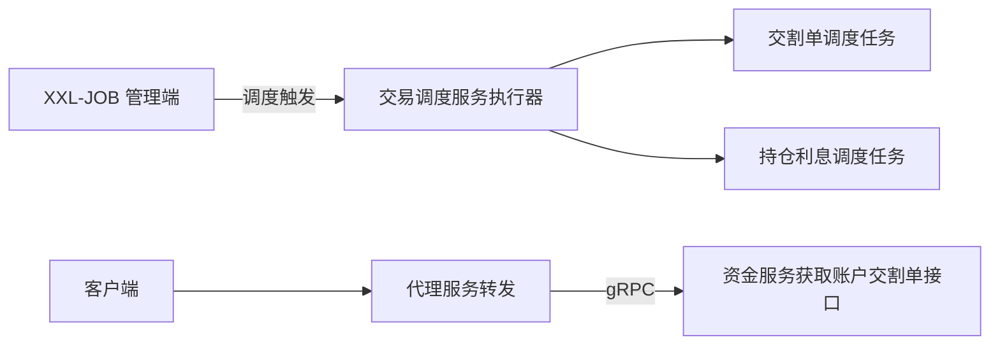

# 第十七章收束：SEATA 全局事务与 XXL-JOB 调度双件套总结

第十七章资金额度调整到本篇收束。这一章沿着"业务补齐、一致性、自动化"走了三步：额度调整打通资金、交易、挂单三服务联动，SEATA 全局事务兜住跨服务资金操作的回滚，XXL-JOB 接管收盘后的批量调度。章末总结把调度这条线完整过了一遍：四点学习目标、七步落地内容，外加两条贯穿始终的底线，处理效率与数据准确性。

## 先给结论

- 四点学习目标：创建和配置交易调度服务工程；实现账户交割单、账户持仓利息任务的生成处理；侧重掌握 XXL-JOB 分布式任务调度框架的集成使用；实现获取账户交割单的功能接口。
- 选型理由：任务执行失败后想再次重复执行、想动态修改 Cron 定时任务运行时间，Spring Task 与 Spring Quartz 都存在比较大的局限，因此采用分布式开源框架 XXL-JOB。
- 大数据量任务要做效率优化：处理过程加入事务，应用缓存功能减少数据库的查询次数。
- 弹性能力：XXL-JOB 管理端支持集群模式部署，交易调度服务作为任务执行器也可以部署多个节点同时处理不同的任务；路由策略选项灵活，按业务场景选择不同的运行处理模式。
- 数据准确性是金融平台的底线：交割单、成交记录、资金流水三个核心数据存有关联性，任何一条计算错误都会影响整体核对，必须统一一致、不能出现误差。

## 章内容回顾：从框架对比到接口打通

章末总结按顺序把本章内容过了一遍，对应到前面的实现篇章大致是七步：

1. 对比 XXL-JOB 与主流的分布式任务调度框架，确定选型；
2. 完成 XXL-JOB 管理端的配置和使用，对管理端做了启动和验证；
3. 创建和配置交易调度服务工程；
4. 实现账户股票交割单的调度任务处理。这是数据量比较大的任务，处理效率要重点关注，处理方式上做了相应优化：加入事务，应用缓存功能减少数据库的查询次数；
5. 实现账户持仓利息的调度任务。融资融券、外汇产品交易场景下会存在隔夜利息的计算，要清楚它是如何生成处理的；
6. 对交割单与持仓利息两个调度任务做路由配置。XXL-JOB 提供的配置策略比较丰富，可以根据业务场景需要选择不同的运行处理模式；
7. 定义获取交割单的接口数据结构（PB 文件），资金服务实现获取账户交割单接口，代理服务增加账户交割单接口的转发处理，最后对整体功能做了测试和验证。

整条链路串起来是这样的：



管理端是日常运维的抓手：通过 XXL-JOB 的管理端，能够比较方便地管理和维护调度任务，运行报表、日均分布、成功比例这些指标直接可见。任务侧的两个核心类骨架也值得再瞄一眼，持仓利息业务里利率按万分比配置：

```java
@Service
@Log4j2
public class AccountPositionInterestServiceImpl implements IAccountPositionInterestService {
    @Autowired
    private ITradePositionDao tradePositionDao;
    private Integer interest = 2; // 持仓利息率（万分比）
}
```

任务执行入口统一用 try-catch 兜底，正常返回 SUCCESS、异常返回 FAIL：

```java
try {
    // 生成账户持仓利息
    accountPositionInterestService.generateAccountPositionInterest(param);
    return SUCCESS;
} catch (Exception e) {
    log.error(e.getMessage(), e);
}
return FAIL;
```

## 为什么选 XXL-JOB

调度这件事，Spring 自带的方案能不能扛住？总结里给的理由很直接。实际生产环境当中往往会存在大量的调度任务，如果只用 Spring Task 或 Spring Quartz，并不能完全满足各种场景的需要：任务执行失败了，想再次重复执行，不顺手；想动态修改 Cron 定时任务运行时间，也存在比较大的局限。

所以项目采用分布式的开源框架 XXL-JOB，它是一款比较优秀的开源任务调度处理工具，掌握它的运用便于管理和维护复杂的调度任务。功能也比较强大：管理端可以支持集群模式的部署；交易调度服务作为任务的执行器，也可以部署支持多个节点，同时处理不同的任务。之前做任务配置时讲过的路由策略，选项也比较灵活，有兴趣可以再深入研究。

## 效率与准确性：调度任务的两条底线

第一条是效率。交割单这类任务数据量会比较大，处理方式必须做优化：加入事务提升处理效率，应用缓存功能减少数据库的查询次数。工程里用 AccountsCache 缓存账户数据，设置每十分钟刷新一次的策略，避免每次都查库。

第二条是准确性。持仓利息对应融资融券、外汇的隔夜利息计算场景；交割单记录股票与资金的变动。客户会经常查看交割单，关注自己股票的投资以及资金变化情况。交割单、成交记录、资金流水这三个信息都是重要数据，并且存有一定的关联性，任何一条数据的计算错误都会影响整个数据的核对。作为交易平台，要充分考虑和保障数据的准确性，不能出现误差，这三个核心数据一定要做到统一一致。

接口侧的收尾比较轻：获取账户交割单接口整体实现起来比较简单，但业务作用比较重要。数据结构在 PB 文件里定义，返回结构含 id、userId、dealId 等字段：

```protobuf
message GetAccountSettlementRespData {
    int64 id = 1;
    int64 userId = 2;
    int64 dealId = 3;
}
```

## 小结

第十七章到此真正收束。业务上，资金额度调整把下单链路的账户资金动了起来；一致性上，SEATA 全局事务保障跨服务资金操作的回滚；自动化上，XXL-JOB 把交割单、持仓利息这类收盘后的批量计算纳入统一调度，并通过管理端完成维护与验证。这一章留下三条通用经验：调度框架选型看失败重试、动态 Cron 这类诉求原生方案能否满足；大数据量任务用事务加缓存提效；金融场景的核心数据必须统一一致。做任何交易类系统的定时计算任务，这三条都适用。
