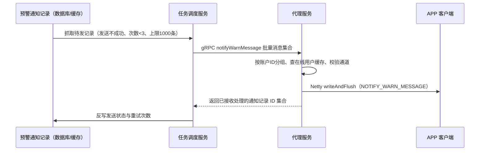

# 从预警生成到 APP 在线推送：开盘价涨跌幅打底，调度与代理双服务分发

上一讲把预警通知记录的生成流程梳理成七步，这一讲把 generateWarnNotifyMessage 的业务层代码写完，顺带补齐行情服务的数据底座：开盘价与涨跌幅。第2章收尾做三场景功能验证，随后进入第3章预警通知推送——接口数据结构、调度服务推送、代理服务分发依次落地，模拟客户端最终收到那条不会重复的预警消息。

## 先给结论

- 生成主循环：遍历有效股票产品缓存 → 取最新报价（为空跳过）→ 按股票产品 ID 模糊匹配该产品下所有账户的预警设置缓存 → 逐账户检查（首次或距上次预警超 10 分钟才放行）→ 按模板生成通知记录 → 次数累加，满 3 次清缓存、当天不再生成。
- 接收方跟着通知类型走：短信填手机号、邮件填邮箱、APP 站内信填交易账户 ID，用户表联系人信息必须完善。
- 开盘价是当天开盘的第一口报价，只记一次、不可覆盖：JVM 内 ConcurrentHashMap 判空写入保证性能，同步双写 Redis 用于服务宕机后恢复；凌晨 1 点到 2 点之间每 10 分钟重置缓存，服务重启时 @PostConstruct 从 Redis 回载。
- 涨跌幅 =（最新价 − 收盘价）/ 收盘价 × 100%，按价差正、零、负三种情况处理；挂在最新行情对象上带非持久化注解，与最新价一起入缓存、不落库。
- APP 在线推送链路：调度服务抓取待发记录（发送不成功、次数小于 3、单次上限 1000 条）→ gRPC 调代理服务 → 代理按账户 ID 分组汇总、查在线用户缓存 → Netty Channel 批量下发，已处理记录 ID 返回调度服务反写状态。
- 只对在线用户推送，省无效开销；离线靠重试次数与状态标记兜底，用户下次登录拉取未读消息，完善方案再接 Firebase、极光离线推送。

## 预警通知记录生成：主循环与三道闸

实现落在交易调度服务的 AccountWarnSettingServiceImpl，加事务控制——数据量大，要批量提交。主循环照着上一讲的七步走：

```java
@Transactional(rollbackFor = Exception.class)
public void generateWarnNotifyMessage() {
    // 1. 遍历所有有效股票产品
    stocksCache.getKeys().forEach(stockId -> {
        // 2. 取最新行情报价，无实时行情跳过
        TradeStockQuoteLast quoteLast = getTradeStockQuoteLast(stockId);
        if (null == quoteLast) {
            log.warn("no last quote, stockId: {}", stockId);
            return;
        }
        // 3. 前缀拼接股票产品 ID，模糊匹配该产品下所有账户的预警设置
        Set<String> keys = redisTemplate.keys(
                GlobalConstants.ACCOUNT_WARN_SETTING_STOCK_KEY + stockId);
        if (null == keys || keys.isEmpty()) {
            log.warn("no account warn setting, stockId: {}", stockId);
            return;
        }
        // 4. 获取预警设置缓存对象，逐账户处理
        Cache cache = cacheManager.getCache(
                GlobalConstants.ACCOUNT_WARN_SETTING_STOCK_KEY + stockId);
        keys.forEach(key -> {
            Cache.ValueWrapper valueWrapper = cache.get(key);
            if (null != valueWrapper && null != valueWrapper.get()) {
                AccountWarnSettingBo bo = (AccountWarnSettingBo) valueWrapper.get();
                // 5. 条件闸门：首次生成或距上次预警超 10 分钟
                if (checkAccountWarnSetting(bo)) {
                    // 6. 按模板生成预警通知记录
                    doNotifyMessage(bo, quoteLast);
                }
            }
        });
    });
}
```

两处细节：缓存 Key 前缀用两个冒号分割，解析前先替换掉前缀；取出的是 ValueWrapper 包装对象，判空后才能强转成 AccountWarnSettingBo。

条件闸门 checkAccountWarnSetting 两条规则：上次预警记录时间为空说明是第一次，放行；当前时间与上次预警时间差超 10 分钟，也放行；其余返回 false——10 分钟内不重复通知。

doNotifyMessage 先判断是否存在多种通知类型，存在就遍历、逐个调 recordNotifyMessage。止盈止损用同一个模板，生成逻辑一样：按预警类型查找对应模板设置，把模板变量替换成实际值、组装为通知内容；再按接收类型设置接收方：

```java
if (GlobalConstants.ACCOUNT_WARN_NOTIFY_TYPE_SMS.equals(type)) {
    notifyMessage.setReceiver(accountWarnSettingBo.getPhone());   // 短信：手机号
} else if (GlobalConstants.ACCOUNT_WARN_NOTIFY_TYPE_EMAIL.equals(type)) {
    notifyMessage.setReceiver(accountWarnSettingBo.getEmail());   // 邮件：邮箱
} else if (GlobalConstants.ACCOUNT_WARN_NOTIFY_TYPE_APP.equals(type)) {
    // 站内信：接收方记录交易账户 ID
    notifyMessage.setReceiver(accountWarnSettingBo.getAccountId());
}
```

组装其余信息后调数据层接口保存，最后更新记录的生成时间——缓存判断正基于这个最后更新时间。回到主循环两步收尾：BO 里的通知生成次数累加一并更新缓存；次数大于等于 3 时按交易账户 ID 清除缓存记录，当天不再生成。防骚扰口径两条：10 分钟内不重复、一天最多三次，阈值可调。

## 开盘价与涨跌幅：预警判断的数据底座

开盘价是当天开盘的第一口报价（9:30 开盘、15:00 收盘）。要害在"当天只能记录一次、不能被覆盖"，覆盖了信息就不准确。项目把开盘价双写两处：JVM 的 Map 与 Redis。

流程不复杂：开盘后的第一口报价写入 Map；交易时间内行情源源不断推送，每一口都对 Map 做判空，有值就不再写入；写 Map 的同时更新 Redis 里的开盘价。

```java
/** 标记股票是否需要写入开盘价：stockId -> 开盘价 */
public Map<Long, Long> stockOpenCache = new ConcurrentHashMap<>();

private void updateOpenPrice(TradeStockQuoteLast quoteLast) {
    Long openPrice = stockOpenCache.get(quoteLast.getStockId());
    if (openPrice == null) {
        // 当天还没有开盘价：写 Redis，同时更新本地 MAP
        Cache curOpenPriceCache = redisCacheManager.getCache(
                GlobalConstants.STOCK_QUOTE_OPEN_PRICE_CUR);
        curOpenPriceCache.put(quoteLast.getStockId(), quoteLast.getLastPrice());
        stockOpenCache.put(quoteLast.getStockId(), quoteLast.getLastPrice());
    }
}
```

为什么双写？每口行情都要判一次空，走 Redis 是远程调用，不如本地 Map 判断快、省开销；但宕机后 Map 数据会丢，从 Redis 把开盘价重新加载回 Map 即可。既要性能又要稳定，所以两边都写。隔天重置靠定时任务：

```java
@Override
@Scheduled(cron = "0 0/10 1 ? * *")
public void scheduleResetOpenPriceCache() {
    stockOpenCache.keySet().forEach(stockId -> stockOpenCache.put(stockId, null));
}
```

任务安排在每天凌晨 1 点执行，保留一个小时的缓存时间：1 点到 2 点之间每 10 分钟运行一次，确保缓存真正清除，第二天开盘价才能正常接收更新。宕机恢复靠启动加载：@PostConstruct 的 initOpenPriceCache 从 Redis 拿到所有开盘价缓存的 Key，逐个解析出股票 ID、取出开盘价放回本地 Map——Map 按 stockId 存储，有几个股票产品就有几条记录。

涨跌幅依赖收盘价——前面章节讲过收盘价计算，针对不直接提供收盘价的行情源。公式：涨跌幅 =（最新报价 − 收盘价）/ 收盘价，以收盘价为基准，按价差分三种情况：

```java
private double calcPriceRate(Long lastPrice, Long lastClosePrice) {
    double priceRate = 0;
    if (null != lastClosePrice) {
        long diffPrice = MathUtils.sub(lastPrice, lastClosePrice);
        if (diffPrice > 0) {
            priceRate = MathUtils.divDouble(diffPrice, lastClosePrice) * 100;
        } else if (diffPrice == 0) {
            priceRate = 0;
        } else {
            // 负值的情况不要忽略
            priceRate = -MathUtils.divDouble(diffPrice, lastClosePrice) * 100;
        }
    }
    return priceRate;
}
```

调用点在订阅获取产品行情实时数据的处理里，每一口报价算一次。涨跌幅作为新增属性挂在 TradeStockQuoteLast 上，加非持久化注解——动态数据不落库，与最新价一起入缓存，供后续预警条件判断直接取用。

## APP 在线推送：调度服务 → 代理服务 → 客户端

APP 在线推送相对邮件、短信零成本、实时性最高——不像 Firebase、极光那样要经第三方中转，它基于 Socket 长连接实现。落地考虑多场景：用户量大但同时在线的不一定多，消息只发在线用户、省开销；离线就不推送，发了也收不到。推送要有重试机制：超过指定次数仍不在线，给消息做标记或放进单独的离线消息队列与缓存，下次登录先拉取未读。长连接受网络波动也可能丢消息，解法是客户端加响应确认机制，服务端支持批量发送、减少网络交互。

### 第一步：定义接口数据结构

代理服务对内提供 gRPC 接口，在 PB 公用工程的 resource 目录下新增 StockProxyService.proto：

```protobuf
// 代理服务接口：发送预警通知消息
service StockProxyService {
    rpc notifyWarnMessage (WarnMessageDataRequest) returns (WarnMessageResponse) {}
}

// 请求体是集合：调度服务批量传送预警通知记录
message WarnMessageDataRequest {
    repeated WarnMessageData warnMessageDataList = 1;
}
```

消息体带用户信息、账户信息、预警类型与通知内容；返回结构含状态、响应消息与处理成功的通知记录 ID 集合——10 条通知 7 条成功就返回这 7 条的 ID。对外的 Netty 结构只定义响应包：Proxy 主动推送、不需要请求包。返回体同样是集合，字段与 gRPC 侧基本一致；ResponseMessage 的 oneof 增加 warnMessage 数据包（序号 11），StockHead 的 RequestType 枚举新增 NOTIFY_WARN_MESSAGE 类型。执行 protoc_grpc、protoc_netty 脚本生成 Java 代码。

### 第二步：调度服务封装消息发送

为便于消息服务集成，新建独立模块 stock-starter-sender，pom 加实体与公用工具组件两个依赖。封装分三层：base 公用接口、service 实现、vo 参数与响应对象。

```java
public interface IWarnNotifySender {
    /** 异步方式发送消息 */
    SenderResult sendMessage(SenderMessage notifyMessage);
    /** 同步方式发送消息 */
    SenderResult sendSyncMessage(SenderMessage senderMessage);
}
```

SenderMessage 统一发送对象：交易账户 ID、发送主题、接收者、通知内容、更新时间；SenderResult 记录数据 ID、发送状态（默认错误，成功后反显）、结果记录，并提供快速判断发送是否成功的方法。

AppSender 是 APP 在线推送的实现：持有代理服务的 gRPC 接口 StockProxyServiceBlockingStub，sendMessage 根据 SenderMessage 构造请求包、调代理服务的 RPC 接口发送，返回处理成功的通知记录 ID，据此记录发送结果。注意：这只代表成功发送到代理服务，不代表客户端真正接收到——整个交互是异步的，闭环需要客户端响应回馈机制，课程暂不实现。同步方法 sendSyncMessage 直接调 sendMessage；异步实现只是给 sendMessage 加 @Async 注解。有个容易踩的坑：@Async 类似事务注解，必须以接口形式从外部调用才生效；类内部方法之间引用，Spring 的 AOP 拦截不到内部调用，注解不生效。

调度服务侧在 AccountWarnSettingServiceImpl 里注入 appSender，增加发送接口实现 sendWarnNotifyMessage：

```java
// 获取待推送消息：状态发送不成功、次数小于 3，每次 1000 条
List<AccountWarnNotifyMessage> messages = accountWarnNotifyMessageDao.get(...);
// 并行流发送：多线程提升处理速度，但不保证有序
messages.parallelStream().forEach(notifyMessage -> {
    SenderResult result = null;
    if (GlobalConstants.ACCOUNT_WARN_NOTIFY_TYPE_APP.equals(
            notifyMessage.getNotifyType())) {
        // APP 站内通知；短信、邮件在此扩展
        result = appSender.sendSyncMessage(getSenderMessage(notifyMessage));
    }
    // 累加发送次数，超过 3 次不再发送
    accountWarnNotifyMessageDao.updateNotifyDataSendStatus(result);
});
```

发送次数累加在 SQL 里用了一个相当于 MySQL ifnull 的函数：次数字段为 null 先置 0 再累加，直接对 null 累加不会生效。发送任务建在 warning 包下，SendWarnNotifyMessageJob 调 service 完成发送；工程配置补 gRPC 服务端与 client 调用配置（调度服务端口 19993，client 指向代理服务）。

### 第三步：代理服务按在线用户分发

分发的前提是知道谁在线。用户登录时 StockUserProcessor 的 recordCache 记录通道与账户的关联缓存、记录在线用户缓存；为防止同时登录造成 MAP 信息不一致，加分布式锁（封装在资金服务讲过，直接复用）：

```java
private void recordCache(ChannelId channelId, LoginResponse response) {
    // 通道与账户的关联缓存
    Cache cache = cacheManager.getCache(GlobalConstants.STOCK_PROXY_USER_KEY);
    cache.put(channelId.asLongText(), response.getAccountId());
    // 分布式锁：防止同时写入，MAP 信息记录不一致
    try {
        redisLockService.tryLock(GlobalConstants.STOCK_PROXY_USER_KEY);
        Map<Long, ChannelId> accountInfos = ...;
        accountInfos.put(response.getAccountId(), channelId);
        onlineWrapper.set(accountInfos);
    } catch (Exception e) {
        log.error(e.getMessage(), e);
    } finally {
        redisLockService.unlock(GlobalConstants.STOCK_PROXY_USER_KEY);
    }
}
```

用户退出时 Channel 通道被回收，StockProxyServerHandler 的 handlerRemoved 同步清除：拿 Channel ID，清除用户登录缓存与账户通道关联缓存（同样加分布式锁保障一致性、最后释放锁），再从通道组移除并关闭通道。

代理服务的 gRPC 实现类 GrpcStockProxyService 建在 proxy 工程新增的 grpc 包下，整体流程五步：

```java
// 1. 按账户 ID 分组汇总：同一用户多条通知合并为一次批量下发
Map<Long, List<WarnMessageData>> accNotifyMessages = request.getWarnMessageDataList()
        .stream().collect(Collectors.groupingBy(WarnMessageData::getAccountId));
// 2. 组装客户端头部消息，标识接口数据类型
StockHeadProto.StockHead stockHead = StockHeadProto.StockHead.newBuilder()
        .setRequestType(StockHeadProto.RequestType.NOTIFY_WARN_MESSAGE)
        .setSeqId(warnMessageSeqId++)
        .setStatus(GlobalConstants.STATUS_OK)
        .build();
// 3. 查在线用户缓存，遍历通知：通道有效才下发，集合支持批量
// 4. 记录已发送的通知 ID，组装完整客户端消息
// 5. channel.writeAndFlush(responseMessage) 推送给客户端
```

接口调用成功后，把已接收处理的通知记录 ID 集合返回给调用方（交易调度服务），据此反写状态。工程配置检查：代理服务 gRPC 服务端已配置，端口 8977。

整条链路串起来：



## 功能验证：三个场景与一条不重复的推送

场景一，预警通知模板设置。启动用户管理服务，打开 Swagger（http://127.0.0.1:10691/admin/doc.html），先调登录接口，否则被权限拦截；再调保存模板：填模板内容，notifyType 用 EMAIL，state 设 0 代表有效，warnType 设 1 代表止盈。调用前确认库里没有同 warnType 的模板，避免重复；成功后数据库与 Redis 缓存各多出一条模板数据，预警类型与请求参数一致。

场景二，账户预警通知设置。启动交易服务与代理服务，模拟客户端增加调用接口、代理服务增加处理器实现。参数：notifyType 为 EMAIL，stockId 为 4（数据库里 ID 为 4 的美利集团），warnType 为 1 止盈，stopRate 为 1.06%——比例设小一点，行情推送时容易触发、便于验证。登录后发起调用返回处理成功：数据库生成一条设置记录（止盈、1.06%），缓存同步生成。测第三步前还要检查账户联系人信息：确保邮箱地址填写正确。

场景三，生成账户预警通知记录。启动调度服务 StockTask 与 XXL-JOB 管理后台，新增任务：Job 名称从 warning 目录下的生成任务复制，Cron 每分钟一次，阻塞策略"丢弃后续调度"，负责人必填。执行前记录表为空；执行后 StockTaskApplication 日志正常触发、无异常，表里生成一条 EMAIL 通知记录。预警设置支持多种通知类型：把通知类型加上 APP、SMS 再测，清空测试记录后执行任务，表里生成多条通知——每种类型设置的接收信息不同，所以用户表信息必须完善。

APP 推送验证：前提是已生成通知记录；启动代理服务、交易服务与 XXL-JOB 后台，模拟客户端登录。新增"发送账户预警通知任务"，Cron 每分钟一次，jobHandler 必须与代码里的 Job 名称一致（sendWarnNotifyMessageJob）——演示中就配错成了生成记录的 Job，修正后才跑通。启动调度服务执行任务：模拟终端收到一条预警通知；数据库里 notifyType 为 app 的一条记录，发送状态 200、重试次数 1，数据吻合。再次执行，模拟终端不再收到重复通知——状态已反写为成功，任务不会再抓它。

## 小结

第2章与第3章上半场在此合流。生成侧有 10 分钟去重与每天 3 次上限两道防骚扰闸，模板变量替换让通知内容灵活可维护；数据侧开盘价双写兼顾性能与宕机恢复，涨跌幅现算现缓存、不落库；推送侧 gRPC 打通调度到代理的内部通道，Netty 长连接把消息送到客户端，在线用户缓存加账户分组批量发送压低无效开销。三条通用经验：推送类功能先想清楚"发给谁"，只发在线用户是成本最低的第一刀；状态与次数必须反写，重试上限加抓取上限是调度类任务的标配；异步推送的闭环还差客户端确认机制，留给扩展。
